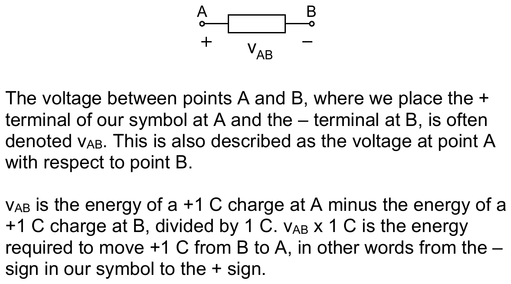
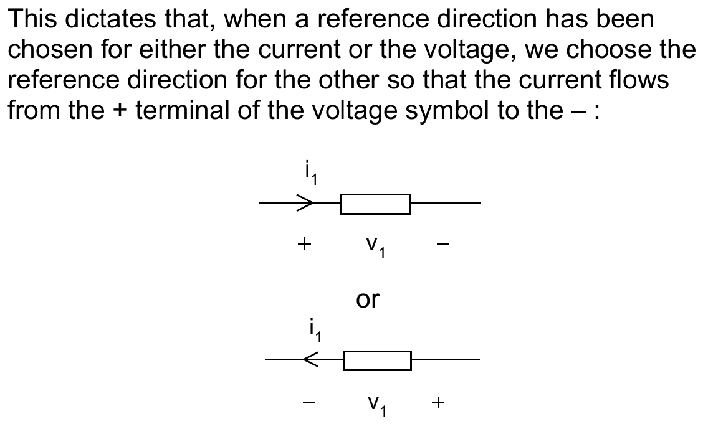
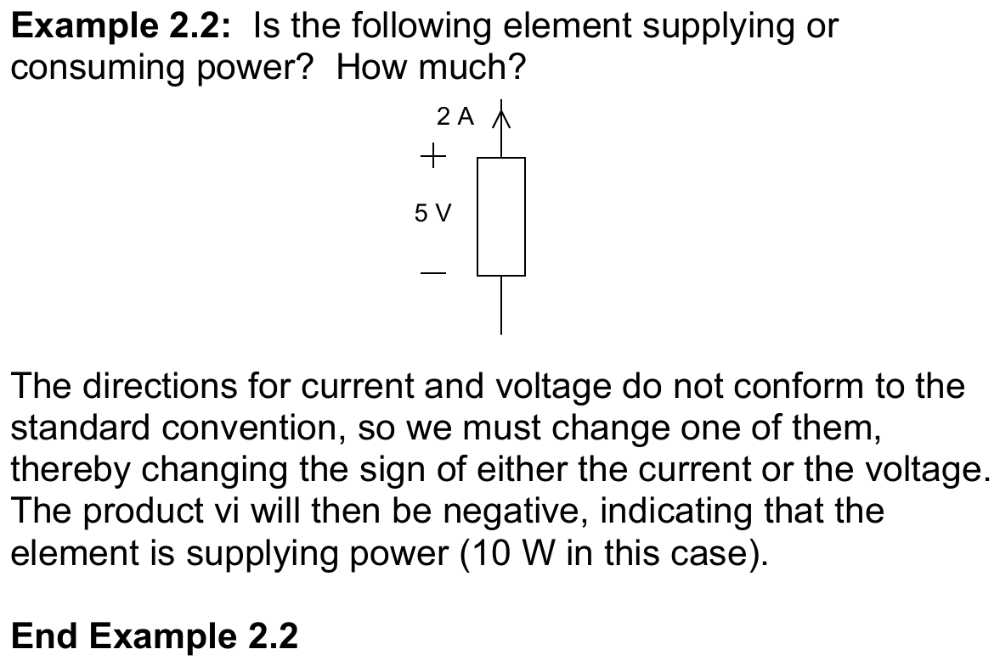
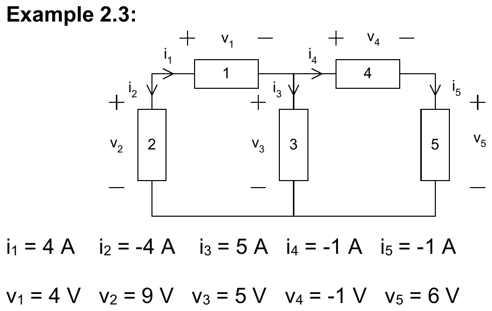
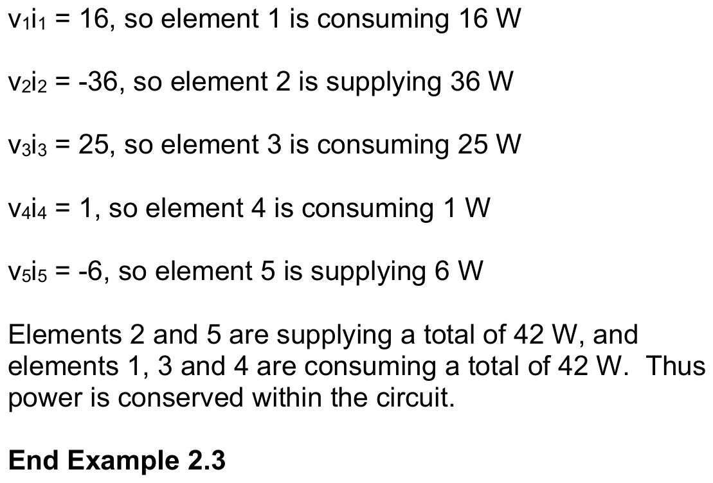
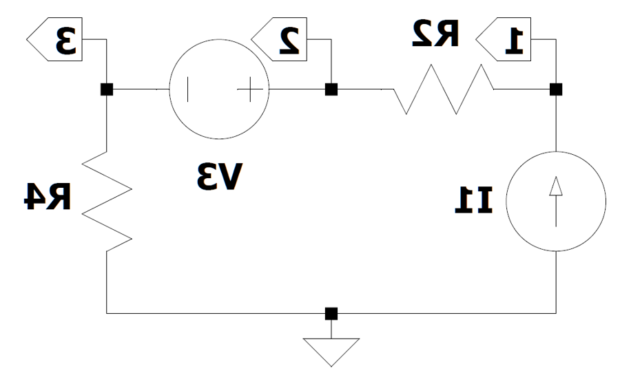

# Topic 1: Current, voltage and power

Slide exercises: Lecture 2 Examples 2.2, 2.3, Self test 2.2 · Past finals: Resit 2021 Q1a

Slides: Lecture 1 (introduction) and Lecture 2, pages 1 to 37.

---

## The big idea

Current is charge flowing.

Voltage is the energy each coulomb gains or loses between two points.

Multiply them and you get power.

 

The hard part is not the maths.

It is the **signs**.

This topic gives you one sign rule that you use for the rest of the course.

---

**How to use these notes:**
When you see 🧠, stop.
Answer it on paper first.
Then click to check.

---

## 🎯 In the final

**Resit 2021 Q1a (20% of Q1):** find the power dissipated in a voltage source that sits in a loop with a current source. That is pure Topic 1: get the sign right with Rule 3 and Equation 4.

Every AC power question later (Topic 12, about one part of Q1 every year) builds on p = vi.

And every "flowing from node A to node B" in a question is a reference direction (§2). Get it backwards and the sign of your answer is wrong.

---

## ⭐ Learn by heart from this topic

The exam is **open book**. All of this is on your [exam sheet](../formula-sheet.md).

But know it without looking. Looking things up costs minutes.

- Equation 1: i = dq/dt. 1 A = 1 C/s.
- Equation 2: v = dw/dq. 1 V = 1 J/C.
- Rule 3: standard reference convention: the current arrow goes **into the + terminal**.
- Equation 4: p = vi. With Rule 3: p > 0 means **absorbing**. p < 0 means **supplying**.
- Rule 5: in any circuit, the powers add up to zero.

**Memory hook:** "In at plus, p is plus: it eats power."

---

## 1. Current and voltage

**Current** is the rate at which charge flows past a point.

### 📐 Equation 1: current
$$i = \frac{dq}{dt}$$

| Symbol | Means | Units |
|---|---|---|
| i | current | amps (A) |
| q | charge | coulombs (C) |
| t | time | seconds (s) |

**What it means:** 1 A is 1 coulomb passing every second.

The arrow on a wire shows the direction we **call** positive.

If the answer comes out negative, the current really flows the other way. That is fine.

 

**Voltage** (potential difference) is the energy needed to move +1 C between two points.

### 📐 Equation 2: voltage
$$v = \frac{dw}{dq}$$

| Symbol | Means | Units |
|---|---|---|
| v | voltage | volts (V) |
| w | energy | joules (J) |

**What it means:** 1 V = 1 J per coulomb.

**How to read this diagram:**
- The + sign is at A. The − sign is at B.
- This voltage is called v_AB: "A with respect to B".
- v_AB = −v_BA. Swap the letters, flip the sign.

**Words you will meet:**
- **dc** = constant. "dc voltage", "dc current".
- **ac** = changes direction, usually a sine wave.

### 🧠 Check
A charge of +2 C moves through a 5 V element, from the + side to the − side. Does it gain or lose energy? How much?

Answer

It **loses 10 J**.

Each coulomb loses 5 J going from + to −. So 2 C loses 2 × 5 = 10 J.

An electron (negative charge) going the same way would **gain** energy.

---

## 2. The standard reference convention

Every element has a current arrow and a voltage + / −.

You choose them. But choose them **this** way:

### 📐 Rule 3: standard reference convention

The current arrow points **into the + terminal** of the voltage.

So current flows through the element from + to −.

**How to read this diagram:**
- Top: arrow goes left to right, + is on the left. ✓
- Bottom: arrow goes right to left, + is on the right. ✓
- Both obey the rule. Only the picture is flipped.

**Use it when:** labelling any element before you write p = vi, Ohm's law (Topic 2) or anything with a sign.

**When not:** a question may give you labels that break the rule (sources often do). Then put a minus sign in (§3).

---

## 3. Power

### 📐 Equation 4: power
$$p = v\,i$$

| Symbol | Means | Units |
|---|---|---|
| p | power | watts (W) |
| v | voltage across the element | V |
| i | current through it | A |

**What it means:**

With Rule 3 labels:

- p **positive**: the element **absorbs** (consumes, dissipates) power.
- p **negative**: the element **supplies** (delivers) power.

**Use it when:** any "power dissipated in…" or "power supplied by…" question.

**When not:** if the labels break Rule 3, use p = −vi for "absorbed".

**How to read this diagram:**
- The 2 A arrow goes **out of** the + terminal. That breaks Rule 3.
- So "absorbed" = −(5)(2) = −10 W.
- Negative absorbed means it is **supplying 10 W**.

### 🧠 Check
A resistor has 3 V across it and 2 mA flowing into its + terminal. How much power does it absorb?

Answer

p = vi = 3 × 2 mA = **6 mW** absorbed.

A resistor always absorbs (it is passive).

---

## 4. Power is conserved

### 📐 Rule 5: conservation of power

Add up p = vi for **every** element (all with Rule 3 labels).

The total is **zero**.

What the sources supply, the rest absorbs.

**Use it when:** checking an answer. If your powers don't add to zero, a sign is wrong.

**How to read this diagram:**
- Five elements. Each one has its own v and i.
- Check each one against Rule 3 before you multiply.

**How to read this answer:**
- Supplying: element 2 (36 W) and element 5 (6 W). Total 42 W.
- Absorbing: elements 1, 3, 4: 16 + 25 + 1 = 42 W.
- 42 = 42. Power is conserved.

**Active and passive:**
- An **active** element can supply energy (a battery, a source).
- A **passive** element absorbs at least as much as it ever gives back (resistor, capacitor, inductor).

---

## Worked example: Resit 2021 Q1a

A current source I1, a resistor R2, a voltage source V3 and a resistor R4 form **one loop**.

I1 = 1 mA, R2 = 2 kΩ, V3 = 3 V, R4 = 4 kΩ.

Find the power dissipated in V3.

**Step 1.** It is one loop. So the same current flows everywhere: **1 mA**, set by I1.

**Step 2.** Follow the current. It flows from node 2 into the **+ terminal** of V3 and out of its − terminal (node 3).

That matches Rule 3.

**Step 3.** p = vi = 3 V × 1 mA = **3 mW**.

Positive, so V3 is **absorbing** 3 mW. A source can absorb power. Think of a battery being charged.

**Hidden structure:** the resistors don't matter at all. A current source fixes the current in a loop.

---

## Method: power questions

| You're asked for | Use |
|---|---|
| power in a resistor | p = i²R = v²/R (always absorbing) |
| power in a source | label it with Rule 3, then p = vi. Positive = absorbing |
| "is it supplying or absorbing?" | the sign of p (Rule 3 labels) |
| check your answers | Rule 5: total power = 0 |

---

Next: [End-of-topic test](../questions/01-current-voltage-power.md)
