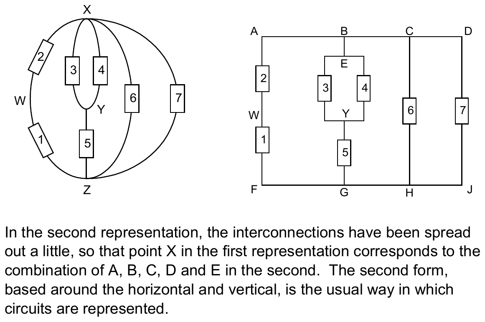
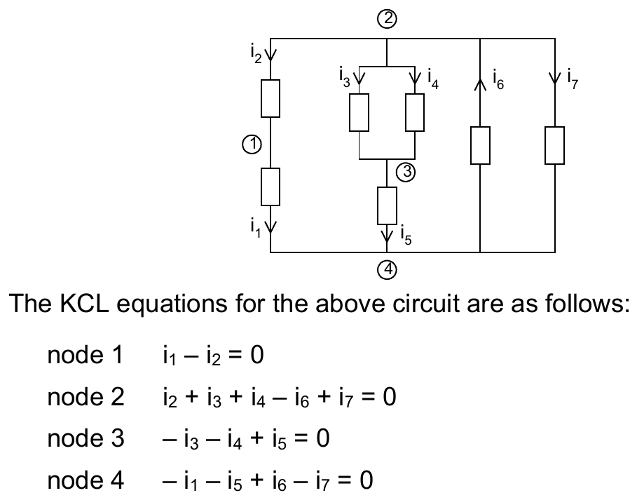
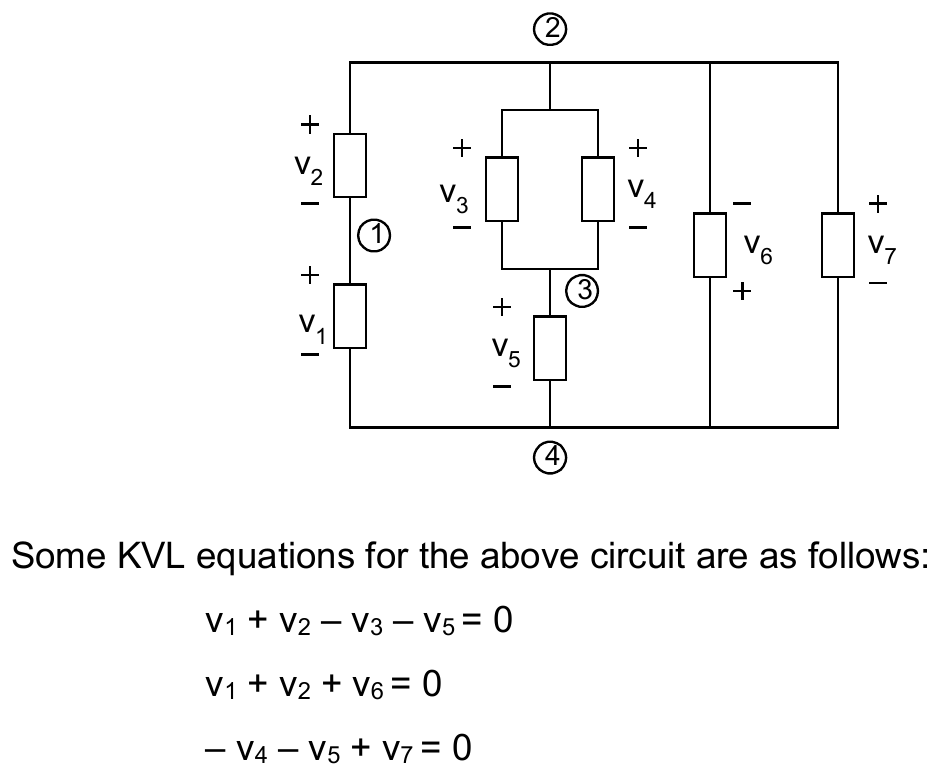
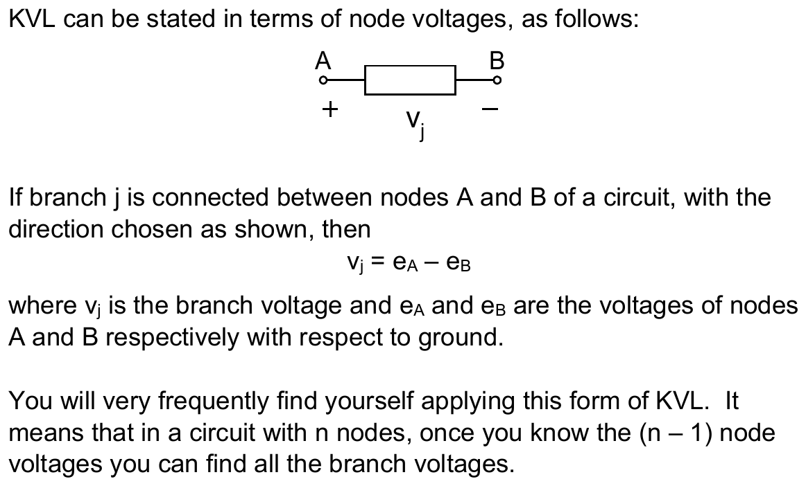
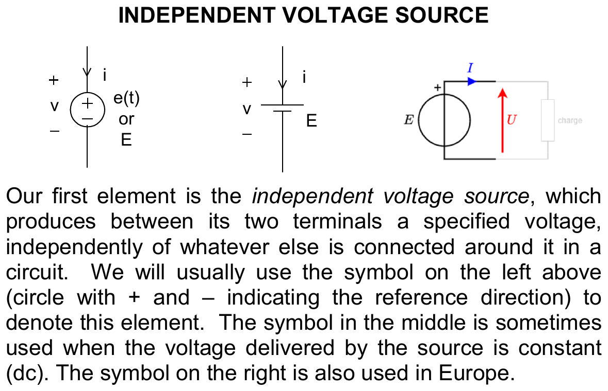
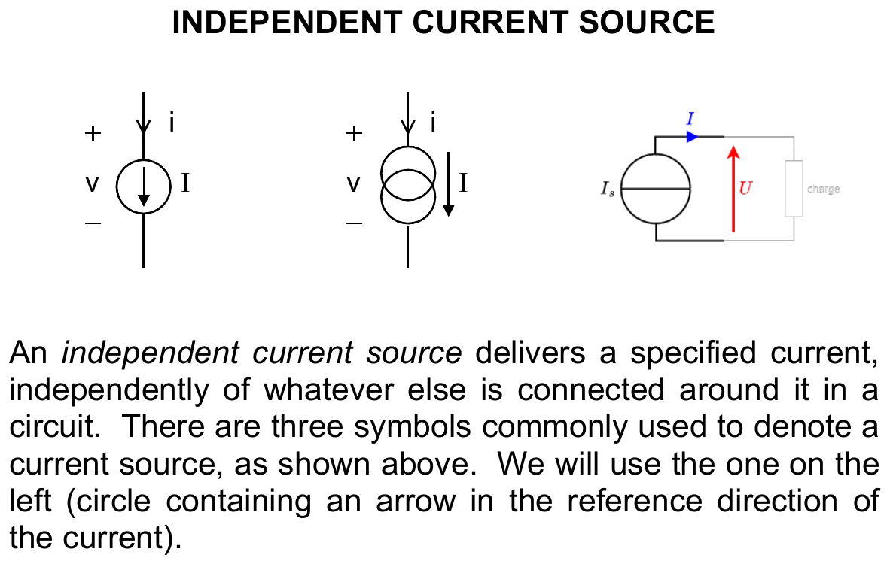
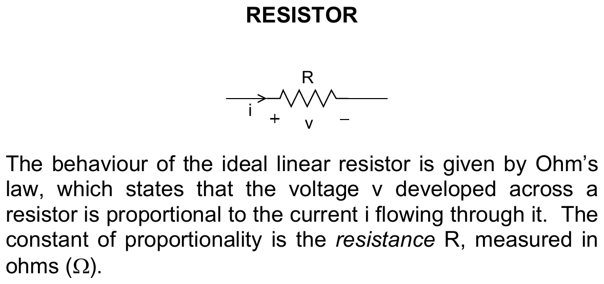
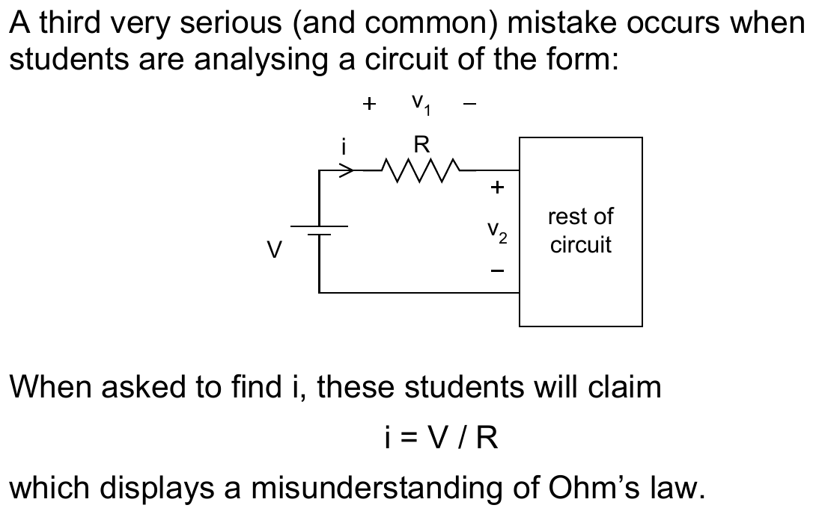
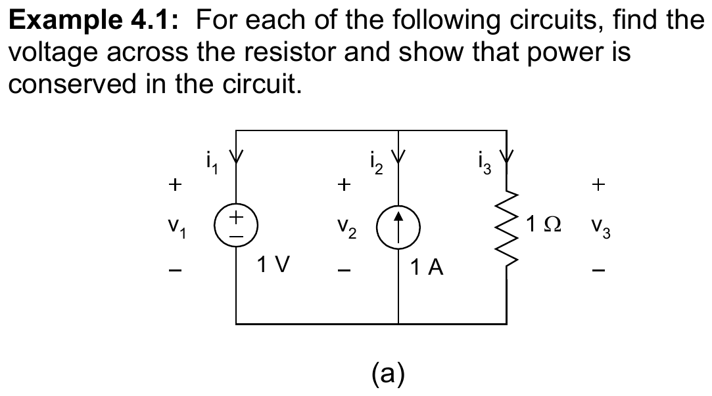

# Topic 2: Circuit elements and Kirchhoff's laws

Slide exercises: Lecture 3 Examples 3.1, 3.2 · Lecture 4 Example 4.1, Self test 4.1 · Past finals: used in every question

Slides: Lecture 3, pages 1 to 42, and Lecture 4, pages 1 to 46.

---

## The big idea

A circuit is built from a few ideal elements:

voltage source, current source, resistor, short circuit, open circuit, switch.

Each element has one equation.

 

Two laws tie them together:

**KCL:** current in = current out, at every node.

**KVL:** voltages around any loop add to zero.

Every method in this course (division, Thévenin, nodal, phasors) is just KCL + KVL + element equations, organised cleverly.

---

**How to use these notes:**
When you see 🧠, stop.
Answer it on paper first.
Then click to check.

---

## 🎯 In the final

Never asked on its own. But **every** question uses it.

The most common lost marks are:
- applying Ohm's law to the wrong voltage (§4),
- forgetting that a voltage source can carry **any** current (§3),
- sign slips in KCL (§1).

---

## ⭐ Learn by heart from this topic

Open book: all of this is on your [exam sheet](../formula-sheet.md). Know it cold anyway.

- Rule 6, KCL: sum of currents **leaving** a node = 0.
- Rule 7, KVL: sum of voltages around a loop = 0.
- Equation 8, Ohm's law: v = Ri, or i = Gv with G = 1/R. Only **across the resistor**.
- Rule 9: a voltage source fixes v. Its current is whatever the circuit needs.
- Rule 10: a current source fixes i. Its voltage is whatever the circuit needs.
- Equation 11: branch voltage v = e_A − e_B (node voltages).

**Memory hook:** "Sources are stubborn about one thing only."

---

## 1. Nodes, branches, loops

- A **node** is a junction where elements meet. All wire between elements is one node.
- A **branch** is one two-terminal element.
- A **loop** is a closed path that visits no node twice.

**How to read this diagram:**
- Both drawings are the **same circuit**.
- Point X on the left is the whole wire A–B–C–D–E on the right.
- Count nodes by counting separate pieces of wire, not dots.

---

## 2. Kirchhoff's current law (KCL)

### 📐 Rule 6: KCL

At every node, the sum of the currents **leaving** is zero.

Same thing: current in = current out.

**What it means:** charge can't pile up in a wire.

**Use it when:** writing node equations (Topic 5), current division (Topic 3).

**How to read this diagram:**
- At node 2, i2, i3, i4 and i7 point away from the node. i6 points in.
- So: i2 + i3 + i4 − i6 + i7 = 0.
- Arrow away = plus. Arrow in = minus. Be consistent.

### 🧠 Check
In that circuit, i1 = 1 A, i3 = 2 A, i4 = −2 A, i6 = 5 A. Find i2, i5 and i7.

Answer

Node 1: i1 − i2 = 0 → **i2 = 1 A**

Node 3: −i3 − i4 + i5 = 0 → i5 = 2 + (−2) → **i5 = 0 A**

Node 2: 1 + 2 − 2 − 5 + i7 = 0 → **i7 = 4 A**

---

## 3. Kirchhoff's voltage law (KVL)

### 📐 Rule 7: KVL

Around any loop, the voltages add up to zero.

Walk round the loop. Add a voltage when you meet its + first. Subtract when you meet its − first.

**What it means:** energy is conserved. Come back to the start, you're back at the same potential.

**How to read this diagram:**
- Loop 1 → 2 → 3 → 4 → 1: v1 + v2 − v3 − v5 = 0.
- v3 and v4 are across the same two nodes. So v3 = v4 (from the loop v3 − v4 = 0).

### 📐 Equation 11: branch voltage from node voltages
$$v_j = e_A - e_B$$

| Symbol | Means |
|---|---|
| e_A, e_B | node voltages: each node's voltage relative to ground |
| v_j | the voltage across branch j, + at A, − at B |

**What it means:** choose one node as **ground** (0 V). Then every voltage is a difference of two node voltages. KVL is automatically true.

**Use it when:** always, from Topic 5 on.

---

## 4. The elements

### Voltage source

### 📐 Rule 9: ideal voltage source
v = E, **whatever current flows**.

The current through it is set by the rest of the circuit. It can be anything, even negative.

### Current source

### 📐 Rule 10: ideal current source
i = I, **whatever voltage is across it**.

The voltage across it is set by the rest of the circuit.

### Resistor

### 📐 Equation 8: Ohm's law
$$v = R\,i \qquad i = G\,v, \quad G = \frac{1}{R}$$

| Symbol | Means | Units |
|---|---|---|
| R | resistance | ohms (Ω) |
| G | conductance | siemens (S) |

**What it means:** voltage across a resistor is proportional to current through it, **with Topic 1 Rule 3 labels**.

**When not:** Ohm's law is for **resistors only**. Never for a source, a diode or a whole circuit.

**How to read this diagram:**
- The voltage source V is not across R. So i ≠ V/R.
- Ohm's law needs the voltage **across the resistor**: i = (v1 − v2)/R.

### Short circuit, open circuit, switch
- **Short circuit:** v = 0, any current.
- **Open circuit:** i = 0, any voltage.
- **Ideal switch:** open = open circuit. Closed = short circuit.

### 🧠 Check

A 1 V source, a 1 A current source and a 1 Ω resistor are all in parallel. What is the voltage across the resistor? Who supplies power?

Answer

All three are in parallel, so they share the voltage. The voltage source fixes it: **1 V**.

Resistor current = 1 V / 1 Ω = 1 A, so it absorbs 1 W.

The current source pushes 1 A up into the top node. The resistor takes exactly 1 A. So the voltage source carries **0 A**.

The current source supplies 1 W. The voltage source supplies nothing. 1 = 1, power is conserved.

---

## Method: setting up any circuit

| You're asked for | Use |
|---|---|
| a current at a node | KCL (Rule 6) |
| a voltage round a loop | KVL (Rule 7) |
| a resistor's current from its voltage | Ohm, with the voltage **across** it (Equation 8) |
| a voltage source's current | KCL at its terminal (Rule 9: it can be anything) |
| a current source's voltage | KVL round a loop through it (Rule 10) |
| any branch voltage | e_A − e_B (Equation 11) |

---

Next: [End-of-topic test](../questions/02-elements-kirchhoff.md)
