# Topic 3: Series, parallel, voltage and current division

Slide exercises: Lecture 6 Examples 6.2, 6.3 · Homework 0 Q1, Q2 · Homework 1 Q1a, Q1b (2026 and 2025) · Past finals: inside almost every Q1 part

Slides: Lecture 5, pages 1 to 40, and Lecture 6, pages 1 to 44.

---

## The big idea

Most circuits can be **shrunk**.

Two resistors in series become one. Two in parallel become one.

Keep shrinking until the answer is obvious.

 

Then go back out with two shortcuts:

**Voltage division** shares a voltage between series resistors.

**Current division** shares a current between parallel resistors.

---

**How to use these notes:**
When you see 🧠, stop.
Answer it on paper first.
Then click to check.

---

## 🎯 In the final

Not a part of its own in recent finals. But you use it inside nearly every Q1 part:

- **Final 2025 Q1a:** a bridge. You can't shrink it with series/parallel. That is why you need node analysis (Topic 5).
- **Final 2025 Q1b, Final 2024 Q1a, every Thévenin part:** parallel combinations.
- **Every op-amp part:** the gain is a voltage divider in disguise (Topic 7).

Homework 0 and Homework 1 Q1a, Q1b are pure Topic 3.

---

## ⭐ Learn by heart from this topic

Open book: all on your [exam sheet](../formula-sheet.md). These you should do without looking.

- Equation 12: series: R = R1 + R2.
- Equation 13: parallel: R = R1R2/(R1 + R2). "Product over sum."
- Equation 15: voltage division: v1 = V × R1/(R1 + R2).
- Equation 16: current division: i1 = I × R2/(R1 + R2). Note: the **other** resistor on top.
- Rule 17: a real source = ideal source + internal resistance. The load voltage drops.

**Memory hook:** "Voltage takes its own R. Current takes the other R."

---

## 1. Series and parallel

- **Parallel:** connected between the **same two nodes**. Same voltage.
- **Series:** joined at a node that **nothing else** touches. Same current.

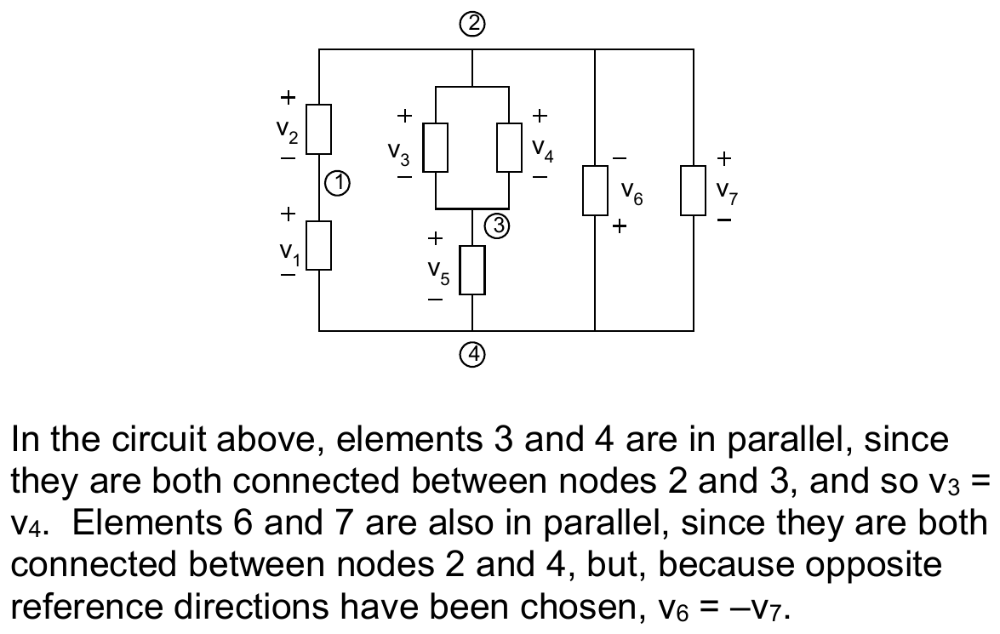

**How to read this diagram:**
- Elements 3 and 4 both join node 2 to node 3. Parallel.
- Elements 6 and 7 both join node 2 to node 4. Parallel too.
- Elements 1 and 2 meet at node 1, and nothing else touches node 1. Series.

### Sources

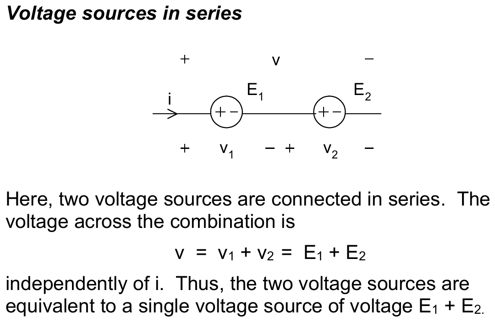

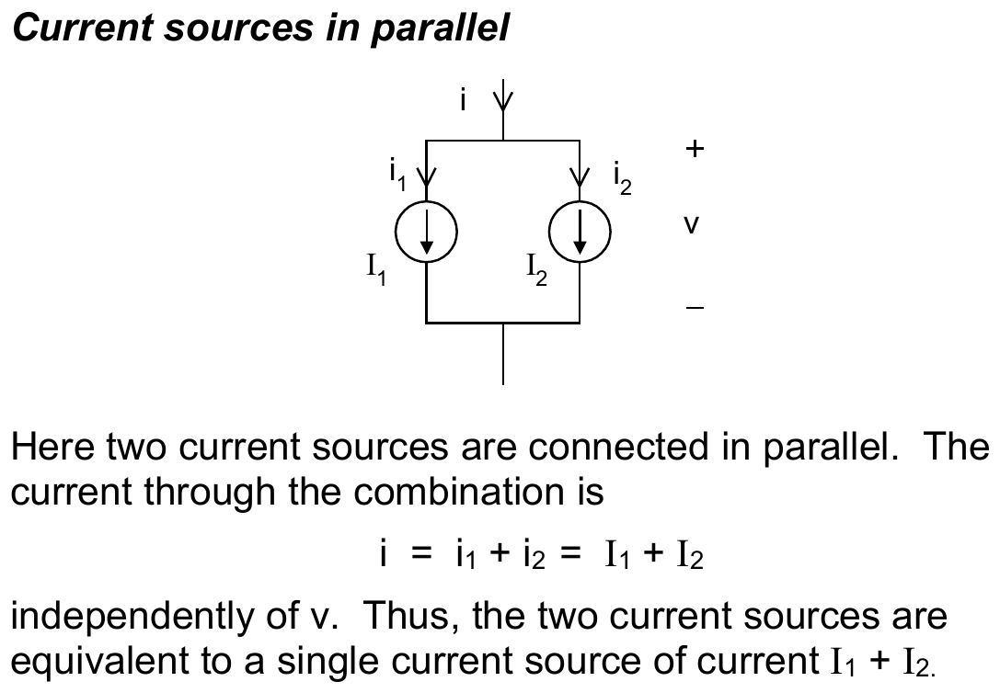

### 📐 Rule 14: combining sources
- Voltage sources in **series** add (watch the + / − directions).
- Current sources in **parallel** add (watch the arrows).
- Anything in **parallel with a voltage source** sees that voltage. It can't change other voltages.
- Anything in **series with a current source** carries that current. It can't change other currents.

**Use it when:** simplifying before you start. E.g. Homework 0 Q1a: Va and Vb in series = 3 V.

---

## 2. Resistors in series and parallel

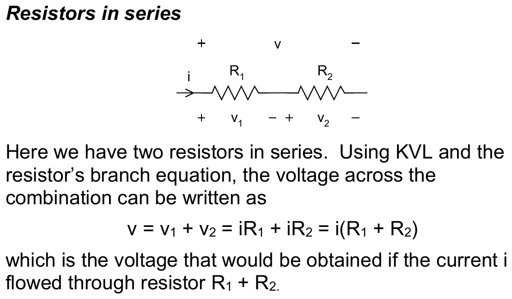

### 📐 Equation 12: series resistors
$$R_{total} = R_1 + R_2 + \dots$$

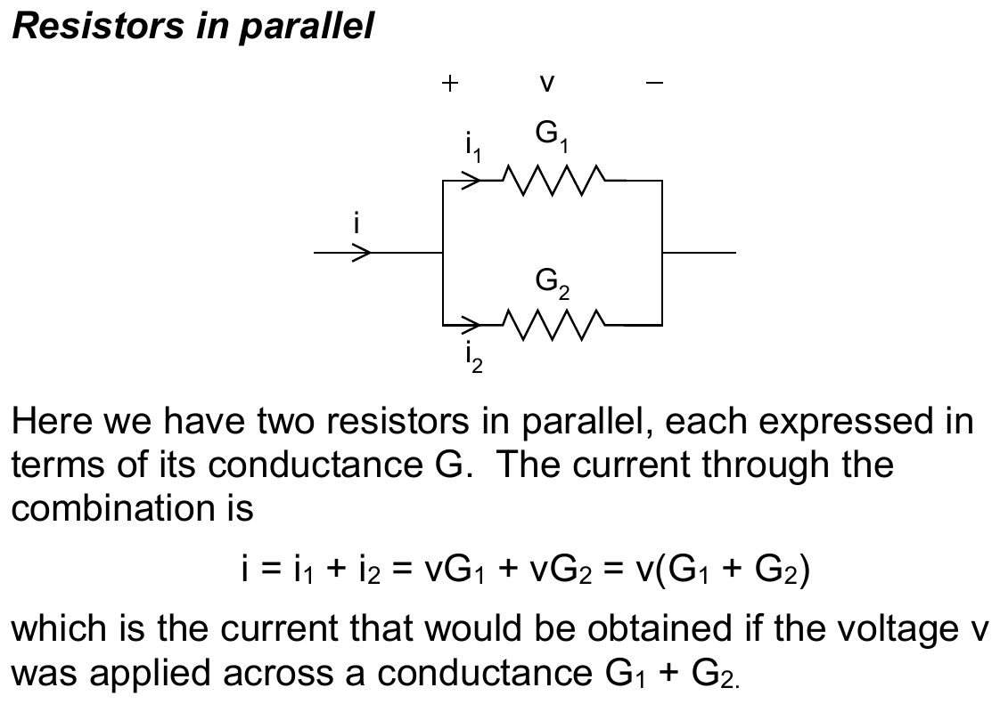

### 📐 Equation 13: parallel resistors
$$G_{total} = G_1 + G_2 \qquad R_{total} = \frac{R_1 R_2}{R_1 + R_2}$$

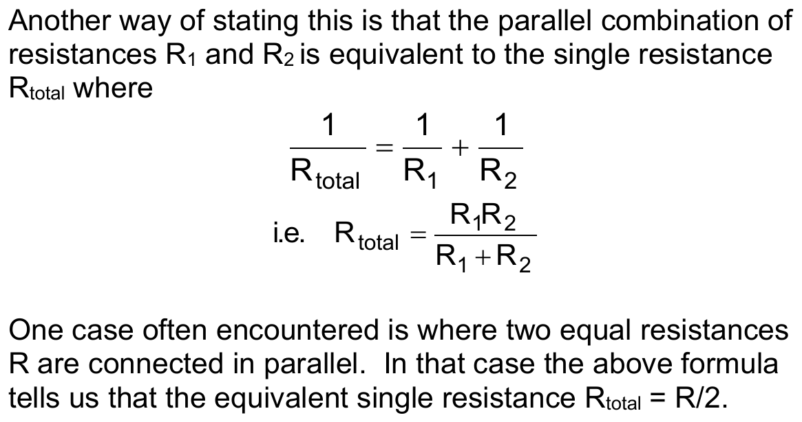

| Symbol | Means |
|---|---|
| R1 ∥ R2 | short way to write "R1 in parallel with R2" |
| G = 1/R | conductance. Conductances in parallel add |

**What it means:**
- Adding in series always **increases** R.
- Adding in parallel always **decreases** R. The result is smaller than the smallest one.
- Two equal resistors in parallel give R/2.

**Use it when:** shrinking a network. For three or more in parallel, add the conductances.

### 🧠 Check
Homework 0 Q1d: R1 ∥ R2 in series with R3 ∥ R4. R1 = 1000, R2 = 2200, R3 = 3300, R4 = 4700 Ω. Find R_AB.

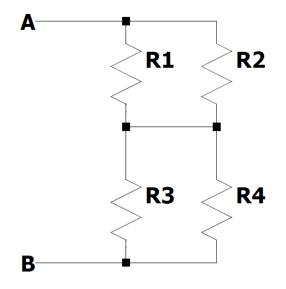

Answer

1000 ∥ 2200 = 2.2 M / 3200 = 687.5 Ω

3300 ∥ 4700 = 15.51 M / 8000 = 1938.75 Ω

R_AB = 687.5 + 1938.75 = **2626 Ω** (official answer 2.626 kΩ).

---

## 3. Voltage division

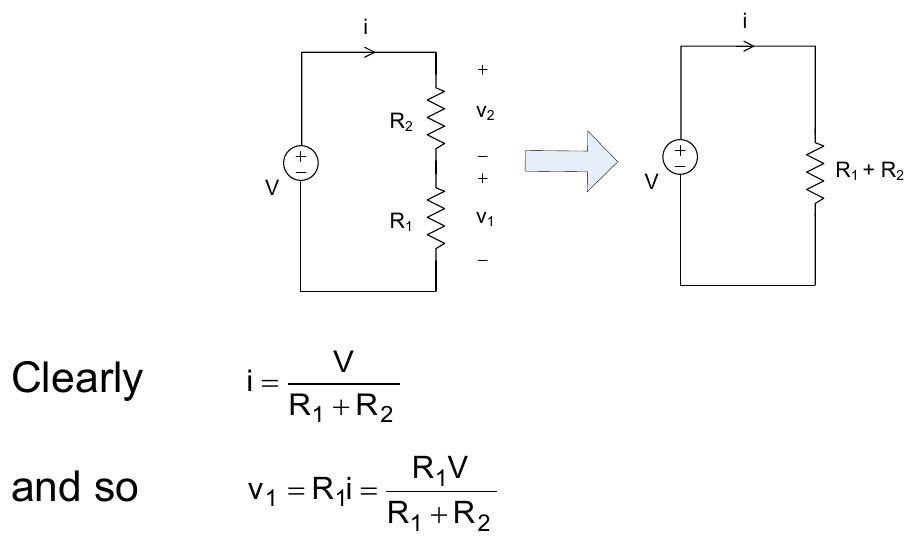

### 📐 Equation 15: voltage division
$$v_1 = \frac{R_1}{R_1 + R_2}\,V$$

| Symbol | Means |
|---|---|
| V | the voltage across the whole series string |
| v1 | the part across R1 |

**What it means:** each resistor takes a share of the voltage in proportion to its **own** resistance.

**Use it when:** the **same current** flows through all the resistors.

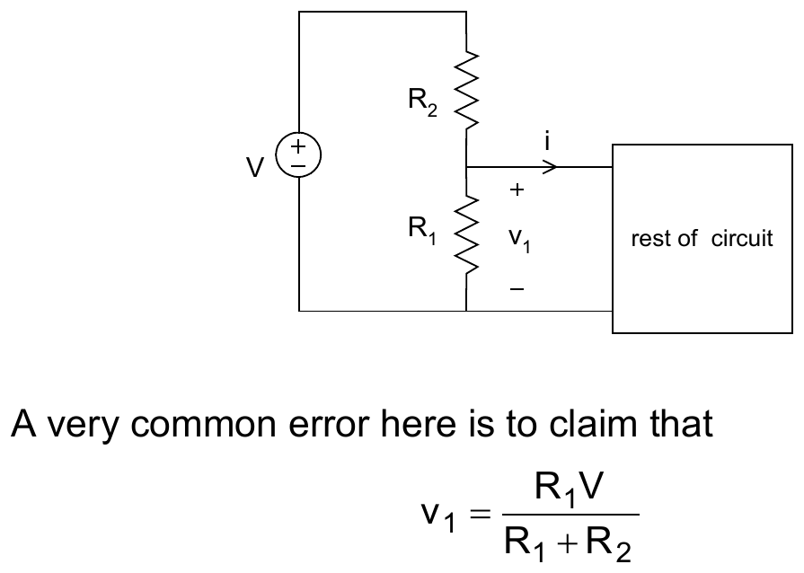

**How to read this diagram:**
- Here R1 has the "rest of circuit" hanging off it.
- So R1 and R2 do **not** carry the same current.
- Voltage division is wrong here. First combine R1 with whatever is in parallel with it.

### 📐 Rule 17: real sources and loading

A real source = an ideal source Vs in series with an internal resistance Rs.

With a load RL, the load voltage is a voltage divider:
$$v_L = \frac{R_L}{R_s + R_L} V_s$$

If RL ≫ Rs, nearly all of Vs reaches the load. If RL is small, a lot is lost inside the source.

**Example 6.2:** a 5 V battery with 20 Ω inside. Load 20 Ω → 2.5 V. Load 200 Ω → 4.55 V.

---

## 4. Current division

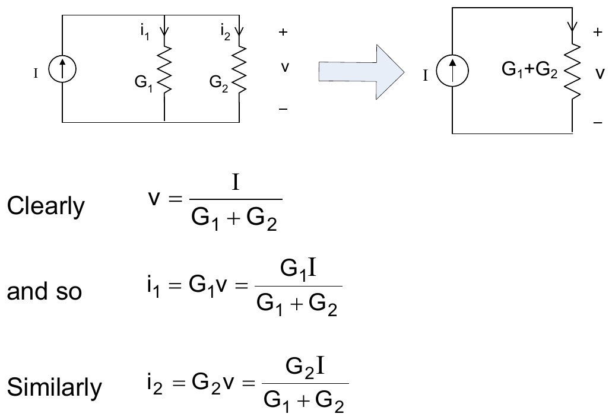

### 📐 Equation 16: current division
$$i_1 = \frac{G_1}{G_1 + G_2}\,I = \frac{R_2}{R_1 + R_2}\,I$$

**What it means:** current prefers the easy path. The **smaller** resistor takes the **bigger** share.

In R form, the **other** resistor goes on top.

**Use it when:** a known current splits between parallel branches.

### 🧠 Check
Homework 1 Q1a: a 1 mA source feeds R1 = 1 kΩ, then splits between R2 = 2.2 kΩ and R3 = 3.3 kΩ in parallel. Find I(R2).

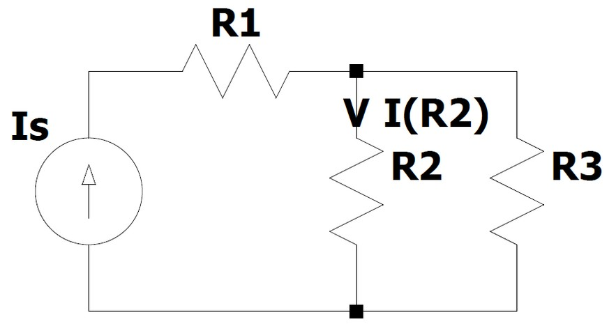

Answer

R1 is in series with the source, so it doesn't change the current (Rule 14). All 1 mA reaches the R2 ∥ R3 pair.

I(R2) = 1 mA × 3300 / (2200 + 3300) = **0.6 mA**.

---

## 5. Shrink, solve, expand

Lecture 6 Example 6.3 shows the full method.

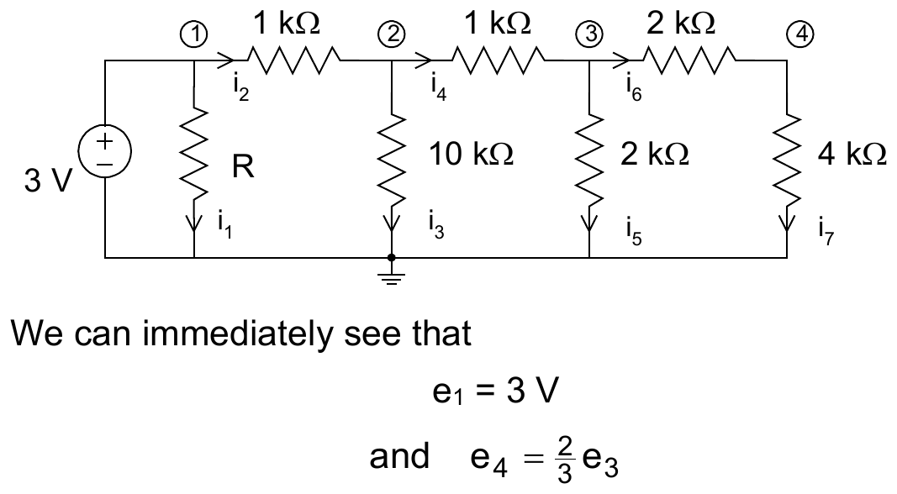

**How to read this diagram:**
- R is directly across the 3 V source, so it changes nothing else (Rule 14).
- From the right: 2 k + 4 k = 6 k, in parallel with 2 k = 1.5 k.
- Then 1 k + 1.5 k = 2.5 k, in parallel with 10 k = 2 k.
- Then 1 k + 2 k: e2 = 3 × 2/3 = 2 V.
- Go back out with voltage division: e3 = 2 × 1.5/2.5 = 1.2 V, e4 = 1.2 × 4/6 = 0.8 V.

Currents: i2 = 1 mA, i3 = 0.2 mA, i4 = 0.8 mA, i5 = 0.6 mA, i6 = i7 = 0.2 mA.

---

## Worked example: Homework 0 Q2

V1 = 9 V drives two branches from node A to ground.

Branch 1: R1 = 1 kΩ, then R2 ∥ R3 (2.2 k ∥ 3.3 k) to ground. Middle node B.

Branch 2: R4 = 3.3 kΩ, then R5 ∥ R6 (2.2 k ∥ 1 k) to ground. Middle node C.

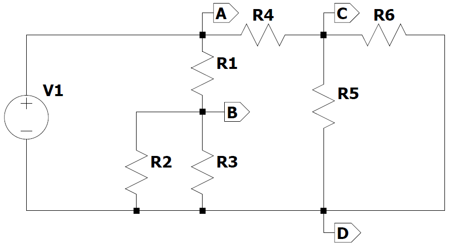

**(a) V_CA**

Branch 2 is a voltage divider. R5 ∥ R6 = 2200 × 1000 / 3200 = 687.5 Ω.

e_C = 9 × 687.5 / (3300 + 687.5) = 1.552 V.

V_CA = e_C − e_A = 1.552 − 9 = **−7.448 V** (official −7.448 V).

**(c) P(R1)**

R2 ∥ R3 = 1320 Ω. Branch current = 9 / (1000 + 1320) = 3.879 mA.

P(R1) = i²R = (3.879 mA)² × 1000 = **15.05 mW** (official).

**(e)** P(R2) grows with V1²: P(R2) = (V1 × 1320/2320)² / 2200. At 9 V it is 11.9 mW. The plot is a parabola.

---

## Method: resistor networks

| You're asked for | Use |
|---|---|
| R between two terminals | shrink: series add, parallel product/sum (Eq 12, 13) |
| voltage on one of several series resistors | voltage division (Eq 15). Check: same current? |
| current in one of several parallel resistors | current division (Eq 16) |
| a voltage with a source's internal resistance | Rule 17 divider |
| something in a bridge (no series/parallel pair) | node analysis (Topic 5) or Thévenin (Topic 4) |

---

Next: [End-of-topic test](../questions/03-series-parallel-division.md)
