# Topic 4: Superposition, Thévenin and Norton

Slide exercises: Lecture 7 Examples 7.1, 7.2, Self test 7.1 · Lecture 8 Examples 8.4, 8.5 · Homework 1 Q1c, Q1d (2026 and 2025) · Homework 2 (2025) Q1d · Past finals: Final 2024 Q1a, Resit 2025 Q1a

Slides: Lecture 7, pages 1 to 26, and Lecture 8, pages 1 to 39.

---

## The big idea

Three tricks that make big circuits small.

**Superposition:** with several sources, do one source at a time, then add.

**Thévenin:** anything seen from two terminals = one voltage source + one resistor.

**Norton:** the same thing as one current source + one resistor.

 

They only work for **linear** circuits (resistors, sources, controlled sources, and later C and L).

Not for diodes.

---

**How to use these notes:**
When you see 🧠, stop.
Answer it on paper first.
Then click to check.

---

## 🎯 In the final

- **Final 2024 Q1a and Resit 2025 Q1a (20% of Q1):** two sine sources of **different frequencies** drive a resistor network. Superposition is the only way (§1, worked example).
- **Final 2025 Q1b (20%):** a Thévenin resistance with a controlled source (Topic 6 §4 finishes it).
- Thévenin's idea is also behind **maximum power transfer** (§5), which comes up in AC form almost every year (Topic 12).
- Homework 1 Q1c (superposition) and Q1d (Norton).

---

## ⭐ Learn by heart from this topic

Open book: all on your [exam sheet](../formula-sheet.md). Know the "turn off" rule by reflex.

- Rule 18, superposition: one source at a time. **Voltage source off = short. Current source off = open.** Then add.
- Rule 19, source transformation: E in series with R ⇔ E/R in parallel with R.
- Rule 20, Thévenin / Norton: Vth = open-circuit voltage. Rth = resistance with the sources turned off. In = short-circuit current = Vth/Rth. Rn = Rth.
- Equation 21: bridge: Vth = Vs(R3/(R1 + R3) − R4/(R2 + R4)).
- Equation 22, dc maximum power: RL = Rs gives Pmax = Vs²/(4Rs).

**Memory hook:** "Short the volts, open the amps."

---

## 1. Superposition

### 📐 Rule 18: superposition

In a linear circuit with several independent sources:

1. Keep **one** source. Turn the others off:
   - a voltage source becomes a **short circuit** (0 V),
   - a current source becomes an **open circuit** (0 A).
2. Find the answer for that one source.
3. Repeat for each source.
4. **Add** the answers, with signs.

**Use it when:** sources of different kinds, or different **frequencies** (Topic 11, Final 2025 Q2b).

**When not:** never for power directly (power is not linear: add the currents first, then square). Never with diodes. Don't turn off controlled sources (Topic 6).

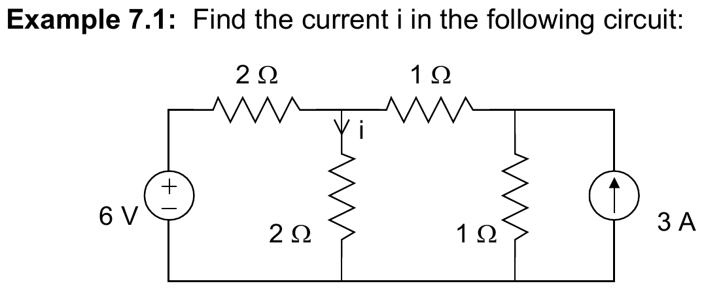

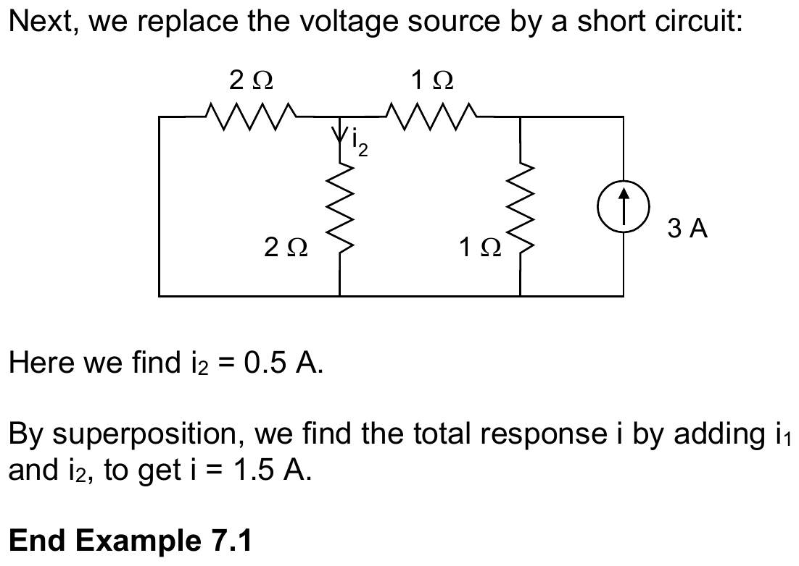

**How to read this diagram:**
- 6 V alone (3 A source open): i1 = 1 A.
- 3 A alone (6 V source shorted): i2 = 0.5 A.
- Total: i = 1 + 0.5 = **1.5 A**.

---

## 2. Source transformation

### 📐 Rule 19: source transformation

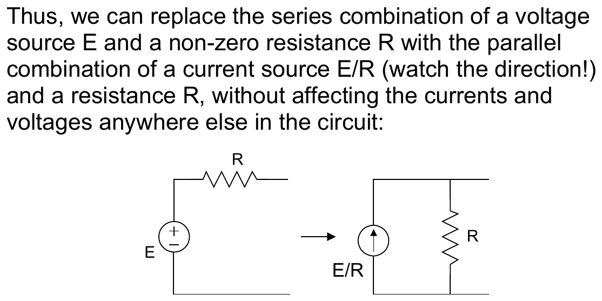

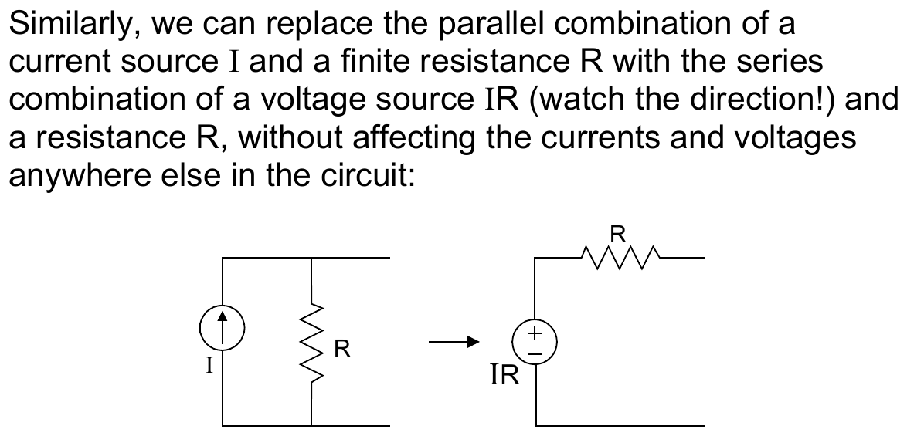

A voltage source E in **series** with R

= a current source E/R in **parallel** with the same R.

The outside world can't tell the difference.

**Watch the direction:** the current arrow points towards the + end of the old voltage source.

**Use it when:** you want only current sources (for nodal analysis by inspection, Topic 5) or want to merge sources.

---

## 3. Thévenin and Norton

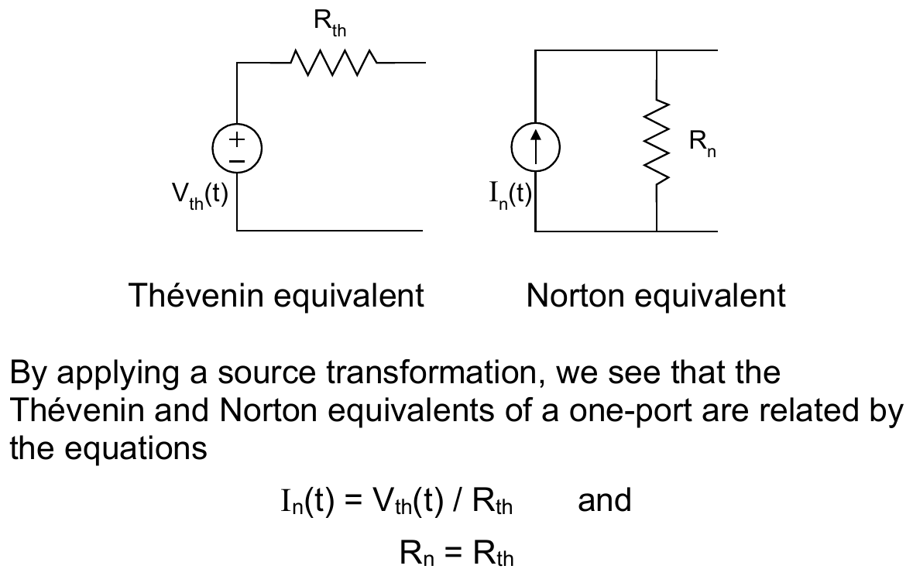

### 📐 Rule 20: Thévenin and Norton equivalents

Seen from two terminals A and B, any linear circuit is the same as:

**Thévenin:** a voltage source Vth in series with Rth.

**Norton:** a current source In in parallel with Rn.

$$V_{th} = \text{open-circuit voltage}, \qquad I_n = \text{short-circuit current}$$
$$R_{th} = R_n = \frac{V_{th}}{I_n}$$

| Symbol | How to find it |
|---|---|
| Vth | leave A–B open. Find V_AB |
| In | short A to B. Find the current from A to B |
| Rth | turn off the independent sources (Rule 18). Find R between A and B |

**Three ways to get Rth:**
1. No controlled sources: turn the sources off, then combine resistors.
2. Rth = Vth / In.
3. With controlled sources: turn off only the independent ones, put a **test source** across A–B, Rth = V_test / I_test (Topic 6 §4).

**Use it when:** asked for "the Thévenin equivalent", "the Norton equivalent", "the current in a load", or before maximum power transfer.

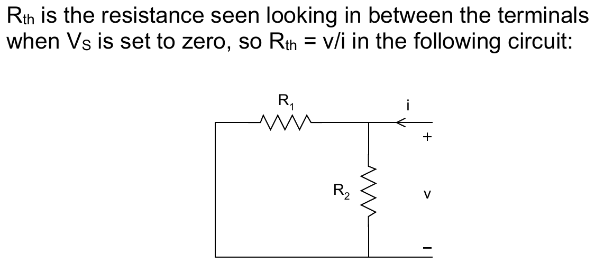

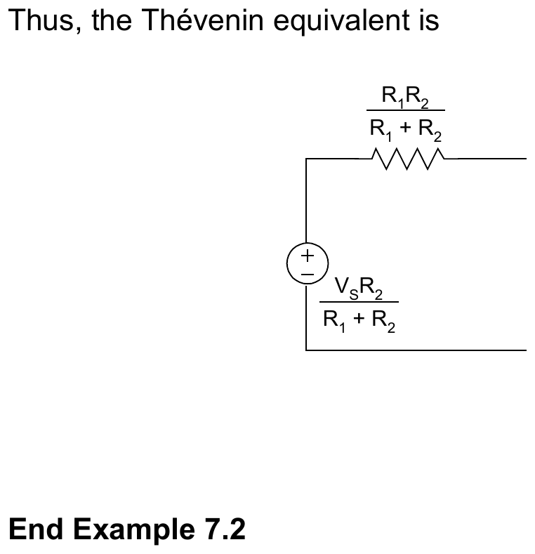

**How to read this diagram:**
- A divider: Vth = Vs R2/(R1 + R2) (voltage division, open terminals).
- Turn Vs off (short): R1 ∥ R2 = Rth.

### 🧠 Check
Lecture 7 Self test 7.1: 1 V source, 1 kΩ, 1 kΩ and a 2 mA source. The open-circuit voltage is 3 V. A voltmeter with 2 kΩ internal resistance reads 1.5 V. What is Rth?

Answer

The meter's 2 kΩ forms a divider with Rth:

1.5 = 3 × 2k / (Rth + 2k) → Rth + 2k = 4k → **Rth = 2 kΩ**.

This is also how Homework 2 (2025) Q1d finds a signal generator's output resistance.

---

## 4. The Wheatstone bridge

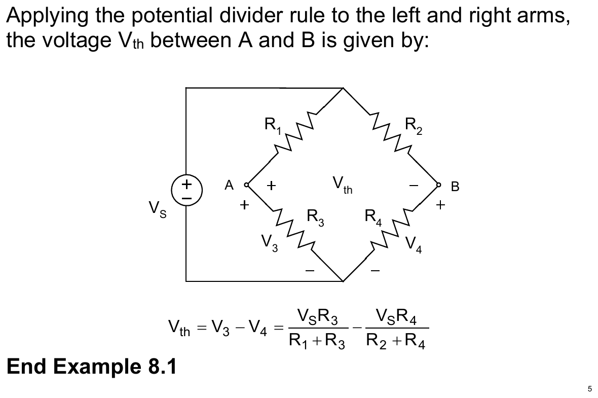

### 📐 Equation 21: bridge Thévenin voltage
$$V_{th} = V_S\left(\frac{R_3}{R_1 + R_3} - \frac{R_4}{R_2 + R_4}\right)$$

Two voltage dividers side by side. Vth is their difference.

**Balanced** (Vth = 0) when R2/R1 = R4/R3.

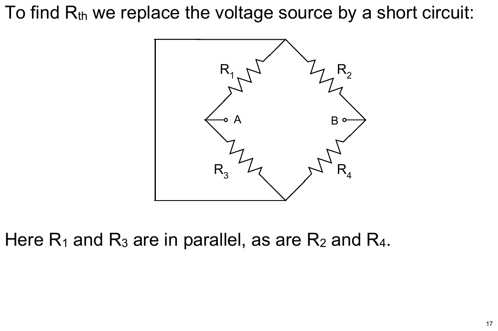

**How to read this diagram:**
- Short Vs. Now the top and bottom nodes are the same node.
- R1 ∥ R3 from A, R2 ∥ R4 from B, in series:

$$R_{th} = R_1 \parallel R_3 + R_2 \parallel R_4$$

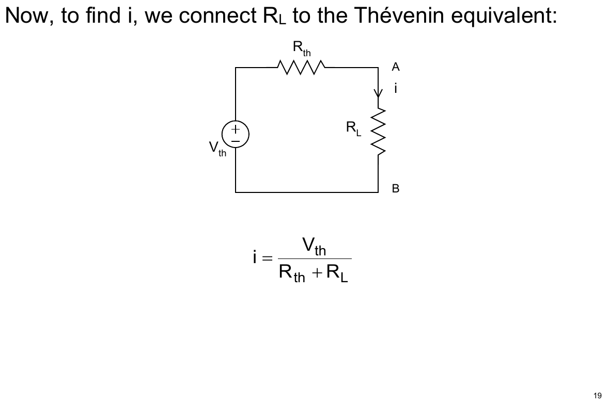

i = Vth / (Rth + RL).

**Example 8.4:** Vs = 12 V, R1 = 900 Ω, the rest 1 kΩ, RL = 10 kΩ: Vth = 315.8 mV, Rth = 973.7 Ω, i = 28.8 μA.

This is exactly **Final 2025 Q1a** (Topic 5 worked example), done the Thévenin way.

---

## 5. Maximum power transfer (dc)

A source (Vs and Rs) drives a load RL. Which RL gets the most power?

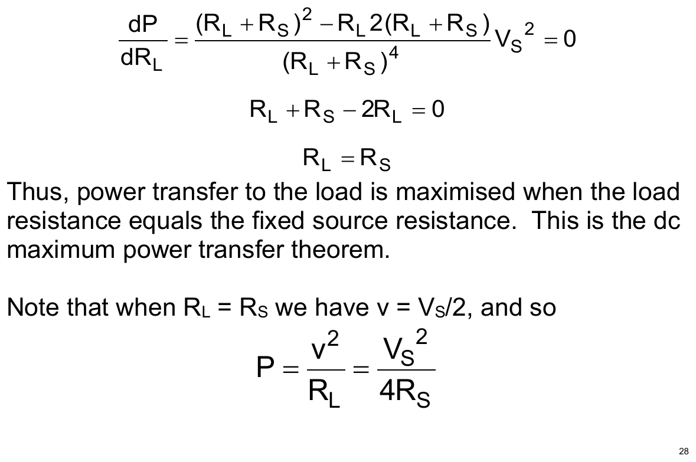

### 📐 Equation 22: dc maximum power transfer
$$R_L = R_S \qquad P_{max} = \frac{V_S^2}{4 R_S}$$

| Symbol | Means |
|---|---|
| Vs, Rs | the source, or the Thévenin equivalent of the circuit seen by the load |
| Pmax | the "available power" |

**What it means:** match the load to the source.

At that point only half the power reaches the load (efficiency 50%).

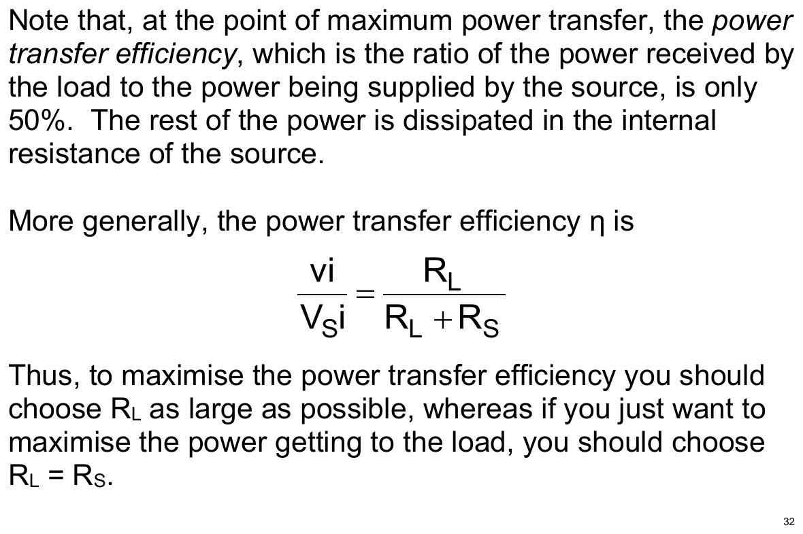

**Use it when:** "what RL gives maximum power?". First find the Thévenin equivalent seen by RL.

The AC version (Topic 12) says ZL = Zs*, the complex conjugate.

**Example 8.5:** the circuit seen by R is 1 V with 2 kΩ. So R = 2 kΩ, Pmax = 1²/(4 × 2k) = 125 μW.

---

## Worked example: Final 2024 Q1a

V1 = 5 sin(2000πt) through R1 = 1200 Ω and V2 = 2 cos(5000πt) through R3 = 3300 Ω both feed node 2. R2 = 2200 Ω goes from node 2 to ground.

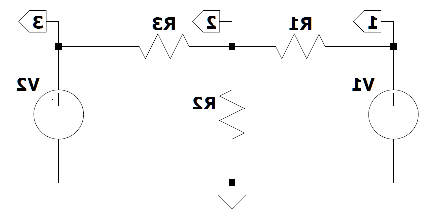

Find e2(t), then e2 at t = 1.25 ms.

**Step 1: V1 alone** (V2 shorted). R2 ∥ R3 = 1320 Ω.

e2' = V1 × 1320/(1200 + 1320) = 0.5238 V1.

**Step 2: V2 alone** (V1 shorted). R1 ∥ R2 = 776.5 Ω.

e2'' = V2 × 776.5/(3300 + 776.5) = 0.1905 V2.

**Step 3: add.**

$$e_2(t) = 2.619\sin(2000\pi t) + 0.381\cos(5000\pi t)\ \text{V}$$

**Step 4: t = 1.25 ms.**

sin(2000π × 0.00125) = sin(2.5π) = 1.

cos(5000π × 0.00125) = cos(6.25π) = cos(0.25π) = 0.7071.

e2 = 2.619 + 0.381 × 0.7071 = **2.888 V**.

**Shortcut (Millman):** a node fed through resistors from several sources:

$$e_2 = \frac{V_1/R_1 + V_2/R_3}{1/R_1 + 1/R_2 + 1/R_3}$$

It is the same answer in one line.

**Hidden structure:** the circuit is only resistors, so each frequency passes straight through with no phase shift. Different frequencies can't be added as phasors. Keep them as separate terms.

---

## Method: equivalents

| You're asked for | Use |
|---|---|
| an answer with two or more sources | superposition (Rule 18), or nodal (Topic 5) |
| sources at two different frequencies | superposition, one term per frequency |
| Thévenin equivalent | Vth = open-circuit V, Rth = sources off (Rule 20) |
| Norton equivalent | In = short-circuit I, Rn = Rth |
| current in a load resistor in a bridge | Vth by Eq 21, Rth = R1∥R3 + R2∥R4, i = Vth/(Rth + RL) |
| RL for maximum power | RL = Rth, Pmax = Vth²/(4Rth) (Eq 22) |
| a source's internal resistance from a loaded reading | divider: Rs = RL(Voc/Vload − 1) |

---

Next: [End-of-topic test](../questions/04-superposition-thevenin-norton.md)
