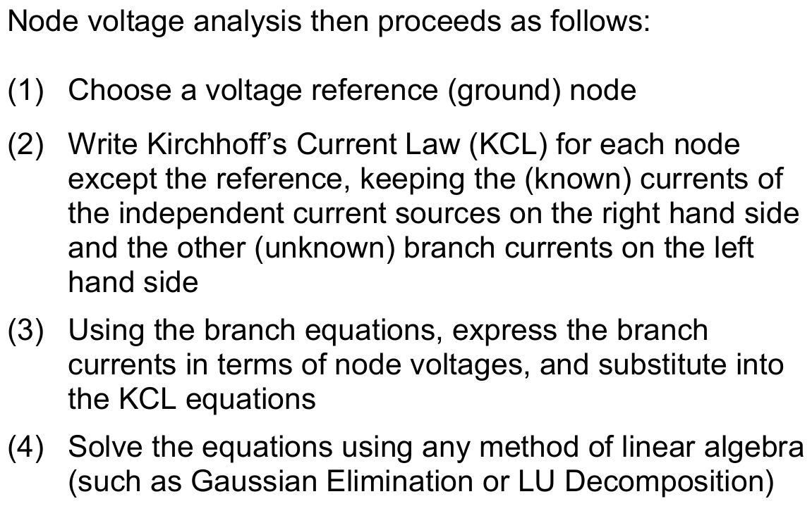
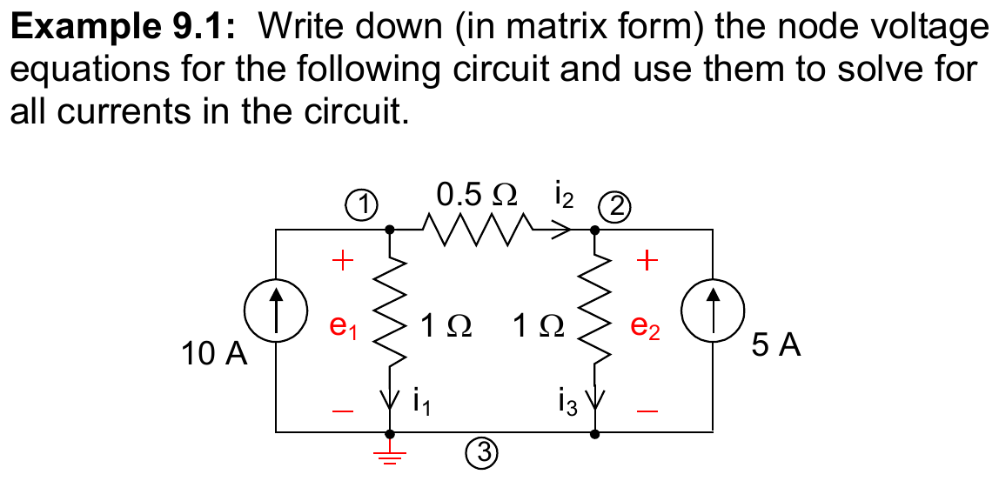
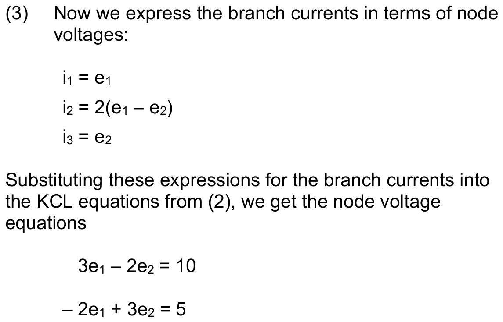
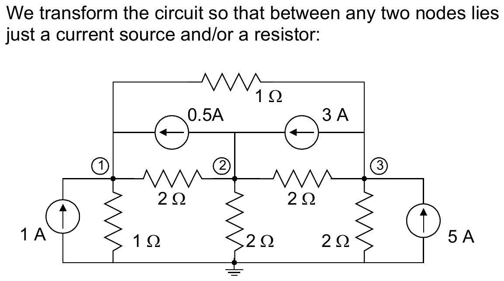
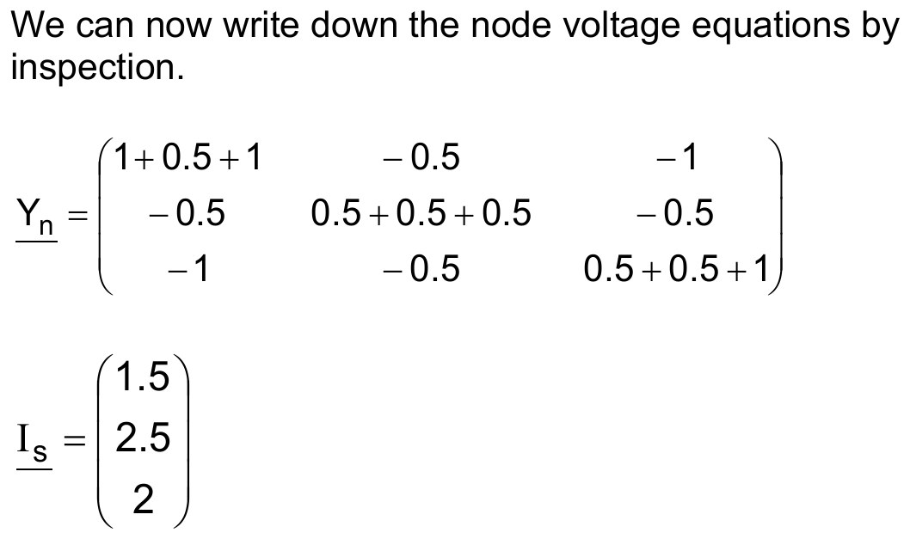
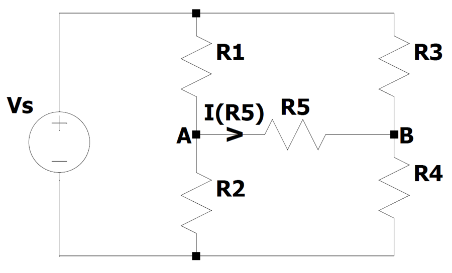
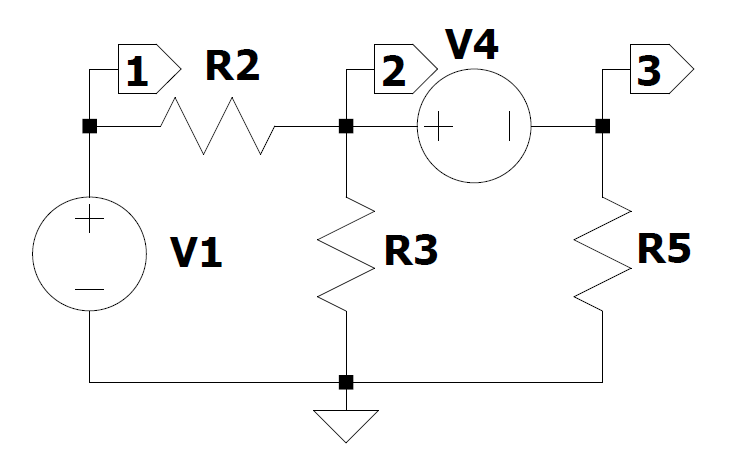

# Topic 5: Node voltage analysis

Slide exercises: Lecture 9 Examples 9.1, 9.2, 9.3 · Past finals: Final 2025 Q1a, 2023 Q1b, 2022 Q1b, 2021 Q1b · Resit 2024 Q1b, 2023 Q1b, 2022 Q1b, 2021 Q1b

Slides: Lecture 9, pages 1 to 35.

---

## The big idea

One method that works on **any** resistive circuit.

Pick a ground. Call the other node voltages e1, e2, …

Write KCL at each node, with every current written as (difference of node voltages) / R.

Solve.

 

No luck needed. No cleverness needed.

That is why it is the safest method in an exam.

---

**How to use these notes:**
When you see 🧠, stop.
Answer it on paper first.
Then click to check.

---

## 🎯 In the final

**Every single paper** has a resistive Q1b (or Q1a): "calculate the voltage at node 2" or "the current from node A to node B". 20% of Q1.

- Final 2025 Q1a: a bridge, current through R5.
- Final 2023 Q1b / Resit 2024 Q1b: two batteries and four resistors, e1 or e2.
- Final 2022 Q1b / Resit 2023 Q1b: a voltage source and a current source, V24 or V12.
- Final 2021 Q1b / Resit 2022 Q1b: two voltage sources, one of them floating.
- Resit 2021 Q1b: a current from node 1 to node 2.

These are usually **one or two unknown nodes**. Five minutes each, once you have the method.

---

## ⭐ Learn by heart from this topic

Open book: on your [exam sheet](../formula-sheet.md). But practise until it is automatic.

- Rule 23: the four steps: ground, KCL at each other node, currents as (e_this − e_other)/R, solve.
- Rule 24: by inspection: diagonal = sum of the conductances at the node. Off-diagonal = **minus** the conductance between the two nodes. Right side = source currents **into** the node.
- Rule 25: a voltage source from a node to ground **gives** you that node voltage. A floating voltage source links two nodes: e_a − e_b = V.

**Memory hook:** "Out through every resistor, sum to zero."

---

## 1. The method

### 📐 Rule 23: node voltage analysis

1. Choose a **ground** (reference) node. Usually the bottom wire, or the node with most connections.
2. Label the other nodes e1, e2, …
3. At each unknown node, write KCL: the currents **leaving** through the resistors add up to the source currents **entering**.
4. Each resistor current leaving node a towards node b is (e_a − e_b)/R.
5. Solve the equations.
6. Any current or voltage you want comes from the node voltages.

**Use it when:** any resistive circuit with more than one loop. Especially bridges and circuits with sources in odd places.

### 🧠 Check

Write the two node equations and solve for e1 and e2.

Answer

Node 1: e1/1 + (e1 − e2)/0.5 = 10 → 3e1 − 2e2 = 10

Node 2: e2/1 + (e2 − e1)/0.5 = 5 → −2e1 + 3e2 = 5

**e1 = 8 V, e2 = 7 V.** Then i1 = 8 A, i2 = 2 A, i3 = 7 A.

---

## 2. Writing the matrix by inspection

### 📐 Rule 24: node equations by inspection

When the circuit has only resistors and current sources:

$$\mathbf{Y_n}\,\mathbf{e} = \mathbf{I_s}$$

- **Diagonal** entry k: the sum of all conductances touching node k.
- **Off-diagonal** entry (j, k): **minus** the conductance between nodes j and k.
- **Right side** entry k: the sum of source currents flowing **into** node k.

**Use it when:** you want to write the equations fast. Check that the matrix is symmetric.

### Voltage sources

### 📐 Rule 25: voltage sources in nodal analysis
- A voltage source from a node to ground: that node voltage is **known**. Don't write KCL there.
- A voltage source **in series with a resistor**: turn it into a current source with a source transformation (Topic 4 Rule 19).
- A **floating** voltage source between nodes a and b: use e_a − e_b = V to remove one unknown.

**How to read this diagram:**
- Each voltage source with its series resistor became a current source with a parallel resistor.
- Now every branch is "R and/or current source". Rule 24 applies.

---

## Worked example: Final 2025 Q1a

A bridge. Vs = 9 V at the top. R1 = 1200 (top to A), R2 = 2200 (A to ground), R3 = 3300 (top to B), R4 = 4700 (B to ground), R5 = 5600 (A to B).

Find the current from A to B through R5.

**Step 1.** Ground at the bottom. The top node is 9 V (Rule 25). Unknowns: e_A and e_B.

**Step 2. KCL at A** (currents leaving):

$$\frac{e_A - 9}{1200} + \frac{e_A}{2200} + \frac{e_A - e_B}{5600} = 0$$

**Step 3. KCL at B:**

$$\frac{e_B - 9}{3300} + \frac{e_B}{4700} + \frac{e_B - e_A}{5600} = 0$$

**Step 4. Solve** (calculator, or substitution):

e_A = 5.7735 V, e_B = 5.4125 V.

**Step 5.**

$$I(R_5) = \frac{e_A - e_B}{5600} = \frac{0.3610}{5600} = 64.46\ \mu\text{A}$$

**Official answer: 64.46 μA.** ✓

**Other way:** Thévenin of the bridge without R5 (Topic 4 §4): Vth = 9(2200/3400 − 4700/8000) = 0.5362 V, Rth = 1200∥2200 + 3300∥4700 = 776.5 + 1938.8 = 2715.2 Ω. I = 0.5362 / (2715.2 + 5600) = 64.5 μA. Same.

---

## Worked example: Final 2021 Q1b (a floating source)

V1 = 1 V (node 1), R2 = 2 kΩ (1 to 2), R3 = 3 kΩ (2 to ground), V4 = 4 V with + at node 2 and − at node 3, R5 = 5 kΩ (3 to ground).

**Step 1.** e1 = 1 V. V4 floats: e3 = e2 − 4 (Rule 25).

**Step 2.** One unknown, e2. KCL for the whole "supernode" {2, 3}: everything leaving it:

$$\frac{e_2 - 1}{2000} + \frac{e_2}{3000} + \frac{e_2 - 4}{5000} = 0$$

**Step 3.** Multiply by 30 000: 15(e2 − 1) + 10 e2 + 6(e2 − 4) = 0 → 31 e2 = 39.

**e2 = 1.258 V.** (And e3 = −2.742 V.)

---

## Method: resistive Q1 parts

| You're asked for | Use |
|---|---|
| a node voltage | Rule 23. One unknown? Write one KCL and solve by hand |
| current from node a to node b through R | (e_a − e_b)/R after nodal |
| current in the middle resistor of a bridge | nodal, or Thévenin (Topic 4 §4) |
| voltage source from a node to ground | that node is known (Rule 25) |
| floating voltage source | e_a − e_b = V, write KCL round both nodes together |
| current source between two nodes | it is just a known current in both KCL equations |
| power in a source | find its current with KCL, then Topic 1 Equation 4 |

---

Next: [End-of-topic test](../questions/05-node-voltage.md)
