# Topic 6: Controlled sources and amplifier models

Slide exercises: Lecture 10 Examples 10.1 to 10.4 · Lecture 11 Example 11.3 · Homework 1 Q2 · Homework 2 Q1b, Q1c (2026 and 2025) · Past finals: Final 2025 Q1b, Final 2023 Q3, Resit 2024 Q3

Slides: Lecture 10, pages 1 to 25, and Lecture 11, pages 1 to 25.

---

## The big idea

An amplifier is modelled with **controlled sources**.

A controlled source is like a normal source, but its value depends on a voltage or current **somewhere else** in the circuit.

 

There are four kinds. Same diamond symbol, different letters.

You analyse them with the same KCL and KVL as before.

The one new rule: **never turn a controlled source off.**

---

**How to use these notes:**
When you see 🧠, stop.
Answer it on paper first.
Then click to check.

---

## 🎯 In the final

- **Final 2025 Q1b (20% of Q1):** Thévenin resistance of a transistor model with a CCCS. Official answer 28.1 Ω. Worked example below.
- **Final 2023 Q3 and Resit 2024 Q3 (a whole 50-mark question!):** a FET amplifier with a VCCS and a source resistor. Find H = Vo/Vs, then the gm for a gain in dB. Worked example below.
- Homework 1 Q2 and Homework 2 Q1b, Q1c are the same ideas.

---

## ⭐ Learn by heart from this topic

Open book: on your [exam sheet](../formula-sheet.md). The method matters more than the formulas.

- Rule 26: the four controlled sources: VCVS (E), CCCS (F), CCVS (H), VCCS (G). Last two letters = what it **makes**. First two = what **controls** it.
- Rule 27: superposition and Thévenin: **never** turn off a controlled source. For Rth, use a **test source**.
- Equation 28: amplifier with source and load: vL/vs = [Ri/(Rs + Ri)] × A × [RL/(Ro + RL)].
- Equation 29: CCCS at the output: Rth = Ro ∥ (Rs + rπ)/(β + 1).
- Equation 30: VCCS with a source resistor: H = −gm R2 / (1 + gm R1).
- Equation 31: gain in dB = 20 log10 |gain|.

**Memory hook:** "Diamonds are forever: you can't switch them off."

---

## 1. The four controlled sources

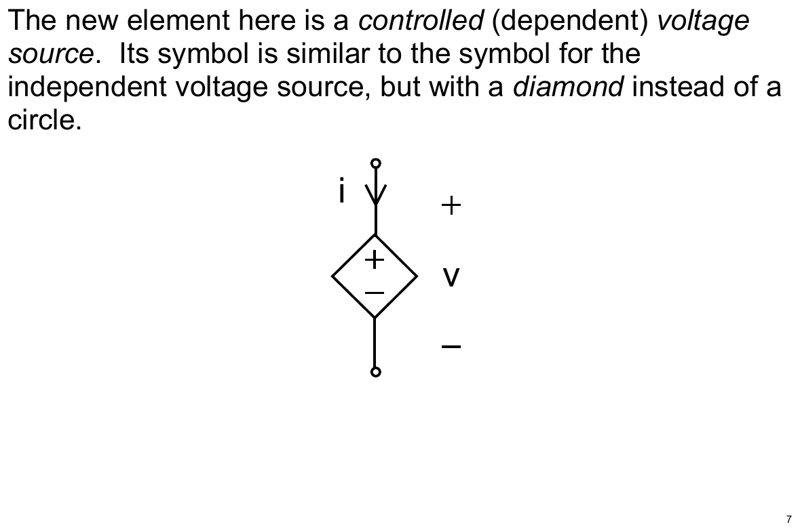

### 📐 Rule 26: the four controlled sources

| Name | Letter | Makes | Controlled by | Equation |
|---|---|---|---|---|
| VCVS | E | a voltage | a voltage | v = A v_x |
| CCCS | F | a current | a current | i = β i_x |
| CCVS | H | a voltage | a current | v = r i_x |
| VCCS | G | a current | a voltage | i = g_m v_x |

**What it means:**
- The diamond's inside (+/− or an arrow) says voltage or current, like a normal source.
- The label (A v1, β ib, g_m v_gs…) says what controls it.
- The gain can be dimensionless (A, β), in ohms (r) or in siemens (g_m).

**Use it when:** modelling amplifiers and transistors.

**Tip:** write down the controlling variable as a symbol first (v1, ib, v_gs). Then express it in node voltages. Then substitute.

---

## 2. Amplifier models

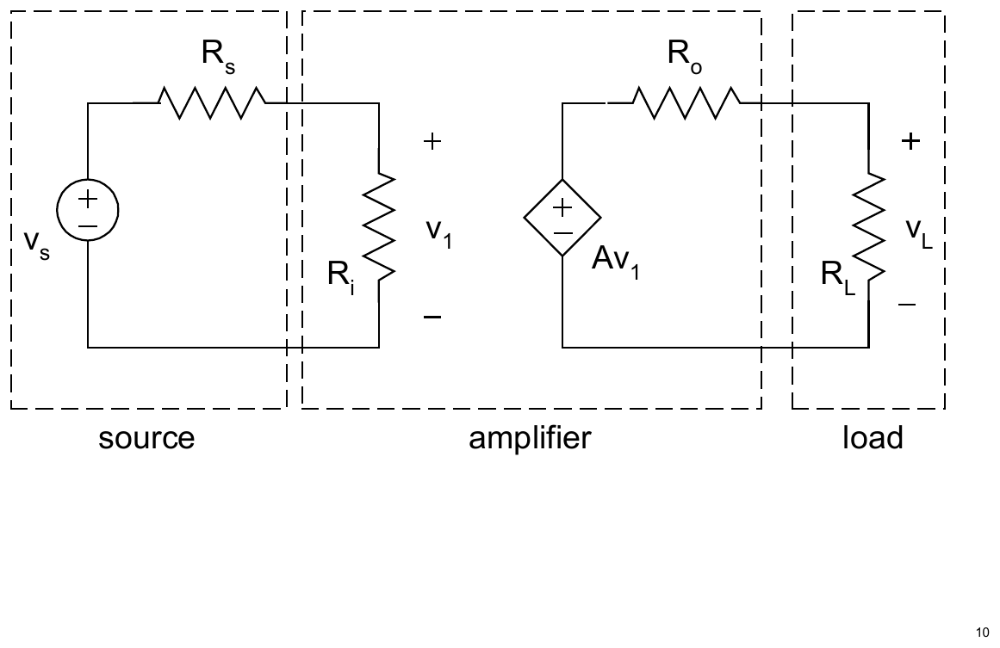

**How to read this diagram:**
- Left: the source vs with its internal resistance Rs.
- Middle: the amplifier. Ri is its input resistance. A v1 is a VCVS. Ro is its output resistance.
- Right: the load RL.

### 📐 Equation 28: voltage amplifier gain
$$\frac{v_L}{v_s} = \frac{R_i}{R_s + R_i} \cdot A \cdot \frac{R_L}{R_o + R_L}$$

Two voltage dividers and a gain.

**What it means:** a good voltage amplifier has **Ri ≫ Rs** (big input resistance) and **Ro ≪ RL** (small output resistance). Then vL ≈ A vs.

The other three models:

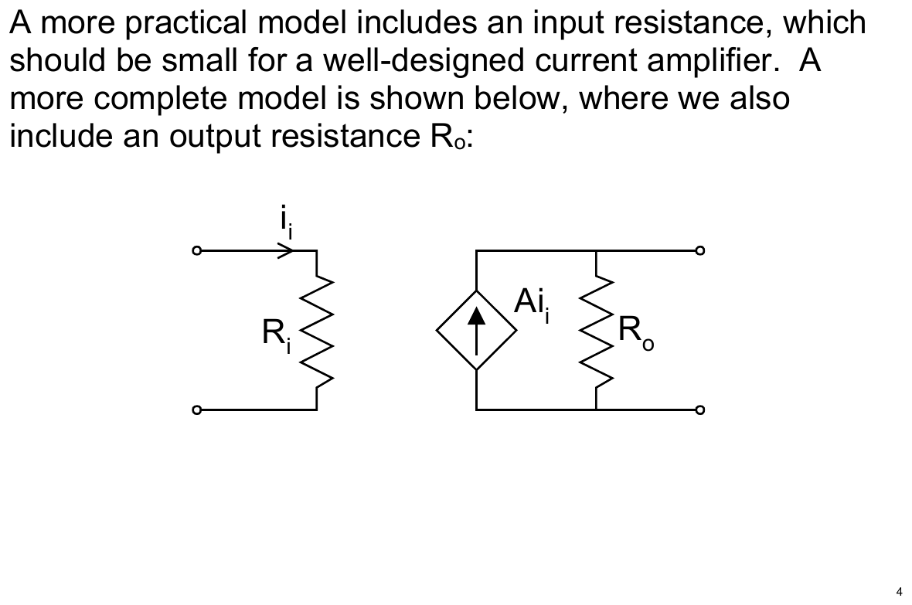

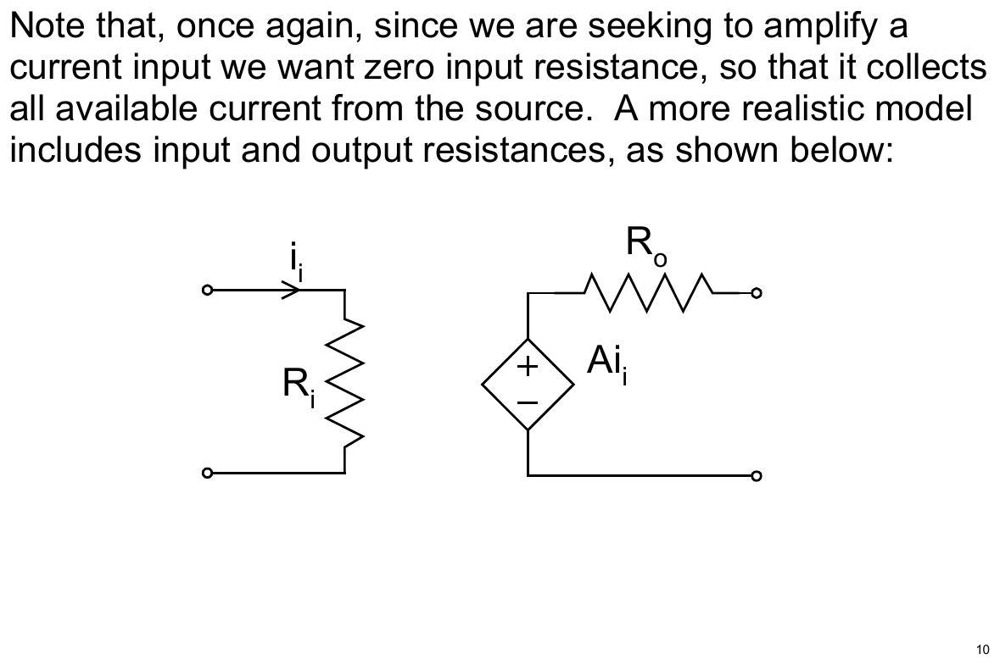

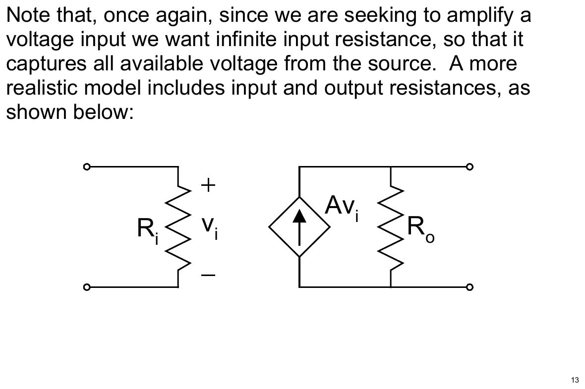

| Amplifies | Wants Ri | Wants Ro |
|---|---|---|
| a voltage (input) | large | |
| a current (input) | small | |
| to give a voltage (output) | | small |
| to give a current (output) | | large |

### 📐 Equation 31: decibels
$$\text{gain (dB)} = 20 \log_{10}\left|\frac{v_{out}}{v_{in}}\right|$$

×10 = 20 dB. ×100 = 40 dB. ×√2 = 3 dB. ×0.5 = −6 dB.

To undo: |gain| = 10^(dB/20). 30 dB → 31.62.

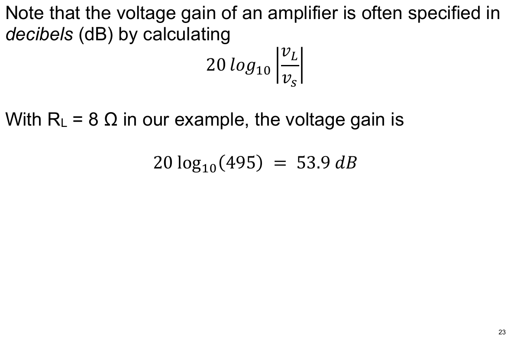

---

## 3. Thévenin with controlled sources

### 📐 Rule 27: don't turn off controlled sources

For superposition and for Rth, turn off only the **independent** sources.

A controlled source stays. Its value will just come out of the equations.

**Test-source method for Rth:**
1. Turn off the independent sources.
2. Put a test voltage v_t across the terminals (or a test current).
3. Find the current i_t it supplies.
4. Rth = v_t / i_t.

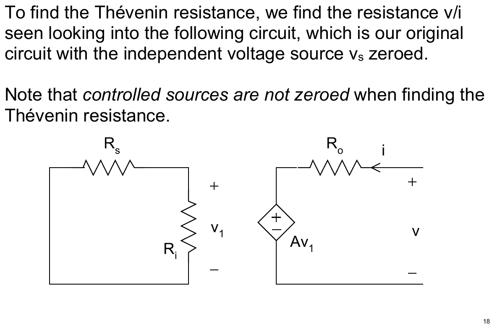

**How to read this diagram:**
- vs is zeroed. Now nothing drives Ri, so v1 = 0 and A v1 = 0.
- So looking in from the output you see only Ro: **Rth = Ro**.

---

## 4. Transistor models

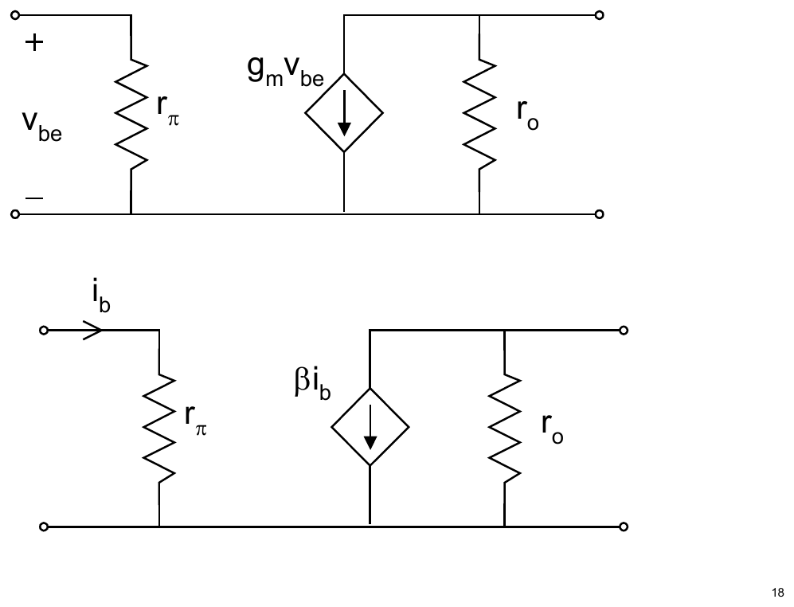

**How to read this diagram:**
- Top: VCCS model, current g_m v_be.
- Bottom: CCCS model, current β i_b.
- They are the same if g_m v_be = β i_b, i.e. β = g_m rπ.

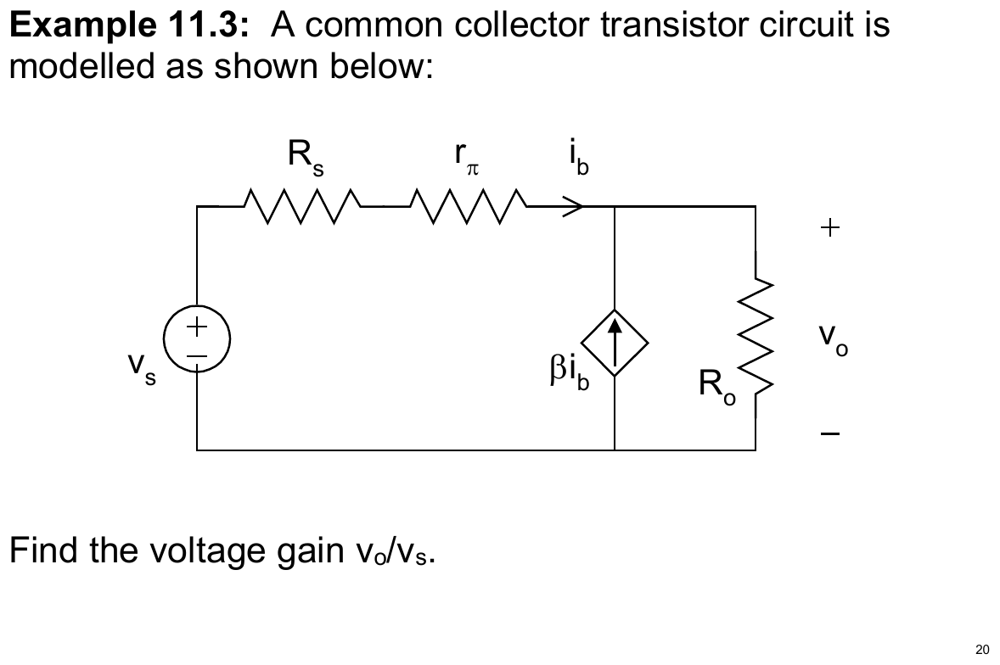

Example 11.3 (emitter follower): KCL gives (1 + β) i_b through Ro. KVL round the input loop gives:

$$\frac{v_o}{v_s} = \frac{(1+\beta)R_o}{R_s + r_\pi + (1+\beta)R_o}$$

Just under 1. The resistance Ro looks (1 + β) times bigger from the input.

### 📐 Equation 29: Rth with a CCCS feeding the output node
$$R_{th} = R_o \parallel \frac{R_s + r_\pi}{\beta + 1}$$

**What it means:** from the output, the input resistors look (β + 1) times **smaller**. The transistor current helps any current you push in.

**Use it when:** the CCCS pushes its current into the output node, controlled by the current flowing **towards** that node through Rs + rπ (Final 2025 Q1b, Homework 2 Q1c). Otherwise do the test source.

---

## Worked example: Final 2025 Q1b

Vs, Rs = 50 Ω and Rpi = 5600 Ω in series to node A. A CCCS F pushes β I(Rpi) from B up into A, with β = 200. Ro = 100 kΩ from A to B.

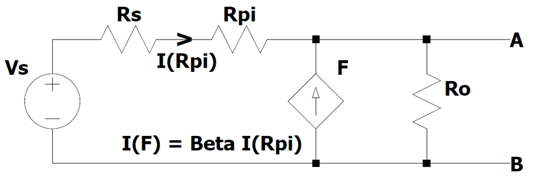

Find Rth between A and B.

**Step 1.** Turn off Vs (short). Keep F (Rule 27).

**Step 2.** Put a test voltage v_t at A.

I(Rpi) flows towards A. With Vs = 0: I(Rpi) = (0 − v_t)/(Rs + Rpi) = −v_t/5650.

**Step 3.** KCL at A. The test source must supply:

$$i_t = \frac{v_t}{R_o} - I(R_{pi}) - \beta I(R_{pi}) = v_t\left(\frac{1}{R_o} + \frac{1 + \beta}{R_s + R_{pi}}\right)$$

**Step 4.**

$$R_{th} = \frac{v_t}{i_t} = 100\,\text{k} \parallel \frac{5650}{201} = 100\,\text{k} \parallel 28.11 = 28.1\ \Omega$$

**Official answer: 28.1 Ω.** ✓

The value of Vs (a sine wave) doesn't matter for Rth.

---

## Worked example: Final 2023 Q3 (50 marks)

Vs drives the gate through Rs. No gate current (ig = 0). A VCCS g_m v_gs flows from the top (drain) node down to the source node S. R1 from S to ground. R2 from the drain node to ground. Vo across R2.

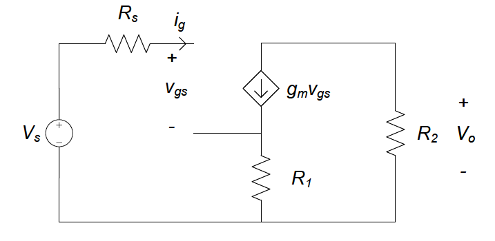

**(a) Find H = Vo/Vs.**

No gate current, so nothing drops across Rs. The gate is at Vs.

v_gs = Vs − v_S.

The controlled current flows down through R1: v_S = g_m v_gs R1.

So v_gs = Vs − g_m v_gs R1 → v_gs = Vs / (1 + g_m R1).

The same current flows **up** through R2 (out of ground, into the drain node). So Vo = −g_m v_gs R2.

### 📐 Equation 30: VCCS amplifier with a source resistor
$$H = \frac{V_o}{V_s} = \frac{-g_m R_2}{1 + g_m R_1}$$

Rs is not in the answer: no current flows in it.

**(b) Rs = 1 kΩ, R1 = 500 Ω, R2 = 10 kΩ. Find g_m for H = 20 dB.**

20 dB → |H| = 10 (Equation 31).

g_m × 10 000 / (1 + 500 g_m) = 10

10 000 g_m = 10 + 5000 g_m → 5000 g_m = 10 → **g_m = 2 mS**.

**Resit 2024 Q3:** R1 = 470 Ω, R2 = 22 kΩ, 30 dB → |H| = 31.62.

g_m (22 000 − 31.62 × 470) = 31.62 → **g_m = 4.43 mS**.

**Hidden structure:** if g_m R1 ≫ 1, H → −R2/R1. The gain stops depending on the transistor. That is negative feedback, the same idea as the op amp (Topic 7).

---

## Method: controlled sources

| You're asked for | Use |
|---|---|
| a gain vo/vs | name the controlling variable, KCL/KVL, eliminate it |
| a gain in a source → amplifier → load chain | Equation 28 (two dividers and A) |
| Rth with a controlled source | test source (Rule 27), or Equation 29 when it fits |
| Thévenin voltage of an amplifier | open circuit output: no current in Ro, so vth = A v1 |
| a component value for a gain in dB | |H| = 10^(dB/20), then solve Equation 30 (or your H) |
| max power from an amplifier | RL = Rth = Ro (Topic 4 Equation 22) |

---

Next: [End-of-topic test](../questions/06-controlled-sources.md)
