# Topic 7: Operational amplifiers

Slide exercises: Lecture 12 Examples 12.1 to 12.4, Self test 12.1 · Lecture 13 Examples 13.1, 13.2, Self test 13.1 · Lecture 14 Example 14.2 · Homework 2 Q2 (2026 and 2025) · Past finals: Resit 2022 Q2 · and every op-amp filter in Q2 and Q1e (Topic 15)

Slides: Lecture 12, pages 1 to 38 · Lecture 13, pages 1 to 23 · Lecture 14, pages 1 to 24.

---

## The big idea

An op amp is a VCVS with a **huge** gain.

Wrap negative feedback round it, and the huge gain disappears from the answer.

What is left is set by **resistors only**.

 

Two rules do all the work:

**No current** flows into the inputs.

The two inputs sit at the **same voltage** (virtual short).

---

**How to use these notes:**
When you see 🧠, stop.
Answer it on paper first.
Then click to check.

---

## 🎯 In the final

Op amps are in **every** paper:

- **Q1e** (most years, 20%): an inverting amplifier with R ∥ C feedback (Topic 15).
- **Q2** (50 marks, most years): an op-amp filter (Topic 15).
- **Resit 2022 Q2:** a difference amplifier at dc (worked example below).
- **Homework 2 Q2:** the Howland current source.

The two rules below are what you apply. With capacitors, the resistors just become impedances.

---

## ⭐ Learn by heart from this topic

Open book: on your [exam sheet](../formula-sheet.md). But the two rules must be reflex.

- Rule 32, ideal op amp with negative feedback: **i+ = i− = 0** and **v+ = v−**.
- Equation 33, inverting: vo/vin = −Rf/R1.
- Equation 34, non-inverting: vo/vin = 1 + Rf/R1.
- Equation 35, buffer: vo = vin.
- Equation 36, summing: vo = −Rf (v1/R1 + v2/R2 + …).
- Equation 37, difference: vo = (R2/R1)(v2 − v1) when the two dividers match.

**Memory hook:** "No current in, no voltage between."

---

## 1. The ideal op amp

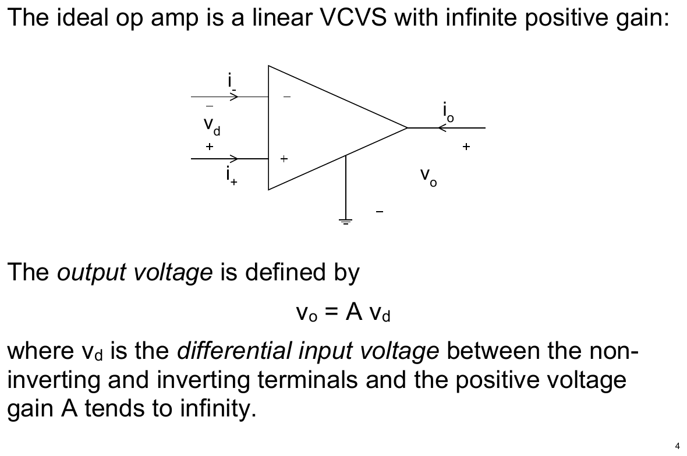

**How to read this diagram:**
- vd = v+ − v−, the differential input voltage.
- The output is a VCVS: vo = A vd, with A → ∞.
- The inputs draw no current.

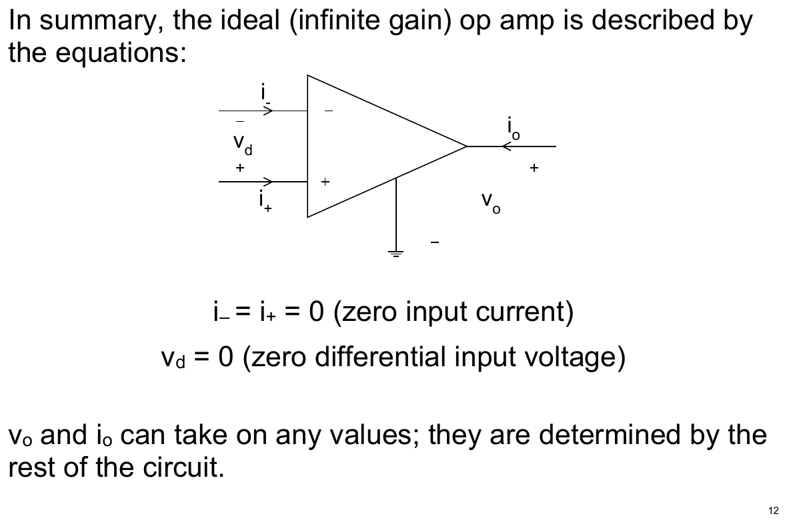

### 📐 Rule 32: the ideal op amp

With **negative feedback** (a path from the output back to the − input):

$$i_+ = i_- = 0 \qquad v_+ = v_-$$

The output voltage and output current are whatever the circuit needs.

**What it means:** vo is finite and A is infinite, so vd = vo/A = 0. The inputs are a "virtual short": same voltage, but no current flows between them.

**Use it when:** every op-amp question in this course.

**When not:** without negative feedback (output to the + input), the output runs away to a supply rail (§5).

---

## 2. The standard circuits

### Inverting amplifier

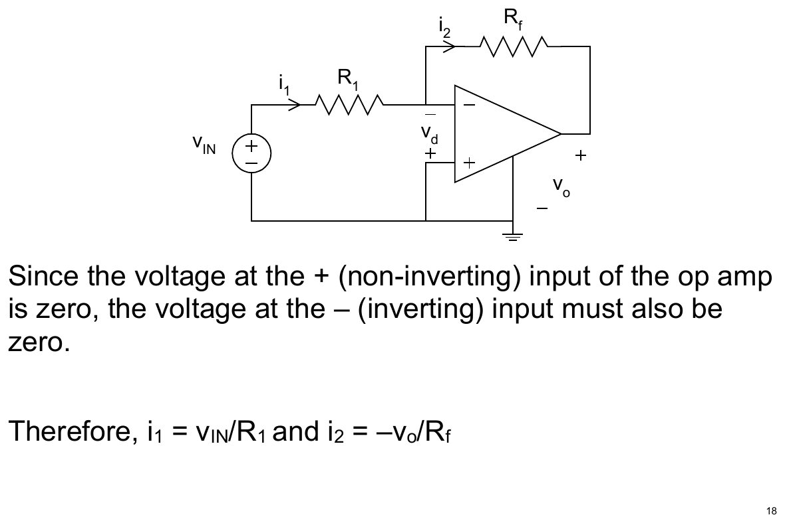

v+ = 0, so v− = 0. i1 = vIN/R1 flows on through Rf (no current into the op amp). vo = −i1 Rf.

### 📐 Equation 33: inverting amplifier
$$\frac{v_o}{v_{IN}} = -\frac{R_f}{R_1}$$

With impedances (Topic 15): vo/vin = −Zf/Z1.

### Non-inverting amplifier

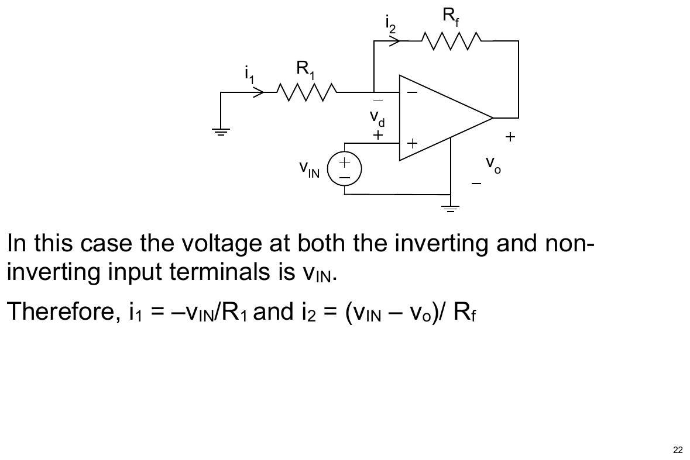

v− = v+ = vIN. Rf and R1 form a divider from vo: vIN = vo R1/(R1 + Rf).

### 📐 Equation 34: non-inverting amplifier
$$\frac{v_o}{v_{IN}} = 1 + \frac{R_f}{R_1}$$

### Buffer

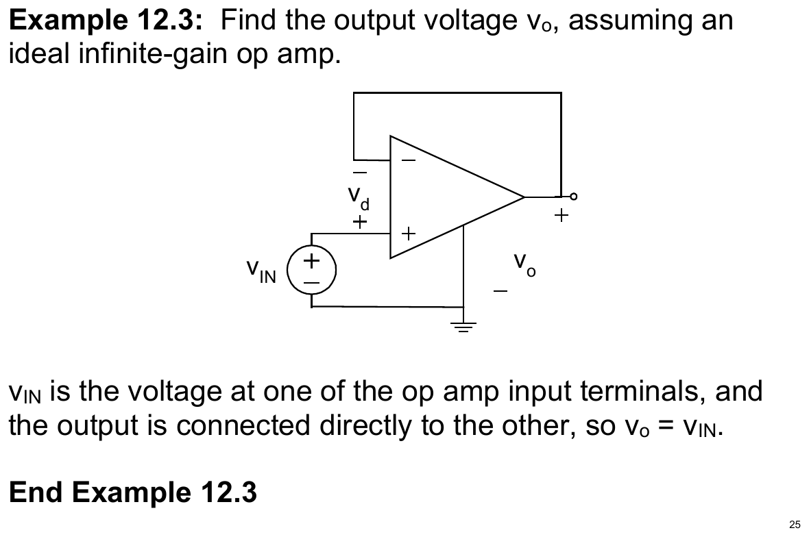

### 📐 Equation 35: unity-gain buffer
$$v_o = v_{IN}$$

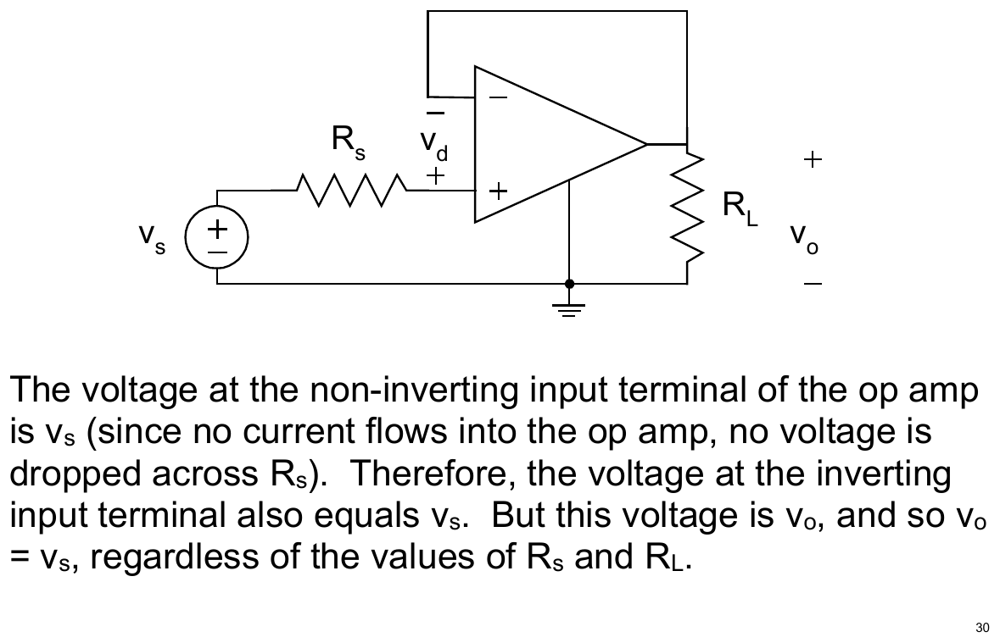

**Why bother?** The buffer draws no current from the source, and drives any load. So Rs and RL no longer form a divider: vo = vs exactly.

### Summing amplifier

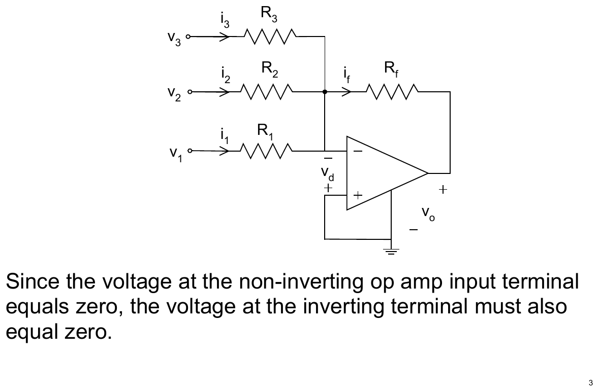

### 📐 Equation 36: inverting summing amplifier
$$v_o = -R_f\left(\frac{v_1}{R_1} + \frac{v_2}{R_2} + \frac{v_3}{R_3}\right)$$

The − input is at 0 V, so each input current is v_k/R_k. They all flow through Rf.

**Example 13.2:** an R-2R ladder feeding a summing amplifier is a **DAC**: vo = −E (b1/2 + b2/4 + b3/8).

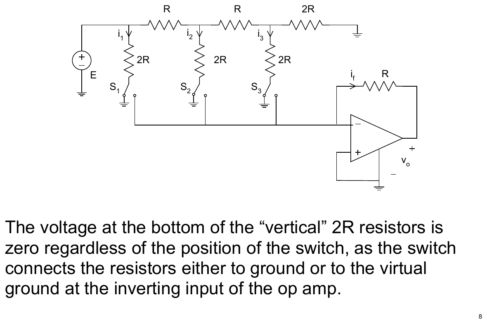

### Difference amplifier

### 📐 Equation 37: difference amplifier
$$v_o = \frac{R_2}{R_1}\,(v_2 - v_1)$$

v1 goes through R1 to the − input, with R2 feedback. v2 goes through R1 to the + input, with R2 to ground.

Works when **both** sides use the same R1 and R2. In general (Homework 2 (2025) Q2):

$$v_o = \frac{(R_1 + R_2) R_4}{R_1 (R_3 + R_4)}\,v_2 - \frac{R_2}{R_1}\,v_1$$

### 🧠 Check
Lecture 13 Self test 13.1: design vo = −(v1 + 2 v2). Inputs up to ±10 V, no resistor current above 2 mA.

Answer

Summing amplifier: need Rf/R1 = 1 and Rf/R2 = 2.

The feedback resistor carries the **sum** of the input currents. So keep that sum under 2 mA too.

One choice: **Rf = 20 kΩ, R1 = 20 kΩ, R2 = 10 kΩ**.

At 10 V: i1 = 0.5 mA, i2 = 1 mA, feedback 1.5 mA. All under 2 mA. ✓

---

## 3. Finite gain (how good is "ideal"?)

Example 12.4: a non-inverting amplifier with Rf = R1 = 10 kΩ and a finite op-amp gain A:

$$\frac{v_o}{v_{IN}} = \frac{R_1 + R_f}{R_1 + (R_1 + R_f)/A}$$

A = 10⁹ → 2.000. A = 10⁴ → 1.9996. Still 2.000 to three places.

**The gain is set by the resistors, not by the op amp.**

---

## 4. A real op amp

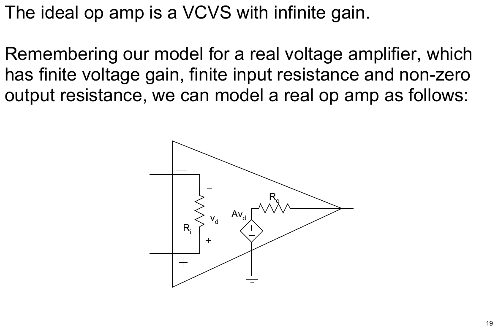

A real op amp has finite input resistance Ri (≈ 2 MΩ for a 741), output resistance Ro (≈ 75 Ω) and gain A (≈ 2 × 10⁵).

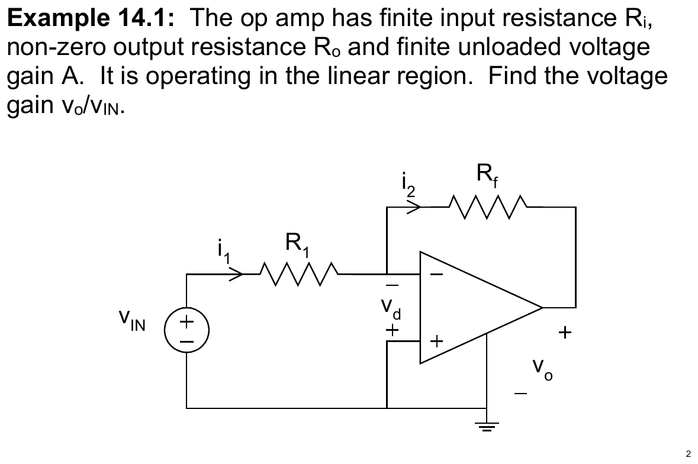

**Example 14.2:** inverting amplifier with R1 = 10 kΩ, Rf = 50 kΩ on a 741: gain = −4.99985. The ideal model says −5. Close enough for every exam answer.

Other real limits (Lecture 14): output can't go beyond the supply rails (saturation), limited output current, offset voltage, bias currents, finite slew rate.

---

## 5. Negative vs positive feedback

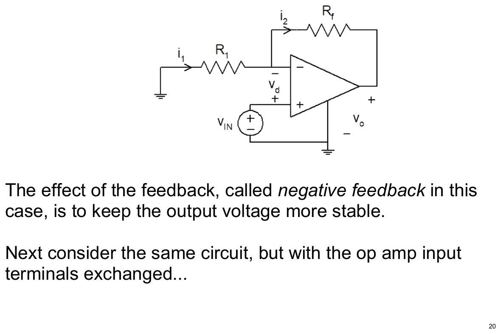

**Negative feedback** (output to the − input): if vo rises, vd falls, which pulls vo back down. Stable. Rule 32 works.

**Positive feedback** (output to the + input): if vo rises, vd rises, vo rises more. It runs to a rail. Rule 32 does **not** apply.

**Check before you use Rule 32:** is the feedback going to the − input?

---

## Worked example: Homework 2 Q2 (Howland current source)

Vs through R1 to node 2 (the + input, and the load). R2 from ground to node 3 (the − input). R3 from node 3 to the output (node 4). R4 from node 4 back to node 2. RL from node 2 to ground.

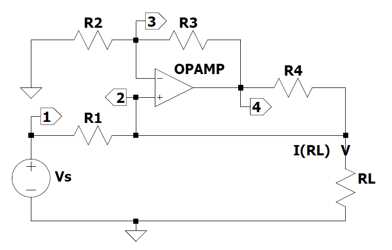

**(a)** Find R0 in I(RL) = Vs/R1 − e2/R0.

Rule 32: v− = v+ = e2. Node 3 is a non-inverting amplifier: e4 = e2 (1 + R3/R2).

KCL at node 2 (into node 2 from R1 and R4, out through RL):

$$I(R_L) = \frac{V_s - e_2}{R_1} + \frac{e_4 - e_2}{R_4} = \frac{V_s}{R_1} - e_2\left(\frac{1}{R_1} - \frac{R_3}{R_2 R_4}\right)$$

$$R_0 = \frac{R_1 R_2 R_4}{R_2 R_4 - R_1 R_3}$$

**(b) to (e)** R1 = R2 = 10 kΩ, R3 = R4 = 12 kΩ, RL = 1 kΩ, Vs = 10 V.

R2 R4 = 120 M = R1 R3. The denominator is **zero**: **R0 = ∞**.

So I(RL) = Vs/R1 = **1 mA**, whatever RL is. A perfect current source.

e2 = 1 mA × 1 kΩ = **1 V**. e4 = 1 × (1 + 12/10) = **2.2 V**.

**Hidden structure:** the bridge is "balanced" (R1/R2 = R4/R3). The op amp feeds exactly the current that RL would steal.

---

## Worked example: Resit 2022 Q2 (difference amplifier at dc)

Vs1 through Ri to the − input, Rf ∥ Cf feedback. Vs2 through Ri to the + input, Rf ∥ Cf to ground. Ri = 1 kΩ, Rf = 5 kΩ, Cf = 1 nF.

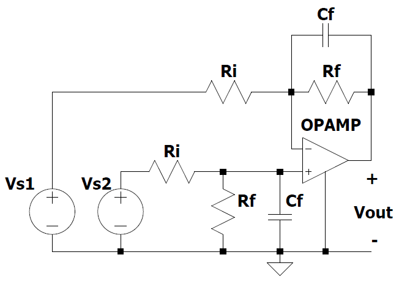

At dc the capacitors are open (Topic 8). So it is Equation 37 with R1 = Ri, R2 = Rf.

**(a)** H1(0) = −Rf/Ri = **−5**

**(b)** H2(0) = +Rf/Ri = **+5**

**(c)** Vs1 = −0.8 V, Vs2 = 1.2 V: Vout = 5 (1.2 − (−0.8)) = **10 V** (a constant).

At other frequencies replace Rf by Zf = Rf ∥ Cf: Final 2021 Q2 (Topic 15).

---

## Method: op amps

| You're asked for | Use |
|---|---|
| gain of a standard circuit | Equations 33 to 37 |
| any other op-amp circuit | Rule 32: v− = v+, no input current, then KCL at the − input (and at other nodes) |
| a circuit with capacitors | same, with impedances (Topic 15) |
| "is Rule 32 allowed?" | only with negative feedback (§5) |
| effect of finite gain | KCL with vd = vo/A. It changes the answer very little (§3) |

---

Next: [End-of-topic test](../questions/07-op-amps.md)
