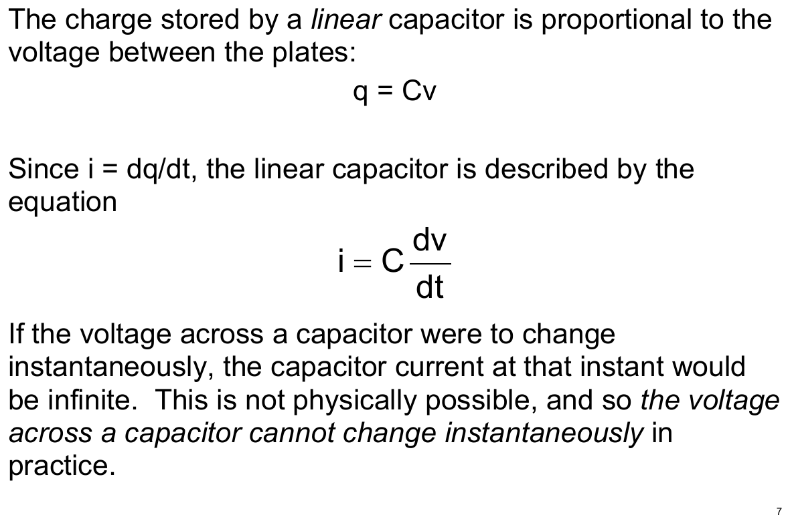
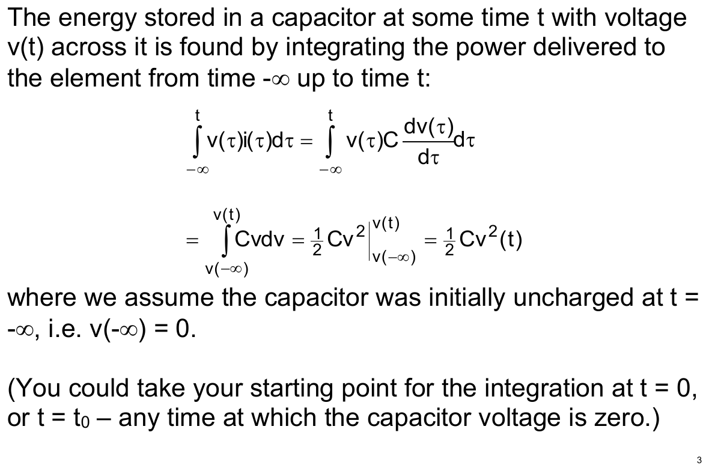
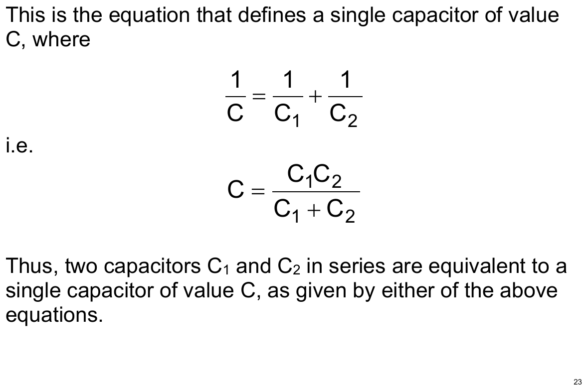
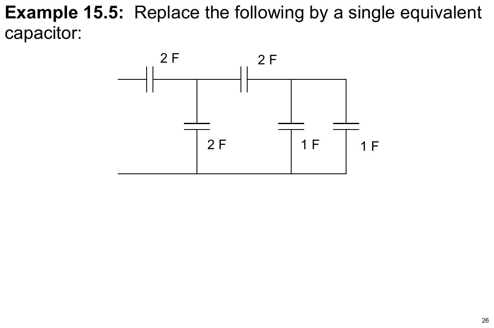
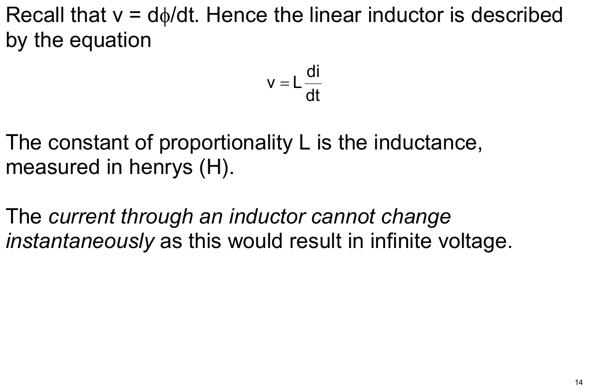
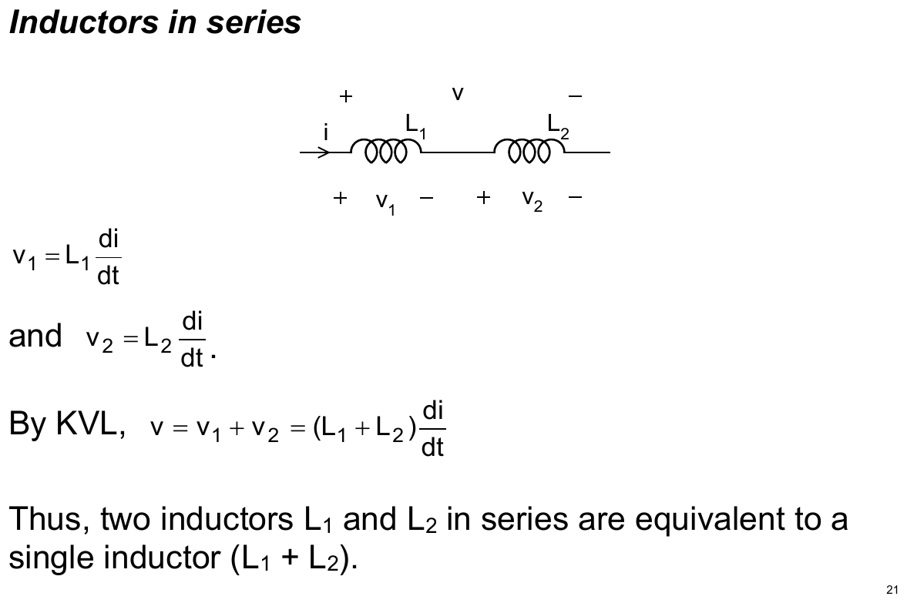
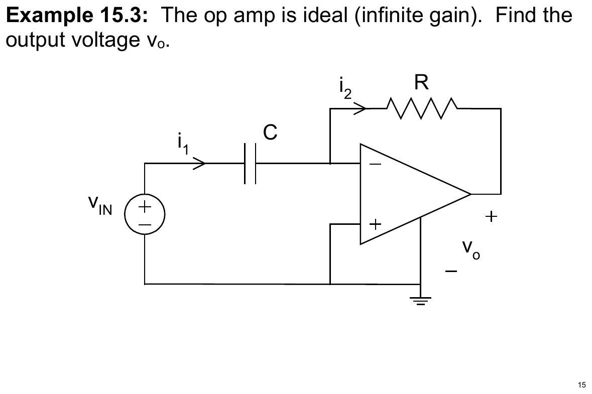
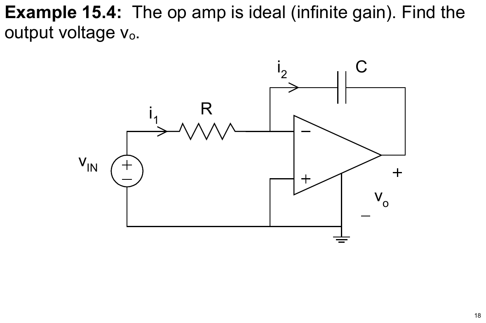
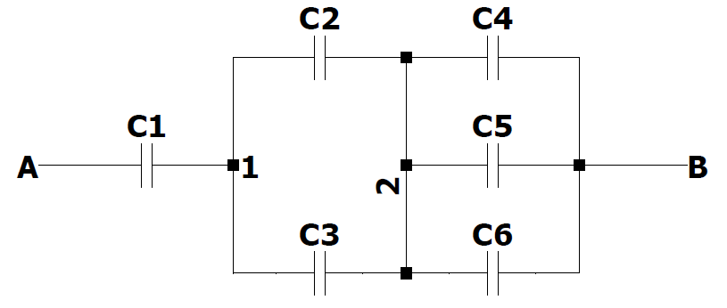

# Topic 8: Capacitors and inductors

Slide exercises: Lecture 15 Examples 15.3 to 15.5 · Lecture 16 Example 16.3 · Homework 2 Q1a (2026 and 2025) · Past finals: inside every transient, phasor and filter question

Slides: Lecture 15, pages 1 to 32, and Lecture 16, pages 1 to 31.

---

## The big idea

Resistors respond to **now**.

Capacitors and inductors respond to **change**.

 

A capacitor's current depends on how fast its **voltage** changes.

An inductor's voltage depends on how fast its **current** changes.

 

So a capacitor's voltage can't jump. An inductor's current can't jump.

That one fact solves every transient question (Topic 9).

---

**How to use these notes:**
When you see 🧠, stop.
Answer it on paper first.
Then click to check.

---

## 🎯 In the final

Never asked on its own in recent finals. But:

- **Every transient part of Q1** (one every year: Topic 9) needs the continuity rule and the dc behaviour below.
- **Every phasor, power and filter question** (Topics 11 to 15) uses the capacitor and inductor equations in impedance form.
- **Homework 2 Q1a:** combine six capacitors.

---

## ⭐ Learn by heart from this topic

Open book: on your [exam sheet](../formula-sheet.md). Know the "can't jump" rules cold.

- Equation 38: capacitor: q = Cv, i = C dv/dt. **v can't jump.**
- Equation 39: energy: w = ½ C v² (capacitor), w = ½ L i² (inductor).
- Equation 40: capacitors in **parallel add**. In **series**: 1/C = 1/C1 + 1/C2. (Opposite of resistors.)
- Equation 41: inductor: v = L di/dt. **i can't jump.**
- Equation 42: inductors combine like resistors: series add, parallel product/sum.
- Equation 43: op-amp integrator vo = −(1/RC)∫vin dt. Differentiator vo = −RC dvin/dt.

**Memory hook:** "Cap holds Voltage, Inductor holds I(current)."

---

## 1. The capacitor

Two conducting plates with an insulator between them.

### 📐 Equation 38: capacitor
$$q = C\,v \qquad i = C\,\frac{dv}{dt}$$

| Symbol | Means | Units |
|---|---|---|
| C | capacitance | farads (F). Usually pF, nF, μF |
| v | voltage across it | V |
| i | current into its + terminal | A |

**What it means:**
- Constant voltage → no current. At dc a capacitor is an **open circuit**.
- A sudden voltage jump would need infinite current. So **the capacitor voltage can't change instantly**.

**Integral form:**

$$v(t) = \frac{1}{C}\int_{t_0}^{t} i\,d\tau + v(t_0)$$

### 📐 Equation 39: stored energy
$$w_C = \tfrac{1}{2} C v^2 \qquad w_L = \tfrac{1}{2} L i^2$$

Capacitors and inductors **store** energy and give it back. They don't dissipate it. So their **average** power in AC is zero (Topic 12).

---

## 2. Capacitors in series and parallel

### 📐 Equation 40: combining capacitors
$$\text{parallel: } C = C_1 + C_2 \qquad \text{series: } \frac{1}{C} = \frac{1}{C_1} + \frac{1}{C_2}$$

**What it means:** capacitors combine the **opposite** way to resistors.

Parallel plates side by side = bigger plates = more C.

### 🧠 Check

Replace these by one capacitor.

Answer

Right end: 1 F ∥ 1 F = 2 F. In series with the 2 F before it: 1 F.

That 1 F is in parallel with the 2 F going down: 3 F.

In series with the first 2 F: 2 × 3/(2 + 3) = **6/5 F**.

---

## 3. The inductor

A coil of wire. Current makes a magnetic field. A changing field makes a voltage.

### 📐 Equation 41: inductor
$$v = L\,\frac{di}{dt} \qquad i(t) = \frac{1}{L}\int_{t_0}^{t} v\,d\tau + i(t_0)$$

| Symbol | Means | Units |
|---|---|---|
| L | inductance | henries (H). Usually μH, mH |

**What it means:**
- Constant current → no voltage. At dc an inductor is a **short circuit**.
- **The inductor current can't change instantly.**

### 📐 Equation 42: combining inductors
Series: L = L1 + L2. Parallel: L = L1 L2/(L1 + L2). Like resistors.

**Example 16.3** (same picture as Example 15.5, with henries): **28/9 H**.

**Coupled coils** (Lecture 16 end) lead to the transformer: Topic 13.

---

## 4. Op-amp integrator and differentiator

### 📐 Equation 43: integrator and differentiator
$$\text{differentiator: } v_o = -RC\,\frac{dv_{IN}}{dt} \qquad \text{integrator: } v_o = -\frac{1}{RC}\int v_{IN}\,dt$$

Same op-amp rules as Topic 7 (v− = 0, no input current). The capacitor current is C dv/dt.

Put a resistor in parallel with the integrator's capacitor and you get a **lossy integrator**: a low-pass filter (Topic 15, and Homework 3 (2025) Q2 in Topic 9).

---

## Worked example: Homework 2 Q1a

C1 from A to node 1. C2 and C3 both from node 1 to node 2. C4, C5 and C6 all from node 2 to B. All 1000 pF.

**Step 1.** C2 ∥ C3 = 2000 pF. C4 ∥ C5 ∥ C6 = 3000 pF (Equation 40).

**Step 2.** Three in series: 1000, 2000, 3000 pF.

$$\frac{1}{C_{AB}} = \frac{1}{1000} + \frac{1}{2000} + \frac{1}{3000} = \frac{6 + 3 + 2}{6000}$$

**C_AB = 6000/11 = 545.5 pF**

---

## Method: C and L

| You're asked for | Use |
|---|---|
| current from a voltage waveform | i = C dv/dt (slope × C) |
| voltage from a current waveform | v = (1/C)∫i dt + v(0) |
| combine capacitors | parallel add, series reciprocal (Eq 40) |
| combine inductors | like resistors (Eq 42) |
| energy stored | ½Cv², ½Li² (Eq 39) |
| behaviour at dc (steady state) | C = open, L = short (Topic 9 Rule 44) |
| what happens at a switching instant | vC and iL keep their values (Topic 9 Rule 47) |

---

Next: [End-of-topic test](../questions/08-capacitors-inductors.md)
