# Topic 9: First-order transients

Slide exercises: Lecture 17 Examples 17.1 to 17.3 · Homework 2 Q1d · Homework 3 (2025) Q1c, Q1d, Q2 · Past finals: Final 2025 Q3, 2024 Q1b, 2023 Q1c, 2022 Q1c, 2021 Q1c · Resit 2025 Q1b, 2024 Q1c, 2023 Q1c, 2022 Q1c, 2021 Q1c

Slides: Lecture 17, pages 1 to 39.

---

## The big idea

Flip a switch in a circuit with **one** capacitor or **one** inductor.

Every voltage and current moves from an old value to a new value along an **exponential**.

 

You need only three numbers:

1. where it **starts**,
2. where it **ends**,
3. how **fast**: the time constant τ.

Then one formula gives the answer at any time.

---

**How to use these notes:**
When you see 🧠, stop.
Answer it on paper first.
Then click to check.

---

## 🎯 In the final

**Every** paper has one, usually Q1b or Q1c, 20% of Q1. And Final 2025 Q3 was a **whole 50-mark question** on it.

| Paper | Circuit | Asked for |
|---|---|---|
| Final 2025 Q3 | RC driven by a 0/8 V square wave | sketch, period, Vmax, Vmin |
| Final 2024 Q1b, Resit 2025 Q1b | R–R–L, a 100 μs (or 50 μs) pulse | inductor current or e2 after the pulse |
| Final 2023 Q1c, Resit 2024 Q1c | R–L–R, step 1 → 2 V (or 0 → 2 V) | e3 or I(R4) 50 μs later |
| Final 2022 Q1c, Resit 2023 Q1c | R–C, step 1 → 2 V (or 1 → 0 V) | e2 later |
| Final 2021 Q1c, Resit 2022 Q1c | switch closes on L–R | i4 or e3 |
| Resit 2021 Q1c | switch, R–(R ∥ L) | I(L4) via Thévenin |

---

## ⭐ Learn by heart from this topic

Open book: on your [exam sheet](../formula-sheet.md). This formula you should write without thinking.

- Rule 44: dc steady state: capacitor = **open**, inductor = **short**.
- Equation 45: X(t) = X(∞) + [X(t0) − X(∞)] e^(−(t − t0)/τ).
- Equation 46: τ = R C or τ = L / R, with R = the **Thévenin resistance** seen by the C or L.
- Rule 47: v_C and i_L are **continuous**: same value just after a switch as just before.
- Equation 48: square wave of height V into RC, half-period T/2: Vmax = V/(1 + x), Vmin = V x/(1 + x), x = e^(−T/(2τ)).
- After 1τ: 63% of the way. After 5τ: more than 99%.

**Memory hook:** "Start, end, tau. Then plug in."

---

## 1. DC steady state

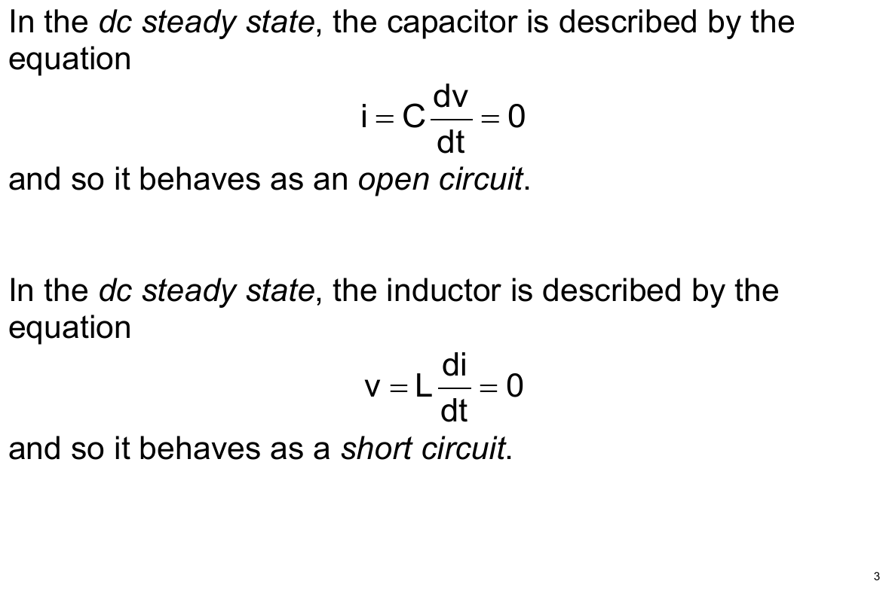

### 📐 Rule 44: dc steady state

After a long time with constant (dc) sources:

- capacitor: dv/dt = 0 → i = 0 → **open circuit**,
- inductor: di/dt = 0 → v = 0 → **short circuit**.

**Use it when:** finding the start value (before the switch, "for a long time") and the end value (long after).

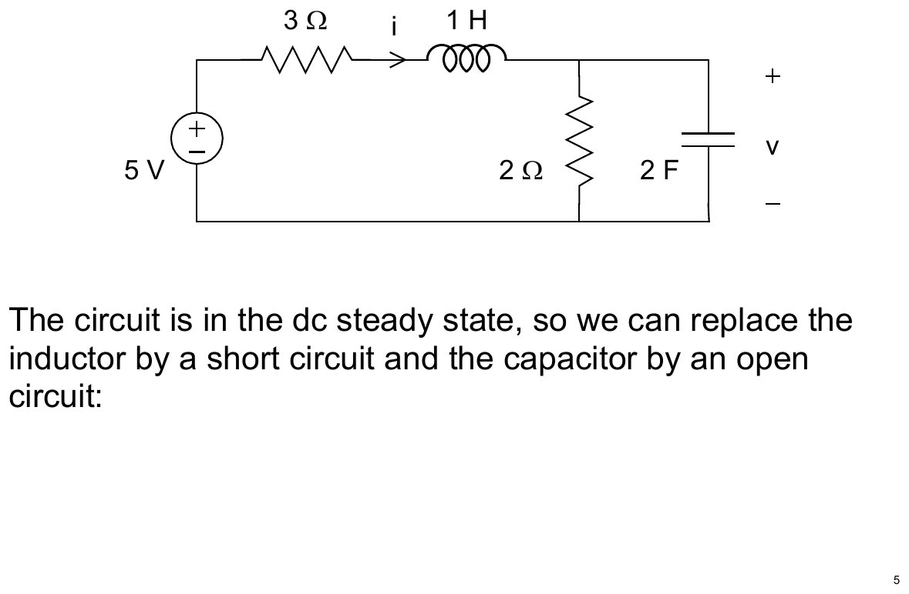

### 🧠 Check
Example 17.1: 5 V, 3 Ω and 1 H in series into 2 Ω ∥ 2 F. Find the steady state v and i.

Answer

Inductor → short. Capacitor → open. So 5 V drives 3 Ω + 2 Ω.

**i = 1 A**, **v = 2 V** (across the 2 Ω).

---

## 2. The first-order formula

An RC circuit: Ri + v = E with i = C dv/dt gives RC dv/dt + v = E.

The solution moves exponentially from v(0) to E.

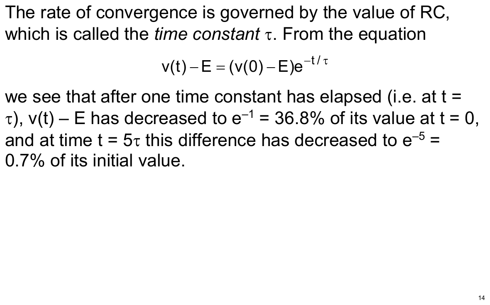

### 📐 Equation 45: generic first-order transient
$$X(t) = X(\infty) + \big[X(t_0) - X(\infty)\big]\,e^{-(t - t_0)/\tau} \qquad (t \ge t_0)$$

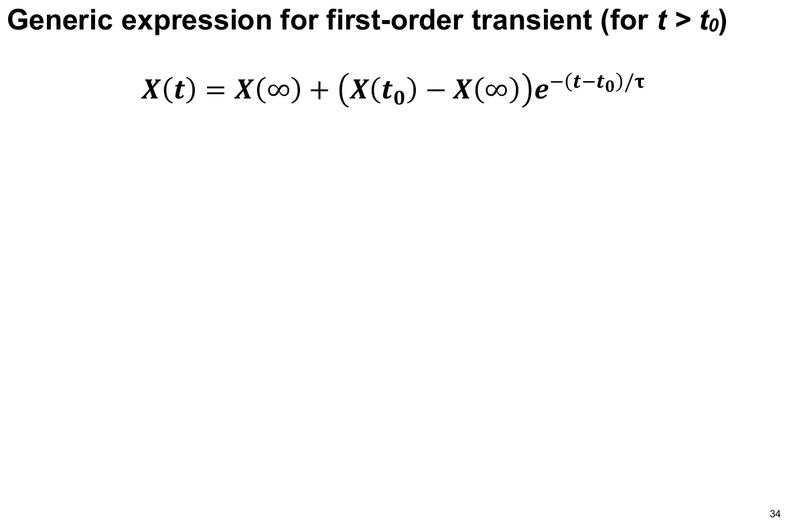

| Symbol | Means |
|---|---|
| X | **any** voltage or current in the circuit |
| t0 | the switching time (often 0) |
| X(t0) | the value just after switching |
| X(∞) | the new steady-state value (Rule 44 on the new circuit) |
| τ | the time constant |

**What it means:** the gap between X and its final value shrinks by e^(−1) = 0.368 every τ.

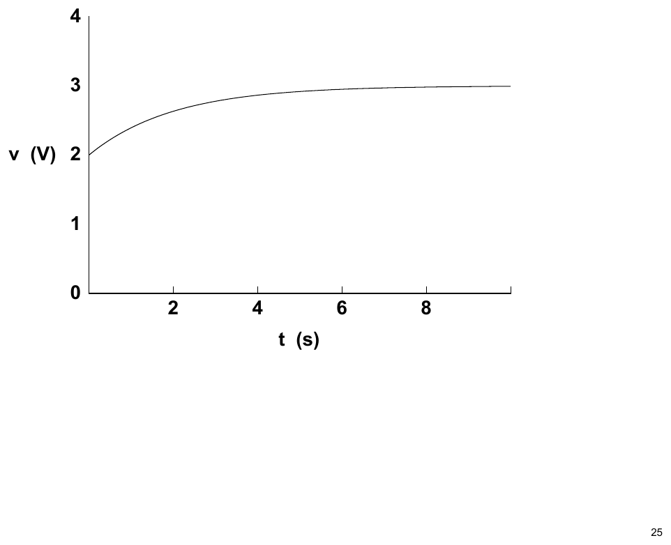

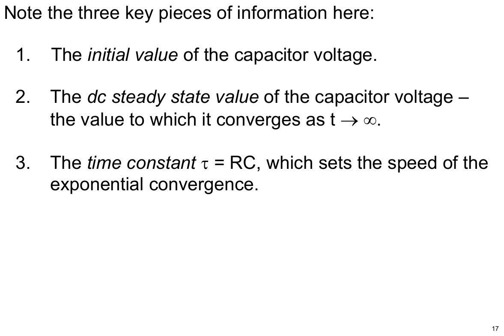

### 📐 Equation 46: the time constant
$$\tau = R_{th} C \qquad \text{or} \qquad \tau = \frac{L}{R_{th}}$$

R_th = the Thévenin resistance seen by the capacitor or inductor, with the independent sources **off** (Topic 4 Rule 20).

**Check your units:** kΩ × nF = μs. kΩ × μF = ms. mH / kΩ = μs.

### 📐 Rule 47: continuity
- A capacitor **voltage** has the same value just after a switch as just before.
- An inductor **current** has the same value just after a switch as just before.

Other quantities (resistor currents, the capacitor current, the inductor voltage) **can** jump.

**Safe method:** find v_C(t) or i_L(t) first (they're continuous), then get anything else from them with Ohm and KVL.

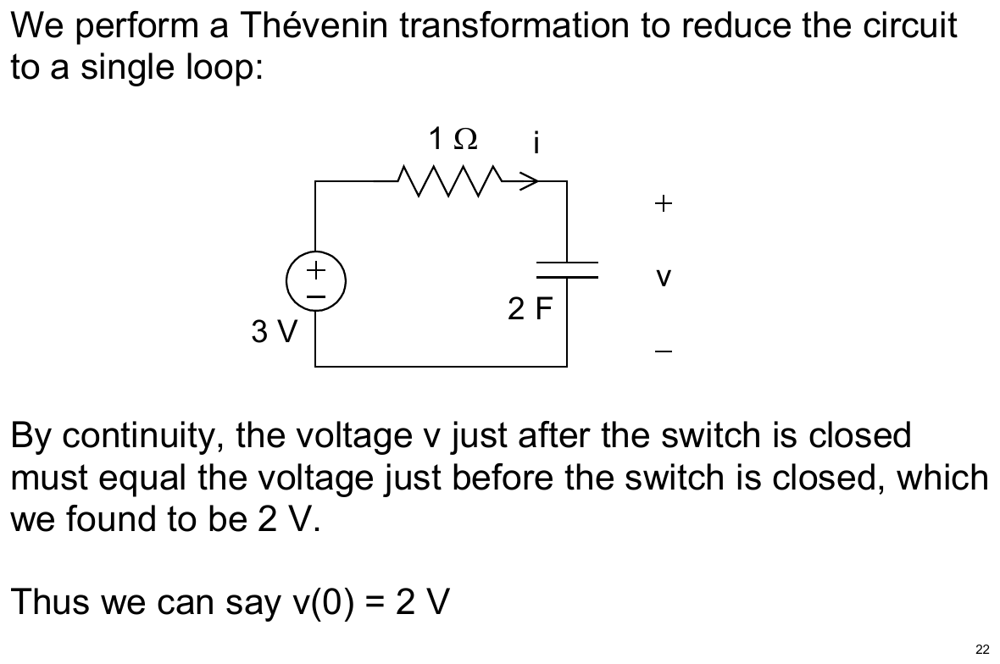

**Example 17.2:** before the switch v = 2 V. After, the circuit seen by the 2 F capacitor is 3 V behind 1 Ω. τ = 2 s. v(t) = 3 − e^(−t/2) V.

---

## 3. RL circuits

The same formula with the inductor **current** and τ = L/R.

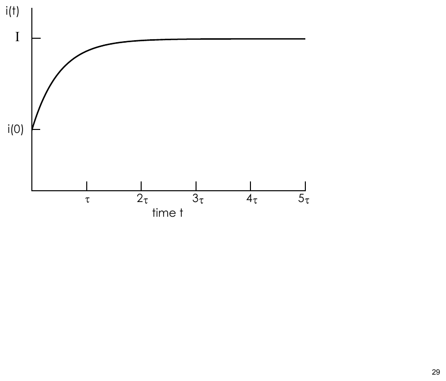

**Example 17.3:** 4 A Norton source, 0.5 Ω, 5 H: τ = 10 s, i(t) = 4(1 − e^(−t/10)) A.

---

## Worked example: Final 2023 Q1c (a step)

V1 – R2 = 1 kΩ – L3 = 100 mH – R4 = 1200 Ω – ground. V1 has been 1 V for a long time. At t = 100 μs it jumps to 2 V. Find e3 at t = 150 μs.

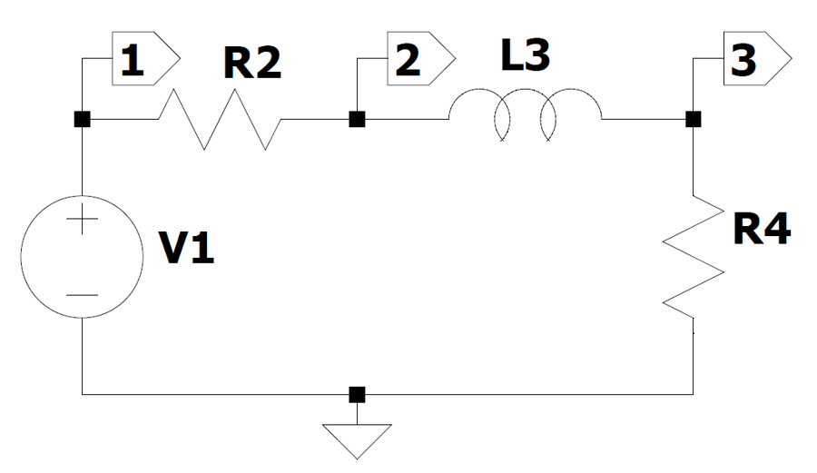

**Start.** Long time at 1 V: inductor = short (Rule 44). i = 1/2200 = 0.4545 mA.

**End.** At 2 V: i(∞) = 2/2200 = 0.9091 mA.

**τ.** The inductor sees R2 + R4 = 2200 Ω. τ = 0.1/2200 = 45.45 μs.

**Formula** (t0 = 100 μs, t − t0 = 50 μs):

i = 0.9091 + (0.4545 − 0.9091) e^(−50/45.45) = 0.9091 − 0.4545 × 0.3329 = 0.7578 mA.

**Answer.** e3 = R4 i = 1200 × 0.7578 mA = **0.909 V**.

---

## Worked example: Final 2024 Q1b (a pulse)

V1 – R1 = 1200 Ω – R2 = 15 Ω – L = 100 mH – ground. V1 = 5 V from 0 to 100 μs, then 0. Find the inductor current I at 200 μs.

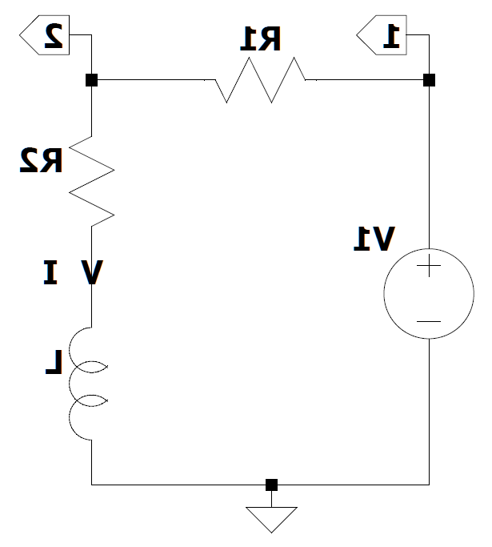

**τ** = L/(R1 + R2) = 0.1/1215 = 82.3 μs (the same in both stages).

**Stage 1 (0 to 100 μs):** from 0 towards 5/1215 = 4.115 mA.

i(100 μs) = 4.115 (1 − e^(−100/82.3)) = 4.115 × 0.7033 = 2.894 mA.

**Stage 2 (after 100 μs):** from 2.894 mA (Rule 47) towards 0.

i(200 μs) = 2.894 e^(−100/82.3) = 2.894 × 0.2967 = **0.859 mA**.

⚠️ **Direction.** The figure's arrow for I points from L up towards R2: opposite to the way the current really flows (out of V1's + terminal, through R1, R2, L to ground). So as drawn, **I = −0.859 mA**. Write the magnitude and say which way it flows.

**Resit 2025 Q1b:** 2 V for 50 μs. i(50 μs) = (2/1215)(1 − e^(−50/82.3)) = 0.750 mA. i(100 μs) = 0.750 × e^(−50/82.3) = 0.408 mA. Then V1 = 0, so e2 = 0 − R1 i = **−0.490 V**. Negative: the inductor keeps pushing current after the source switches off.

---

## Worked example: Final 2025 Q3 (a square wave, 50 marks)

A 0/8 V square wave, 5 kHz, 50% duty (low first), drives R = 10 kΩ in series with C = 22 nF. Find the steady-state Vc(t).

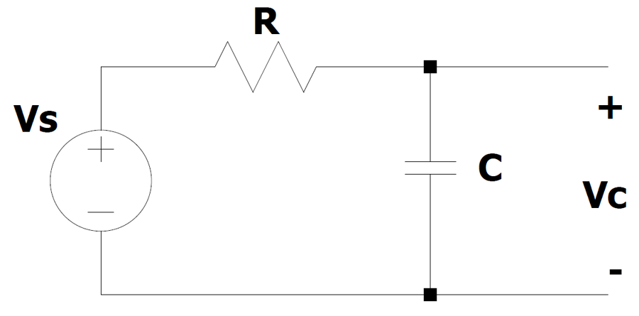

**(b) Period.** The capacitor follows the source: **T = 1/5 kHz = 200 μs**.

**τ** = RC = 10 k × 22 n = 220 μs. Each half-period is T/2 = 100 μs.

x = e^(−100/220) = 0.6348.

**Steady state:** each half-period, Vc moves part of the way. In the high half it rises from Vmin towards 8 V. In the low half it falls from Vmax towards 0.

Vmax = 8 + (Vmin − 8) x and Vmin = Vmax x.

Solve:

### 📐 Equation 48: RC driven by a square wave (steady state)
$$V_{max} = \frac{V}{1 + x} \qquad V_{min} = \frac{V\,x}{1 + x} \qquad x = e^{-T/(2\tau)}$$

**(c)** Vmax = 8/1.6348 = **4.894 V** (official)

**(d)** Vmin = 8 × 0.6348/1.6348 = **3.106 V** (official)

**(a) Sketch:**

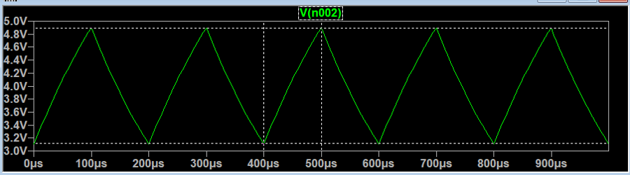

### Drawing checklist: square wave into RC
1. Draw the square wave first, faintly: 0 to 8 V, period 200 μs.
2. Mark Vmax = 4.894 V and Vmin = 3.106 V. They are symmetric about the average, 4 V.
3. During each **high** half: a rising curve, **concave down** (steep at first, then flattening).
4. During each **low** half: a falling curve, **concave up**.
5. Peaks exactly at the switching instants (100, 300, 500 μs…). Troughs at 0, 200, 400 μs…
6. Label the period (200 μs), Vmax, Vmin and the time axis.

Because τ ≈ 2 × (T/2), the curves are only gently bent. It looks almost like a triangle wave.

---

## Method: transients

| You're asked for | Use |
|---|---|
| a value long before the switch | Rule 44 on the old circuit |
| the value just after the switch | Rule 47 for v_C or i_L. Others: from v_C or i_L |
| the final value | Rule 44 on the new circuit |
| τ | R_th C or L/R_th, sources off (Eq 46) |
| a value at time t | Equation 45 with t − t0 |
| a pulse | two stages. The end of stage 1 is the start of stage 2 |
| a square wave in steady state | Equation 48 |
| a switch plus a divider (Resit 2021 Q1c) | Thévenin seen by L or C first |
| op amp with R ∥ C feedback and a step | lossy integrator: vo(∞) = −R2/R1 × V, τ = R2 C |

---

Next: [End-of-topic test](../questions/09-transients.md)
