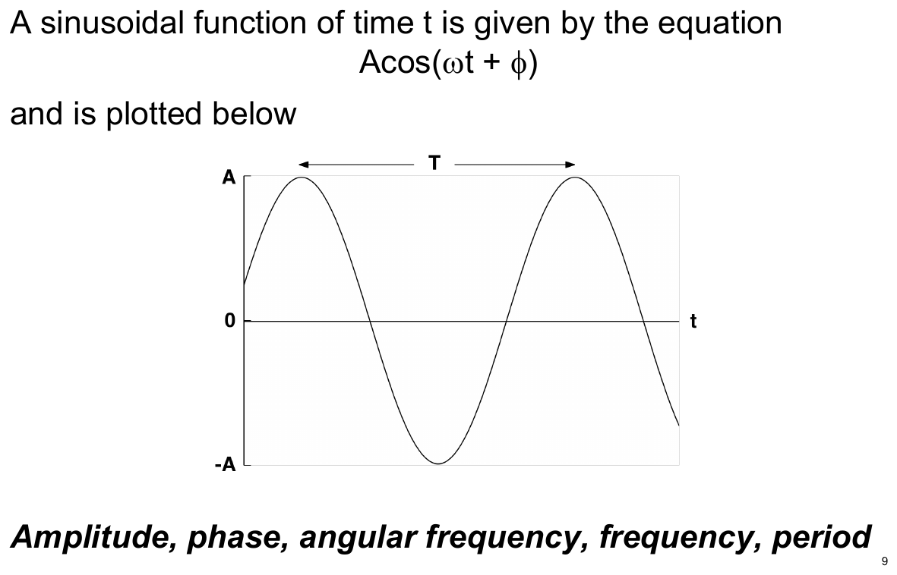
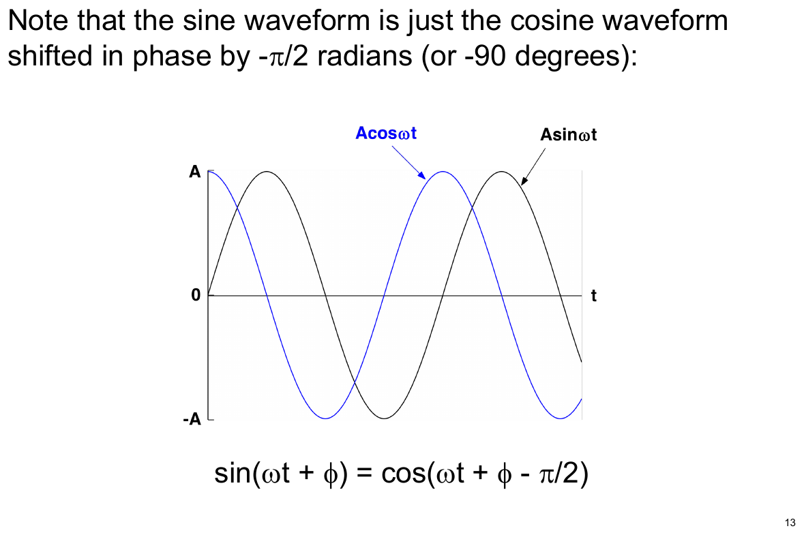
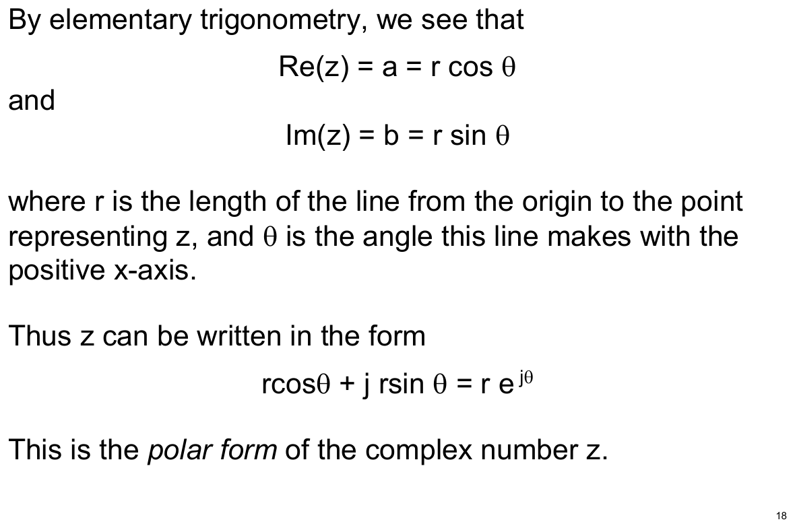
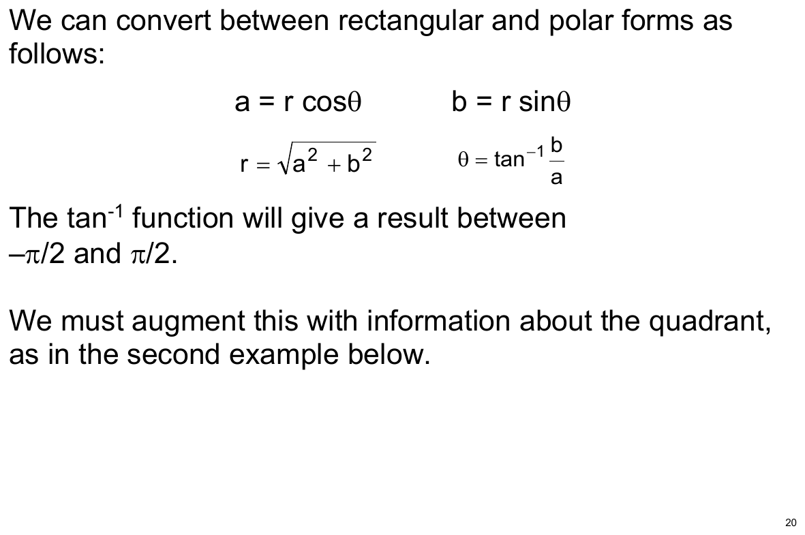
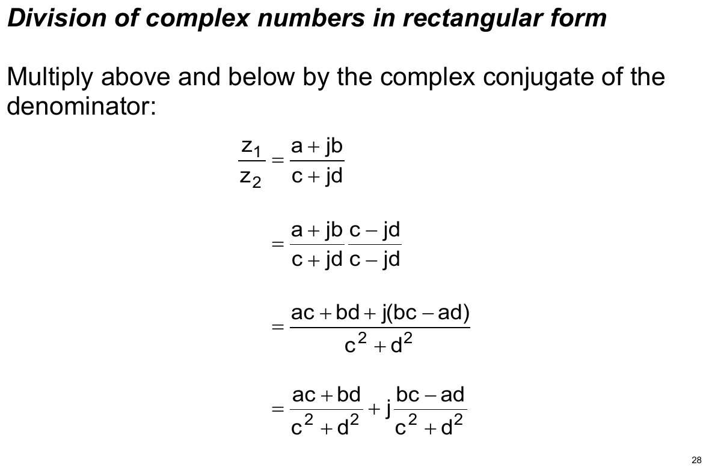
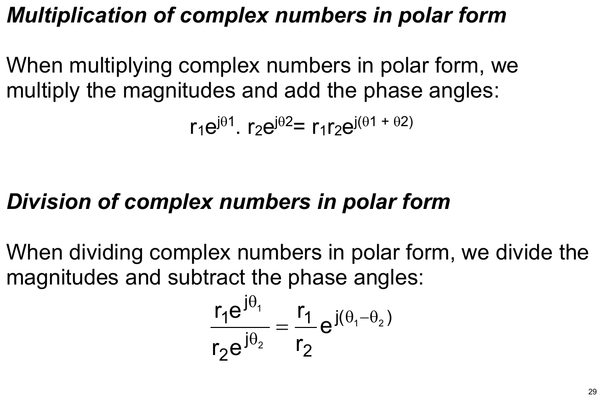
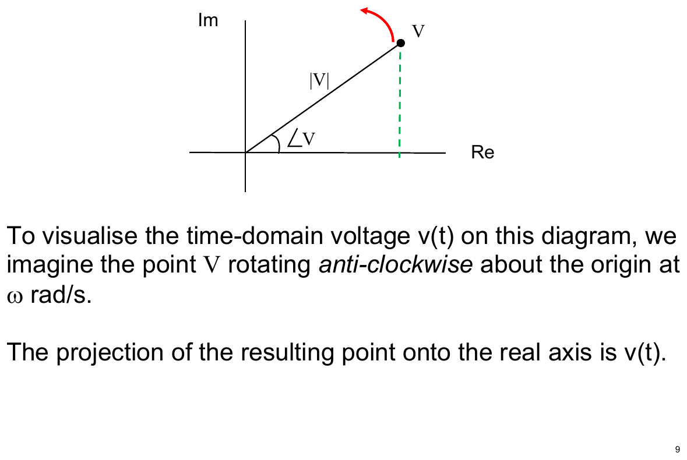
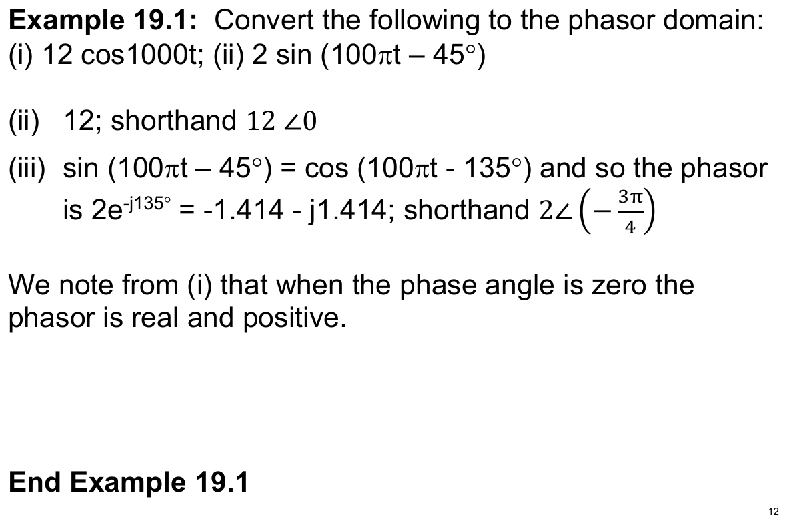
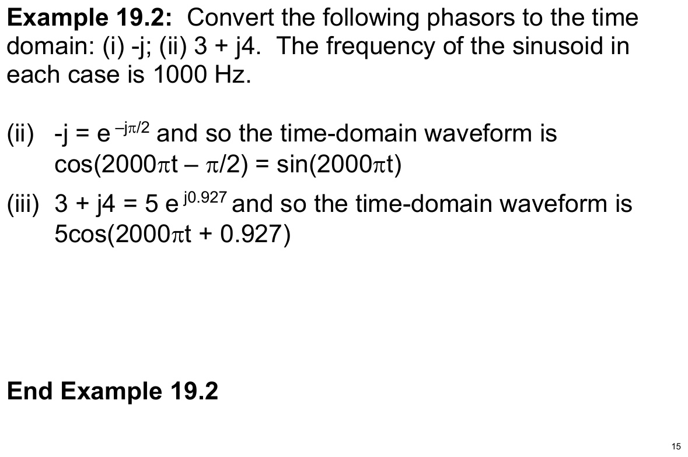

# Topic 10: Sinusoids, complex numbers and phasors

Slide exercises: Lecture 18 Examples 18.1 to 18.3, Self test 18.1 · Lecture 19 Examples 19.1, 19.2, Self test 19.1 · Homework 3 (2025) Q1a, Q1b · Past finals: the last step of every phasor answer (writing Vout(t))

Slides: Lecture 18, pages 1 to 34 · Lecture 19, pages 1 to 15 · Phasor Transform handout (2 pages).

---

## The big idea

In a circuit driven by one sine wave, **every** voltage and current is a sine wave at the **same frequency**.

Only two things change from place to place: the **amplitude** and the **phase**.

 

A complex number holds exactly those two things.

So we swap each sine wave for a complex number, a **phasor**.

Calculus becomes algebra. Then we swap back.

---

**How to use these notes:**
When you see 🧠, stop.
Answer it on paper first.
Then click to check.

---

## 🎯 In the final

Not asked alone. But every Q2 (50 marks) and two or three Q1 parts end with:

"calculate the steady-state output voltage **Vout(t)**"

That is: get a phasor, then turn it back into A cos(ωt + φ). Lose marks here and you lose them in every question.

- Final 2025 Q2b: two frequencies, two separate phasors, added in time.
- Final 2024 Q2d, 2023 Q2d, 2022 Q1e, Q2c, 2021 Q1e, Q2c: Vout(t) from a phasor.
- **Calculator check:** practise polar ↔ rectangular on your own calculator. It saves minutes.

---

## ⭐ Learn by heart from this topic

Open book: the [exam sheet](../formula-sheet.md) has the [Phasor Transform handout](../formula-sheet.md) steps. Still, these must be instant:

- Equation 49: A cos(ωt + φ). ω = 2πf, T = 1/f.
- Rule 50: sin(x) = cos(x − 90°). Always turn sines into cosines (or keep everything in sines).
- Equation 51: z = a + jb = r e^(jθ) = r∠θ. r = √(a² + b²). θ = atan(b/a), **plus 180° if a < 0**.
- Rule 52: phasor transform: A cos(ωt + φ) ↔ A∠φ.
- Multiply: multiply sizes, add angles. Divide: divide sizes, subtract angles.

**Memory hook:** "Size times size, angle plus angle."

---

## 1. Sinusoids

### 📐 Equation 49: a sinusoid
$$x(t) = A\cos(\omega t + \varphi) \qquad \omega = 2\pi f \qquad T = \frac{1}{f}$$

| Symbol | Means | Units |
|---|---|---|
| A | amplitude (peak value) | V or A |
| ω | angular frequency | rad/s |
| f | frequency | Hz |
| φ | phase | rad or degrees |

**Read ω straight off the question:** sin(2000πt) → ω = 2000π rad/s → f = 1 kHz. sin(10⁶ t) → ω = 10⁶ rad/s.

### 📐 Rule 50: sine as cosine
$$\sin(\omega t + \varphi) = \cos(\omega t + \varphi - 90°)$$

The cosine **leads** the sine by 90°.

**Use it when:** the source is a sine. Either convert to cosine first, or treat the sine as the reference (phase 0) and give your answer as a sine. Both are fine. Just don't mix.

---

## 2. Complex numbers

### 📐 Equation 51: rectangular and polar
$$z = a + jb = r\,e^{j\theta} = r\angle\theta$$
$$r = |z| = \sqrt{a^2 + b^2} \qquad \theta = \tan^{-1}\frac{b}{a}$$
$$a = r\cos\theta \qquad b = r\sin\theta$$

**The trap:** your calculator's tan⁻¹ only gives −90° to +90°. If **a is negative**, add (or subtract) 180°.

Example: −3 − j4. tan⁻¹(4/3) = 53.1°. But the point is in the 3rd quadrant: θ = 53.1° − 180° = **−126.9°**.

**Rules:**
- Add and subtract: rectangular.
- Multiply and divide: polar (sizes multiply or divide, angles add or subtract).
- Or divide in rectangular by multiplying top and bottom by the **conjugate** of the bottom.
- j = 1∠90°. −j = 1∠−90°. 1/j = −j.

### 🧠 Check
z1 = 6 + j3, z2 = 3 − j. Find z1/z2 both ways.

Answer

Rectangular: (6 + j3)(3 + j)/(9 + 1) = (18 + 6j + 9j − 3)/10 = **1.5 + j1.5**.

Polar: √45∠26.6° / √10∠−18.4° = 2.121∠45°. Same thing.

---

## 3. Phasors

### 📐 Rule 52: the phasor transform
$$A\cos(\omega t + \varphi) \quad\longleftrightarrow\quad \mathbf{X} = A\,e^{j\varphi} = A\angle\varphi$$

**To a phasor:** write it as a cosine. The phasor is (amplitude)∠(phase). Note ω for later.

**Back to time:** write the phasor as r∠θ. The answer is r cos(ωt + θ).

**How to read this diagram:** the phasor V rotates anticlockwise at ω rad/s. Its shadow on the real axis is v(t).

**Words:**
- A phasor carries amplitude and phase, **not** frequency. All phasors in one problem share one ω.
- Use **capital** V and I for phasors, small v(t) and i(t) for time functions.
- Never write v(t) = 3 + j4. A time function is always real.

### 🧠 Check
Lecture 19 Self test 19.1: write as time functions at ω rad/s: (i) j3, (ii) 8 + j7.5.

Answer

(i) j3 = 3∠90° → **3 cos(ωt + 90°) = −3 sin ωt**

(ii) 8 + j7.5 = 10.97∠43.2° (0.753 rad) → **10.97 cos(ωt + 0.753)**

---

## Worked example: writing Vout(t) (Final 2025 Q2b)

H(ω) = 1/(1 + jωCR), with R = 10 kΩ, C = 470 pF, so RC = 4.7 μs.

Vin(t) = 5 sin(2000πt) + 10 sin(2 × 10⁶ πt).

**Two frequencies** → two separate phasor problems (Topic 4 superposition). Keep the sines as sines: the phase shift adds to whatever the input had.

**1 kHz:** ω = 2000π. ωRC = 0.02953.

H = 1/(1 + j0.02953) = 0.99956∠−0.0295 rad.

Output amplitude 5 × 0.99956 = 4.998. Phase −0.0295 rad.

**1 MHz:** ωRC = 29.53.

H = 1/(1 + j29.53) = 0.03384∠−1.537 rad. Output amplitude 10 × 0.03384 = 0.3384.

**Answer (official):**

$$V_{out}(t) = 4.998\sin(2000\pi t - 0.0295) + 0.3384\sin(2\times 10^6\pi t - 1.537)\ \text{V}$$

A low-pass filter: the 1 kHz part passes, the 1 MHz part is cut to 3.4%.

---

## Method: phasor bookkeeping

| You're asked for | Use |
|---|---|
| ω or f from a source | the number in front of t is ω. f = ω/2π |
| phasor of A sin(ωt + φ) | A∠(φ − 90°), or keep the sine as reference |
| magnitude and phase of a + jb | Eq 51. Check the quadrant |
| a quotient like (a + jb)/(c + jd) | divide in polar: r1/r2 ∠(θ1 − θ2) |
| Vout(t) from a phasor r∠θ | r cos(ωt + θ) (same ω as the input) |
| two frequencies at once | one phasor calculation per frequency, add in time |
| phase in degrees or radians? | either, but **say which**. Exam answers often use radians in the time function |

---

Next: [End-of-topic test](../questions/10-sinusoids-phasors.md)
