# Topic 11: Impedance and phasor analysis

Slide exercises: Lecture 19 · Lecture 20 Examples 20.1 to 20.6, Self test 20.1 · Homework 3 Q1a to Q1c · Homework 4 Q1c · Past finals: Final 2025 Q1d, 2024 Q1c, 2022 Q1d, 2021 Q1d · Resit 2025 Q1c, 2023 Q1d, 2022 Q1d, 2021 Q1d

Slides: Lecture 19, pages 16 to 31, and Lecture 20, pages 1 to 32.

---

## The big idea

In the phasor world, resistors, capacitors and inductors all become **impedances**.

An impedance is just a complex resistance: V = Z I.

 

So **everything** from Topics 2 to 7 works unchanged:

series, parallel, voltage division, Thévenin, nodal analysis, op amps.

Only the arithmetic is complex.

---

**How to use these notes:**
When you see 🧠, stop.
Answer it on paper first.
Then click to check.

---

## 🎯 In the final

**Every paper has an impedance part in Q1** (Q1c or Q1d, 20%):

| Paper | Network | Asked for |
|---|---|---|
| Final 2025 Q1d | R1 + L + (R2 ∥ C) | \|Z\| and phase at 1 kHz (official: 6.35 Ω, 19.0°) |
| Final 2024 Q1c, Resit 2025 Q1c | C1 ∥ (R2 + C2) | a **formula** for Z12 (or Y12) |
| Final 2022 Q1d | R + L | \|Z\|, phase |
| Resit 2023 Q1d | R + L | the f where Re = Im, then \|Z\|, phase |
| Final 2021 Q1d, Resit 2022 Q1d | R + L + C series | \|Z\|, phase |
| Resit 2021 Q1d | R + L + C series | the **admittance** Y |

Four minutes each with a calculator. Free marks.

---

## ⭐ Learn by heart from this topic

Open book: on your [exam sheet](../formula-sheet.md). The three impedances must be instant.

- Equation 53: Z_R = R. Z_L = jωL. Z_C = 1/(jωC) = −j/(ωC).
- Rule 54: every resistive rule works with Z (series add, parallel product/sum, division, Thévenin, nodal, op amps).
- Equation 55: Y = 1/Z. Z = R + jX (resistance, reactance). Y = G + jB (conductance, susceptance).
- Rule 56: the method: transform to phasors, solve, transform back. Never mix time and phasor quantities.
- Positive phase = inductive (current lags). Negative phase = capacitive (current leads).

**Memory hook:** "L goes up with frequency. C goes down."

---

## 1. Impedance of R, L and C

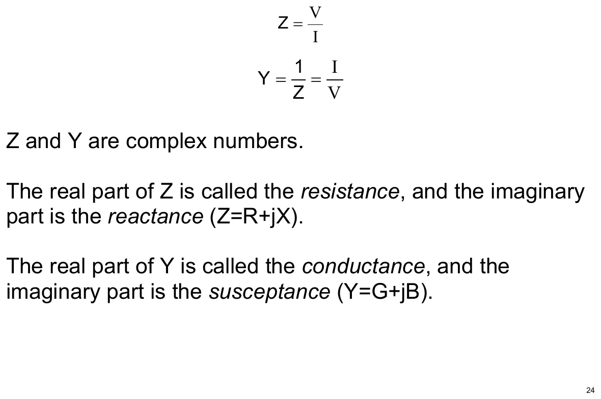

### 📐 Equation 53: impedances
$$Z_R = R \qquad Z_L = j\omega L \qquad Z_C = \frac{1}{j\omega C} = \frac{-j}{\omega C}$$

| Element | Magnitude | Phase | At dc (ω = 0) | At very high ω |
|---|---|---|---|---|
| R | R | 0° | R | R |
| L | ωL | +90° | 0 (short) | ∞ (open) |
| C | 1/(ωC) | −90° | ∞ (open) | 0 (short) |

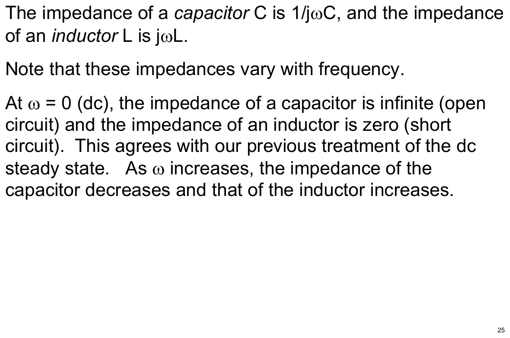

**What it means:**
- An inductor's voltage **leads** its current by 90°.
- A capacitor's voltage **lags** its current by 90°.
- The dc limits match Topic 9 Rule 44.

### 📐 Equation 55: impedance and admittance
$$Z = \frac{V}{I} = R + jX \qquad Y = \frac{1}{Z} = G + jB$$

|Y| = 1/|Z| and ∠Y = −∠Z. Units of Y: siemens (S).

---

## 2. Every rule still works

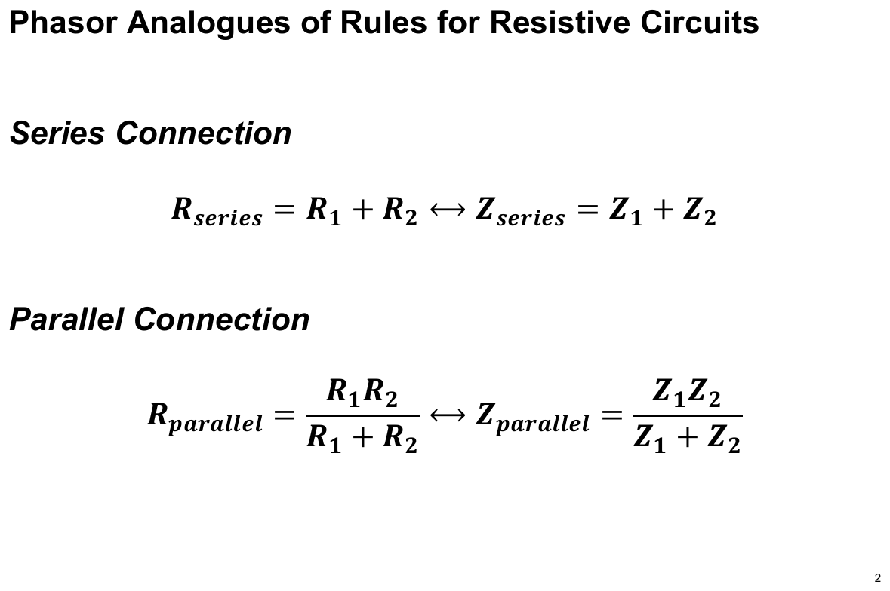

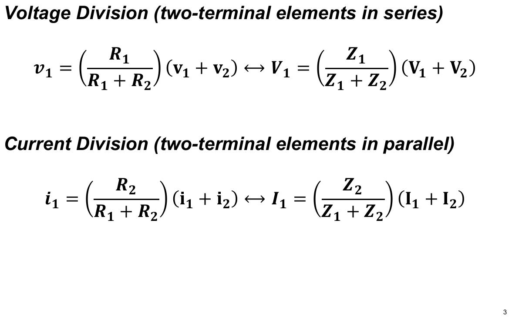

### 📐 Rule 54: resistive rules with impedances
- Series: Z = Z1 + Z2.
- Parallel: Z = Z1 Z2/(Z1 + Z2).
- Voltage division: V1 = Z1/(Z1 + Z2) × V.
- Current division: I1 = Z2/(Z1 + Z2) × I.
- Thévenin, Norton, superposition, nodal analysis: same, with Z.
- Op amps: inverting gain −Zf/Z1, non-inverting 1 + Zf/Z1.

### 📐 Rule 56: sinusoidal steady-state analysis

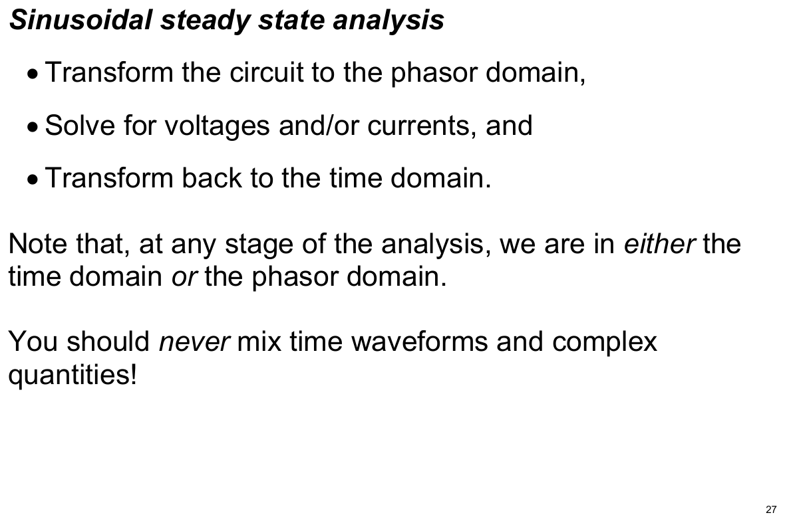

1. Transform the circuit to the phasor domain (sources → phasors, R, L, C → Z).
2. Solve it like a resistive circuit.
3. Transform the answer back to time.

Never write a phasor and a time function in one equation.

### 🧠 Check
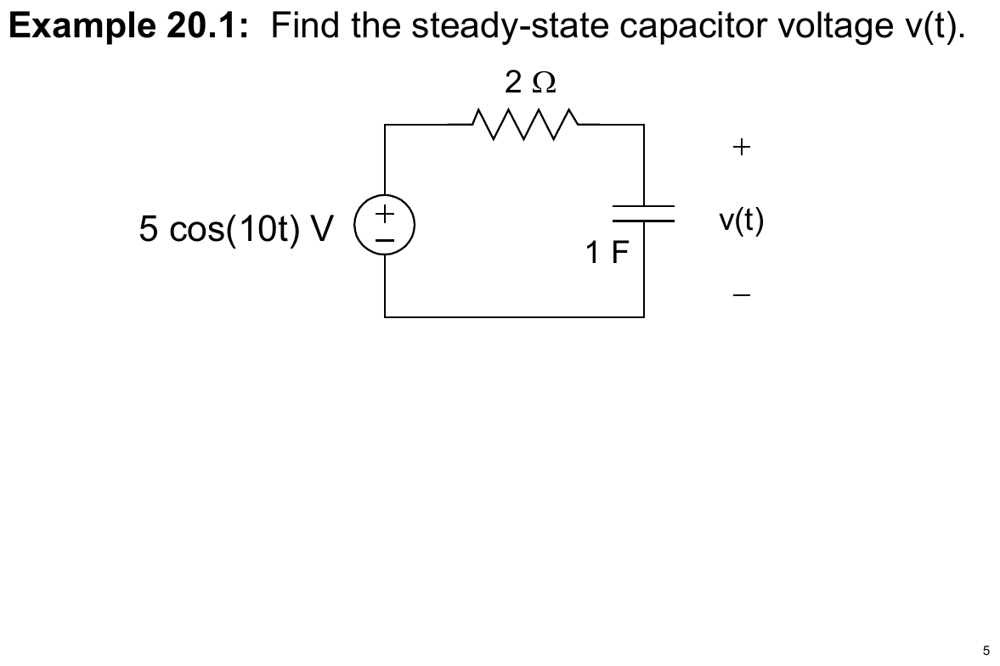

5 cos(10t) V drives 2 Ω in series with 1 F. Find the capacitor voltage v(t).

Answer

ω = 10. Z_C = 1/(j10) = −j0.1 Ω.

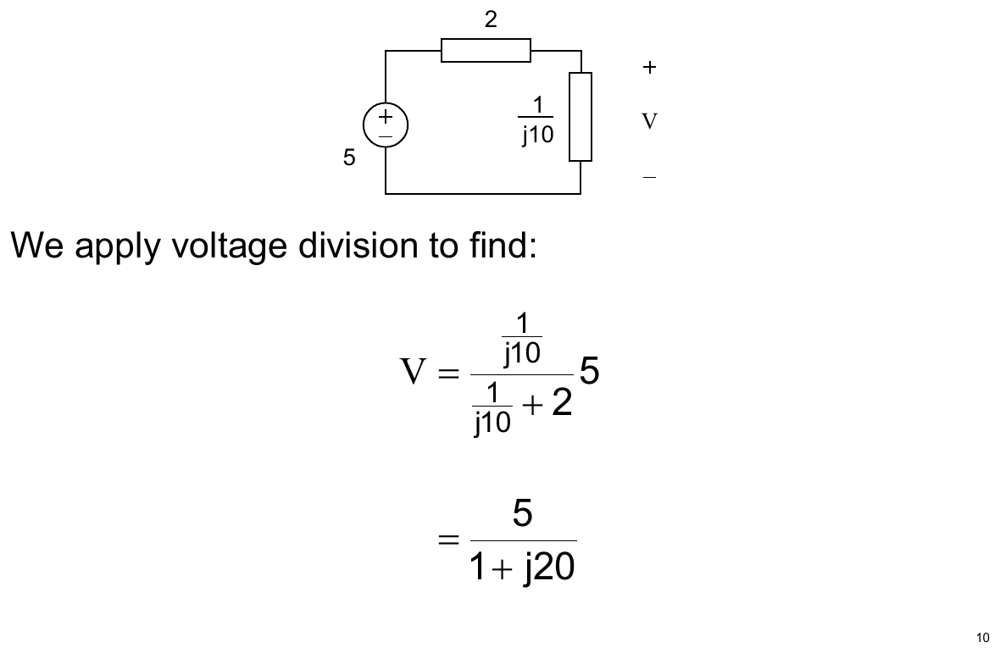

V = 5 × (1/j10)/(1/j10 + 2) = 5/(1 + j20).

|V| = 5/√401 = 0.25. ∠V = −tan⁻¹ 20 = −1.52 rad.

**v(t) = 0.25 cos(10t − 1.52) V**

---

## 3. An op amp with impedances

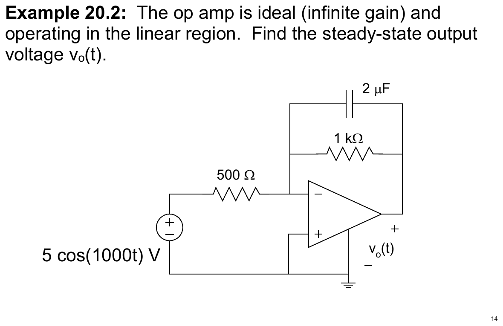

Example 20.2: inverting amplifier, 500 Ω in, 1 kΩ ∥ 2 μF feedback, 5 cos(1000t).

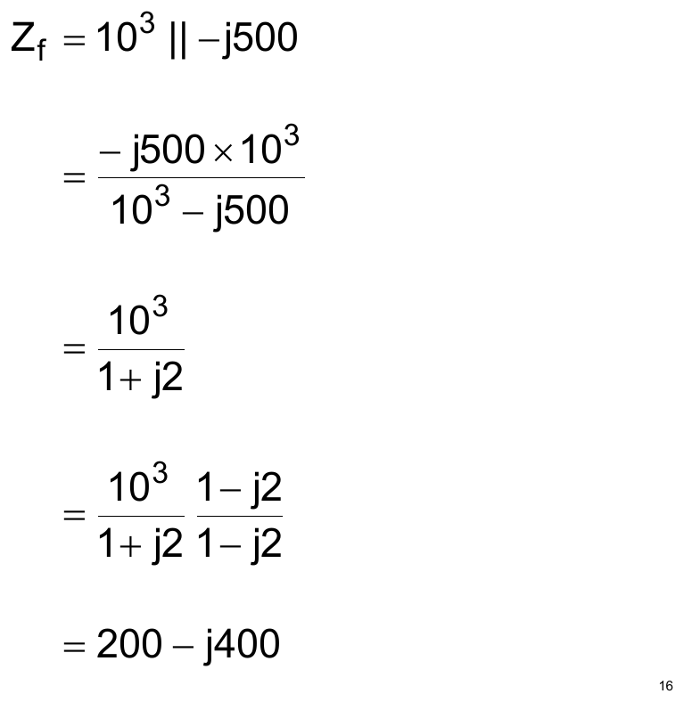

Zf = 200 − j400. Vo = −Zf/500 × 5 = −2 + j4 = 4.472∠2.034 rad.

**vo(t) = 4.472 cos(1000t + 2.034) V**

This is exactly the Q1e of most finals (Topic 15).

---

## 4. AC bridges

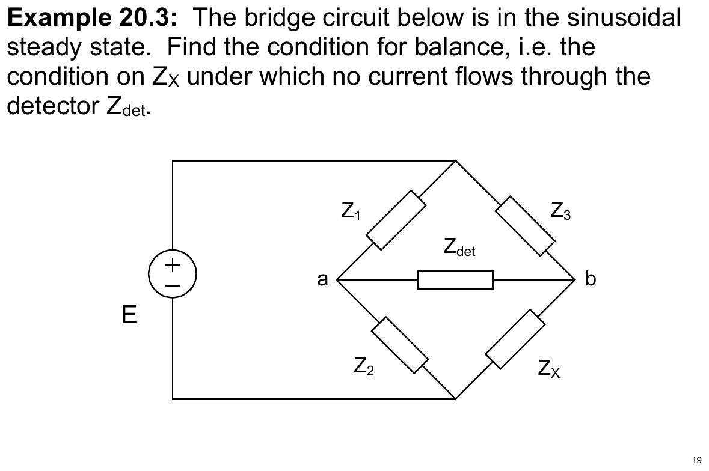

Balance (no current in Z_det) when Z1/Z2 = Z3/Z_X. Two conditions at once: the real parts and the imaginary parts. The Maxwell bridge measures an unknown inductor this way.

---

## Worked example: Final 2025 Q1d

Z_AB = R1 + jωL + (R2 ∥ C), with R1 = 6 Ω, L = 430 μH, C = 252 μF, R2 = 137 Ω, f = 1 kHz.

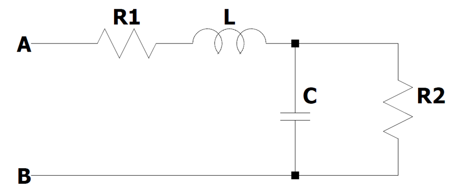

**Step 1.** ω = 2π × 1000 = 6283 rad/s.

jωL = j2.702 Ω.

Z_C = −j/(ωC) = −j0.6316 Ω.

**Step 2.** R2 ∥ C. The capacitor is tiny next to 137 Ω, so it dominates:

R2 ∥ Z_C = 137(−j0.6316)/(137 − j0.6316) = 0.0029 − j0.6316 Ω.

**Step 3.** Add:

Z = 6.003 + j(2.702 − 0.632) = 6.003 + j2.070 Ω.

**Step 4.**

|Z| = **6.35 Ω**, ∠Z = tan⁻¹(2.070/6.003) = **19.0°** (official answers).

Positive phase: overall inductive.

---

## Worked example: Final 2024 Q1c (a formula)

C1 between nodes 1 and 2. R2 and C2 in series also between 1 and 2.

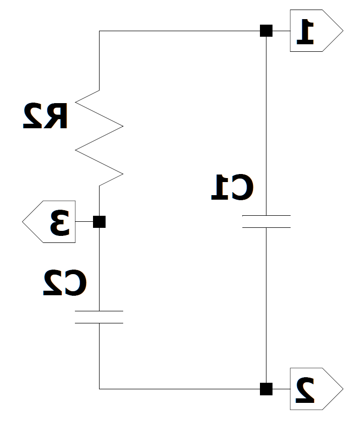

**Z12 = Z_C1 ∥ (R2 + Z_C2).**

$$Z_{12} = \frac{\frac{1}{j\omega C_1}\left(R_2 + \frac{1}{j\omega C_2}\right)}{\frac{1}{j\omega C_1} + R_2 + \frac{1}{j\omega C_2}} = \frac{1 + j\omega R_2 C_2}{j\omega (C_1 + C_2) - \omega^2 R_2 C_1 C_2}$$

**Resit 2025 Q1c** asks for the admittance. Admittances in parallel **add**:

$$Y_{12} = j\omega C_1 + \frac{1}{R_2 + \frac{1}{j\omega C_2}} = j\omega C_1 + \frac{j\omega C_2}{1 + j\omega R_2 C_2}$$

**Check:** ω → 0: Y → 0 (both capacitors block dc). ω → ∞: Z → 0 (C1 shorts it).

---

## Worked example: Resit 2023 Q1d

R1 = 40 Ω in series with L2 = 18 mH. Find f where |Re Z| = |Im Z|, then |Z| and the phase.

**Step 1.** Re Z = 40. Im Z = ωL. Equal when ωL = 40:

f = 40/(2π × 0.018) = **353.7 Hz**

**Step 2.** Z = 40 + j40: |Z| = 40√2 = **56.57 Ω**, phase **45°**.

---

## Method: impedance parts

| You're asked for | Use |
|---|---|
| \|Z\| and phase at f | ω = 2πf, Eq 53 for each element, combine (Rule 54), polar |
| a formula for Z or Y | combine symbolically. Admittances in parallel add |
| admittance | Y = 1/Z: \|Y\| = 1/\|Z\|, ∠Y = −∠Z (Eq 55) |
| the frequency for a condition on Z | write Re Z and Im Z, set the condition, solve for ω |
| a voltage or current in an RLC circuit | Rule 56: divider or nodal with Z, then r cos(ωt + θ) |
| R ∥ C with a tiny C impedance | the smaller impedance dominates a parallel pair |
| series RLC | Z = R + j(ωL − 1/ωC). Zero reactance at resonance (Topic 13) |

---

Next: [End-of-topic test](../questions/11-impedance.md)
