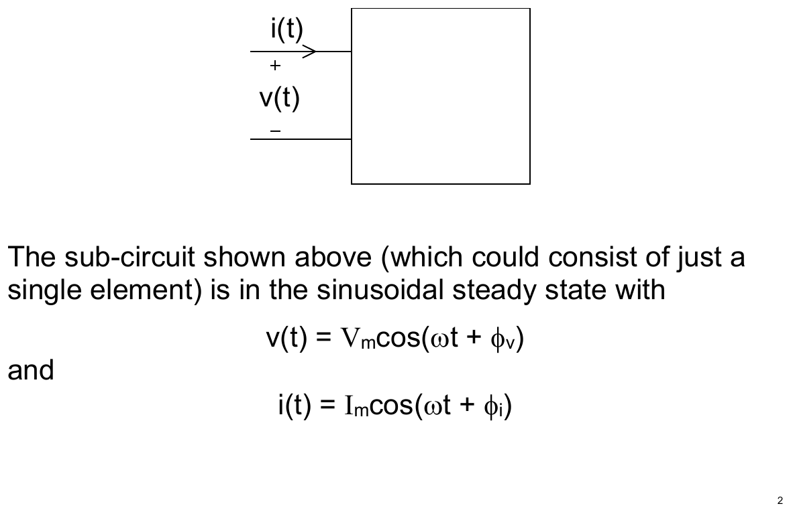
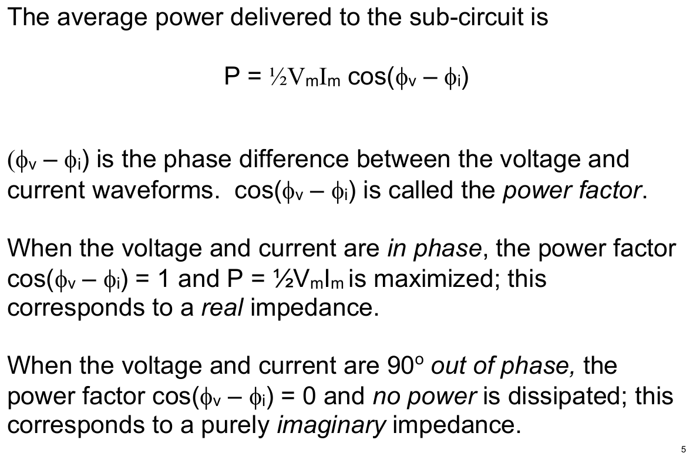
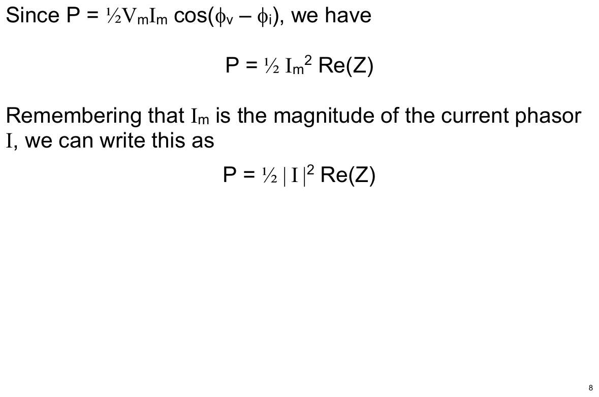
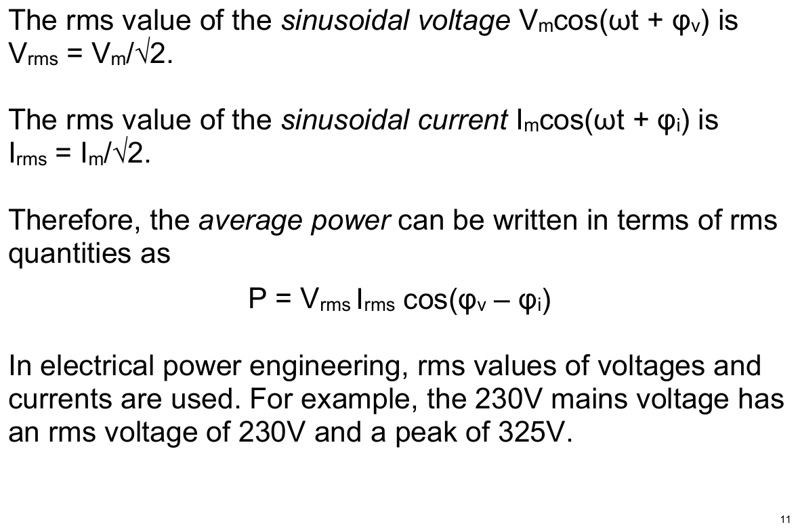
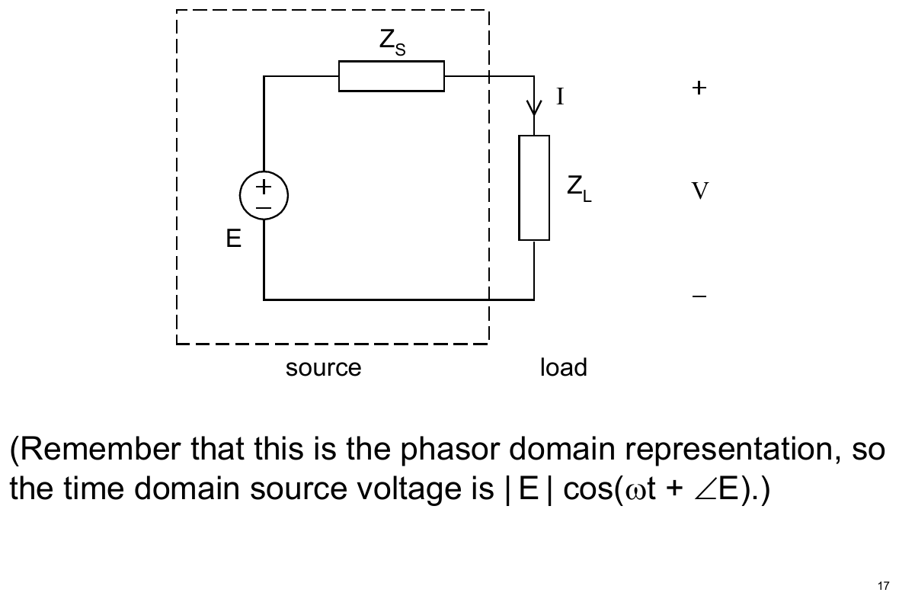
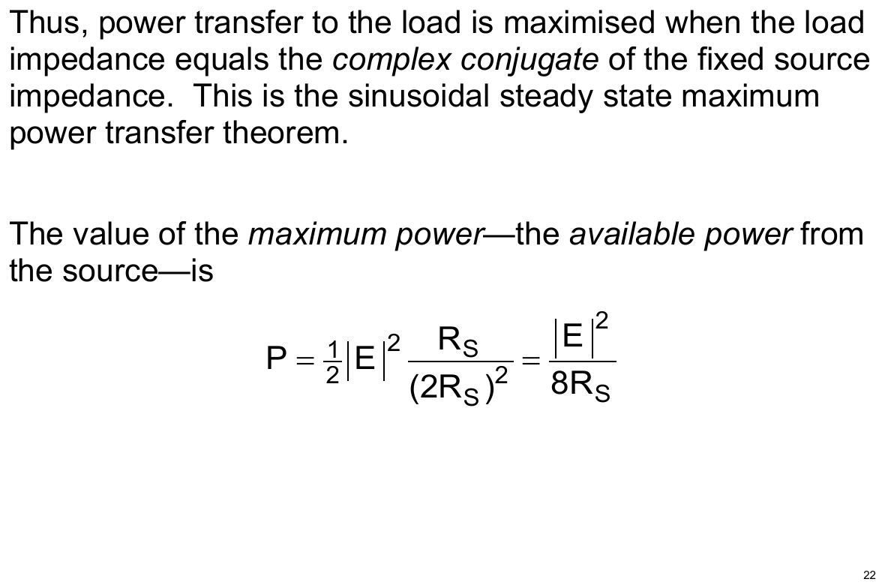
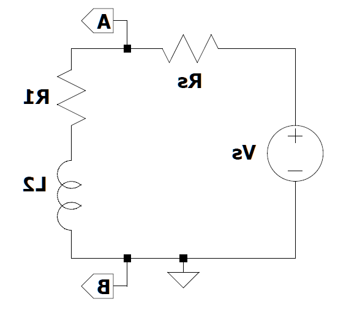
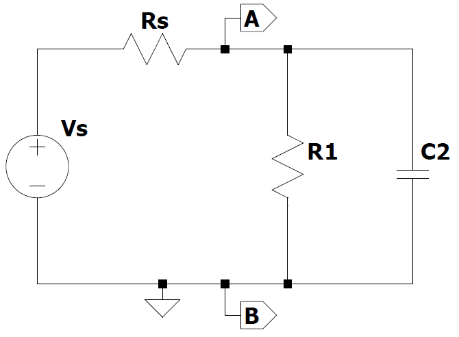
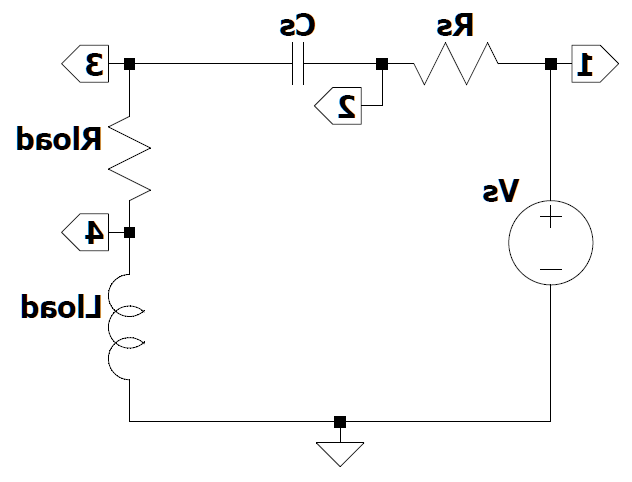

# Topic 12: AC power and maximum power transfer

Slide exercises: Lecture 21 Example 21.1, Self test 21.1 · Homework 3 Q1d · Homework 4 Q1a · Past finals: Final 2024 Q1d, 2022 Q1a · Resit 2025 Q1d, 2023 Q1a (and the transformer power parts in Topic 13)

Slides: Lecture 21, pages 1 to 24.

---

## The big idea

With sine waves, the power goes up and down twice every cycle.

What matters is the **average** power.

 

Only **resistance** absorbs average power.

Capacitors and inductors take energy in and give it back. On average, zero.

 

And to get the most power into a load, make its impedance the **mirror image** (complex conjugate) of the source's.

---

**How to use these notes:**
When you see 🧠, stop.
Answer it on paper first.
Then click to check.

---

## 🎯 In the final

**Almost every paper has a power part in Q1** (20%):

| Paper | Asked for |
|---|---|
| Final 2022 Q1a | average power in R + L from a 325 V, 50 Hz source with Rs |
| Resit 2023 Q1a | average power in R ∥ C from a 325 V, 50 Hz source with Rs |
| Final 2024 Q1d | the Cs for maximum power into Rload + Lload |
| Resit 2025 Q1d | the same, plus the maximum power |
| Final 2023 Q1a, Resit 2024 Q1a, 2021 Q1a, Resit 2022 Q1a | power through a transformer (Topic 13) |

The 325 V, 50 Hz source is the Irish mains: 230 V rms (§2).

---

## ⭐ Learn by heart from this topic

Open book: on your [exam sheet](../formula-sheet.md). The ½ is where marks are lost.

- Equation 57: P = ½ Vm Im cos(φv − φi). cos(φv − φi) is the **power factor**.
- Equation 58: P = ½ |I|² Re(Z) = ½ |I|² R. For a resistor: P = ½ Vm²/R.
- Equation 59: Vrms = Vm/√2. P = Vrms Irms cos(φv − φi). 325 V peak = 230 V rms.
- Equation 60: maximum power: **ZL = ZS\*** (conjugate). Pmax = |E|²/(8 RS), E = peak source voltage.
- Rule 61: instantaneous power p(t) = ½ Vm Im [cos θ + cos(2ωt + φv + φi)]. Peak p = ½ Vm Im (1 + cos θ).

**Memory hook:** "Half, peak times peak, times cos."

---

## 1. Average power

### 📐 Equation 57: average power
$$P = \tfrac{1}{2} V_m I_m \cos(\varphi_v - \varphi_i)$$

| Symbol | Means |
|---|---|
| Vm, Im | **peak** amplitudes |
| φv − φi | the angle between V and I = the angle of Z |
| cos(φv − φi) | power factor. 1 for a resistor, 0 for L or C |

### 📐 Equation 58: power from impedance
$$P = \tfrac{1}{2} |I|^2\,\mathrm{Re}(Z)$$

**What it means:** only the real (resistive) part of Z takes average power.

**Use it when:** you know the current through a load. Find |I| from |V|/|Z_total|, then ½|I|² R.

**Trick:** in a series R + L load, all the average power is in R. So P = ½|I|² R.

In a parallel R ∥ C load, find the voltage across it, then P = ½|V|²/R.

---

## 2. RMS

### 📐 Equation 59: rms values
$$V_{rms} = \frac{V_m}{\sqrt{2}} \qquad P = V_{rms} I_{rms}\cos(\varphi_v - \varphi_i)$$

Mains: 230 V rms = 325 V peak. Same as Equation 57: the ½ hides inside the two √2's.

**Read the question:** "Vs = Vm cos(…), Vm = 325 V" is a **peak** value. Use the ½.

---

## 3. Instantaneous power

### 📐 Rule 61: instantaneous power
$$p(t) = \tfrac{1}{2} V_m I_m\big[\cos\theta + \cos(2\omega t + \varphi_v + \varphi_i)\big], \qquad \theta = \varphi_v - \varphi_i$$

The power wobbles at **twice** the source frequency around its average.

Peak instantaneous power = ½ Vm Im (1 + cos θ).

**Use it when:** Homework 3 Q1d asks for the "peak" load power.

---

## 4. Maximum power transfer (AC)

The source is E in series with ZS = RS + jXS. The load ZL = RL + jXL can be chosen.

### 📐 Equation 60: AC maximum power transfer
$$Z_L = Z_S^* \quad (R_L = R_S,\ X_L = -X_S) \qquad P_{max} = \frac{|E|^2}{8 R_S}$$

| Symbol | Means |
|---|---|
| ZS* | complex conjugate: same real part, opposite imaginary part |
| \|E\| | **peak** source voltage |

**What it means:** cancel the source's reactance, then match the resistances (Topic 4 Equation 22 is the dc version: |E|²/(4RS) there uses dc E).

**If you can only change part of the load** (e.g. only a series C): make the **total reactance zero**, then compute the power.

---

## Worked example: Final 2022 Q1a

Vs = 325 cos(2π 50 t) V, Rs = 10 Ω, load R1 = 100 Ω in series with L2 = 500 mH. Find the average power in the load.

**Step 1.** ωL = 2π × 50 × 0.5 = 157.1 Ω.

**Step 2.** Total Z = 110 + j157.1. |Z| = 191.8 Ω.

**Step 3.** |I| = 325/191.8 = 1.695 A (peak).

**Step 4.** All the load's average power is in R1 (Equation 58):

P = ½ × 1.695² × 100 = **143.6 W**.

---

## Worked example: Resit 2023 Q1a (parallel load)

Same source, Rs = 10 Ω. Load: R1 = 100 Ω ∥ C2 = 220 μF.

Z_C = −j/(2π × 50 × 220 μ) = −j14.47 Ω.

Z_load = 100 ∥ (−j14.47) = 2.051 − j14.17 Ω.

V_A = 325 × Z_load/(10 + Z_load): |V_A| = 325 × 14.32/18.60 = 250.2 V.

P = ½ × 250.2²/100 = **312.9 W**.

---

## Worked example: Final 2024 Q1d and Resit 2025 Q1d

Vs = sin(2πft), f = 10 kHz. Rs = 50 Ω, then a series Cs, then Rload = 50 Ω + Lload = 1 mH.

Only Cs can change. Rs = Rload already. So make the total reactance zero:

1/(ωCs) = ωL → Cs = 1/(ω² L) = 1/((2π × 10⁴)² × 10⁻³) = **253.3 nF**.

**Resit 2025 Q1d:** Lload = 18 mH, Vs = 2 sin(…): Cs = 1/(ω²L) = **14.07 nF**. Then |I| = 2/100 = 20 mA, P = ½ × 0.02² × 50 = **10 mW**.

(Same as |E|²/(8RS) = 4/400 = 10 mW: the load is matched.)

---

## Method: AC power

| You're asked for | Use |
|---|---|
| average power in a series R + L or R + C load | \|I\| = \|V\|/\|Z_total\|, P = ½\|I\|²R |
| average power in a parallel load | \|V\| across it, P = ½\|V\|²/R |
| average power in L or C | 0 |
| power from rms values | P = Vrms Irms cos θ (no ½) |
| ZL for maximum power | ZL = ZS* (Eq 60) |
| only one part adjustable | make the total reactance zero |
| maximum power value | \|E\|²/(8RS) with peak E |
| peak instantaneous power | ½VmIm(1 + cos θ) (Rule 61) |

---

Next: [End-of-topic test](../questions/12-ac-power.md)
