# Topic 13: The ideal transformer and resonance

Slide exercises: Lecture 22 Examples 22.1, 22.2, Self test 22.1 · Homework 4 Q1a · Past finals: Final 2025 Q1c, Q1e, 2024 Q3, 2023 Q1a, 2021 Q1a · Resit 2025 Q3, 2024 Q1a, 2022 Q1a

Slides: Lecture 22, pages 1 to 22.

---

## The big idea

An ideal transformer scales voltage **down** by the turns ratio and current **up** by the same ratio.

So it scales **impedance** by the turns ratio **squared**.

 

That makes it a perfect matching device: it can make a 32 Ω speaker look like 50 Ω.

 

**Resonance:** an L and a C cancel each other at one frequency, ω0 = 1/√(LC).

In series they become a short. In parallel they become an open circuit.

---

**How to use these notes:**
When you see 🧠, stop.
Answer it on paper first.
Then click to check.

---

## 🎯 In the final

The transformer is in **almost every paper**:

| Paper | Asked for |
|---|---|
| Final 2025 Q1c | the turns ratio for maximum power (official: 1.25) |
| Final 2023 Q1a, Resit 2024 Q1a | average power in R + L on the secondary, n = 65 |
| Final 2021 Q1a, Resit 2022 Q1a | average power in RL, 1000:100 turns |
| Final 2024 Q3, Resit 2025 Q3 (50 marks!) | Zload of an R–L ∥ C load, then the secondary voltage |
| Final 2025 Q1e | a transformer feeding a bridge rectifier (Topic 17) |
| Homework 4 Q1a | turns ratio plus a series C for maximum power |

---

## ⭐ Learn by heart from this topic

Open book: on your [exam sheet](../formula-sheet.md). These are short. Learn them anyway.

- Equation 62: V1/V2 = n1/n2. I2 = −(n1/n2) I1. Lossless: power in = power out.
- Equation 63: impedance seen at the primary: Zin = (n1/n2)² ZL.
- Rule 64: matching: choose n1/n2 = √(Rs/RL). Cancel any reactance with a series L or C.
- Equation 65: resonance ω0 = 1/√(LC). Series LC = **short** at ω0. Parallel LC = **open** at ω0.
- Below ω0 a series LC is capacitive. Above ω0 it is inductive. (Parallel: the opposite.)

**Memory hook:** "Turns squared for ohms."

---

## 1. The ideal transformer

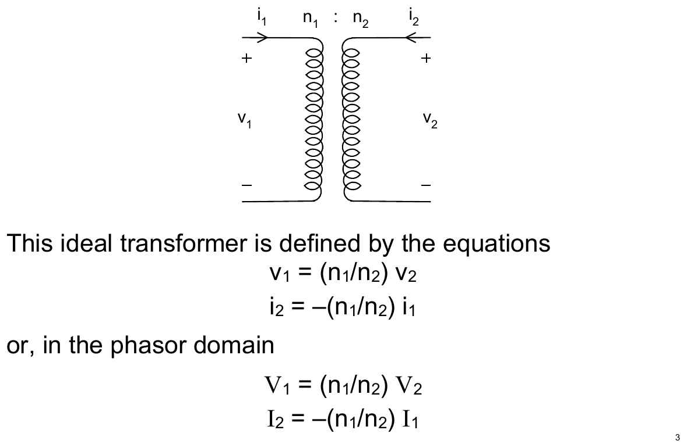

### 📐 Equation 62: the ideal transformer
$$\frac{V_1}{V_2} = \frac{n_1}{n_2} \qquad I_2 = -\frac{n_1}{n_2}\,I_1$$

| Symbol | Means |
|---|---|
| n1, n2 | turns on the primary (input) and secondary (output) |
| n1/n2 | the turns ratio, often written N1:N2 |

**What it means:**
- A step-**down** transformer (n1 > n2) makes the voltage smaller and the current bigger.
- The minus sign in I2 is only about the drawn directions (both currents drawn **into** the dots).
- Power in = power out. The ideal transformer is lossless.

**Exam shortcut:** for amplitudes, |V2| = |V1| × n2/n1.

---

## 2. Impedance reflection

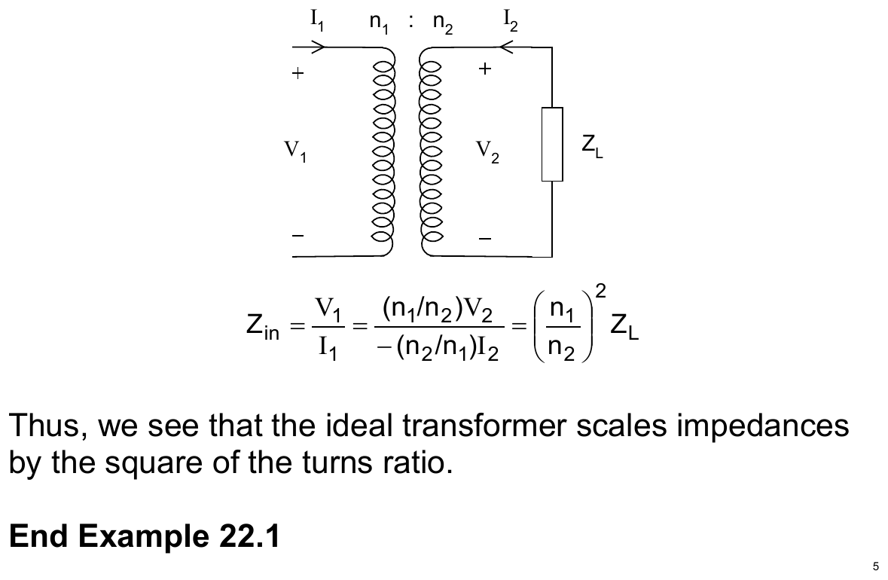

### 📐 Equation 63: reflected impedance
$$Z_{in} = \left(\frac{n_1}{n_2}\right)^2 Z_L$$

**What it means:** from the primary, a load ZL on the secondary looks (n1/n2)² times bigger.

**Use it when:** a transformer sits between a source and a load. Move the load to the primary side, solve there, then come back with Equation 62.

### 📐 Rule 64: matching with a transformer
For maximum power from Rs into RL:

$$\left(\frac{n_1}{n_2}\right)^2 R_L = R_s \quad\Rightarrow\quad \frac{n_1}{n_2} = \sqrt{\frac{R_s}{R_L}}$$

If there are reactances, also cancel them (Topic 12 Equation 60).

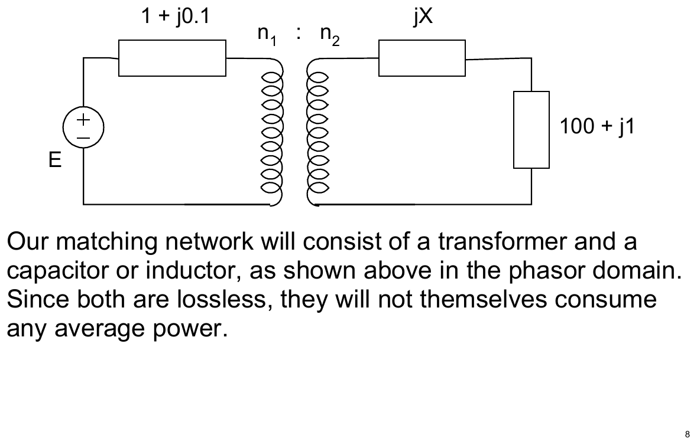

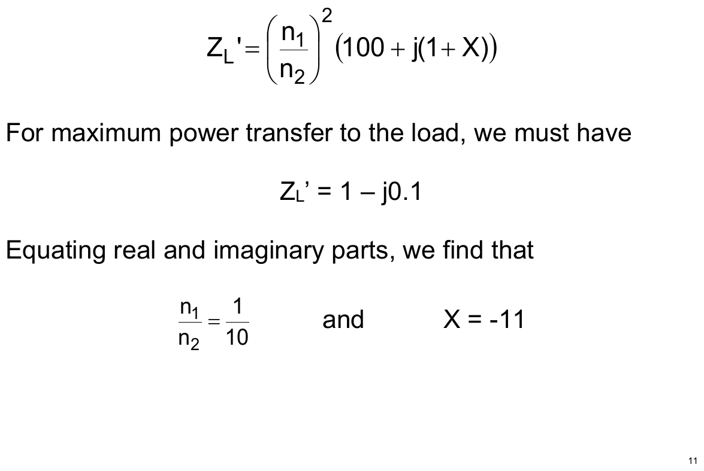

**Example 22.2:** source 1 + j0.1 Ω, load 100 + j1 Ω, at 100 krad/s. Need Z_L' = 1 − j0.1 = (n1/n2)² (100 + j(1 + X)). So n1/n2 = 1/10 and X = −11 Ω: a **909 nF** series capacitor.

### 🧠 Check
Final 2025 Q1c: Rs = 50 Ω, RL = 32 Ω. Which turns ratio N1/N2 gives maximum power?

Answer

N1/N2 = √(50/32) = √1.5625 = **1.25** (official answer).

---

## 3. Resonance

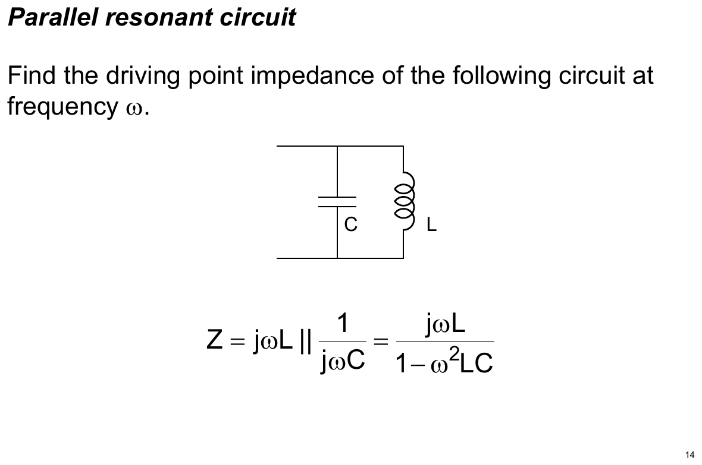

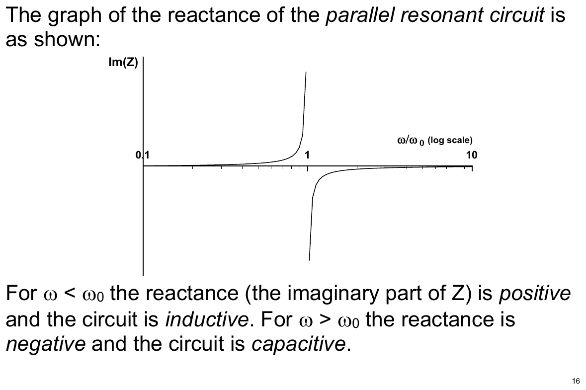

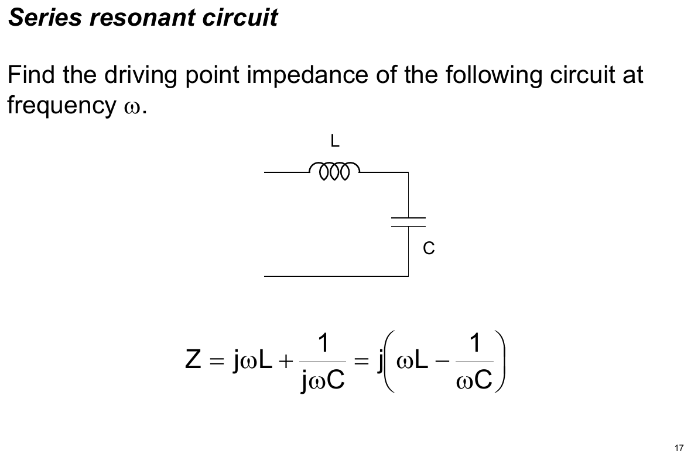

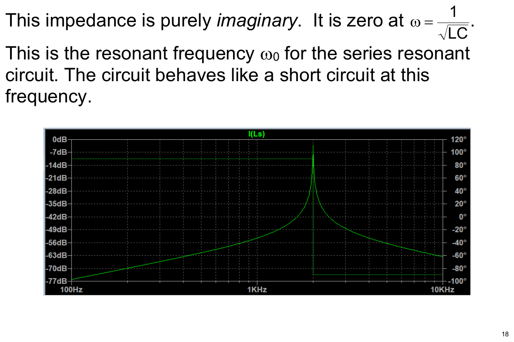

### 📐 Equation 65: LC resonance
$$\omega_0 = \frac{1}{\sqrt{LC}} \qquad f_0 = \frac{1}{2\pi\sqrt{LC}}$$

| | at ω0 | below ω0 | above ω0 |
|---|---|---|---|
| series L + C | Z = 0 (short) | capacitive | inductive |
| parallel L ∥ C | Z = ∞ (open) | inductive | capacitive |

**Spot it in exam questions:**
- Final 2024 Q3: L = 220 mH, C = 100 nF → f0 = 1073 Hz. The question uses 1 kHz: close to parallel resonance, so |Zload| is huge (≈ 10.5 kΩ).
- Resit 2025 Q3: L = 180 mH, C = 120 nF → f0 = 1083 Hz. Same story.
- Resit 2022 Q1d: series 18 mH, 82 nF → f0 = 4144 Hz. At 4 kHz the reactance nearly cancels: |Z| = 51.8 Ω, barely more than R = 40 Ω.

---

## Worked example: Final 2023 Q1a

Vs = 325 cos(2π 50 t) on the primary. The secondary drives R = 100 Ω in series with L = 500 mH. N1/N2 = 65. Find the average power in the load.

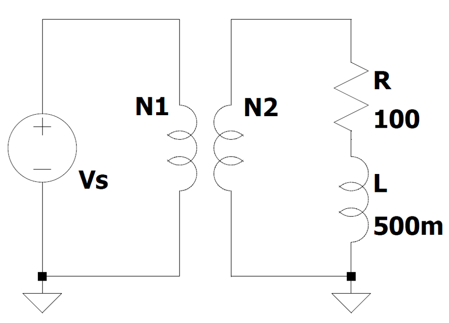

**Step 1.** No source resistance, so the secondary voltage is fixed: |V2| = 325/65 = **5 V** peak (Equation 62).

**Step 2.** ωL = 157.1 Ω. |Z| = √(100² + 157.1²) = 186.2 Ω.

**Step 3.** |I| = 5/186.2 = 26.85 mA.

**Step 4.** P = ½ × 0.02685² × 100 = **36.05 mW**.

**Resit 2024 Q1a:** R = 200 Ω, L = 1 H: ωL = 314.2, |Z|² = 138 696. P = ½ × 25 × 200/138 696 = **18.03 mW**.

---

## Worked example: Final 2021 Q1a

Vs = 1 cos(…) V, Rs = 1000 Ω, N1 = 1000, N2 = 100, RL = 10 Ω. Find the average power in RL.

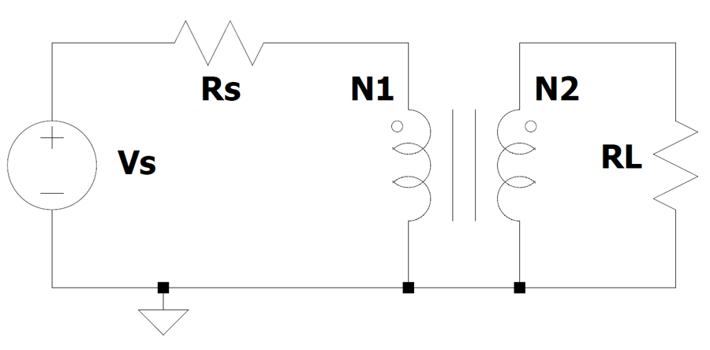

**Step 1.** Reflect RL: (1000/100)² × 10 = **1000 Ω**. It equals Rs: matched!

**Step 2.** The primary voltage is half of Vs: 0.5 V peak.

**Step 3.** Power into the reflected 1000 Ω = power into RL (lossless): P = ½ × 0.5²/1000 = **125 μW**.

**Resit 2022 Q1a** has the same circuit (f doesn't matter: no reactance). Its answer box asks for the power in **Rs**: also **125 μW**, because the load is matched (half the power in each).

---

## Worked example: Final 2024 Q3 (50 marks)

Vs with Rs = 100 Ω drives the primary. The secondary load: Rload + Lload in series, all in parallel with Cload. e3 is the secondary voltage.

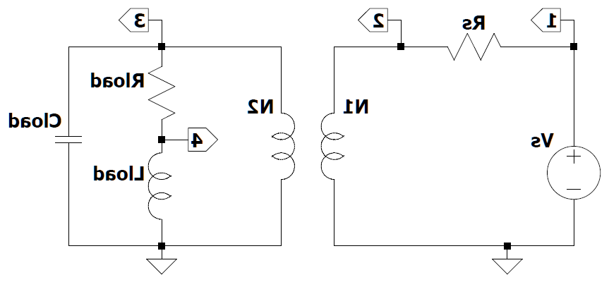

**(a) Zload:**

$$Z_{load} = (R + j\omega L) \parallel \frac{1}{j\omega C} = \frac{R + j\omega L}{1 - \omega^2 L C + j\omega R C}$$

**(b)** f = 1 kHz, R = 10 Ω, L = 220 mH, C = 100 nF.

ωL = 1382.3 Ω. ω²LC = 0.8685. ωRC = 0.006283.

Zload = (10 + j1382.3)/(0.1315 + j0.006283) = **577 + j10 486 Ω**

(Re ≈ 577 Ω, Im ≈ 10.49 kΩ.)

**(c)** ⚠️ **The turns ratio N1:N2 is not given a number in this paper.** Resit 2025 Q3 (the same question) uses 10:1, so assume that.

Reflected: 100 × Zload ≈ 57.7 k + j1.05 M Ω. That is enormous next to Rs = 100 Ω, so almost all of the 1 V reaches the primary.

|e3| = |V1| × N2/N1 ≈ 1 × 1/10 = **0.100 V** amplitude (0.09996 V).

**Resit 2025 Q3:** R = 15 Ω, L = 180 mH, C = 120 nF, 10:1. Zload = **687.6 + j7627 Ω**, |e3| ≈ **0.100 V** again.

**Hidden structure:** the load is near parallel resonance, so it hardly loads the source. The answer is just Vs × N2/N1.

---

## Method: transformers and resonance

| You're asked for | Use |
|---|---|
| secondary voltage, no Rs | \|V2\| = \|V1\| n2/n1 |
| anything with Rs on the primary | reflect the load: (n1/n2)² ZL, solve the primary, then Eq 62 |
| turns ratio for maximum power | n1/n2 = √(Rs/RL) (Rule 64) |
| power in a secondary load | power is the same on both sides (lossless) |
| a load impedance formula | combine with Topic 11 Rule 54 |
| resonant frequency | ω0 = 1/√(LC) (Eq 65) |
| "why is \|Z\| so big/small here?" | check if f is near f0 |

---

Next: [End-of-topic test](../questions/13-transformer-resonance.md)
