# Topic 14: Transfer functions and frequency response

Slide exercises: Lecture 23 Examples 23.1 to 23.4 · Lecture 24 Examples 24.1, 24.2 · Homework 3 Q2 · Past finals: Resit 2021 Q2, and the first half of every Q2 (Topic 15 finishes them)

Slides: Lecture 23, pages 1 to 32, and Lecture 24, pages 1 to 40.

---

## The big idea

A **transfer function** H(ω) = Vout/Vin tells you what a circuit does to a sine wave of frequency ω:

it multiplies the amplitude by |H| and shifts the phase by ∠H.

 

Real signals are mixtures of many frequencies.

So a circuit that treats frequencies differently is a **filter**: it lets some through and blocks others.

 

Q2 of every final (50 marks) is: find H(ω), evaluate it, write Vout(t).

---

**How to use these notes:**
When you see 🧠, stop.
Answer it on paper first.
Then click to check.

---

## 🎯 In the final

**Question 2 (50 marks) is always a frequency-response question.** The standard parts:

1. Derive H(ω) as a formula (30 to 50%).
2. Find a special frequency: where the phase is −90° or 135°, or the 3 dB frequency (10 to 30%).
3. Evaluate |H| and ∠H at a frequency, maybe in dB (10 to 30%).
4. Write Vout(t) for a given Vin(t) (20 to 50%).

Most Q2 circuits have an op amp (Topic 15). **Resit 2021 Q2** and **Homework 3 Q2** are passive. The method is the same.

---

## ⭐ Learn by heart from this topic

Open book: on your [exam sheet](../formula-sheet.md). The 3 dB facts must be automatic.

- Equation 66: H(ω) = Vout(ω)/Vin(ω).
- Rule 67: vin = A cos(ωt + θ) → vout = A|H| cos(ωt + θ + ∠H).
- Equation 68: gain in dB = 20 log10|H|. At the 3 dB frequency: |H| = |H|max/√2, i.e. −3 dB.
- Equation 69: first-order low-pass 1/(1 + jω/ω0), high-pass (jω/ω0)/(1 + jω/ω0). At ω0: |H| = 0.707, phase ∓45°.
- Rule 70: find the type by inspection: ω → 0: C open, L short. ω → ∞: C short, L open.
- Equation 71: RLC band-pass: ω0 = 1/√(LC), bandwidth = 1/(RC), Q = ω0/BW = R√(C/L).

**Memory hook:** "Size times |H|. Angle plus ∠H."

---

## 1. Transfer functions

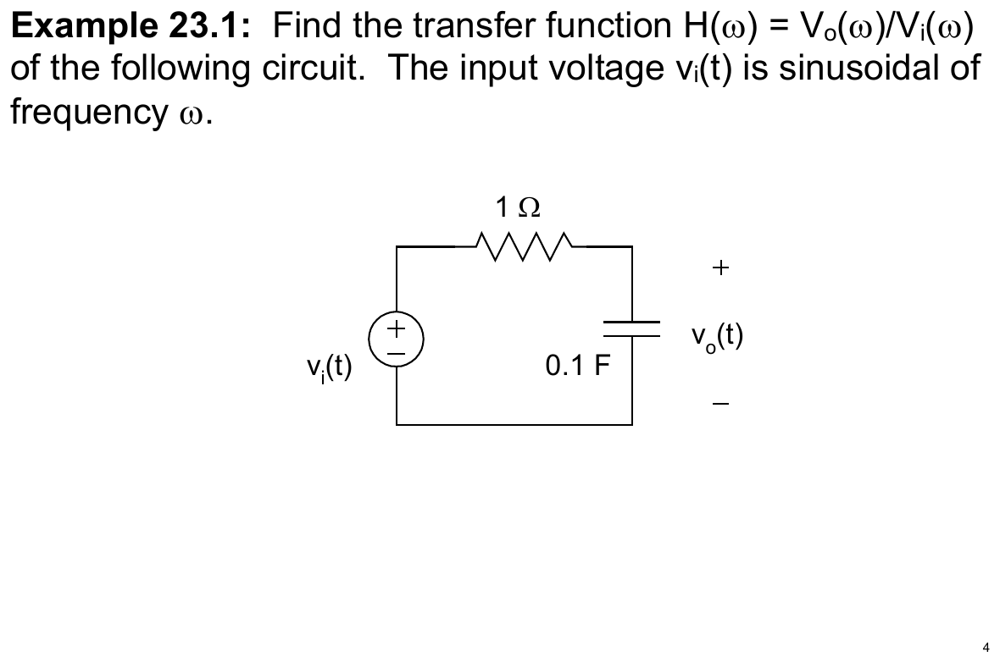

### 📐 Equation 66: transfer function
$$H(\omega) = \frac{V_{out}(\omega)}{V_{in}(\omega)}$$

Example 23.1: voltage division with 1 Ω and 0.1 F:

$$H(\omega) = \frac{1/(j\omega 0.1)}{1 + 1/(j\omega 0.1)} = \frac{1}{1 + j\omega 0.1}$$

### 📐 Rule 67: output of a sine through H

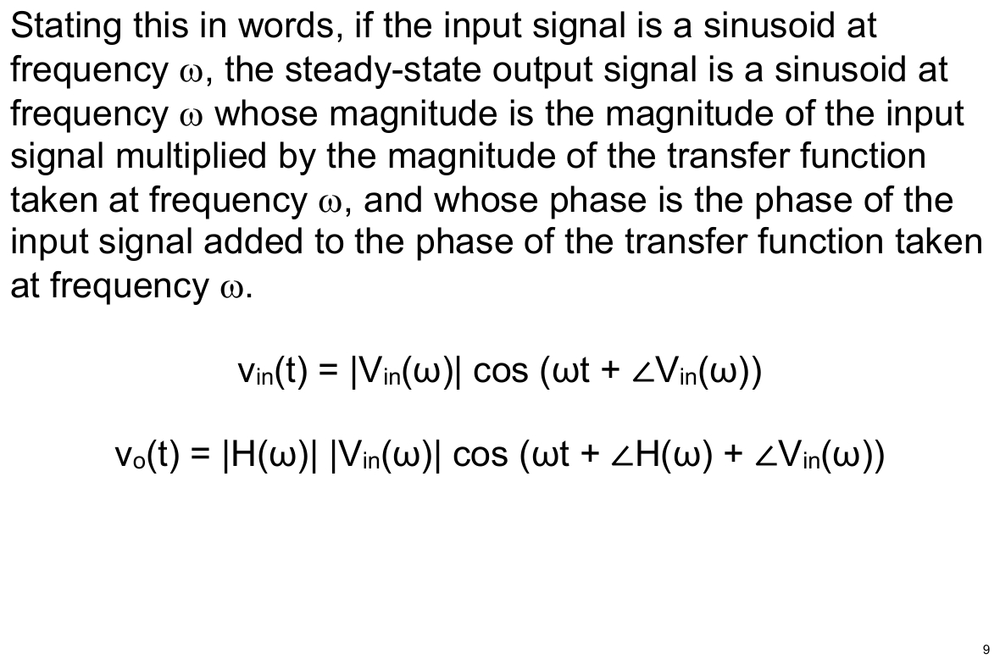

$$v_{in} = A\cos(\omega t + \theta) \;\Rightarrow\; v_{out} = A\,|H(\omega)|\cos\big(\omega t + \theta + \angle H(\omega)\big)$$

**Use it when:** "calculate Vout(t)". Evaluate H at the **input's** ω.

**Several frequencies at once:** do each one with Rule 67 and add (superposition).

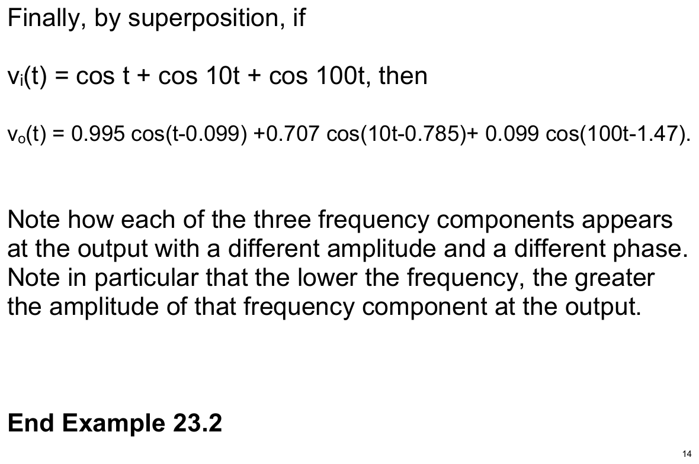

---

## 2. Bode plots and decibels

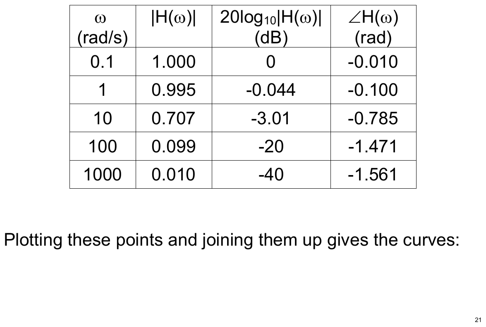

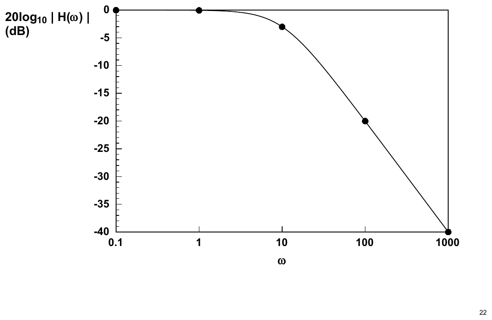

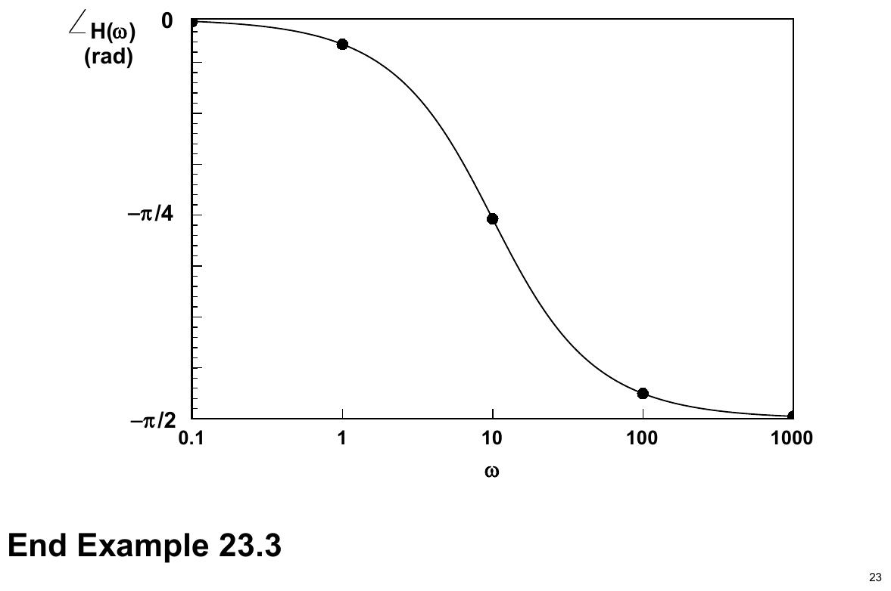

**How to read these plots:**
- Frequency on a **log** axis (each tick ×10).
- Gain in dB: 0 dB = ×1, −20 dB = ×0.1, −40 dB = ×0.01.
- This low-pass is flat until ω0 = 10 rad/s, then falls at **−20 dB per decade**.
- The phase goes from 0 to −90°, passing −45° at ω0.

### 📐 Equation 68: dB and the 3 dB point
$$\text{gain (dB)} = 20\log_{10}|H| \qquad |H(\omega_{3dB})| = \frac{|H|_{max}}{\sqrt 2} \;(-3\ \text{dB})$$

### Drawing checklist: gain and phase plots
1. Log frequency axis covering the range asked (e.g. 10 kHz to 10 MHz: three decades).
2. Work out the low-frequency and high-frequency limits (Rule 70). Write them in dB.
3. Mark the corner (3 dB) frequency. The gain is 3 dB below the flat part there.
4. Slopes: ±20 dB/decade per first-order corner, ±40 dB/decade for second order.
5. Phase: the low and high limits, and the value at the corner (±45° for first order, ±90° for second order).
6. Compute 3 to 5 actual points. Plot them as dots, then join them smoothly.
7. Label the axes with units (dB, degrees or rad, Hz or rad/s).

---

## 3. First-order filters

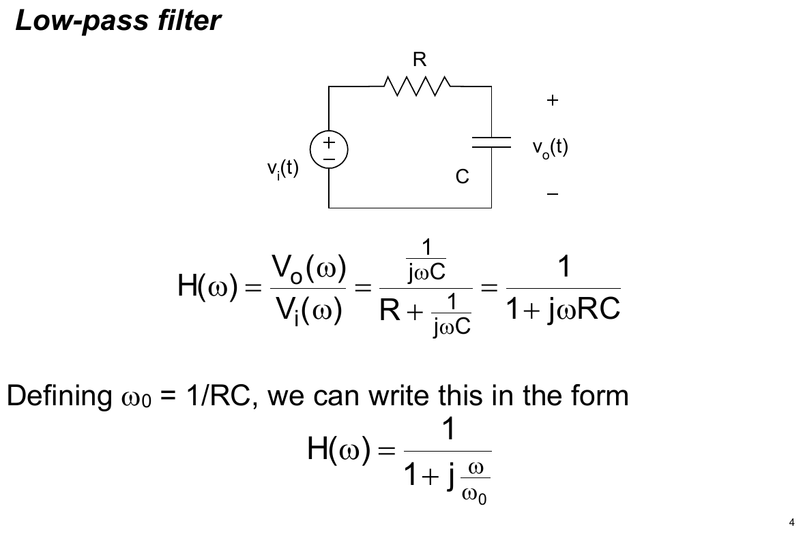

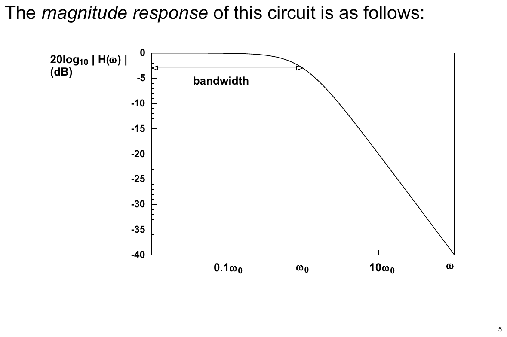

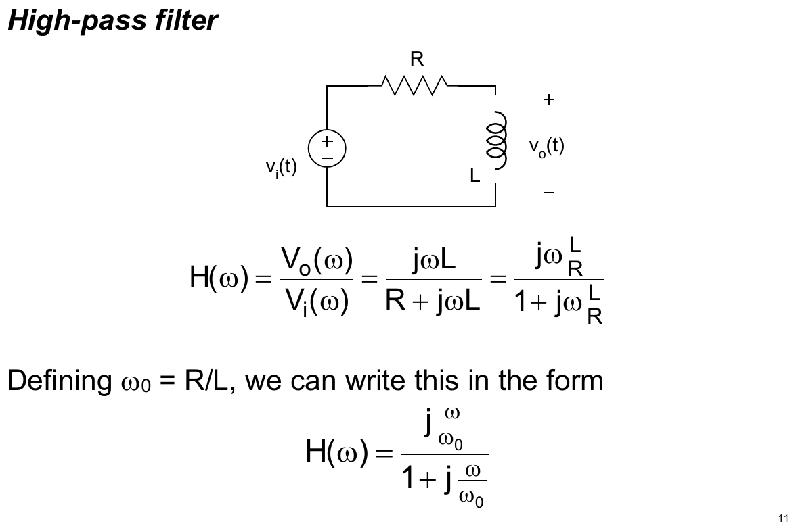

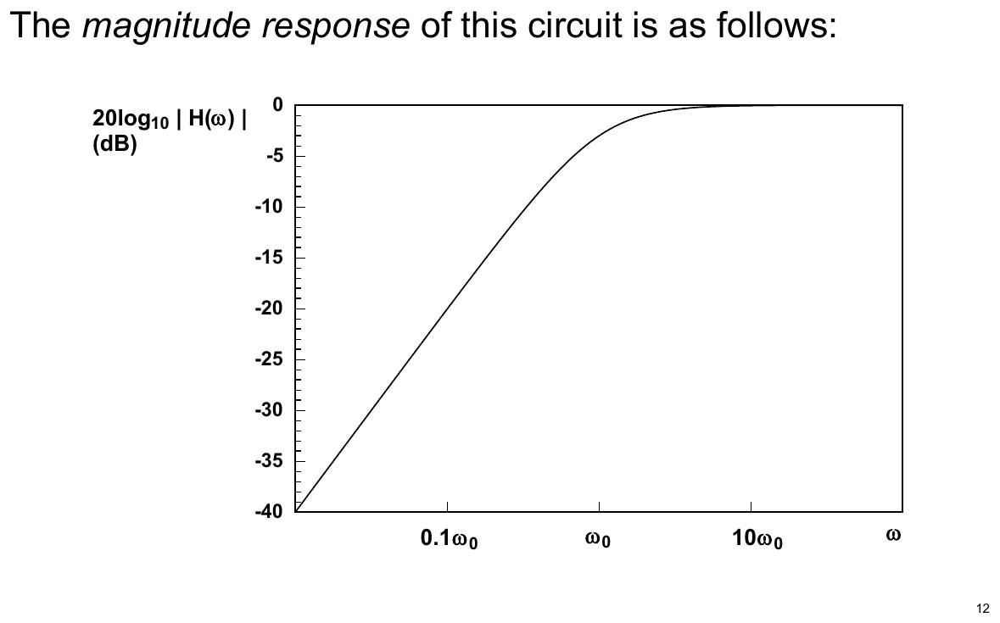

### 📐 Equation 69: first-order filters
$$\text{low-pass: } H = \frac{1}{1 + j\omega/\omega_0} \qquad \text{high-pass: } H = \frac{j\omega/\omega_0}{1 + j\omega/\omega_0}$$

ω0 = 1/(RC) for RC, ω0 = R/L for RL.

| | ω ≪ ω0 | ω = ω0 | ω ≫ ω0 |
|---|---|---|---|
| low-pass \|H\| | 1 | 0.707 (−3 dB) | ω0/ω (−20 dB/dec) |
| low-pass phase | 0 | −45° | −90° |
| high-pass \|H\| | ω/ω0 | 0.707 | 1 |
| high-pass phase | +90° | +45° | 0 |

### 📐 Rule 70: filter type by inspection
- ω → 0: capacitor = open, inductor = short.
- ω → ∞: capacitor = short, inductor = open.

Redraw the circuit for each limit. If the output is connected to the input → passes. If it's shorted to ground or cut off → blocks.

### 🧠 Check
Homework 3 Q2: Vin → R1 → (R2 ∥ C3) → output, with C4 from output to ground. Is it low-pass or high-pass?

Answer

ω → 0: both C open. No current, so Vout = Vin. Gain 1.

ω → ∞: C4 is a short across the output. Gain 0.

**Low-pass.** (C3 just adds a little extra boost at mid frequencies.)

---

## 4. Band-pass and Q

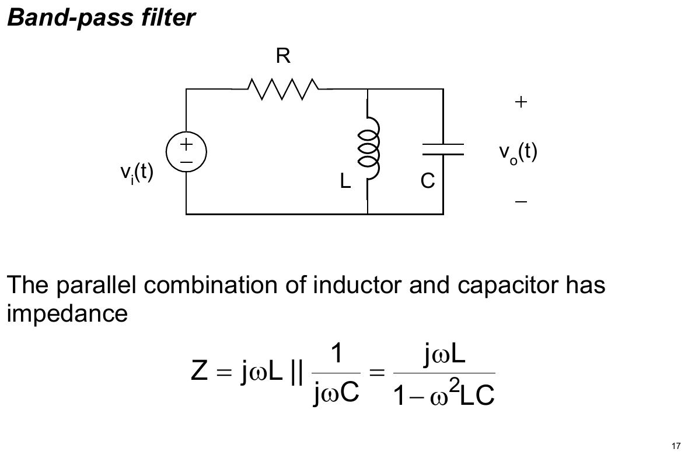

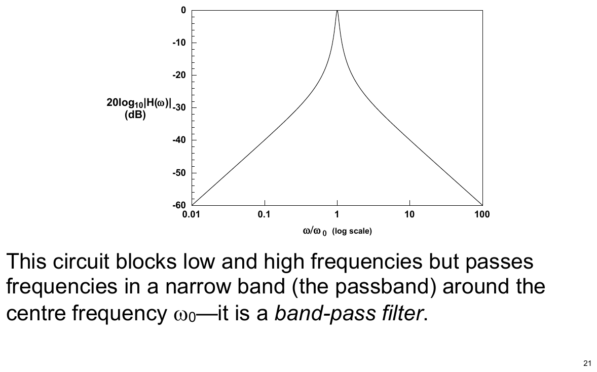

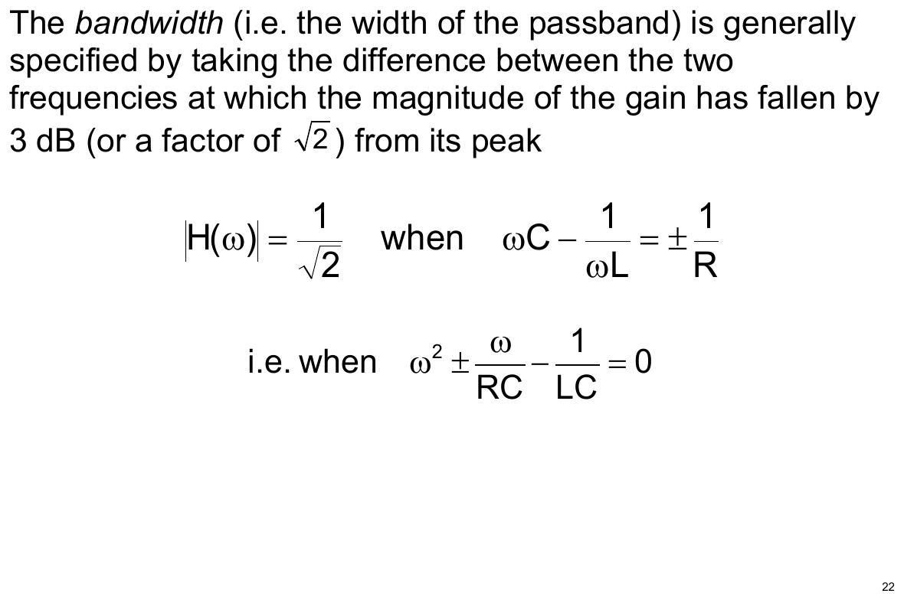

### 📐 Equation 71: RLC band-pass (R in series, L ∥ C to ground)
$$\omega_0 = \frac{1}{\sqrt{LC}} \qquad \text{BW} = \frac{1}{RC} \qquad Q = \frac{\omega_0}{\text{BW}} = R\sqrt{\frac{C}{L}}$$

At ω0 the L ∥ C is an open circuit (Topic 13), so H = 1.

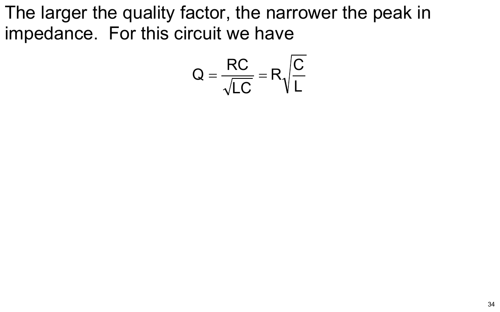

**Example 24.1:** R = 2387 Ω, C = 1 nF, L = 25.33 μH: f0 = 1.000 MHz, BW = 6.667 kHz, Q = 15.

---

## Worked example: Homework 3 Q2

Vin → R1 → (R2 ∥ C3) → output. C4 from output to ground.

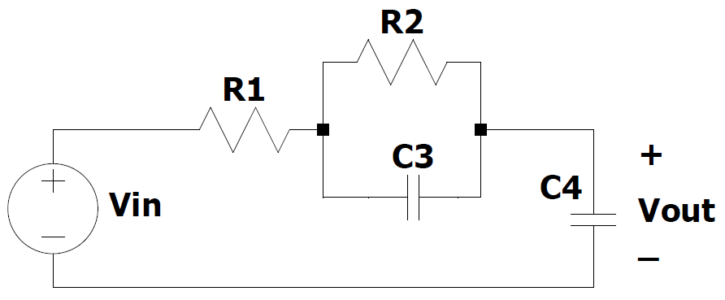

**(a)** Voltage division with Z1 = R1, Z2 = R2, Z3 = 1/(jωC3), Z4 = 1/(jωC4):

$$H(\omega) = \frac{Z_4}{Z_1 + Z_2 \parallel Z_3 + Z_4} = \frac{Z_4 (Z_2 + Z_3)}{(Z_1 + Z_4)(Z_2 + Z_3) + Z_2 Z_3}$$

**(b), (c)** R1 = 1200, R2 = 2200 Ω, C3 = 3300 pF, C4 = 4700 pF, f = 25 kHz.

Z3 = −j1929, Z4 = −j1354.5. Z2 ∥ Z3 = 956.3 − j1090.6.

Sum = 2156.3 − j2445.1 = 3260∠−48.6°.

H = 1354.5∠−90° / 3260∠−48.6° = **0.4155∠−41.41°** (−0.723 rad).

**(d)** Vin = sin(ωt) = cos(ωt − 90°), ω = 2π × 25 000 = 157 080 rad/s.

$$V_{out}(t) = 0.4155\cos(157\,080\,t - 131.4°) = 0.4155\cos(157\,080\,t - 2.294)$$

---

## Worked example: Resit 2021 Q2

Vs → Rs → C2 → output (node 3). L1 and RL both from node 3 to ground. Rs = RL = 1 kΩ, L1 = 1 mH, C2 = 1 nF.

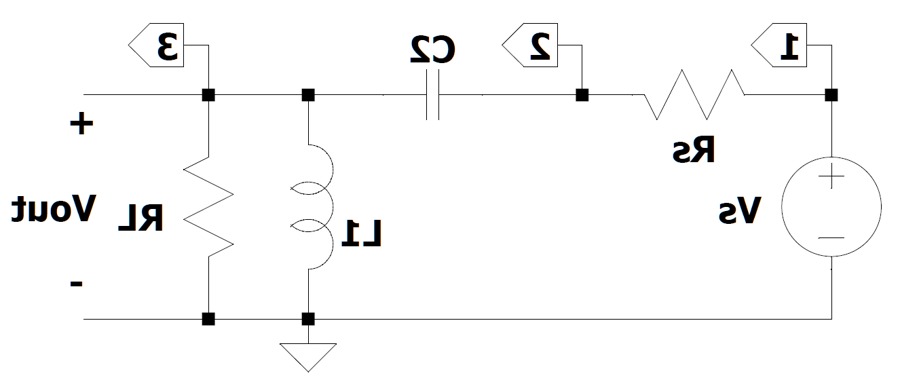

**(a)** Let Zp = jωL1 ∥ RL. Voltage division, then multiply top and bottom to get the (a + jb)/(c + jd) form:

$$H(\omega) = \frac{-\omega^2 L_1 C_2 R_L}{R_L - \omega^2 L_1 C_2 (R_s + R_L) + j\omega(L_1 + C_2 R_s R_L)}$$

**(b) Plot, 10 kHz to 10 MHz.** Rule 70: low ω: C2 open → 0 (gain rises at +40 dB/decade, phase near 180°). High ω: C2 short, L1 open → RL/(Rs + RL) = 0.5 = **−6 dB**, phase 0. A second-order **high-pass**.

| f | 10 kHz | 100 kHz | 159 kHz | 1 MHz | 10 MHz |
|---|---|---|---|---|---|
| gain (dB) | −48.1 | −10.2 | −7.0 | −6.0 | −6.0 |
| phase | 173° | 100° | 63° | 9° | 1° |

**(c)** Vs = sin(10⁶ t), so ω = 10⁶: ω²L1C2 = 1.

H = −1000/(1000 − 2000 + j10⁶ × 2 × 10⁻³) = −1000/(−1000 + j2000) = 0.2 + j0.4 = 0.4472∠63.43°.

Vs = cos(10⁶ t − 90°). Vout = 0.4472 cos(10⁶ t − 90° + 63.43°):

**Vm = 0.447 V, φ = −26.6° (−0.464 rad)**

---

## Method: frequency response

| You're asked for | Use |
|---|---|
| H(ω) of a passive circuit | voltage division with impedances (Topic 11 Rule 54) |
| filter type | Rule 70 limits |
| \|H\| and ∠H at f | put ω = 2πf in, polar form |
| gain in dB | 20 log10\|H\| (Eq 68) |
| 3 dB frequency | solve \|H\| = \|H\|max/√2. First order: ω0 (Eq 69) |
| frequency for a given phase | set ∠H, often "real part = 0" (−90°) or "real = imag" (±45°) |
| Vout(t) | Rule 67. Watch sin vs cos (Topic 10 Rule 50) |
| a Bode plot | the drawing checklist |

---

Next: [End-of-topic test](../questions/14-frequency-response.md)
