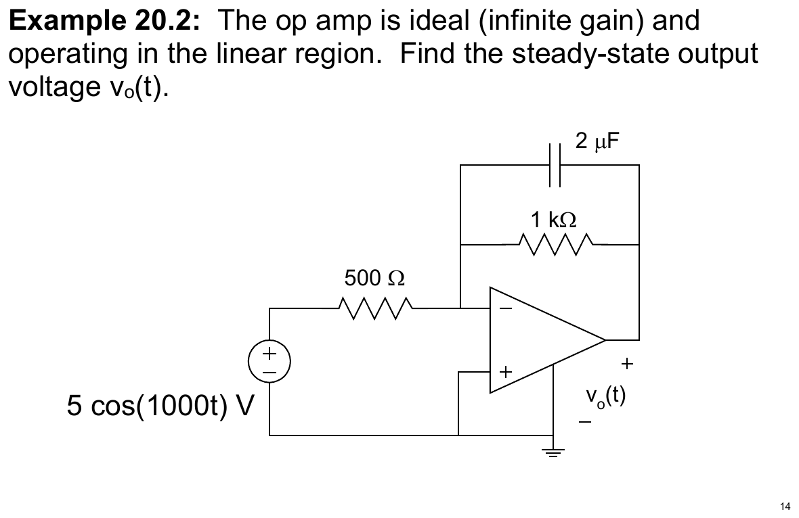
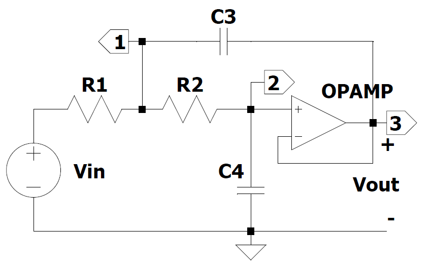
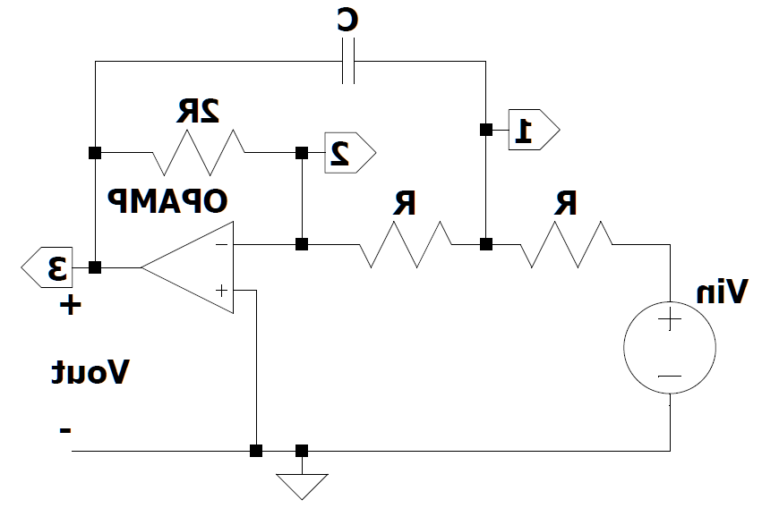
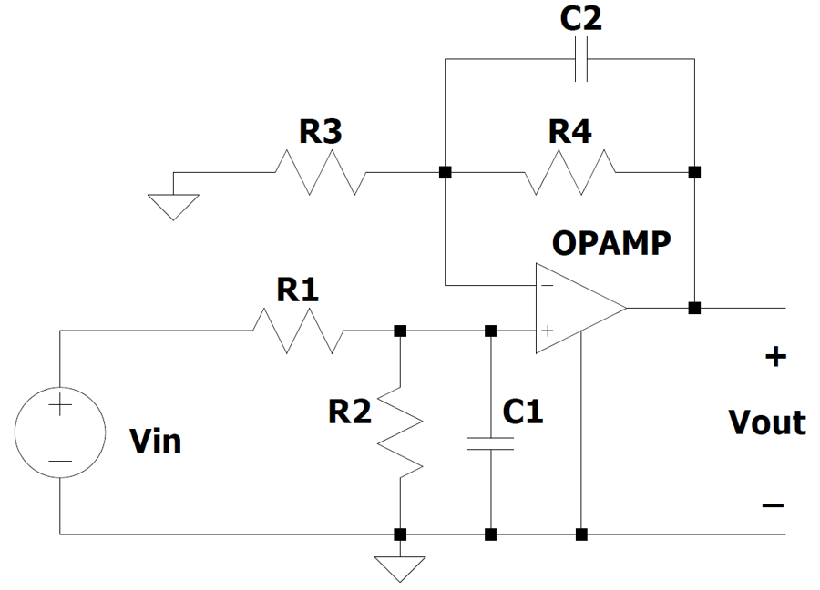
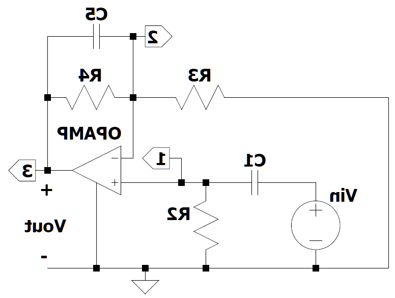
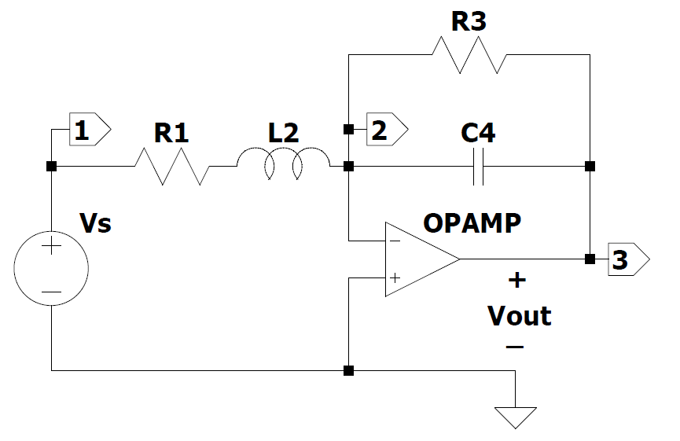

# Topic 15: Op-amp filters

Slide exercises: Lecture 23 Self test 23.1 · Lecture 20 Example 20.2 · Homework 4 Q2 · Past finals: Q2 of Finals 2025, 2024, 2023, 2022, 2021 and Resits 2025, 2024, 2023 · Q1e of Finals 2023, 2022, 2021 and Resits 2024, 2023, 2022, 2021

Slides: Lecture 23 pages 29 to 32 and Lecture 24 (the filter ideas), with Topic 7 (op amps).

---

## The big idea

Put capacitors into an op-amp circuit and the gain depends on frequency.

That is an **active filter**.

 

Nothing new to learn: the op-amp rules (Topic 7) plus impedances (Topic 11).

Inverting: H = −Zf/Z1. Non-inverting: H = 1 + Zf/Z1. Anything else: KCL at the nodes, with v− = v+.

 

The same five or six circuits come back year after year. Learn them here.

---

**How to use these notes:**
When you see 🧠, stop.
Answer it on paper first.
Then click to check.

---

## 🎯 In the final

This topic alone is worth about **70 of the 200 marks** most years:

| Paper | Q1e (20% of Q1) | Q2 (50 marks) |
|---|---|---|
| Final 2025 | (a rectifier instead) | non-inverting with R ∥ C on both sides → 1/(1 + jωCR) |
| Final 2024 | (a diode instead) | inverting with R, R, 2R, C → phase 135° |
| Final 2023 | inverting LP: dc gain, 3 dB | Sallen–Key low-pass, phase −90° |
| Final 2022 | inverting LP: Vout(t) | RC high-pass into a non-inverting amp |
| Final 2021 | inverting LP: Vout(t) | difference amp with Rf ∥ Cf |
| Resit 2025 | (a diode instead) | inverting with R, 2R, 3R, C → phase 135° |
| Resit 2024 | inverting LP: dc gain, 3 dB | Sallen–Key low-pass, phase −90° |
| Resit 2023 | inverting LP: Vout(t) | non-inverting with R ∥ C feedback |
| Resit 2022 | inverting LP: Vout(t) | difference amp at dc (Topic 7) |
| Resit 2021 | non-inverting with an RC high-pass input | passive (Topic 14) |

---

## ⭐ Learn by heart from this topic

Open book: on your [exam sheet](../formula-sheet.md). Recognise each circuit on sight.

- Rule 72: op-amp filters: Topic 7's rules with Z in place of R. Inverting −Zf/Z1. Non-inverting 1 + Zf/Z1.
- Equation 73: inverting low-pass (R2 in, R4 ∥ C3 feedback): H = −(R4/R2)/(1 + jωR4C3). dc gain R4/R2. f3dB = 1/(2πR4C3).
- Equation 74: unity-gain Sallen–Key low-pass: H = 1/(1 − ω²R1R2C3C4 + jωC4(R1 + R2)). Phase −90° at ω0 = 1/√(R1R2C3C4).
- Equation 75: inverting R, aR, bR with C from the middle node to the output: H = −[b/(1 + a)] / [1 + jωCR(a + b)/(1 + a)].
- Equation 76: RC high-pass into a non-inverting amp: H = [jωCR/(1 + jωCR)] × (1 + Rf/R1).
- An inverting filter's phase is **180° minus** the low-pass lag. So at its corner it is 180° − 45° = 135°.

**Memory hook:** "Same op amp, R becomes Z."

---

## 1. The rule

### 📐 Rule 72: op-amp filters
Replace every R by its impedance Z. Then:

- inverting: H = −Zf/Z1,
- non-inverting: H = 1 + Zf/Z1,
- anything else: KCL at each node with v− = v+ and no input current (Topic 7 Rule 32).

Useful parallel combination: R ∥ C = R/(1 + jωRC).

Lecture 20 Example 20.2 is the simplest one: −(1 k ∥ 2 μF)/500.

---

## 2. The inverting low-pass (every Q1e)

R2 from V1 to the − input. R4 ∥ C3 from the − input to the output. + input to ground.

### 📐 Equation 73: inverting low-pass
$$H(\omega) = -\frac{Z_f}{R_2} = -\frac{R_4/R_2}{1 + j\omega R_4 C_3}$$

| Quantity | Value |
|---|---|
| dc gain | −R4/R2, in dB: 20 log(R4/R2) |
| 3 dB frequency | f3dB = 1/(2π R4 C3) |
| phase | 180° − tan⁻¹(ωR4C3). 180° at dc, 135° at f3dB, 90° far above |

**Final 2023 Q1e:** R2 = 10 kΩ, C3 = 10 pF, R4 = 100 kΩ.

dc gain = 10 → **20 dB** (inverting). f3dB = 1/(2π × 100 k × 10 p) = **159.2 kHz**.

**Resit 2024 Q1e:** 22 k, 100 p, 180 k → **18.26 dB**, **8.84 kHz**.

### Worked example: Final 2022 Q1e (writing Vout(t))

V1 = 50 cos(2π 50 000 t) mV, R2 = 10 kΩ, C3 = 10 pF, R4 = 330 kΩ.

ωR4C3 = 2π × 50 000 × 330 k × 10 p = 1.037.

H = −33/(1 + j1.037) = 22.91∠(180° − 46.0°) = 22.91∠134.0°.

$$V_{out}(t) = 1.146\cos(2\pi\,50\,000\,t + 134.0°)\ \text{V}$$

(134.0° = 2.338 rad.) 50 kHz is right at the corner (48.2 kHz): that is why the phase is close to 135°.

---

## 3. Sallen–Key low-pass (Final 2023 Q2, Resit 2024 Q2)

Vin → R1 → node 1 → R2 → node 2 = + input. C4 from node 2 to ground. C3 from node 1 to the output. The op amp is a follower (output to − input).

**(a) In Z1 … Z4.** Follower: Vout = e2. KCL at node 2 gives e1 = Vout(1 + Z2/Z4). KCL at node 1 then gives

$$H = \frac{Z_3 Z_4}{Z_1 Z_2 + Z_3 (Z_1 + Z_2) + Z_3 Z_4}$$

**(b) In R1, R2, C3, C4.** Divide top and bottom by Z3Z4:

### 📐 Equation 74: unity-gain Sallen–Key low-pass
$$H(\omega) = \frac{1}{1 - \omega^2 R_1 R_2 C_3 C_4 + j\omega C_4 (R_1 + R_2)}$$

**(c) Phase −90°:** the real part of the bottom is zero:

$$\omega_0 = \frac{1}{\sqrt{R_1 R_2 C_3 C_4}} \qquad f_0 = \frac{1}{2\pi\sqrt{R_1 R_2 C_3 C_4}}$$

At ω0: H = 1/(jω0C4(R1 + R2)), so |H| = √(R1R2C3/C4)/(R1 + R2). With equal R's and C's, |H| = ½.

**(d)** Vout(t) = A |H(ω0)| cos(2πf0 t − 90°).

⚠️ **Final 2023 Q2 gives no component values** for (c) and (d). Answer with the formulas. Resit 2024 Q2 gives them:

**Resit 2024 Q2:** R1 = R2 = 10 kΩ, C3 = C4 = 1 nF.

ω0 = 1/(RC) = 10⁵ rad/s → **f0 = 15.92 kHz**.

(d) The input is A cos(**π** f0 t): **half** of f0! At ω = ω0/2:

H = 1/(1 − 0.25 + j1) = 1/(0.75 + j1) = 0.8∠−53.13°.

$$V_{out}(t) = 0.8\cos(50\,000\,t - 0.927)\ \text{V}$$

Read the question twice: πf0 is not 2πf0.

---

## 4. The R, aR, bR, C circuit (Final 2024 Q2, Resit 2025 Q2)

Vin → R → node 1 → aR → node 2 = − input. bR from node 2 to the output. C from node 1 to the output. + input to ground.

KCL at node 2 (virtual ground): e1/(aR) + Vout/(bR) = 0 → e1 = −(a/b)Vout.

KCL at node 1: (Vin − e1)/R = e1/(aR) + (e1 − Vout) jωC.

### 📐 Equation 75: inverting R, aR, bR, C filter
$$H(\omega) = -\frac{b/(1+a)}{1 + j\omega C R\,\frac{a + b}{1 + a}}$$

**Final 2024 (a = 1, b = 2):** H = −1/(1 + 1.5 jωRC).

**Resit 2025 (a = 2, b = 3):** H = −1/(1 + (5/3) jωRC).

**(b) Phase 135°:** −1 = 180°. 180° − tan⁻¹(1.5ωRC) = 135° → 1.5 ωRC = 1:

$$f_0 = \frac{1}{3\pi R C} \quad (\text{Final 2024}) \qquad f_0 = \frac{3}{10\pi R C} \quad (\text{Resit 2025})$$

**(c)** Final 2024: R = 10 kΩ, C = 1 nF → **f0 = 10.61 kHz**. Resit 2025: R = 10 kΩ, C = 4 nF → **f0 = 2387 Hz**.

**(d)** At f0, |H| = 1/√2. Vin = cos(2πf0 t):

$$V_{out}(t) = 0.7071\cos(2\pi f_0 t + 135°) = 0.7071\cos(2\pi f_0 t + 3\pi/4)$$

**Hidden structure:** it is just a first-order inverting low-pass with dc gain −1. "Phase 135°" is its 3 dB point.

---

## 5. Non-inverting filters

### Final 2025 Q2 (official answers)

Vin → R1 → + input. R2 and C1 from the + input to ground. R3 from the − input to ground. R4 ∥ C2 from the − input to the output. All R equal, all C equal.

Input divider: (R ∥ C)/(R + R ∥ C) = 1/(2 + jωCR).

Gain: 1 + (R ∥ C)/R = (2 + jωCR)/(1 + jωCR).

Multiply: **H = 1/(1 + jωCR)** (official).

**Hidden structure:** the (2 + jωCR) cancels. A complicated circuit that is just an RC low-pass. Then Topic 10's worked example gives Vout(t).

### Final 2022 Q2 and Resit 2023 Q2

Vin → C1 → + input, R2 from + input to ground (an RC **high-pass**). − input: R3 to ground, R4 ∥ C5 to the output.

### 📐 Equation 76: high-pass into a non-inverting amplifier
$$e_1 = V_{in}\frac{j\omega C_1 R_2}{1 + j\omega C_1 R_2} \qquad V_{out} = e_1\left(1 + \frac{Z_{45}}{R_3}\right), \quad Z_{45} = \frac{R_4}{1 + j\omega R_4 C_5}$$

**Final 2022 (c):** C1 = 100 μF, R2 = 10 kΩ, R3 = 1 kΩ, R4 = 10 kΩ, C5 = 1 nF, f = 7 kHz.

ωC1R2 = 4398, so e1 = Vin (the high-pass passes 7 kHz untouched).

Z45 = 10 k/(1 + j0.4398) = 8379 − j3685. 1 + Z45/R3 = 9.379 − j3.685 = 10.08∠−21.45°.

$$V_{out}(t) = 10.08\cos(2\pi\,7000\,t - 21.45°) = 10.08\cos(43\,982\,t - 0.374)\ \text{V}$$

**Resit 2023 Q2** has no input high-pass (Vin straight to +): H = 1 + Z45/R3 with R3 = 1 k, R4 = 10 k, C5 = 4.7 nF.

1 kHz: |H| = 10.55 → **20.47 dB**, phase **−14.9°**. 10 kHz: |H| = 3.653, phase −56.3° → **Vout(t) = 3.653 cos(2π 10 000 t − 0.982) V**.

---

## 6. Difference amplifier with Zf (Final 2021 Q2)

Topic 7's difference amplifier with Rf ∥ Cf in both places:

$$H_1 = -\frac{Z_f}{R_i} \qquad H_2 = +\frac{Z_f}{R_i} \qquad Z_f = \frac{R_f}{1 + j\omega R_f C_f}$$

**(c)** A1 = 1 V, A2 = 2 V, both cos at 10 kHz, Ri = 1 kΩ, Rf = 10 kΩ, Cf = 1 nF.

Vout = (Zf/Ri)(Vs2 − Vs1) = (Zf/Ri) × 1∠0. Zf/Ri = 10/(1 + j0.628) = 8.467∠−32.1°.

$$V_{out}(t) = 8.467\cos(2\pi\,10^4\,t - 0.561)\ \text{V}$$

---

## 7. Homework 4 Q2

Vs → R1 → L2 → − input. R3 ∥ C4 feedback. + input to ground.

**(a)** H(f) = −[R3/(1 + j2πf R3C4)] / (R1 + j2πf L2)

**(b)** At 1 kHz both corrections are tiny: |H| ≈ R3/R1 = **1.833**

**(c)** Two corners: R3C4 gives 32.88 kHz. R1/L2 gives 159 MHz (far away). So **f3dB = 32.88 kHz**.

**(d)** Vs = sin(2πf3dB t): |H| = 1.833/√2 = 1.296, phase 180° − 45° = 135°:

**Vout(t) = 1.296 sin(2π × 32 880 t + 135°) V**

---

## Method: op-amp filter questions

| You're asked for | Use |
|---|---|
| H(ω) of an inverting circuit | −Zf/Z1 (Rule 72) |
| H(ω) of a non-inverting circuit | (input divider) × (1 + Zf/Z1) |
| H(ω) of anything else | KCL at each node, v− = v+, eliminate the inner nodes |
| H in terms of Z1 … Z4 | keep Z's until the last line, then substitute |
| dc gain | ω = 0: capacitors open |
| 3 dB frequency | the corner: ωRC = 1 for the feedback R ∥ C |
| frequency where the phase is −90° | real part of the bottom = 0 |
| frequency where the phase is 135° | inverting filter at its corner (Eq 75) |
| Vout(t) | Topic 14 Rule 67. Read the input frequency carefully (πf0 vs 2πf0) |

---

Next: [End-of-topic test](../questions/15-op-amp-filters.md)
