# Topic 16: Nonlinear circuits and the diode

Slide exercises: Lecture 26 Example 26.1, Self test 26.1 · Homework 4 Q1b · Past finals: Final 2024 Q1e · Resit 2025 Q1e

Slides: Lecture 25, pages 1 to 23, and Lecture 26, pages 1 to 30.

---

## The big idea

A diode lets current through in **one direction only**.

That makes it **nonlinear**: superposition, Thévenin with sources and phasors no longer work on it directly.

 

The fix: model the diode as a **switch** that is either ON or OFF.

Guess which. Solve the linear circuit. Check that the guess was consistent.

If not, take the other guess.

---

**How to use these notes:**
When you see 🧠, stop.
Answer it on paper first.
Then click to check.

---

## 🎯 In the final

- **Final 2024 Q1e and Resit 2025 Q1e (20% of Q1):** a diode between a voltage source VA and a node pulled up to VDD through RL. Find e3 for two values of VA. The diode drop is 500 mV or 650 mV. Worked example below.
- **Question 3 (50 marks)** in most years is a diode **circuit with a waveform** (Topic 17). Everything there starts with this topic's ON/OFF method.
- Homework 4 Q1b: two diodes clamping a node.

---

## ⭐ Learn by heart from this topic

Open book: on your [exam sheet](../formula-sheet.md). The ON/OFF test is what you must do fast.

- Rule 77: nonlinear means **no superposition**, no phasors through the diode. Use piecewise-linear models.
- Equation 78: real diode: i = Is (e^(v/VT) − 1), VT ≈ 25 mV.
- Rule 79: ideal diode: ON = short circuit (i ≥ 0). OFF = open circuit (v ≤ 0).
- Rule 80: piecewise-linear (PWL) diode: ideal diode in series with Vth (0.7 V unless told otherwise). ON: v = Vth, i ≥ 0. OFF: i = 0, v ≤ Vth.
- Rule 81: assume ON (or OFF), solve, check the current (or voltage) direction. Wrong? Swap.

**Memory hook:** "Guess, solve, check."

---

## 1. Linear vs nonlinear

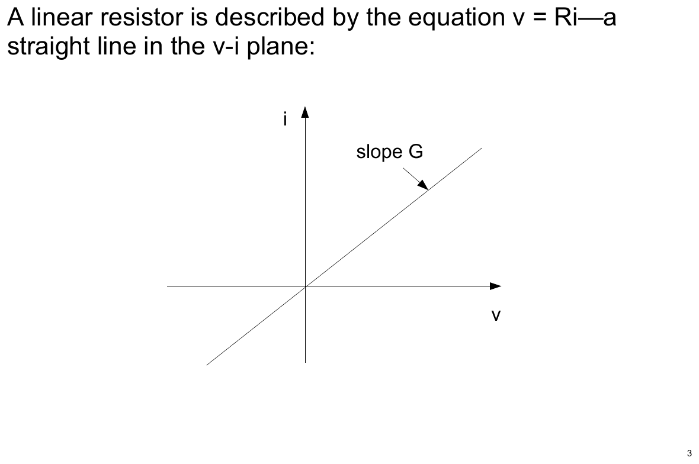

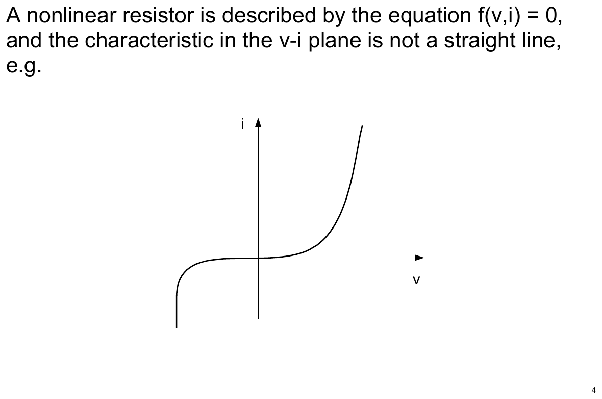

### 📐 Rule 77: nonlinear elements
A nonlinear element's v–i curve is not a straight line through the origin.

- Superposition **fails**.
- Frequency response and phasors **fail** for the whole circuit (each linear piece still works).
- Approximate the curve with straight pieces: **piecewise-linear**.

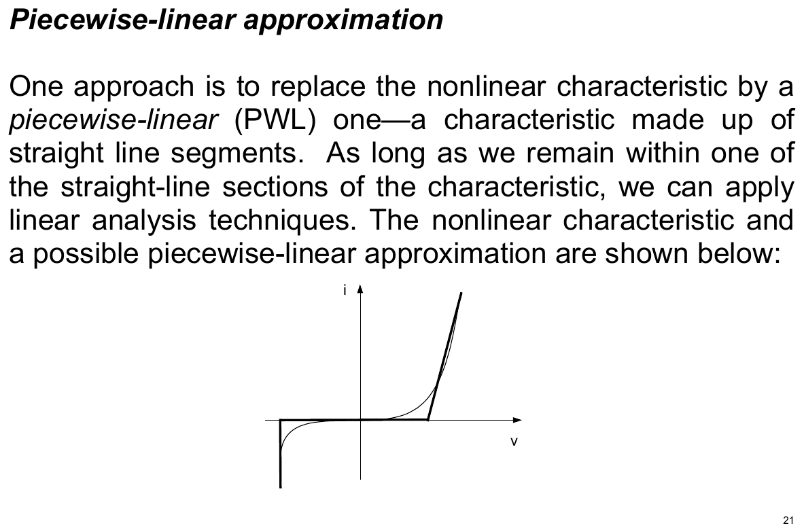

---

## 2. The pn-junction diode

### 📐 Equation 78: the diode equation
$$i = I_s\left(e^{v/V_T} - 1\right)$$

| Symbol | Means | Typical value |
|---|---|---|
| Is | saturation current | 10⁻¹⁵ to 10⁻¹⁰ A |
| VT | thermal voltage | 25 mV at room temperature |

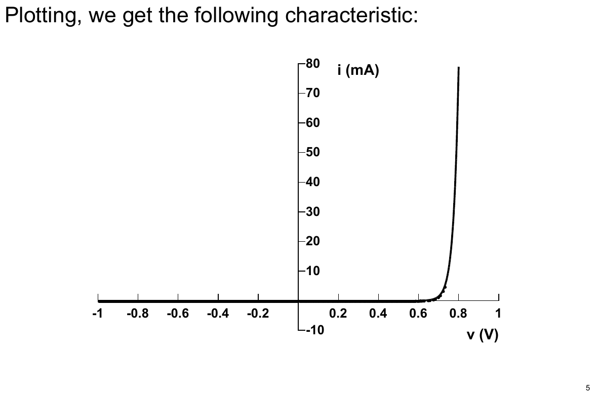

**What it means:** below about 0.6 V almost no current. Above, the current shoots up. Reverse: −Is, essentially zero.

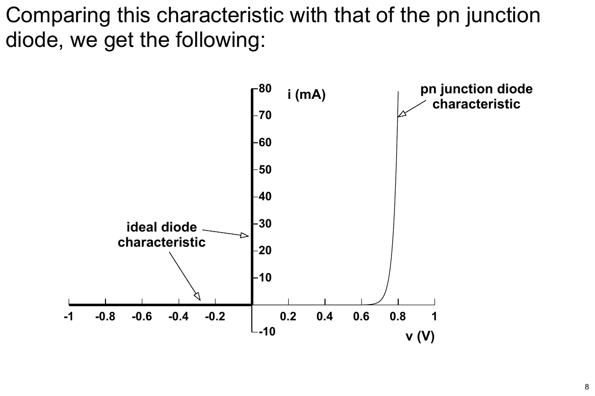

---

## 3. The ideal diode and the PWL model

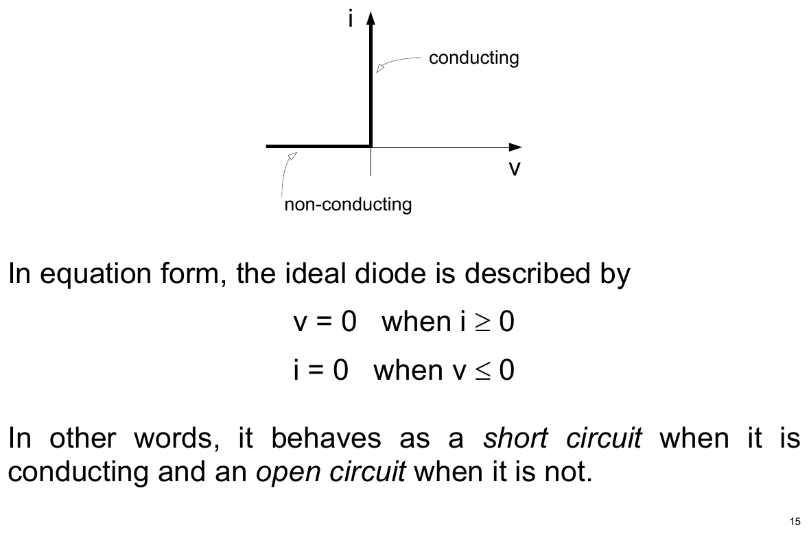

### 📐 Rule 79: ideal diode
- **ON** (conducting): v = 0, i ≥ 0 → short circuit.
- **OFF** (non-conducting): i = 0, v ≤ 0 → open circuit.

Current flows in the direction of the **arrow** (anode → cathode) only.

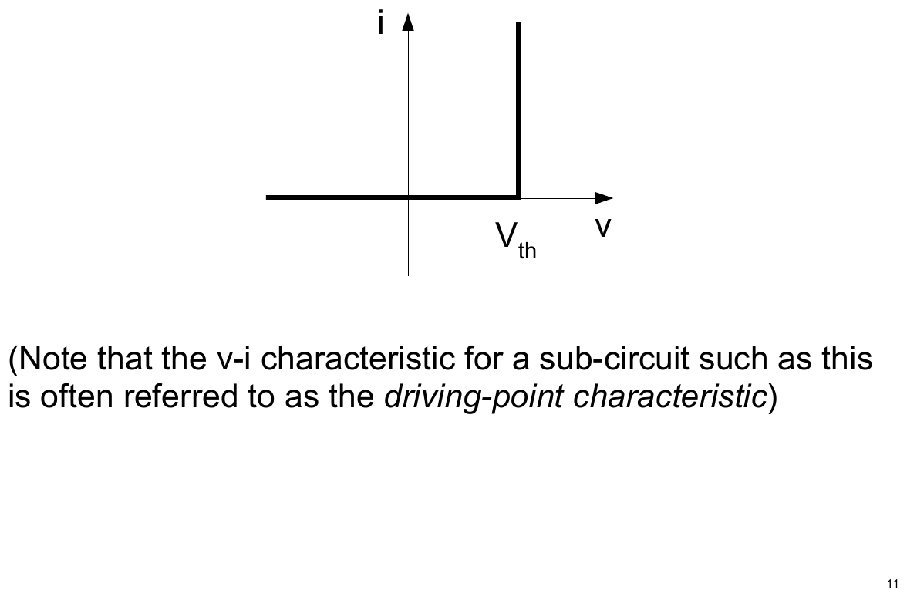

### 📐 Rule 80: piecewise-linear diode
Ideal diode in series with a voltage source Vth:

- ON: v = Vth exactly, any current ≥ 0.
- OFF: i = 0 while v < Vth.

Exam values: Vth = 0.7 V (Homework 4), 500 mV (Final 2024), 650 mV (Resit 2025). "Assume the diodes are ideal" means Vth = 0.

---

## 4. The method

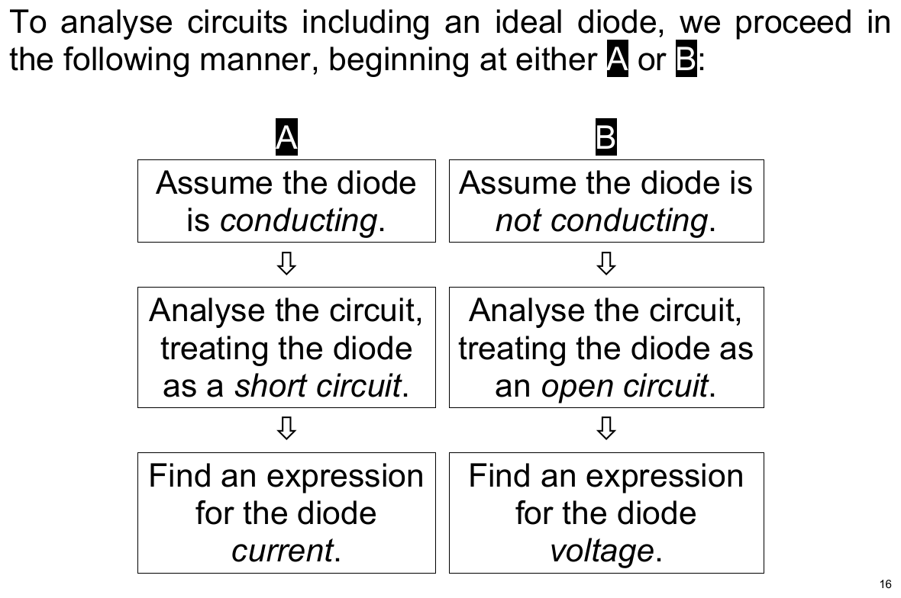

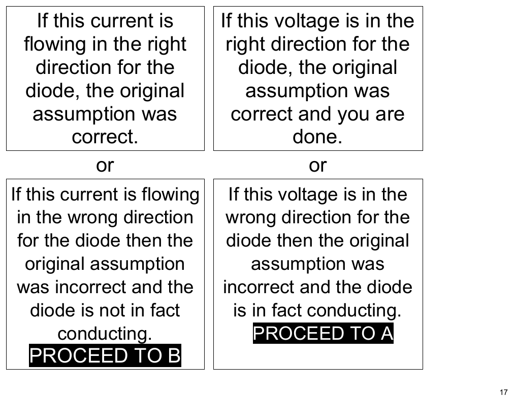

### 📐 Rule 81: assume and check
1. **Assume ON.** Replace the diode by a short (or by Vth). Solve. Is the diode current in the arrow's direction (≥ 0)? Yes → done.
2. Otherwise **assume OFF.** Replace it by an open circuit. Solve. Is the diode voltage below Vth? Yes → done.

With several diodes, try the most likely combination first. Check every diode.

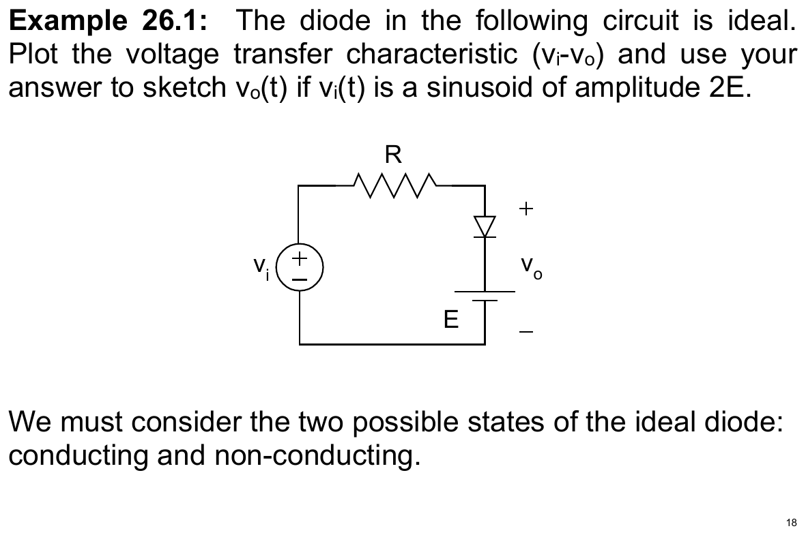

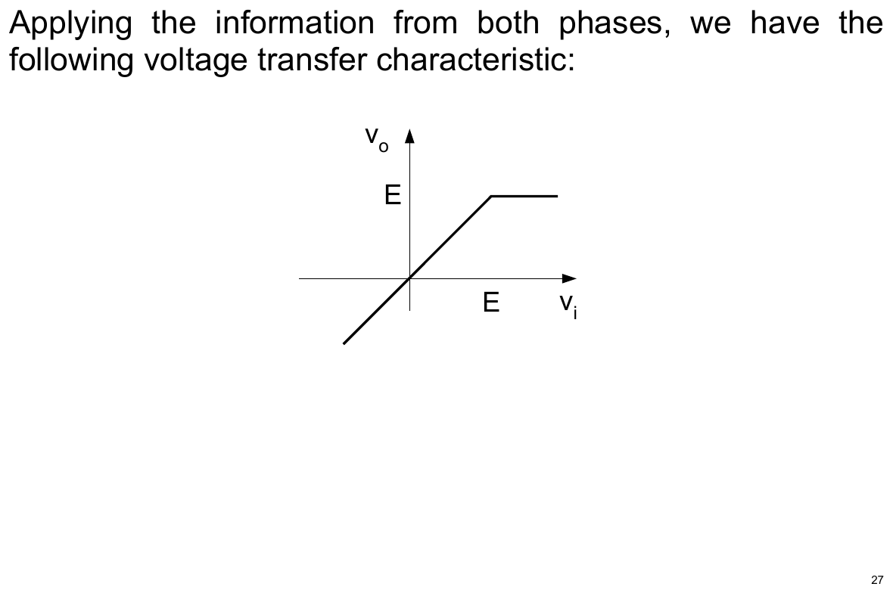

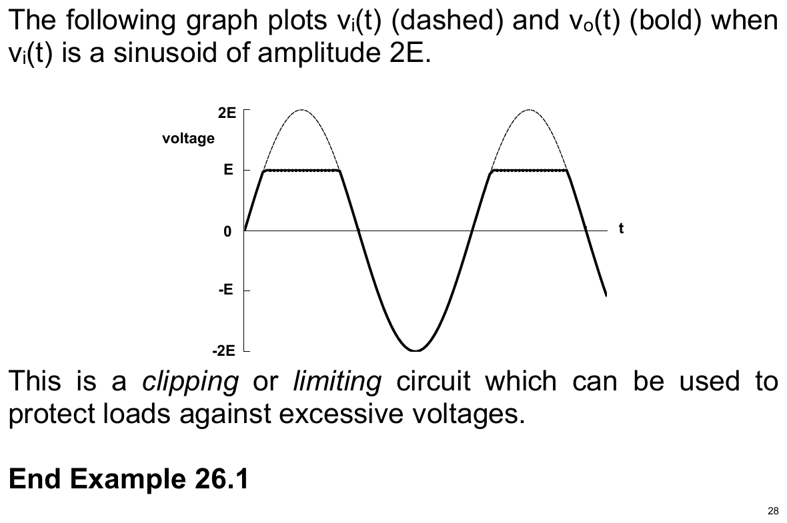

**How to read these diagrams:**
- ON when vi ≥ E: the output is stuck at E.
- OFF when vi < E: no current, vo = vi.
- So the output follows the input but is **clipped** at E. A limiter (Topic 17).

### 🧠 Check
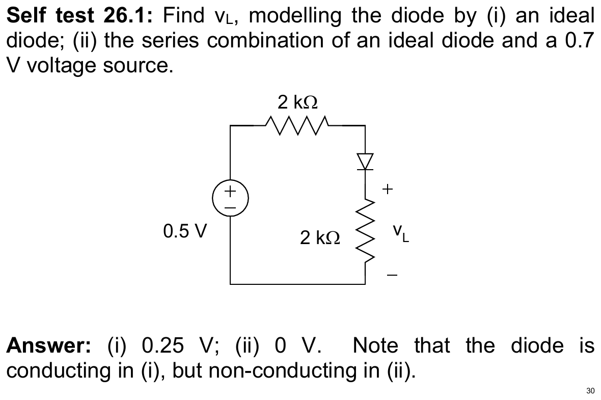

0.5 V source, 2 kΩ in series, diode, then 2 kΩ load. Find vL with (i) an ideal diode, (ii) ideal + 0.7 V.

Answer

(i) Assume ON: 0.5 V across 4 kΩ, i = 0.125 mA > 0 ✓. **vL = 0.25 V**.

(ii) Assume ON: 0.5 − 0.7 < 0 → negative current ✗. So OFF: **vL = 0 V**.

---

## Worked example: Final 2024 Q1e

VDD = 5 V pulls node 3 up through RL = 10 kΩ. A diode has its anode at node 3 and its cathode at node 2. Node 2 is held at VA by a source. Diode drop 500 mV.

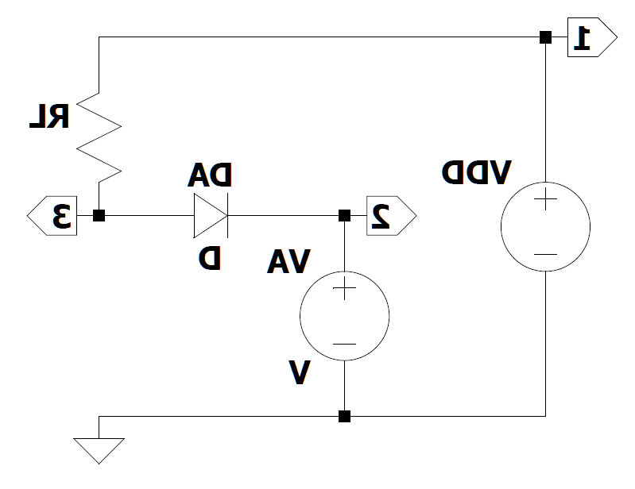

**(i) VA = 250 mV.**

Assume ON: e3 = VA + 0.5 = 0.75 V.

Current through RL = (5 − 0.75)/10 k = 0.425 mA, flowing into the anode ✓.

**e3 = 0.75 V**

**(ii) VA = 4.5 V.**

Assume ON: e3 = 5.0 V. Current = (5 − 5)/10 k = 0. Right on the edge.

Assume OFF: no current, so e3 = VDD = 5 V. Diode voltage = 5 − 4.5 = 0.5 V: not more than 0.5 V ✓.

**e3 = 5 V** either way.

(The answer box says "e3 when VA = 5 V". Then the diode is definitely OFF and e3 = 5 V too.)

**Hidden structure:** this is a diode **AND gate** (Lecture 25). The output is low when VA is low, and high only when VA is high.

**Resit 2025 Q1e:** VDD = 5 V, RL = 20 kΩ, drop 650 mV.

(i) VA = 350 mV: ON, **e3 = 1.0 V** (current 0.2 mA ✓).

(ii) VA = 4.5 V: ON would need e3 = 5.15 V > VDD, impossible. OFF: **e3 = 5 V**.

---

## Worked example: Homework 4 Q1b

VS = 5 V through RS = 1 kΩ to the output node. DA from the output to VA = 3 V. DB from the output to VB = 4 V. Vth = 0.7 V each.

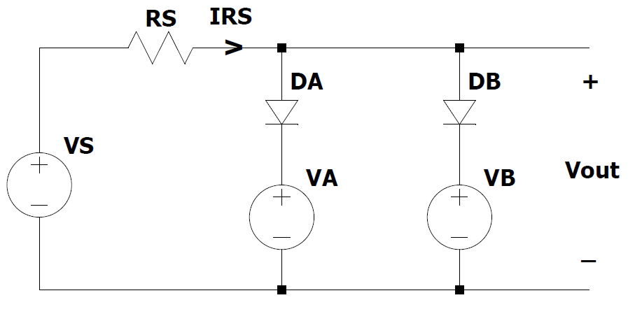

**Guess:** the lower battery wins. DA ON, DB OFF.

Output = 3 + 0.7 = 3.7 V. DB has 3.7 − 4 = −0.3 V < 0.7 ✓ OFF.

IRS = (5 − 3.7)/1 k = **1.3 mA** (flowing into DA ✓).

---

## Method: diode circuits (dc)

| You're asked for | Use |
|---|---|
| any node voltage with diodes | Rule 81: guess, solve, check every diode |
| which diode conducts first | the one with the lowest "turn-on" level (battery + Vth) |
| "assume the diodes are ideal" | Vth = 0: ON is a short |
| a diode exactly on the edge (zero current) | ON and OFF give the same answer |
| a sine input | find the input level where each diode switches, then draw (Topic 17) |

---

Next: [End-of-topic test](../questions/16-diodes.md)
