# Topic 17: Rectifiers, clippers, clampers and peak detectors

Slide exercises: Lecture 27 Example 27.1, Self test 27.1 · Lecture 26 Example 26.1 · Homework 4 Q1d · Past finals: Final 2025 Q1e, 2023 Q1d, 2022 Q3, 2021 Q3 · Resit 2024 Q1d, 2023 Q3, 2022 Q3, 2021 Q3

Slides: Lecture 27, pages 1 to 29.

---

## The big idea

Feed a sine wave into a diode circuit and the output is a **chopped** sine wave.

 

**Rectifier:** keeps only the positive halves (or flips the negative ones up).

**Clipper (limiter):** cuts the tops off at a battery level.

**Peak detector:** a capacitor holds the peak value.

**Clamper:** a capacitor shifts the whole wave up or down.

 

For each one: find **when** each diode switches, then draw the pieces.

---

**How to use these notes:**
When you see 🧠, stop.
Answer it on paper first.
Then click to check.

---

## 🎯 In the final

**Question 3 (50 marks) is a diode waveform question in most years:**

| Paper | Circuit | Asked for |
|---|---|---|
| Final 2022 Q3, Resit 2023 Q3 | two-diode clipper with batteries | sketch Vout, max, min, period |
| Final 2021 Q3 | half-wave peak detector with RC load | sketch, max, period |
| Resit 2022 Q3 | half-wave rectifier, no capacitor | sketch I_RL, max, period |
| Resit 2021 Q3 | clamper (C, diode, battery) | sketch I(R5), max, min, average, period |

And a Q1 part:

| Paper | Circuit |
|---|---|
| Final 2025 Q1e | transformer + bridge rectifier + C |
| Final 2023 Q1d, Resit 2024 Q1d | the two-diode clipper (max and min) |
| Homework 4 Q1d | peak detector with Vth = 0.7 V |

**Sketches are 25 to 50% of Q3.** Use the drawing checklists below.

---

## ⭐ Learn by heart from this topic

Open book: on your [exam sheet](../formula-sheet.md). The pictures are the thing to know.

- Rule 82: half-wave rectifier: vo = vi − Vth when vi > Vth, else 0. Period = the input's.
- Rule 83: full-wave (centre-tap or bridge): vo = |vi| minus the diode drops. A bridge has **two** diodes on at a time: 2 Vth. Period halves.
- Rule 84: peak detector: C charges to the peak (minus Vth), then discharges through RL with τ = RL C until the input catches up.
- Rule 85: clipper: a diode + battery to ground clamps the node at (battery ± Vth). Between the levels, vout = vin.
- Rule 86: clamper: a series C + diode shifts the wave so its peak sits at the diode's battery level. The shape is unchanged.
- Rule 87: when the source has Rs and no other load, Rs drops nothing while the diodes are OFF.

**Memory hook:** "Find the switching level. Draw the pieces."

---

## 1. Half-wave rectifier

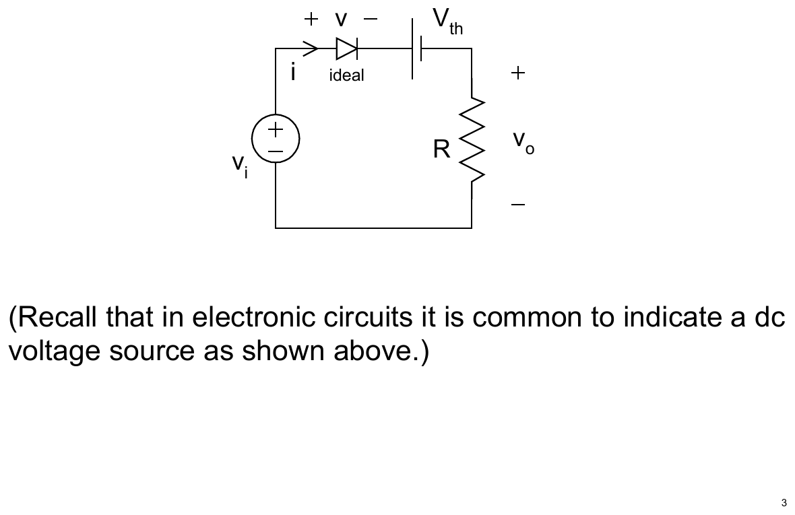

### 📐 Rule 82: half-wave rectifier
$$v_o = \begin{cases} v_i - V_{th} & v_i > V_{th} \\ 0 & v_i \le V_{th}\end{cases}$$

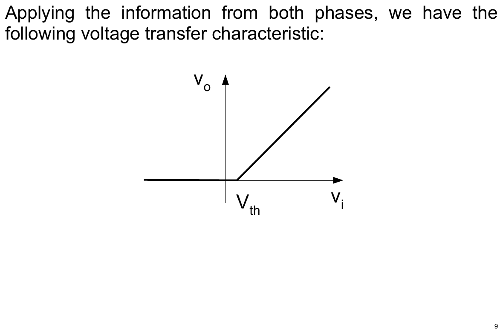

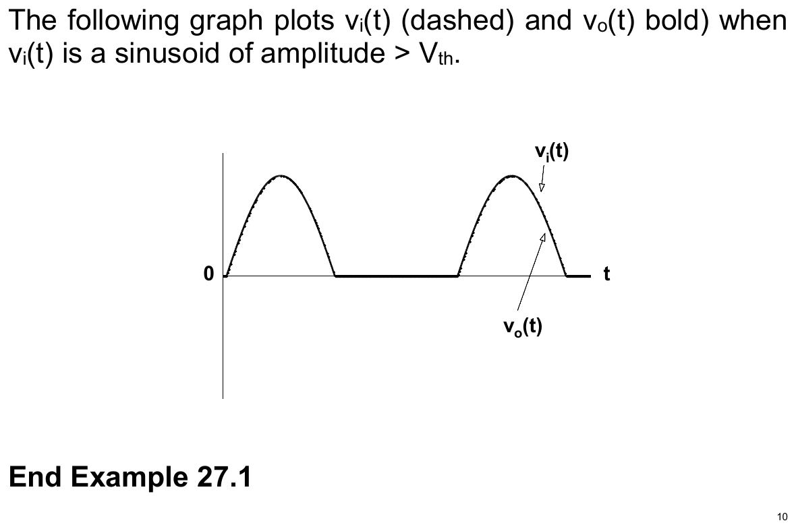

**What it means:** only the positive tops come through, shifted down by Vth.

### Drawing checklist: half-wave rectified output
1. Draw the input sine faintly (dashed). Mark its period T and amplitude A.
2. Mark the switching level Vth on the input.
3. Where vi > Vth: the output is the sine shifted down by Vth. Peak = A − Vth.
4. Elsewhere: output **0**, a flat line.
5. Output period = T (same as the input).
6. Label the peak value and the time axis.

---

## 2. Full-wave and bridge rectifiers

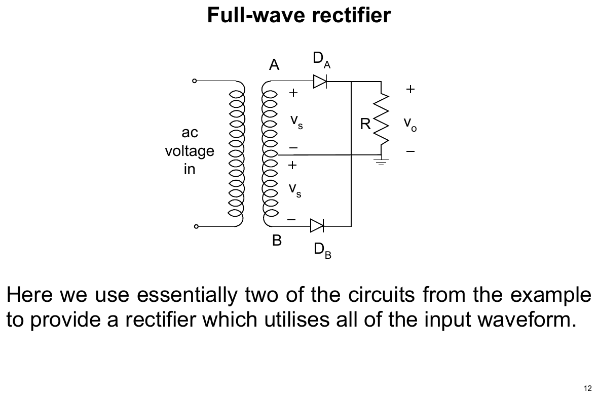

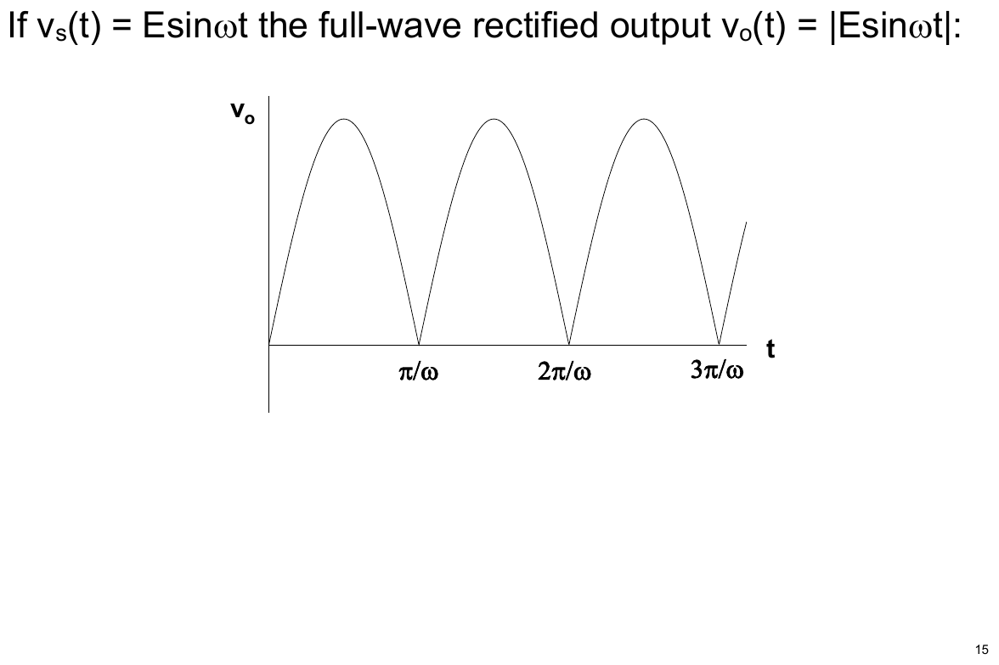

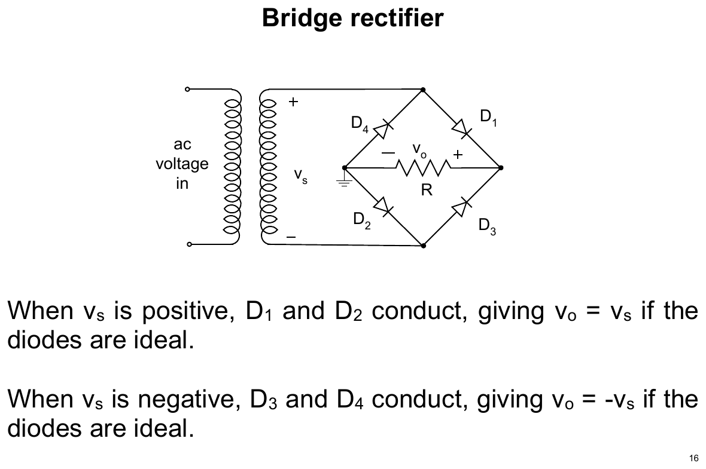

### 📐 Rule 83: full-wave rectifiers
- Centre-tapped: one diode at a time. vo = |vs| − Vth.
- Bridge: **two** diodes at a time (D1 + D2, or D3 + D4). vo = |vs| − 2 Vth.
- Output period = **T/2** (two humps per input cycle).

---

## 3. The peak detector

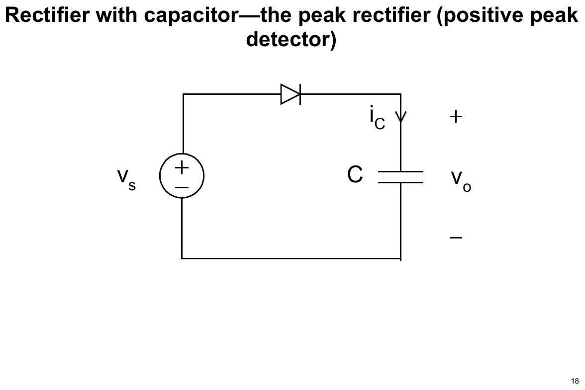

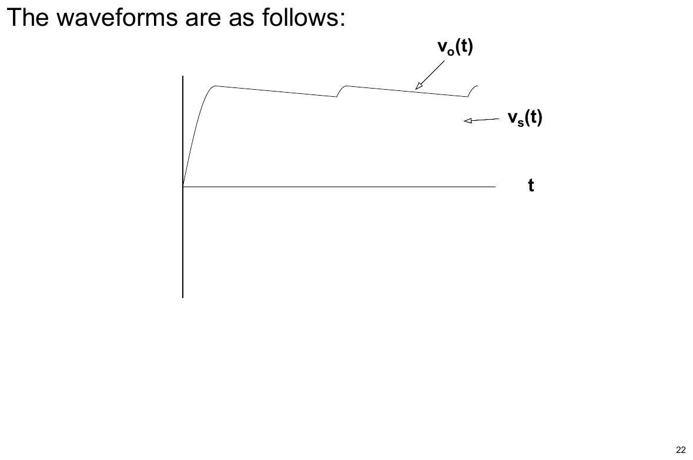

### 📐 Rule 84: peak detector
- While the input rises above vo + Vth, the diode is ON and vo follows the input: vo = vi − Vth.
- After the peak, the input falls faster than C can discharge. The diode turns OFF.
- With no load: vo stays at the peak, A − Vth, forever.
- With a load RL: vo decays as (A − Vth) e^(−t/(RL C)) until the rising input catches it next cycle.

**Ripple:** small if RL C ≫ T. Then max ≈ A − Vth and the minimum ≈ (A − Vth) e^(−T/(RL C)).

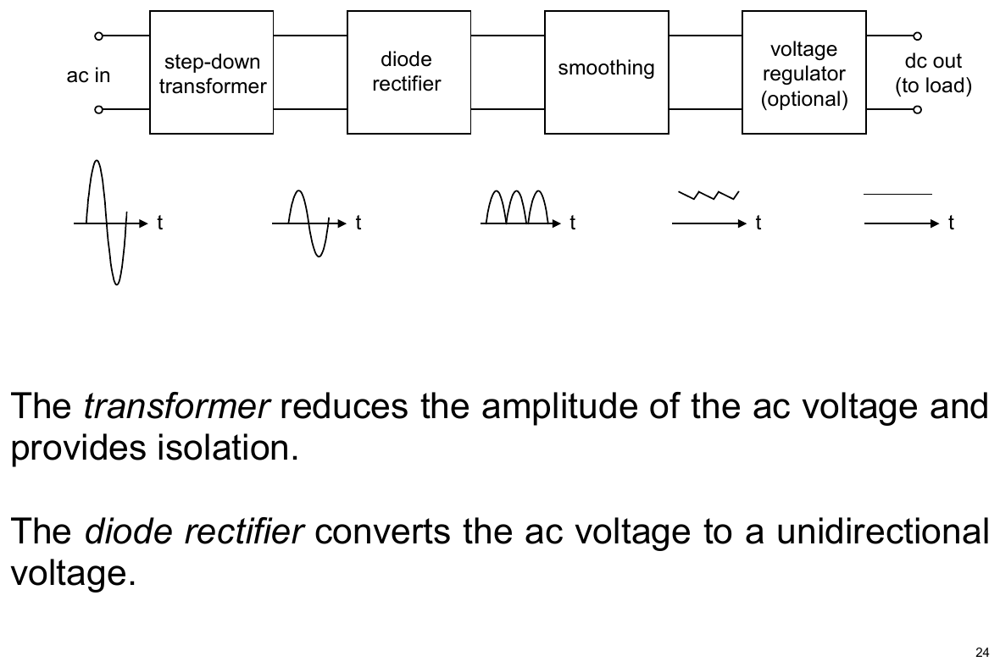

A dc power supply = step-down transformer → rectifier → smoothing capacitor → (regulator).

### Drawing checklist: peak detector with a load
1. Draw the input sine faintly. Mark T.
2. First quarter cycle: vo follows the input up to the peak (minus Vth).
3. After each peak: a slow **exponential** fall (it looks almost straight if RC ≫ T).
4. Where the falling vo meets the rising input (minus Vth): it follows the input up again.
5. Mark Vmax (just under A − Vth) and Vmin. Period = T.
6. A sawtooth-looking ripple riding near the top of the sine.

---

## 4. Clippers (limiters)

The two-diode clipper of Final 2023 Q1d, Final 2022 Q3 and Resit 2023 Q3:

Vac → Rs → output node. D1 (anode at the output) to Vdc1 (+) to ground. Vdc2 with − at the output, + at node 4. D2 from ground (anode) to node 4 (cathode).

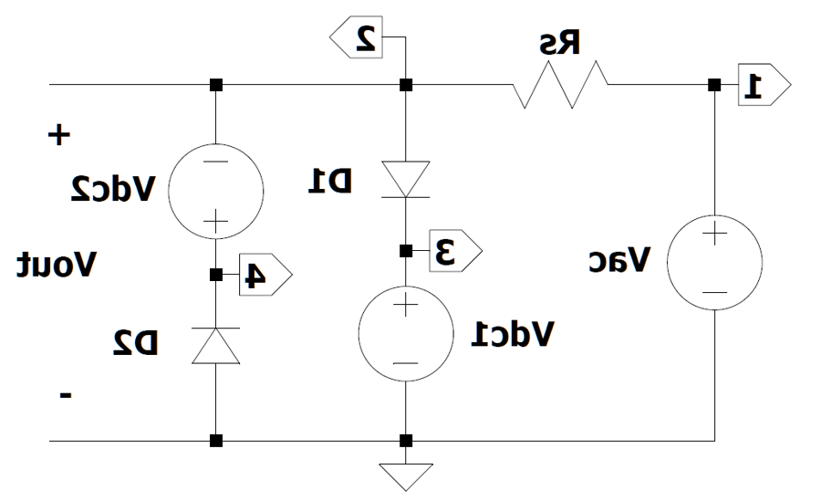

### 📐 Rule 85: clipper levels
- D1 turns ON when vout > Vdc1 (+Vth). Then vout is held at **Vdc1**.
- D2 turns ON when vout + Vdc2 < 0, i.e. vout < **−Vdc2**. Then vout is held there.
- In between, both are OFF. No current flows, so Rs drops nothing: **vout = vin** (Rule 87).

So: Vmax = min(A, Vdc1), Vmin = max(−A, −Vdc2). Period = the input's.

### Drawing checklist: clipper output
1. Draw the input sine faintly. Mark A and T.
2. Draw horizontal dashed lines at +Vdc1 and −Vdc2.
3. Output = the sine, but **flat** wherever the sine goes past a line.
4. If A is smaller than a level, that side is not clipped at all.
5. Label Vmax, Vmin and the period.

---

## 5. Clampers

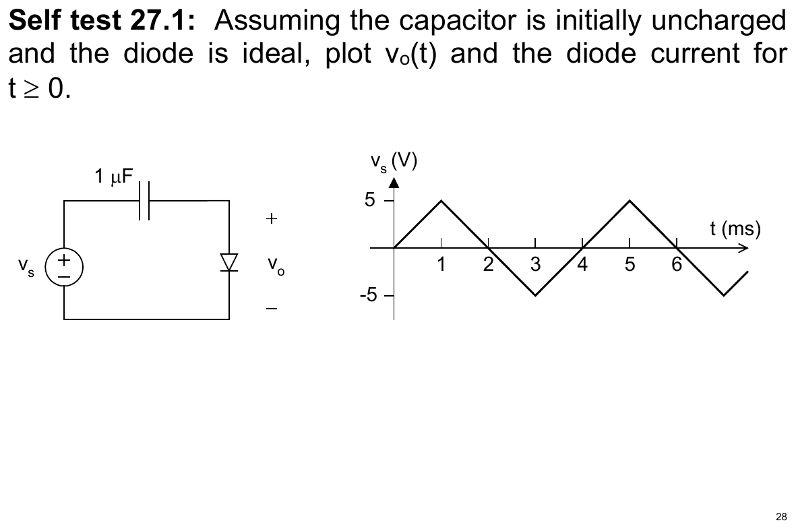

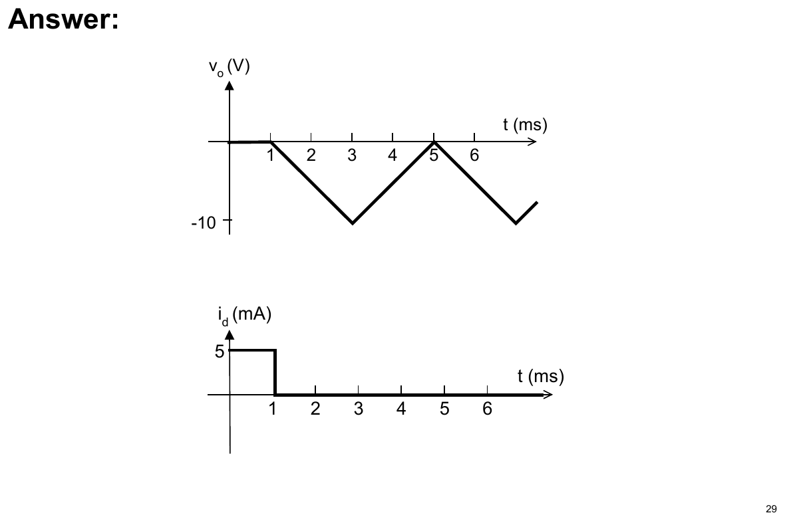

### 📐 Rule 86: clamper
A series capacitor and a diode to ground (or to a battery):

- On the first peak the diode conducts and charges C. After that the diode stays (almost) OFF.
- The capacitor voltage subtracts a **constant** from the input. The output has the same shape, **shifted**.
- The output's peak sits at the diode's level (0, or the battery voltage).

Self test 27.1: a ±5 V triangle into 1 μF and a diode to ground: the output is the triangle shifted down to swing from 0 to −10 V.

---

## Worked example: Final 2022 Q3 (two-diode clipper)

Vac = 5 sin(2π 1000 t), Rs = 100 Ω, Vdc1 = Vdc2 = 1.5 V, ideal diodes.

**(b)** D1 clips at +1.5 V, D2 at −1.5 V. A = 5 V exceeds both.

**Vmax = 1.5 V, Vmin = −1.5 V.**

**(c)** **Period = 1 ms.**

**(a) Sketch:** the sine with flat tops at +1.5 V and flat bottoms at −1.5 V. The flat parts are long (5 V ≫ 1.5 V), so it looks almost like a trapezium wave.

**Final 2023 Q1d:** A = 15 V, Vdc1 = 3 V, Vdc2 = 4 V: **max 3 V, min −4 V**.

**Resit 2024 Q1d:** A = 1.5 V, Vdc1 = Vdc2 = 0.7 V: **max 0.7 V, min −0.7 V**.

**Resit 2023 Q3:** A = 1 V, f = 2 kHz, Vdc1 = 0.5 V, Vdc2 = 1.5 V: **max 0.5 V, min −1 V** (the negative side never reaches −1.5 V), **period 0.5 ms**.

---

## Worked example: Final 2021 Q3 (peak detector)

Vs = 5 sin(2π 50 t), Rs = 10 Ω, ideal diode, then C = 100 μF ∥ RL = 1 kΩ.

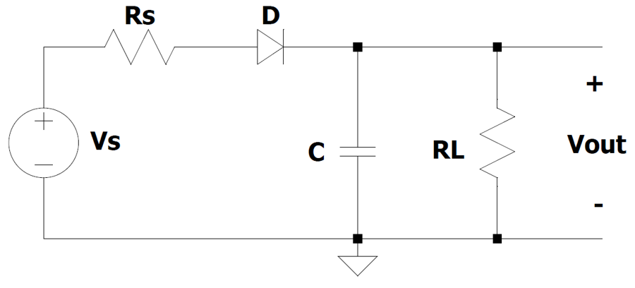

**Period:** **20 ms** (half-wave: the same as the input).

**τ** = RL C = 0.1 s = 5 periods. Slow discharge: small ripple.

**Maximum:** hand estimate ≈ **5 V** (ideal diode, Rs small). A simulation that includes the Rs drop during charging gives **4.79 V**.

**Minimum:** it decays for most of a period: about 4.79 × e^(−0.017/0.1) ≈ **4.04 V**.

**Sketch:** follow the drawing checklist. A ripple between about 4.0 and 4.8 V, period 20 ms.

---

## Worked example: Homework 4 Q1d (peak detector with Vth)

VS = 5 sin(2π 1000 t), Vth = 0.7 V, C = 1000 nF, RL = 1000 Ω.

**Max = 5 − 0.7 = 4.3 V.**

τ = RL C = 1 ms = T. Big ripple. After the peak (t = 0.25 ms) vo = 4.3 e^(−(t − 0.25 ms)/1 ms).

It falls until the next rise catches it: 5 sin(2π 1000 t) − 0.7 = vo. Try t = 1.086 ms (0.086 ms into the next cycle): 5 sin(0.540 rad) − 0.7 = 1.87, and 4.3 e^(−0.836) = 1.86. Match.

**Min ≈ 1.86 V.**

---

## Worked example: Resit 2022 Q3 (half-wave, no capacitor)

Vs = 1 sin(2π 4000 t), Rs = 10 Ω, ideal diode, RL = 5 kΩ.

I_RL = Vs/(Rs + RL) when Vs > 0, else 0.

**Max = 1/5010 = 199.6 μA. Period = 250 μs.**

Sketch: positive half-sine humps of height 199.6 μA, flat zero between them (Rule 82 checklist).

---

## Worked example: Resit 2021 Q3 (clamper)

V1 = A sin(2π f t) → C2 → node 2. A diode from node 2 (anode) to V4 (+) to ground. R5 from node 2 to ground. A = 1 V, f = 1 kHz, C2 = 100 μF, V4 = 1 V, R5 = 10 kΩ.

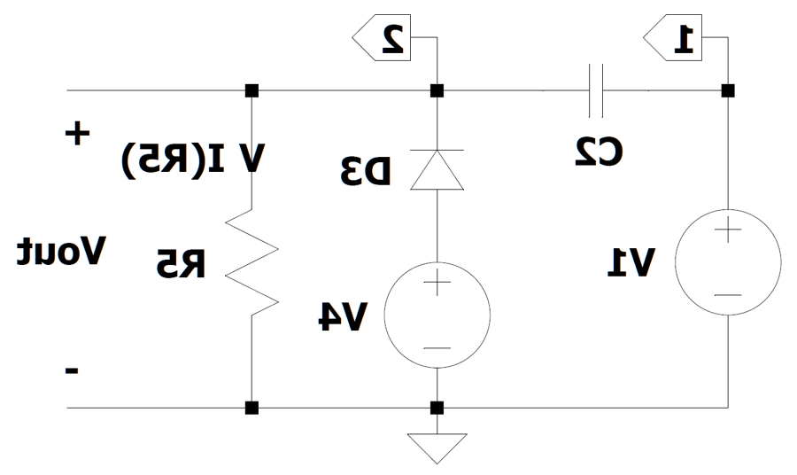

The diode holds e2 ≤ V4. In steady state C2 charges to A − V4, so e2 = v1 − (A − V4): the sine shifted down so its peak touches V4. (C2 R5 = 1 s ≫ 1 ms, so the droop between peaks is negligible.)

I(R5) = e2/R5:

- max = V4/R5, min = (V4 − 2A)/R5, average = (V4 − A)/R5.

**With A = V4 = 1 V:** C2 never charges, e2 = v1. **Max 0.1 mA, min −0.1 mA, average 0, period 1 ms.**

⚠️ The original paper adds a student-number offset to A and V4. With other digits, A > V4 and the wave shifts down by A − V4.

---

## Worked example: Final 2025 Q1e (power supply)

230 V peak mains, a 23:1 transformer, a bridge rectifier (Vth = 0.7 V each), C = 100 μF across nodes 5–6, no load.

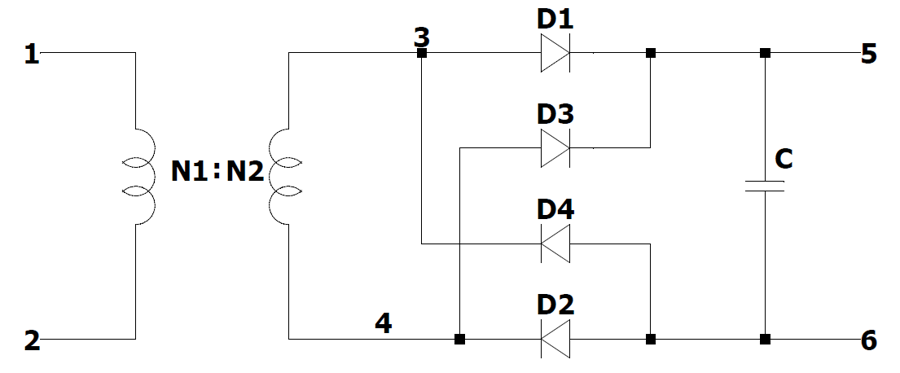

Secondary peak: 230/23 = 10 V. Two bridge diodes conduct: 10 − 2 × 0.7 = **8.6 V**.

**Official answer: 8.6 V** ("peak-peak value of V56").

⚠️ With no load the capacitor holds 8.6 V with no ripple, so 8.6 V is really the **peak** (dc) value of V56. Write 8.6 V and say why.

---

## Method: Q3 diode waveforms

| You're asked for | Use |
|---|---|
| the type of circuit | diode in series → rectifier. Diode + battery to ground → clipper. Series C + diode → clamper. Diode then C ∥ R → peak detector |
| the switching levels | Rule 81 (Topic 16): when does each diode turn ON? |
| max and min | the clip levels, or the peak minus the drops, or the decay |
| the period | same as the input. Full-wave: half |
| an average | half-wave sine: A/π. Clamper: the shift |
| a sketch | the matching drawing checklist |
| a decay between peaks | exponential with τ = RL C (Topic 9) |

---

Next: [End-of-topic test](../questions/17-rectifiers-clippers.md)
