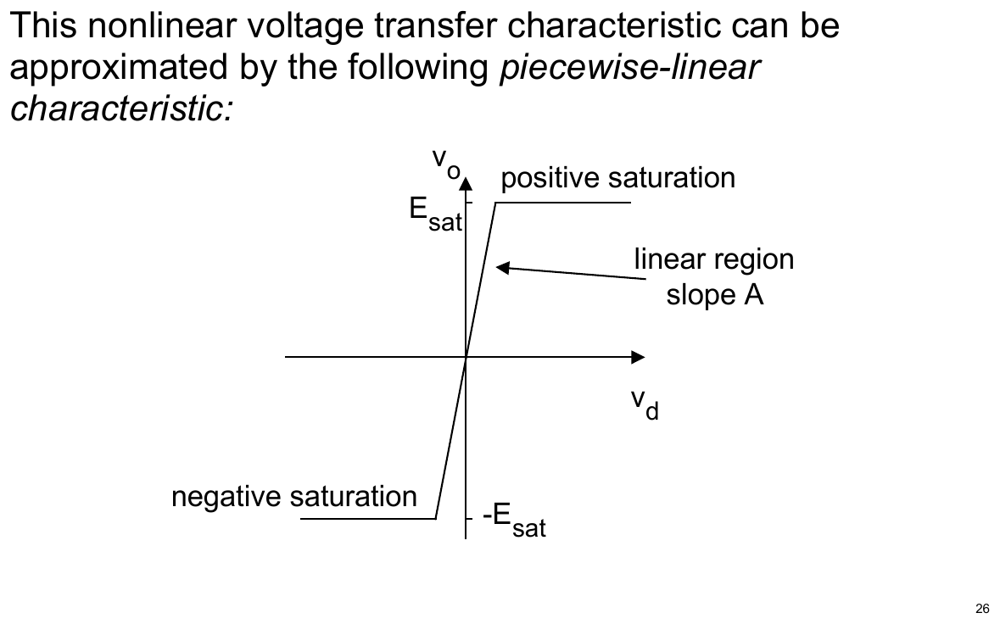
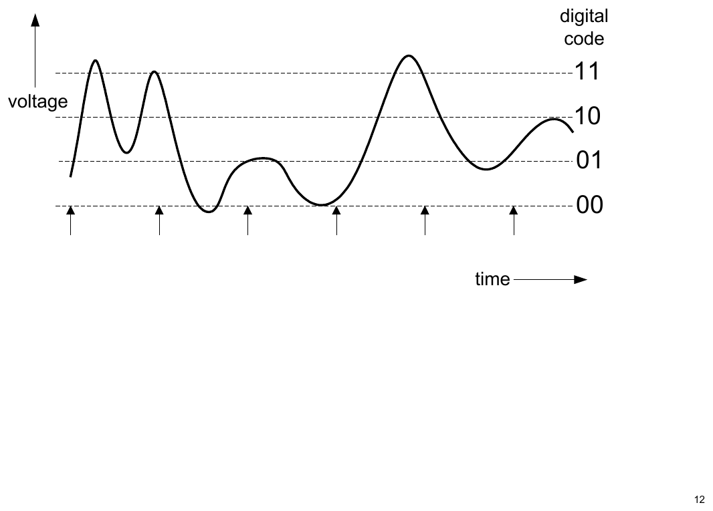
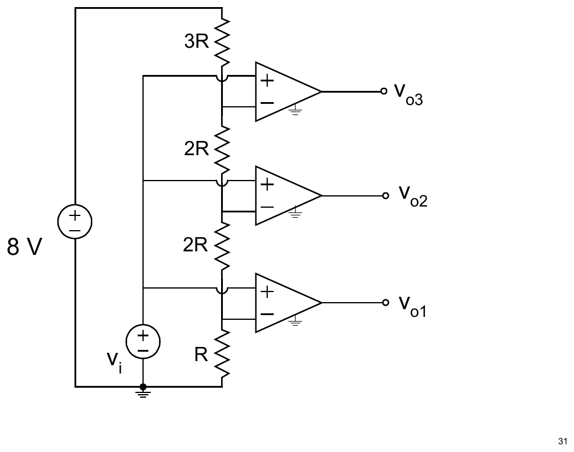
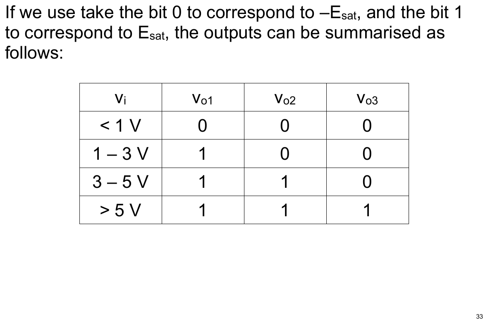

# Topic 18: Other nonlinear elements

Slide exercises: Lecture 25 Example 25.1, Self tests 25.1, 25.2 · Past finals: none

Slides: Lecture 25, pages 10 to 39 · Lecture 28 notes (5 pages, same content).

---

## The big idea

An op amp can't put out more than its supply voltage.

Without negative feedback it slams to **+Esat** or **−Esat**.

 

That is useful: it becomes a **comparator**, a 1-bit decision "is v+ bigger than v−?".

A stack of comparators is a **flash analogue-to-digital converter**.

---

**How to use these notes:**
When you see 🧠, stop.
Answer it on paper first.
Then click to check.

---

## 🎯 In the final

**Not asked in any of the ten past papers.** Skim it.

It is in the learning outcomes ("explain how nonlinear circuits differ…"), so a short "explain" part is possible. The ideas below are enough for that.

---

## ⭐ Learn by heart from this topic

Open book: on your [exam sheet](../formula-sheet.md). Skim level.

- Rule 88: op amp saturation: the output is limited to ±Esat. Rule 32 (Topic 7) only holds in the linear region.
- Rule 89: comparator (no feedback): vo = +Esat if v+ > v−, −Esat if v+ < v−.
- Rule 90: flash ADC: a resistor ladder makes reference levels. One comparator per level. The outputs form a code.
- Equation 91: an n-bit quantizer over a range V has 2ⁿ levels: resolution V/(2ⁿ − 1), maximum error half of that.

**Memory hook:** "No feedback, no virtual short."

---

## 1. Op amp saturation

### 📐 Rule 88: saturation
- Linear region: vo = A vd (A huge). With negative feedback, vd ≈ 0 and Rule 32 holds.
- Positive saturation: vo = +Esat.
- Negative saturation: vo = −Esat.

**Check after any op-amp calculation:** is |vo| below the supply? If not, the op amp is saturated and the answer is ±Esat.

---

## 2. The comparator

### 📐 Rule 89: comparator
With no feedback, any tiny difference saturates the output:

$$v_o = \begin{cases} +E_{sat} & v_+ > v_- \\ -E_{sat} & v_+ < v_- \end{cases}$$

A 1-bit analogue-to-digital converter.

---

## 3. Quantization and the flash ADC

Sample the signal. Compare each sample with a set of reference levels. Output the code of the nearest level.

### 📐 Rule 90: flash ADC
The ladder (R, 2R, 2R, 3R from 8 V) gives references of 1 V, 3 V and 5 V at the − inputs. vi goes to every + input.

| vi | vo1 vo2 vo3 |
|---|---|
| < 1 V | 0 0 0 |
| 1 to 3 V | 1 0 0 |
| 3 to 5 V | 1 1 0 |
| > 5 V | 1 1 1 |

Four ranges → simple logic turns them into a 2-bit word. Fast (all comparisons at once), but needs 2ⁿ − 1 comparators.

### 📐 Equation 91: quantizer resolution
$$\text{resolution} = \frac{V_{range}}{2^n - 1} \qquad \text{max error} = \frac{\text{resolution}}{2}$$

### 🧠 Check
Lecture 25 Self test 25.1: an 8-bit quantizer with levels evenly spaced from 0 to 10 V. Resolution? Largest error, in volts and in % of full scale?

Answer

255 steps: 10/255 = **0.0392 V**. Max error **0.0196 V** = **0.196%** of 10 V.

---

## 4. The transistor

A three-terminal device: the voltage between two terminals controls the current in the third. Used as an amplifier (analogue) or a switch (digital). Not covered further in this module. Its linear models are the controlled sources of Topic 6.

---

## Method: other nonlinear elements

| You're asked for | Use |
|---|---|
| op-amp output with no feedback | comparator: ±Esat (Rule 89) |
| an op-amp answer bigger than the supply | it saturates at ±Esat (Rule 88) |
| flash ADC outputs | reference levels from the divider, then compare (Rule 90) |
| quantizer resolution and error | Equation 91 |

---

Next: [End-of-topic test](../questions/18-other-nonlinear.md)
