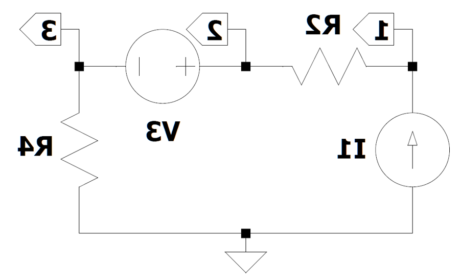
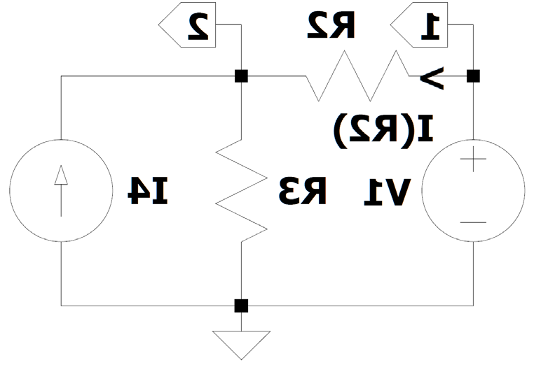
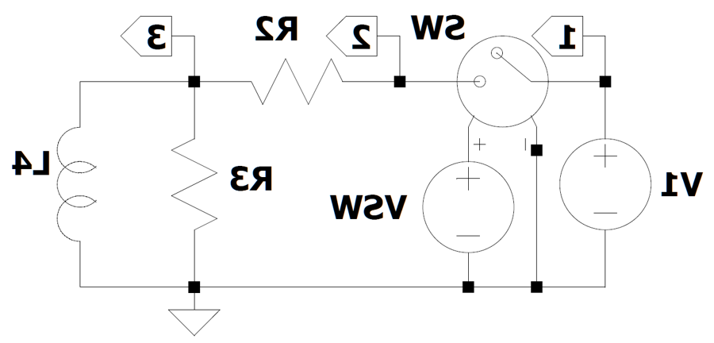
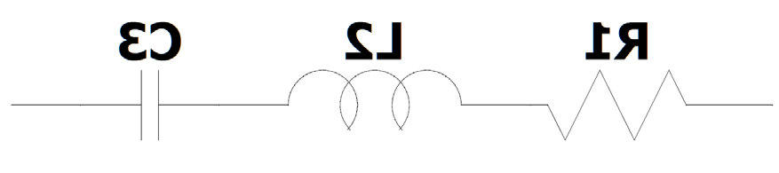
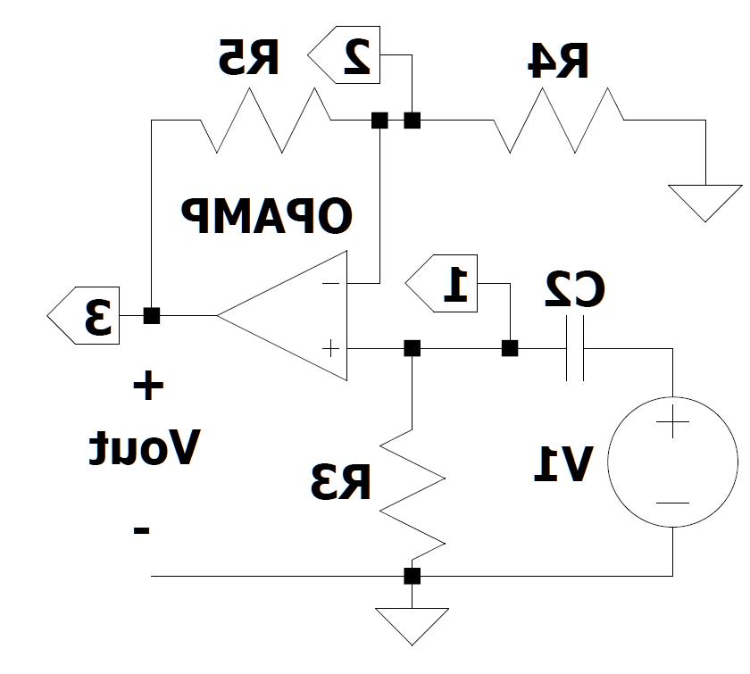
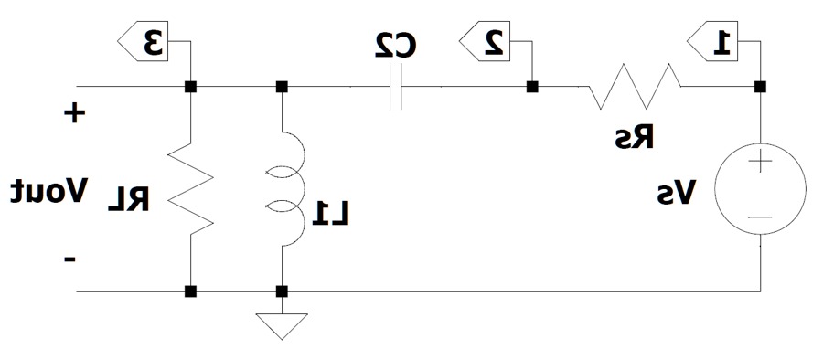
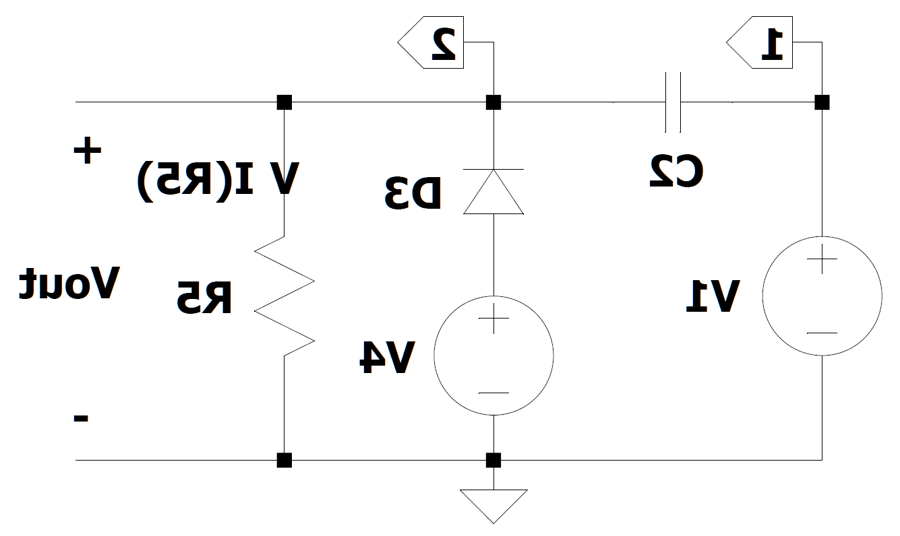

# Resit Final 2021

The real EEEN20020 resit from Spring 2020/21. The original adds student-number digits to many values. Here they are all **0**.

**2 hours. Answer all three questions. Q1 is 100 marks, Q2 and Q3 are 50 marks each.** The % next to each part is its share of that question.

Open book. Calculator allowed.

There are **no official answers** for this paper. These are my worked answers, every number checked in Python (`tools/check_numbers.py`).

---

## Questions

### Q1. Five short circuits — 100 marks

**(a)** Calculate the instantaneous power dissipated in voltage source V3. I1 = 1000 μA, R2 = 2000 Ω, V3 = 3000 mV, R4 = 4000 Ω. (20%)

**(b)** Calculate the current from node 1 to node 2 through R2. Vm = 1000 mV, R2 = 2000 Ω, R3 = 3000 Ω, I4 = 4000 μA. (20%)

**(c)** The switch closes at t = 0. I(L4) is zero just before. Calculate I(L4) at t = 5 μs. V1 = 1000 mV, R2 = 2000 Ω, R3 = 3000 Ω, L4 = 4000 μH. (20%)

**(d)** Calculate the magnitude and phase of the **admittance** Y of the series RLC at f = 200 kHz. R1 = 4700 Ω, L2 = 10 mH, C3 = 100 pF. (20%)

**(e)** Calculate Vout(t) when V1(t) = A cos ωt. A = 1000 mV, C2 = 2000 pF, R3 = 3000 Ω, R4 = 4000 Ω, R5 = 5000 Ω, f = 10 kHz. (20%)

---

### Q2. Passive RLC filter — 50 marks

Rs = RL = 1000 Ω, L1 = 1000 μH, C2 = 1000 pF.

(a) Derive H(ω) = Vout(ω)/Vs(ω). Hint: write it as (a + jb)/(c + jd). (40%)

(b) Plot the gain and phase of H(ω) from 10 kHz to 10 MHz. (20%)

(c) When Vs(t) = sin(10⁶ t), Vout(t) = Vm cos(10⁶ t + φ). Calculate Vm and φ. (40%)

---

### Q3. Clamper — 50 marks

V1 = A sin(ωt), A = 1000 mV, f = 1000 Hz, C2 = 100 μF, V4 = 1000 mV, R5 = 10 kΩ. Assume the diode is ideal.

(a) Sketch two periods of I(R5)(t), starting at t = 10 ms, and find the period T. (40%)

(b) Calculate the maximum, minimum and average of I(R5)(t) in steady state. (60%)

---

## Answers

Q1 answers

**(a)** One loop, so 1 mA flows everywhere. It enters V3's + terminal.

**P = 3 V × 1 mA = 3 mW** (absorbed)

From: Topic 1 worked example

 

**(b)** KCL at 2: (e2 − 1)/2k + e2/3k = 4 mA → e2 = 5.4 V.

**I(R2) = (1 − 5.4)/2k = −2.2 mA**

From: Topic 5 Rule 23

 

**(c)** Thévenin seen by L4: 0.6 V behind 1.2 kΩ. i(∞) = 0.5 mA, τ = 3.33 μs.

**I(L4) = 0.5 (1 − e^(−1.5)) = 388 μA**

From: Topic 9 Equation 46

 

**(d)** Z = 4700 + j(12 566 − 7958) = 4700 + j4609 = 6582∠44.4°.

**|Y| = 151.9 μS, ∠Y = −44.4°**

From: Topic 11 Equation 55

 

**(e)** RC high-pass (C2, R3) into a non-inverting amp of gain 1 + R5/R4 = 2.25. ωC2R3 = 0.377.

**Vout(t) = 0.794 cos(2π 10⁴ t + 1.210) V** (+69.3°)

From: Topic 15 Equation 76

Q2 answers

**(a) H = −ω²L1C2RL / [RL − ω²L1C2(Rs + RL) + jω(L1 + C2RsRL)]**

**(b)** Second-order high-pass. −48 dB at 10 kHz rising at 40 dB/decade, −7 dB at 159 kHz, flat at −6 dB above 1 MHz. Phase from about 173° to 0°, 63° at 159 kHz.

**(c)** At ω = 10⁶: H = 0.2 + j0.4 = 0.447∠63.4°. Vs = cos(10⁶t − 90°).

**Vm = 0.447 V, φ = −26.6° (−0.464 rad)**

From: Topic 14 Resit 2021 Q2 worked example

Q3 answers

The diode clamps e2 ≤ V4. In steady state e2 = v1 − (A − V4). With A = V4 = 1 V the capacitor never charges: e2 = v1.

**(a)** I(R5) = e2/R5 = 0.1 sin(2π 1000 t) mA. **T = 1 ms.**

**(b) Max 0.1 mA, min −0.1 mA, average 0** (taking I(R5) from node 2 to ground)

General case: max V4/R5, min (V4 − 2A)/R5, average (V4 − A)/R5.

From: Topic 17 Resit 2021 Q3 worked example

