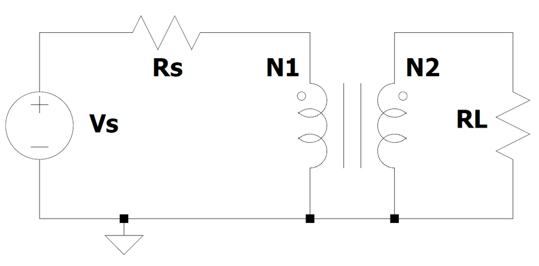
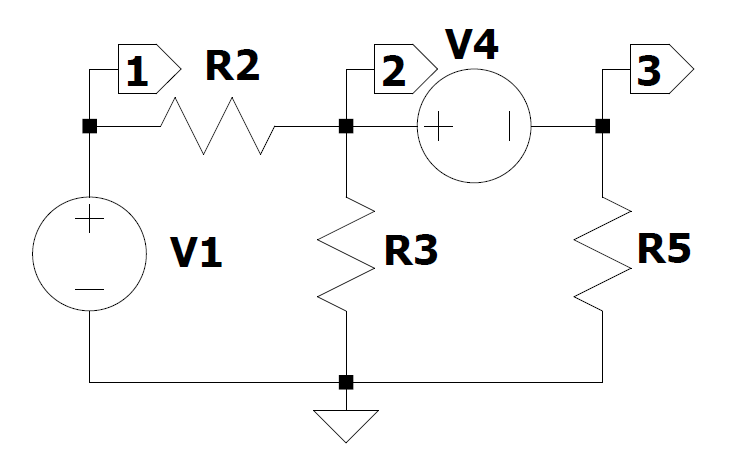
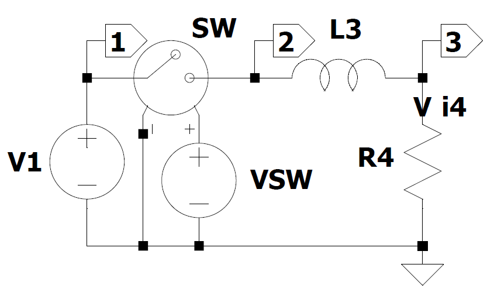
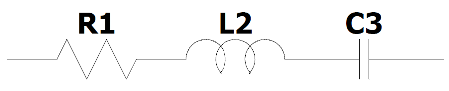
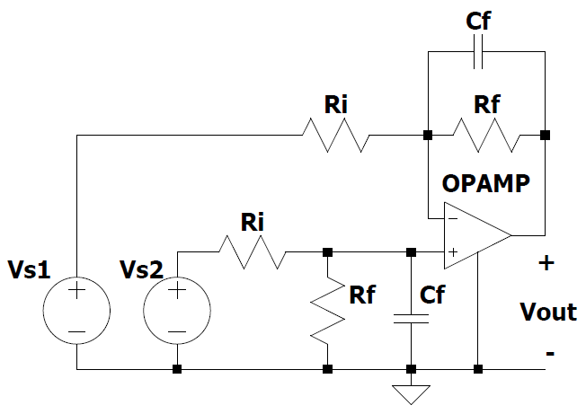
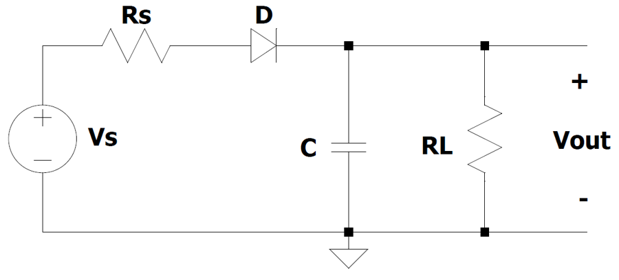

# Final 2021

The real EEEN20020 final from Autumn 2021/22. The original adds student-number digits (α, ε, η, …) to many values. Here they are all **0**.

**2 hours. Answer all three questions. Q1 is 100 marks, Q2 and Q3 are 50 marks each.** The % next to each part is its share of that question.

Open book. Calculator allowed.

There are **no official answers** for this paper. These are my worked answers, every number checked in Python (`tools/check_numbers.py`).

---

## Questions

### Q1. Five short circuits — 100 marks

**(a)** Calculate the average steady-state power in RL. Rs = 1000 Ω, RL = 10 Ω, ideal transformer N1 = 1000, N2 = 100, Vs = A cos(2πft), A = 1000 mV, f = 5000 Hz. (20%)

**(b)** Calculate the voltage at node 2. V1 = 1000 mV, R2 = 2000 Ω, R3 = 3000 Ω, V4 = 4000 mV, R5 = 5000 Ω. (20%)

**(c)** The switch closes at t = 0 and stays closed. e3 = 0 V at t = 0. Calculate i4 at t = 1 μs. V1 = 1000 mV, L3 = 3000 μH, R4 = 4000 Ω. (20%)

**(d)** Calculate the magnitude and phase of the impedance of the series RLC network at f = 1000 Hz. R1 = 1300 Ω, L2 = 18 mH, C3 = 100 nF. (20%)

**(e)** Calculate the steady-state Vout(t) when V1(t) = A sin(2πft). A = 1000 mV, R2 = 1000 Ω, C3 = 2000 pF, R4 = 4000 Ω, f = 30 kHz. (20%)

---

### Q2. Difference amplifier — 50 marks

(a) Calculate H1(ω) = Vout/Vs1. (30%)

(b) Calculate H2(ω) = Vout/Vs2. (30%)

(c) Calculate Vout(t) when Vs1 = A1 cos(2πft), Vs2 = A2 cos(2πft), A1 = 1000 mV, A2 = 2000 mV, f = 10 kHz, Ri = 1000 Ω, Rf = 10 kΩ, Cf = 1 nF. (40%)

---

### Q3. Peak detector — 50 marks

Vs = A sin(ωt), A = 5000 mV, f = 50 Hz, Rs = 10 Ω, RL = 1000 Ω, C = 100 μF. Assume the diode is ideal.

(a) Sketch Vout(t) in steady state. (50%)

(b) Calculate the maximum value and period of Vout(t) in steady state. (50%)

---

## Answers

Q1 answers

**(a)** Reflected RL = (1000/100)² × 10 = 1000 Ω = Rs (matched). Primary voltage 0.5 V peak.

**P = ½ × 0.5²/1000 = 125 μW**

From: Topic 13 Final 2021 Q1a worked example

 

**(b)** V4 floats: e3 = e2 − 4. KCL round nodes 2 and 3: (e2 − 1)/2k + e2/3k + (e2 − 4)/5k = 0 → 31 e2 = 39.

**e2 = 1.258 V**

From: Topic 5 Final 2021 Q1b worked example

 

**(c)** i: 0 → 0.25 mA, τ = 3 mH/4 kΩ = 0.75 μs.

**i4(1 μs) = 0.25 (1 − e^(−1.333)) = 184 μA**

From: Topic 9 Equation 45

 

**(d)** Z = 1300 + j(113.1 − 1591.5) = 1300 − j1478.4.

**|Z| = 1969 Ω, phase −48.7°**

From: Topic 11 Equation 53

 

**(e)** H = −4/(1 + j1.508) = 2.211∠123.55°. Keep the sine:

**Vout(t) = 2.211 sin(2π 30 000 t + 2.156) V**

From: Topic 15 Equation 73

Q2 answers

**(a) H1 = −Zf/Ri = −(Rf/Ri)/(1 + jωRfCf)**

**(b) H2 = +Zf/Ri** (the + input divider Zf/(Ri + Zf) times the gain (Ri + Zf)/Ri)

**(c)** Vout = (Zf/Ri)(Vs2 − Vs1) = (Zf/Ri) × 1∠0. Zf/Ri = 10/(1 + j0.628) = 8.467∠−32.1°.

**Vout(t) = 8.467 cos(2π 10⁴ t − 0.561) V**

From: Topic 15 §6

Q3 answers

**(a)** vo follows the sine up to its peak, then decays slowly (τ = RL C = 0.1 s = 5 periods) until the next cycle catches it. A small ripple near the top.

**(b) Max ≈ 4.8 V** (≈ 5 V ignoring Rs; 4.79 V by simulation, because Rs drops voltage while C recharges). **Period = 20 ms.** (Min ≈ 4.0 V.)

From: Topic 17 Final 2021 Q3 worked example, peak detector checklist

