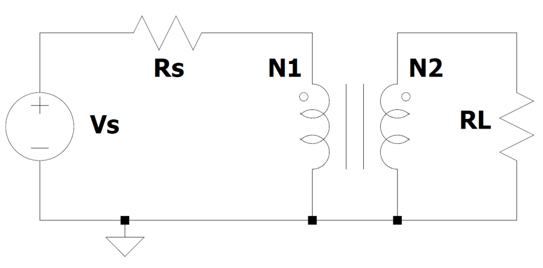
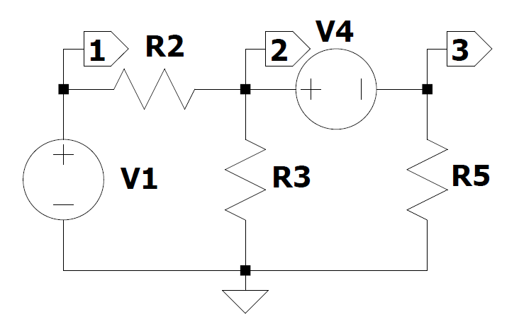
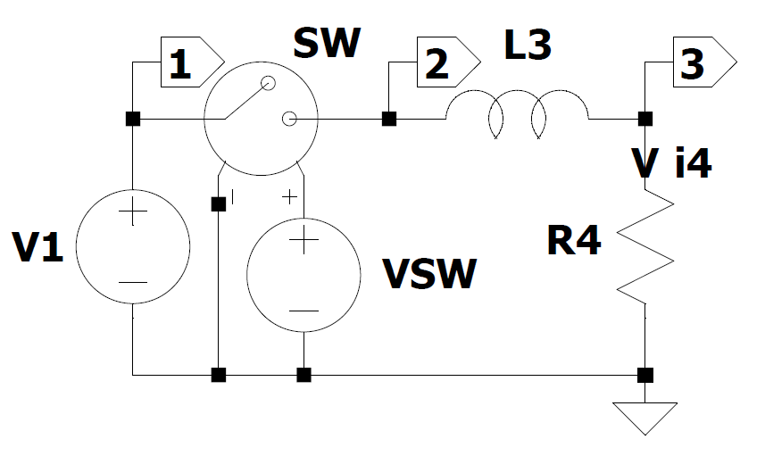
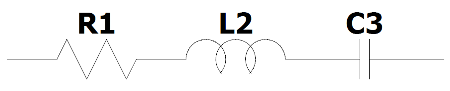
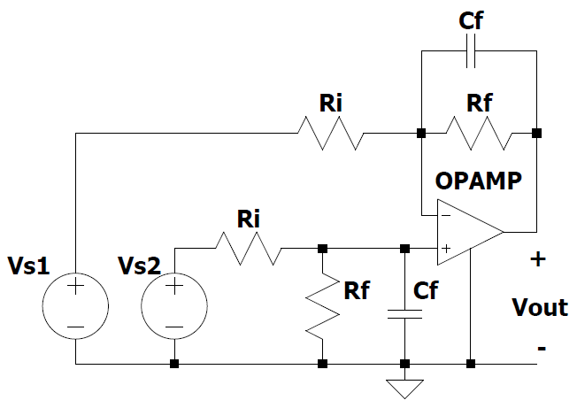
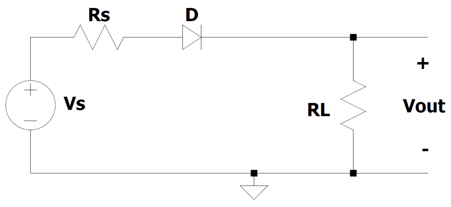

# Resit Final 2022

The real EEEN20020 resit from Spring 2021/22. Same circuits as [Final 2021](2021.md) for Q1 and Q2. The original adds student-number digits to many values. Here they are all **0**.

**2 hours. Answer all three questions. Q1 is 100 marks, Q2 and Q3 are 50 marks each.** The % next to each part is its share of that question.

Open book. Calculator allowed.

There are **no official answers** for this paper. These are my worked answers, every number checked in Python (`tools/check_numbers.py`).

---

## Questions

### Q1. Five short circuits — 100 marks

**(a)** Calculate the average power in RL. Rs = 1000 Ω, RL = 10 Ω, N1 = 1000, N2 = 100, Vs = A cos(2πft), A = 1000 mV, f = 500 Hz. (The answer box says "power dissipated in Rs".) (20%)

**(b)** Calculate the voltage at node 3. V1 = 5000 mV, R2 = 4000 Ω, R3 = 3000 Ω, V4 = 2000 mV, R5 = 5000 Ω. (20%)

**(c)** The switch closes at t = 0. e3 = 0 V at t = 0. Calculate e3 at t = 3 μs. V1 = 1000 mV, L3 = 6000 μH, R4 = 4000 Ω. (20%)

**(d)** Calculate the magnitude and phase of the impedance of the series RLC at f = 4000 Hz. R1 = 40 Ω, L2 = 18 mH, C3 = 82 nF. (20%)

**(e)** Calculate Vout(t) when V1(t) = A cos(2πft). A = 2000 mV, R2 = 3300 Ω, C3 = 2200 pF, R4 = 8200 Ω, f = 10 kHz. (20%)

---

### Q2. Difference amplifier at dc — 50 marks

Ri = 1 kΩ, Rf = 5 kΩ, Cf = 1 nF.

(a) Calculate the dc gain H1(0) = Vout/Vs1. (35%)

(b) Calculate the dc gain H2(0) = Vout/Vs2. (35%)

(c) Calculate Vout when Vs1 = −0.8 V and Vs2 = 1.2 V. (30%)

---

### Q3. Half-wave rectifier — 50 marks

Vs = A sin(ωt), A = 1000 mV, f = 4 kHz, Rs = 10 Ω, RL = 5000 Ω. Assume the diode is ideal.

(a) Sketch the current I_RL through RL in steady state. (50%)

(b) Calculate the maximum value and period of I_RL. (50%)

---

## Answers

Q1 answers

**(a)** Reflected RL = 1000 Ω = Rs: matched. Half the power goes to each.

**P(RL) = 125 μW** (and P(Rs) = 125 μW too)

From: Topic 13 Final 2021 Q1a worked example

 

**(b)** (e2 − 5)/4k + e2/3k + (e2 − 2)/5k = 0 → e2 = 2.106 V.

**e3 = e2 − 2 = 0.106 V**

From: Topic 5 Rule 25

 

**(c)** τ = 6 mH/4 kΩ = 1.5 μs. **e3 = 1 − e^(−2) = 0.865 V**

From: Topic 9 Equation 45

 

**(d)** ωL = 452.4, 1/(ωC) = 485.2. Z = 40 − j32.8.

**|Z| = 51.75 Ω, phase −39.4°** (nearly at series resonance, 4144 Hz)

From: Topic 11 Equation 53

 

**(e)** H = −2.485/(1 + j1.1335) = 1.644∠131.4°.

**Vout(t) = 3.288 cos(2π 10⁴ t + 2.294) V**

From: Topic 15 Equation 73

Q2 answers

At dc the capacitors are open. A matched difference amplifier.

**(a) H1(0) = −Rf/Ri = −5**

**(b) H2(0) = +Rf/Ri = +5**

**(c) Vout = 5 × (1.2 + 0.8) = 10 V**

From: Topic 7 Resit 2022 Q2 worked example

Q3 answers

**(a)** Positive half-sine humps, zero between them (the diode blocks the negative halves).

**(b) Max = 1/(10 + 5000) = 199.6 μA. Period = 250 μs.**

From: Topic 17 Rule 82, half-wave checklist

