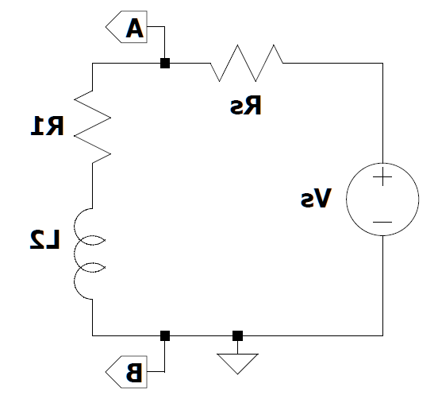
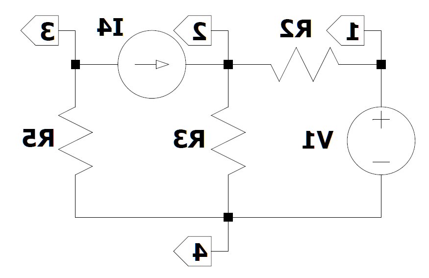
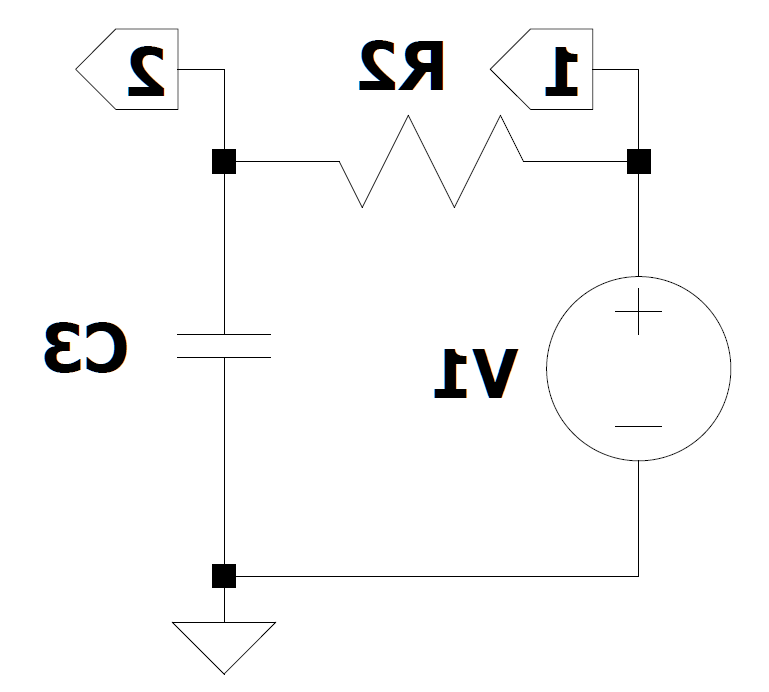
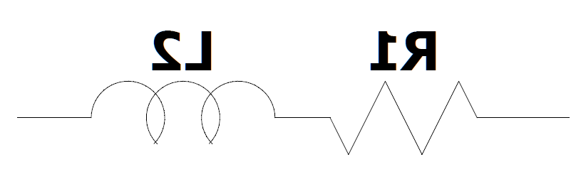
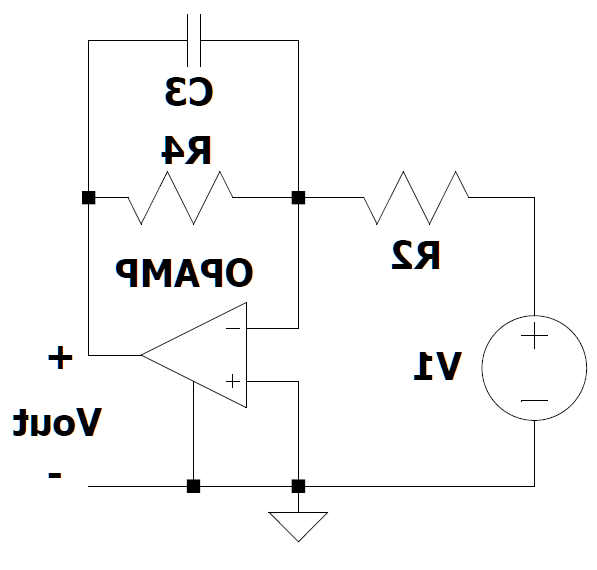
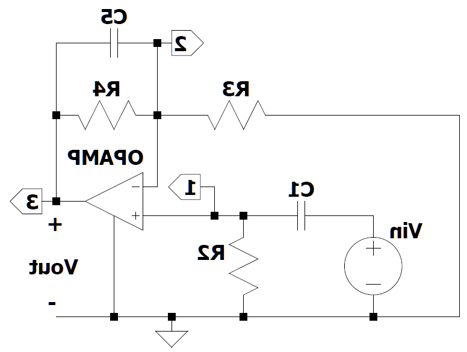
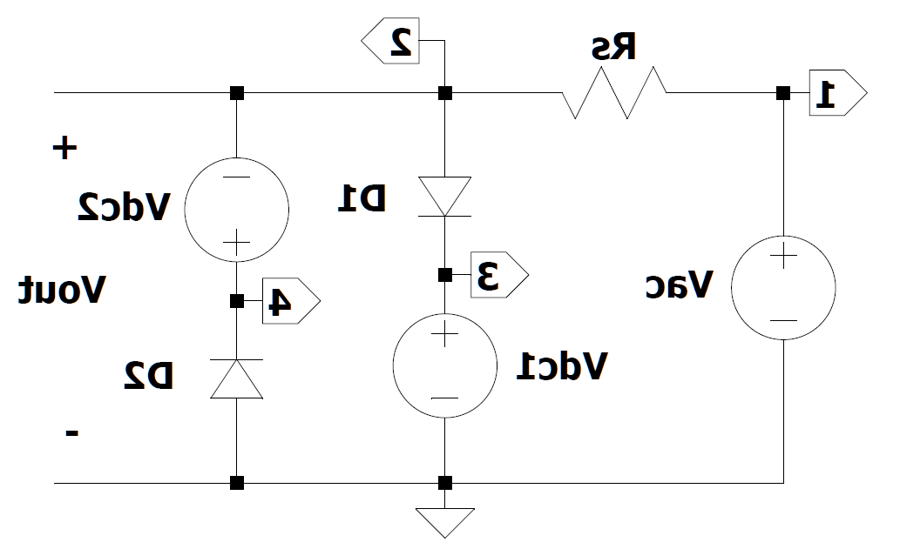

# Final 2022

The real EEEN20020 final from Autumn 2022/23.

**2 hours. Answer all three questions. Q1 is 100 marks, Q2 and Q3 are 50 marks each.** The % next to each part is its share of that question.

Open book. Calculator allowed.

There are **no official answers** for this paper. These are my worked answers, every number checked in Python (`tools/check_numbers.py`).

---

## Questions

### Q1. Five short circuits — 100 marks

**(a)** The load to the right of A and B is R1 in series with L2: R1 = 100 Ω, L2 = 500 mH. Calculate the average steady-state power in the load when Vs = Vm cos(2πft), Vm = 325 V, f = 50 Hz, Rs = 10 Ω. (20%)

**(b)** Calculate V24. V1 = 1 V, R2 = 2 kΩ, R3 = 3 kΩ, I4 = 0.5 mA, R5 = 5 kΩ. (20%)

**(c)** V1 has been at 1 V for a long time and C3 is fully charged. At t = 1 ms, V1 switches to 2 V and stays there. Calculate e2 at t = 2 ms. R2 = 2200 Ω, C3 = 470 nF. (20%)

**(d)** Calculate the magnitude and phase angle of the impedance of R1 = 40 Ω in series with L2 = 18 mH at f = 1 kHz. (20%)

**(e)** Calculate the steady-state Vout(t) when V1(t) = A cos(2πft). A = 50 mV, R2 = 10 kΩ, C3 = 10 pF, R4 = 330 kΩ, f = 50 kHz. (20%)

---

### Q2. High-pass into a non-inverting amplifier — 50 marks

(a) Calculate e1(ω) at node 1 in terms of Vin(ω), C1, R2 and ω. (20%)

(b) Calculate Vout(ω) in terms of e2(ω), R3, R4, C5 and ω. Hint: call the impedance of R4 ∥ C5 Z45(ω). (30%)

(c) Calculate the steady-state Vout(t) when Vin(t) = A cos(2πft), A = 1 V, f = 7 kHz. C1 = 100 μF, R2 = 10 kΩ, R3 = 1 kΩ, R4 = 10 kΩ, C5 = 1 nF. (50%)

---

### Q3. Two-diode clipper — 50 marks

Vac = A sin(2πft), A = 5 V, f = 1 kHz, Rs = 100 Ω, Vdc1 = Vdc2 = 1.5 V. Assume ideal diodes.

(a) Sketch Vout(t). (50%)

(b) Calculate the maximum and minimum of Vout(t). (30%)

(c) Calculate the period of Vout(t). (20%)

---

## Answers

Q1 answers

**(a)** ωL = 157.1 Ω. |Z_total| = |110 + j157.1| = 191.8 Ω. |I| = 1.695 A.

**P = ½ × 1.695² × 100 = 143.6 W**

From: Topic 12 Final 2022 Q1a worked example

 

**(b)** Node 4 as reference, e1 = 1 V. KCL at 2 (I4 enters): (e2 − 1)/2k + e2/3k = 0.5 mA → e2 = 1.2 V.

**V24 = 1.2 V**

From: Topic 5 Rule 23

 

**(c)** e2: 1 V → 2 V, τ = 2200 × 470 n = 1.034 ms.

**e2(2 ms) = 2 − e^(−1/1.034) = 1.620 V**

From: Topic 9 Equation 45

 

**(d)** Z = 40 + j113.1.

**|Z| = 120.0 Ω, phase 70.5°**

From: Topic 11 Equation 53

 

**(e)** H = −33/(1 + j1.037) = 22.91∠134.0°.

**Vout(t) = 1.146 cos(2π 50 000 t + 2.338) V** (134.0°)

From: Topic 15 §2 worked example

Q2 answers

**(a) e1 = Vin jωC1R2/(1 + jωC1R2)**

**(b) Vout = e2 (1 + Z45/R3), Z45 = R4/(1 + jωR4C5)**

**(c)** e2 = e1 ≈ Vin at 7 kHz (ωC1R2 = 4398). Z45 = 8379 − j3685 Ω. 1 + Z45/R3 = 10.08∠−21.45°.

**Vout(t) = 10.08 cos(43 982 t − 0.374) V**

From: Topic 15 §5 Equation 76

Q3 answers

**(a)** The input sine (5 V peak) with flat tops at +1.5 V and flat bottoms at −1.5 V. Between the levels Vout = Vac (no current in Rs).

**(b) Vmax = 1.5 V, Vmin = −1.5 V**

**(c) Period = 1 ms**

From: Topic 17 Final 2022 Q3 worked example, clipper checklist

