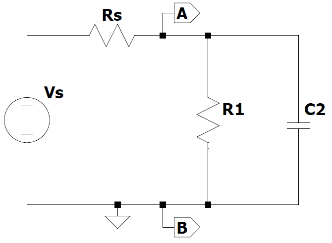
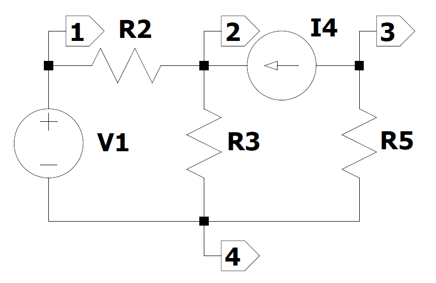
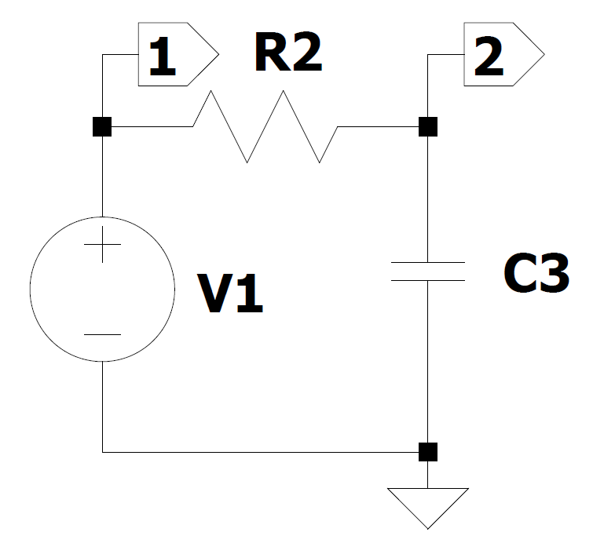
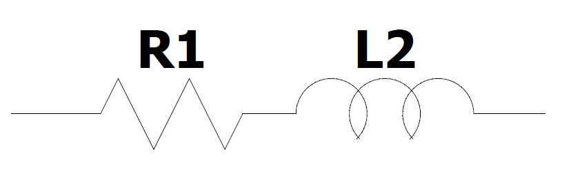
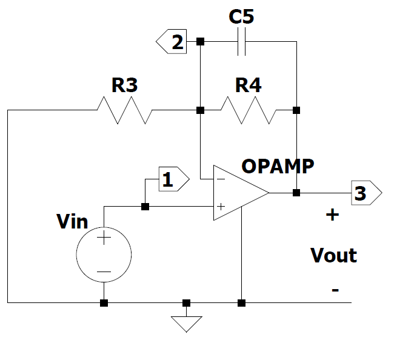
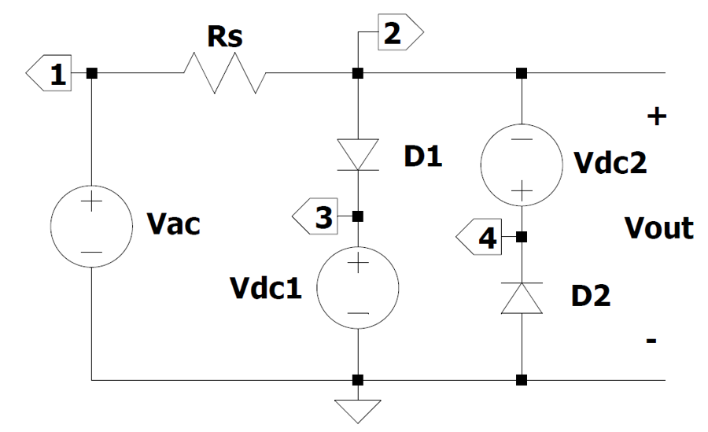

# Resit Final 2023

The real EEEN20020 early resit from Spring 2022/23. Same style as [Final 2022](2022.md).

**2 hours. Answer all three questions. Q1 is 100 marks, Q2 and Q3 are 50 marks each.** The % next to each part is its share of that question.

Open book. Calculator allowed.

There are **no official answers** for this paper. These are my worked answers, every number checked in Python (`tools/check_numbers.py`).

---

## Questions

### Q1. Five short circuits — 100 marks

**(a)** The load right of A and B is R1 ∥ C2: R1 = 100 Ω, C2 = 220 μF. Calculate the average power in it when Vs = Vm cos(2πft), Vm = 325 V, f = 50 Hz, Rs = 10 Ω. (20%)

**(b)** Calculate V12. V1 = 1 V, R2 = 2 kΩ, R3 = 3 kΩ, I4 = 0.5 mA, R5 = 5 kΩ. (20%)

**(c)** V1 has been at 1 V for a long time (C3 fully charged). At t = 1 ms, V1 switches to 0 V. Calculate e2 at t = 1.5 ms. R2 = 1800 Ω, C3 = 560 nF. (20%)

**(d)** For R1 = 40 Ω in series with L2 = 18 mH, find the frequency f where |Re Z| = |Im Z|. Then find |Z| and its phase at f. (20%)

**(e)** Calculate Vout(t) when V1(t) = A cos(2πft). A = 100 mV, R2 = 4.7 kΩ, C3 = 12 pF, R4 = 33 kΩ, f = 400 kHz. (20%)

---

### Q2. Non-inverting filter — 50 marks

(a) Calculate Vout(ω) at node 3 in terms of Vin, C5, R3, R4 and ω. Hint: Z45 = R4 ∥ C5. (20%)

(b) Calculate the gain (dB) and phase (degrees) of Vout/Vin at f = 1 kHz. (30%)

(c) Calculate Vout(t) when Vin(t) = A cos(2πft), f = 10 kHz. A = 1 V, R3 = 1 kΩ, R4 = 10 kΩ, C5 = 4.7 nF. (50%)

---

### Q3. Clipper — 50 marks

Vac = A sin(ωt), A = 1 V, f = 2 kHz, Rs = 100 Ω, Vdc1 = 0.5 V, Vdc2 = 1.5 V. Assume ideal diodes.

(a) Sketch Vout(t). (50%)

(b) Calculate the maximum and minimum of Vout(t). (30%)

(c) Calculate the period of Vout(t). (20%)

---

## Answers

Q1 answers

**(a)** Z_C = −j14.47 Ω. Z_load = 2.051 − j14.17 Ω. |V_A| = 250.2 V.

**P = ½ × 250.2²/100 = 312.9 W**

From: Topic 12 Resit 2023 Q1a worked example

 

**(b)** e1 = 1 V, e2 = 1.2 V (as in Final 2022 Q1b).

**V12 = −0.2 V**

From: Topic 5 Rule 23

 

**(c)** e2: 1 V → 0 V, τ = 1.008 ms. **e2(1.5 ms) = e^(−0.5/1.008) = 0.609 V**

From: Topic 9 Equation 45

 

**(d)** ωL = R → **f = 40/(2π × 0.018) = 353.7 Hz**. **|Z| = 56.57 Ω, phase 45°**

From: Topic 11 Resit 2023 Q1d worked example

 

**(e)** ωR4C3 = 0.995 (at the corner). H = 4.977∠135.1°.

**Vout(t) = 0.498 cos(2π 400 000 t + 2.359) V**

From: Topic 15 Equation 73

Q2 answers

**(a) Vout = Vin (1 + Z45/R3), Z45 = R4/(1 + jωR4C5)**

**(b) 20.47 dB, −14.9°**

**(c) Vout(t) = 3.653 cos(62 832 t − 0.982) V** (−56.3°)

From: Topic 15 §5

Q3 answers

**(a)** The sine clipped flat at +0.5 V. The bottoms are normal sine troughs down to −1 V (the −1.5 V level is never reached).

**(b) Vmax = 0.5 V, Vmin = −1 V**

**(c) Period = 0.5 ms**

From: Topic 17 Rule 85, clipper checklist

