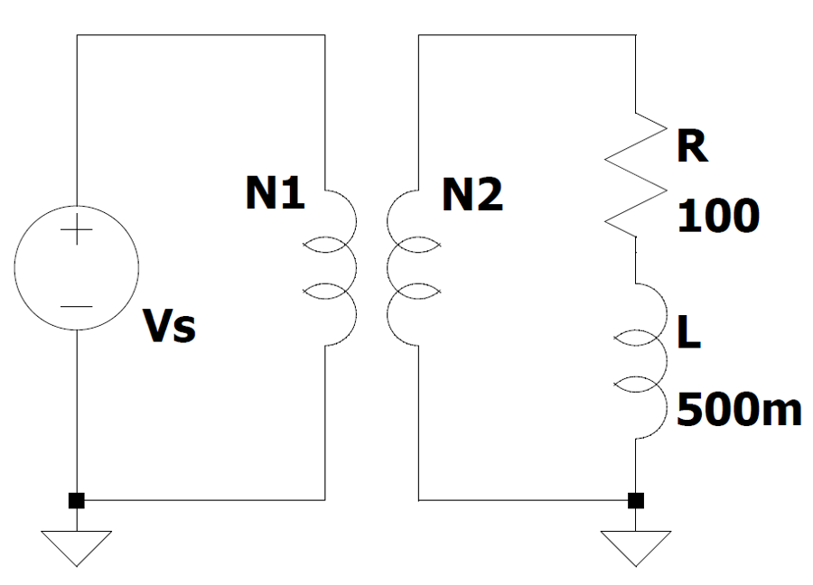
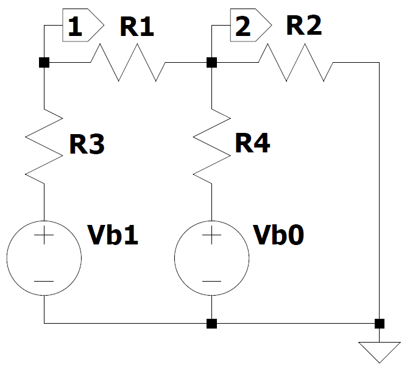
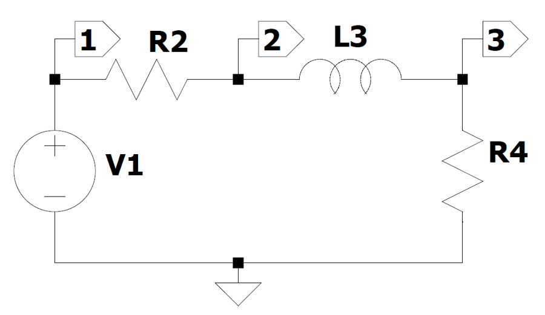
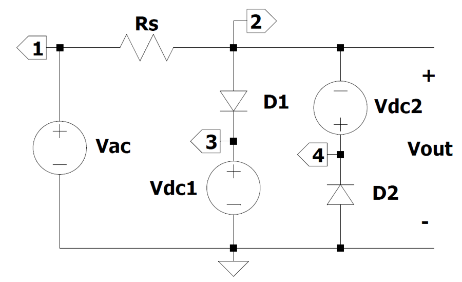
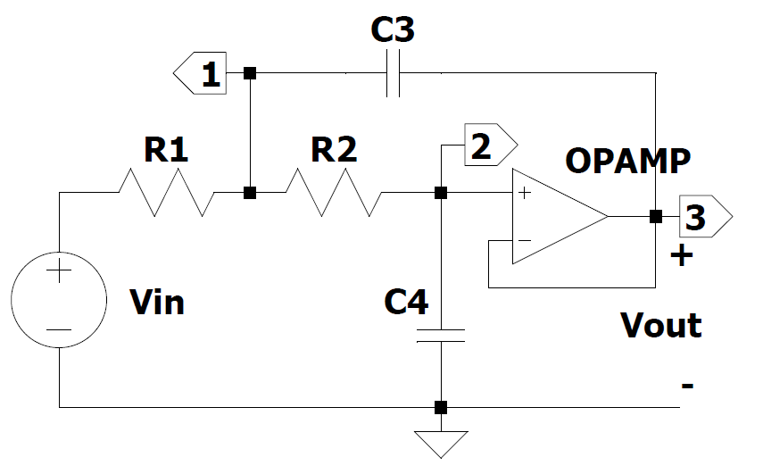
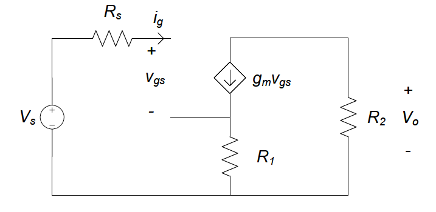

# Final 2023

The real EEEN20020 final from Autumn 2023/24.

**2 hours. Answer all three questions. Q1 is 100 marks, Q2 and Q3 are 50 marks each.** The % next to each part is its share of that question.

Open book. Calculator allowed.

There are **no official answers** for this paper. These are my worked answers, every number checked in Python (`tools/check_numbers.py`).

---

## Questions

### Q1. Five short circuits — 100 marks

**(a)** A load (R in series with L) is connected to the secondary of a transformer. Calculate the average steady-state power in the load when Vs = Vm cos(2πft) drives the primary. Vm = 325 V, f = 50 Hz, R = 100 Ω, L = 500 mH, N1/N2 = 65. (20%)

**(b)** Calculate e1. Vb0 = Vb1 = 1 V, R1 = 1 kΩ, R2 = R3 = R4 = 2 kΩ. (20%)

**(c)** V1 has been at 1 V for a long time. At t = 100 μs it switches to 2 V and stays there. Calculate e3 at t = 150 μs. R2 = 1 kΩ, L3 = 100 mH, R4 = 1200 Ω. (20%)

**(d)** Calculate the maximum and minimum of Vout(t) when Vac = A sin(2πft), A = 15 V, f = 1 kHz, Rs = 200 Ω, Vdc1 = 3 V, Vdc2 = 4 V. Assume ideal diodes. (20%)

**(e)** Calculate the dc voltage gain (dB) and 3 dB bandwidth (Hz) of the low-pass filter. R2 = 10 kΩ, C3 = 10 pF, R4 = 100 kΩ. (20%)

---

### Q2. Sallen–Key filter — 50 marks

Denote the branch impedances Z1(ω), Z2(ω), Z3(ω), Z4(ω).

(a) Calculate H(ω) = Vout/Vin in terms of Z1, Z2, Z3 and Z4. (50%)

(b) Calculate H(ω) in terms of R1, R2, C3, C4 and ω. (30%)

(c) Calculate the frequency f0 at which the phase of H(ω) is −90°. (10%)

(d) Calculate the steady-state Vout(t) when Vin(t) = A cos(2πf0t), A = 1 V. (10%)

---

### Q3. Transistor amplifier — 50 marks

(a) Calculate H = Vo/Vs in terms of Rs, R1, R2 and gm. (50%)

(b) If Rs = 1 kΩ, R1 = 500 Ω and R2 = 10 kΩ, what gm gives H = 20 dB? (50%)

---

## Answers

Q1 answers

**(a)** |V2| = 325/65 = 5 V. ωL = 157.1 Ω, |Z| = 186.2 Ω, |I| = 26.85 mA.

**P = ½ × 0.02685² × 100 = 36.05 mW**

From: Topic 13 Final 2023 Q1a worked example

 

**(b)** 1.5 e1 − e2 = 0.5 and −e1 + 2e2 = 0.5.

**e1 = 0.75 V** (e2 = 0.625 V)

From: Topic 5 Rule 23

 

**(c)** i: 0.4545 mA → 0.9091 mA, τ = 0.1/2200 = 45.45 μs. At 50 μs after the step: i = 0.7578 mA.

**e3 = 1200 × 0.7578 mA = 0.909 V**

From: Topic 9 Final 2023 Q1c worked example

 

**(d)** D1 clips at +Vdc1, D2 at −Vdc2. A = 15 V passes both.

**Vmax = 3 V, Vmin = −4 V**

From: Topic 17 Rule 85

 

**(e)** H = −(R4/R2)/(1 + jωR4C3).

**dc gain = 20 dB** (×10, inverting). **3 dB bandwidth = 1/(2πR4C3) = 159.2 kHz**

From: Topic 15 Equation 73

Q2 answers

**(a) H = Z3Z4 / (Z1Z2 + Z3(Z1 + Z2) + Z3Z4)**

**(b) H = 1/(1 − ω²R1R2C3C4 + jωC4(R1 + R2))**

**(c)** Real part of the bottom = 0:

**f0 = 1/(2π√(R1R2C3C4))**

**(d)** At ω0, H = 1/(jω0C4(R1 + R2)):

**Vout(t) = [√(R1R2C3/C4)/(R1 + R2)] cos(2πf0t − 90°)**. With equal R's and C's: 0.5 cos(2πf0t − 90°).

⚠️ The paper gives no component values here. Formulas are the full answer.

From: Topic 15 §3 Equation 74

Q3 answers

**(a)** No gate current, so the gate is at Vs. vgs = Vs − gm vgs R1 → vgs = Vs/(1 + gmR1). Vo = −gm vgs R2.

**H = −gmR2/(1 + gmR1)** (Rs drops out)

**(b)** |H| = 10: 10 000 gm = 10(1 + 500 gm) → **gm = 2 mS**

From: Topic 6 Final 2023 Q3 worked example, Equation 30

