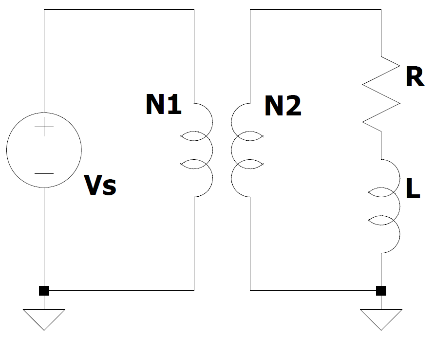
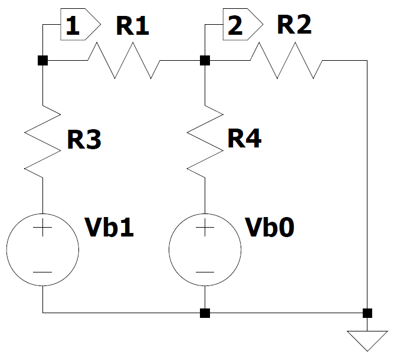
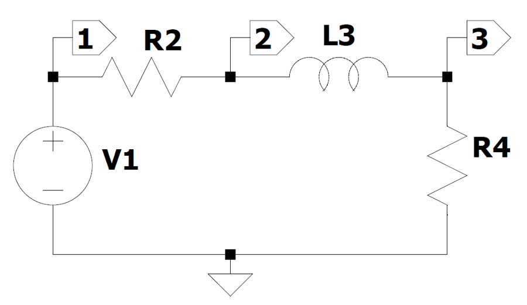
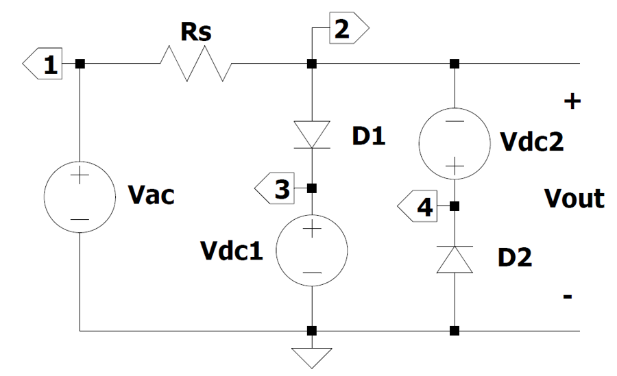
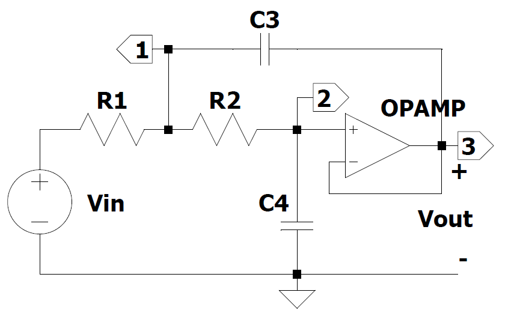
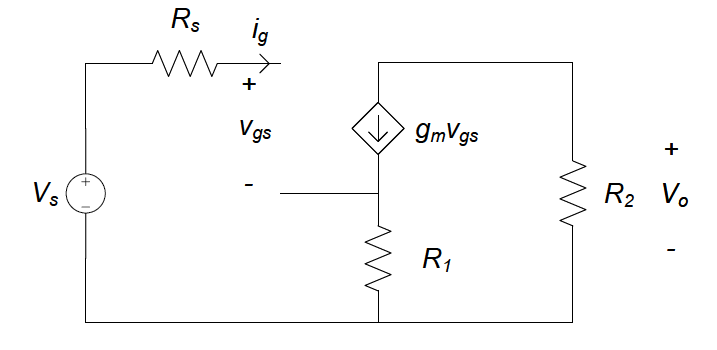

# Resit Final 2024

The real EEEN20020 resit from Spring 2023/24. Same circuits as [Final 2023](2023.md), new numbers and twists.

**2 hours. Answer all three questions. Q1 is 100 marks, Q2 and Q3 are 50 marks each.** The % next to each part is its share of that question.

Open book. Calculator allowed.

There are **no official answers** for this paper. These are my worked answers, every number checked in Python (`tools/check_numbers.py`).

---

## Questions

### Q1. Five short circuits — 100 marks

**(a)** A load (R in series with L) is on the secondary of a transformer. Calculate the average power in the load when Vs = Vm cos(2πft) drives the primary. Vm = 325 V, f = 50 Hz, R = 200 Ω, L = 1 H, N1/N2 = 65. (20%)

**(b)** Calculate e2. Vb0 = Vb1 = 1 V, R1 = 1 kΩ, R2 = R3 = R4 = 2 kΩ. (20%)

**(c)** V1 has been at 0 V for a long time. At t = 100 μs it switches to 2 V. Calculate the current from node 3 to ground through R4 at t = 150 μs. R2 = 1 kΩ, L3 = 100 mH, R4 = 1500 Ω. (20%)

**(d)** Calculate the maximum and minimum of Vout(t) when Vac = A sin(2πft), A = 1.5 V, f = 1 kHz, Rs = 200 Ω, Vdc1 = Vdc2 = 0.7 V. Assume ideal diodes. (20%)

**(e)** Calculate the dc voltage gain (dB) and 3 dB bandwidth (Hz). R2 = 22 kΩ, C3 = 100 pF, R4 = 180 kΩ. (20%)

---

### Q2. Sallen–Key filter — 50 marks

(a) H(ω) in terms of Z1, Z2, Z3, Z4. (20%)

(b) H(ω) in terms of R1, R2, C3, C4 and ω. (20%)

(c) If R1 = R2 = 10 kΩ and C3 = C4 = 1 nF, calculate f0 where the phase of H is −90°. (30%)

(d) With the same values, write Vout(t) when Vin(t) = A cos(πf0t), A = 1 V. (30%)

---

### Q3. Transistor amplifier — 50 marks

(a) Calculate H = Vo/Vs in terms of Rs, R1, R2 and gm. (40%)

(b) If Rs = 1 kΩ, R1 = 470 Ω and R2 = 22 kΩ, what gm gives H = 30 dB? (60%)

---

## Answers

Q1 answers

**(a)** |V2| = 5 V. ωL = 314.2 Ω. |Z|² = 200² + 314.2² = 138 696.

**P = ½ × 25 × 200/138 696 = 18.03 mW**

From: Topic 13 Final 2023 Q1a worked example

 

**(b)** Same equations as Final 2023 Q1b. **e2 = 0.625 V**

From: Topic 5 Rule 23

 

**(c)** i: 0 → 2/2500 = 0.8 mA, τ = 0.1/2500 = 40 μs, 50 μs later:

**I(R4) = 0.8 (1 − e^(−1.25)) = 0.571 mA**

From: Topic 9 Equation 45

 

**(d) Vmax = 0.7 V, Vmin = −0.7 V**

From: Topic 17 Rule 85

 

**(e)** R4/R2 = 8.18. **dc gain 18.26 dB. 3 dB bandwidth 8.84 kHz.**

From: Topic 15 Equation 73

Q2 answers

**(a) H = Z3Z4/(Z1Z2 + Z3(Z1 + Z2) + Z3Z4)**

**(b) H = 1/(1 − ω²R1R2C3C4 + jωC4(R1 + R2))**

**(c) f0 = 1/(2πRC) = 15.92 kHz**

**(d)** πf0 is half of ω0: 50 000 rad/s. H = 1/(0.75 + j1) = 0.8∠−53.13°.

**Vout(t) = 0.8 cos(50 000 t − 0.927) V**

From: Topic 15 §3

Q3 answers

**(a) H = −gmR2/(1 + gmR1)**

**(b)** |H| = 10^1.5 = 31.62. gm(22 000 − 31.62 × 470) = 31.62.

**gm = 4.43 mS**

From: Topic 6 Equation 30

