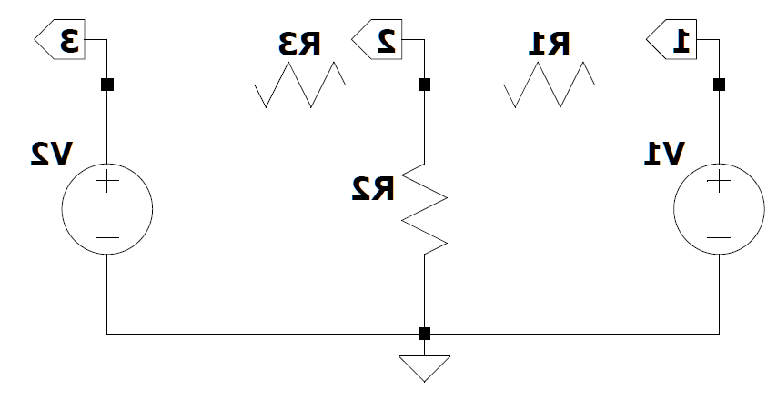
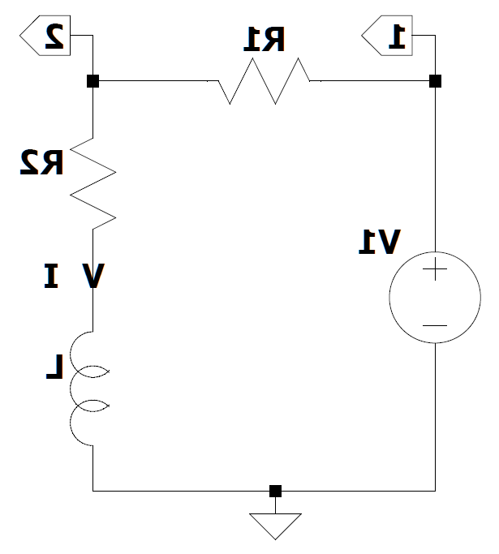
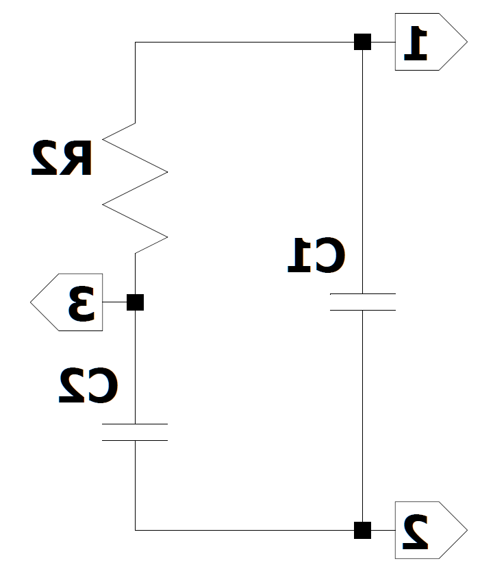
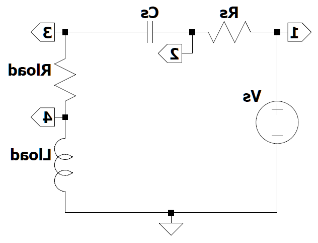
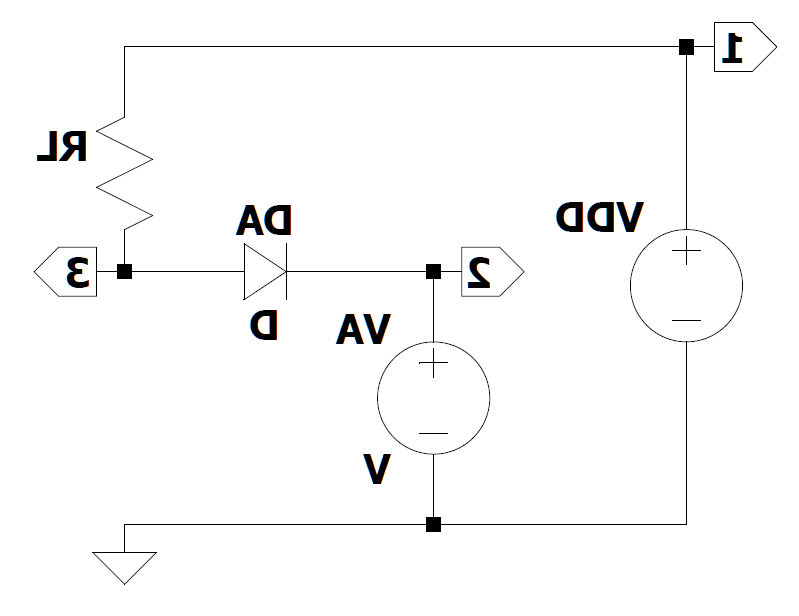
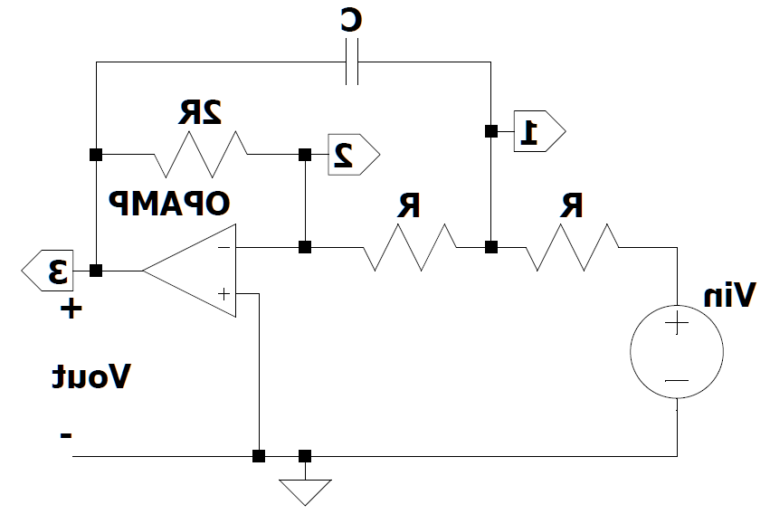
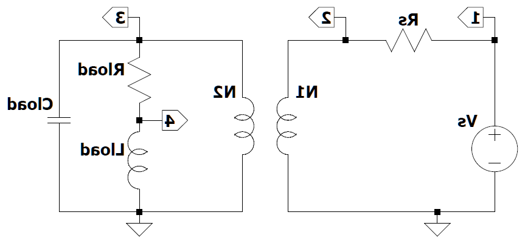

# Final 2024

The real EEEN20020 final from Autumn 2024/25.

**2 hours. Answer all three questions. Q1 is 100 marks, Q2 and Q3 are 50 marks each.** The % next to each part is its share of that question.

Open book. Calculator allowed.

There are **no official answers** for this paper. These are my worked answers, every number checked in Python (`tools/check_numbers.py`). Each part says which topic to go back to.

---

## Questions

### Q1. Five short circuits — 100 marks

**(a)** Derive a formula for e2(t) at node 2, then calculate e2 at t = 1.25 ms. V1 = 5 sin(2000πt), V2 = 2 cos(5000πt), R1 = 1200 Ω, R2 = 2200 Ω, R3 = 3300 Ω. (20%)

**(b)** V1 has been at zero for a long time. At t = 0 it steps to 5 V, stays there for 100 μs, then steps back to 0 V. Calculate the inductor current I at t = 200 μs. R1 = 1200 Ω, R2 = 15 Ω, L = 100 mH. (20%)

**(c)** Write a formula for the impedance Z12(jω) of the RC network between nodes 1 and 2. (20%)

**(d)** Calculate the Cs that transfers maximum power from Vs to the load (Rload in series with Lload). Vs = sin(2πft), f = 10 kHz, Rs = Rload = 50 Ω, Lload = 1 mH. (20%)

**(e)** Calculate the voltage at node 3 when (i) VA = 250 mV and (ii) VA = 4.5 V. VDD = 5 V, RL = 10 kΩ, the forward drop of a conducting diode is 500 mV. (20%)

---

### Q2. Active filter — 50 marks

(a) Calculate H(ω) = Vout(ω)/Vin(ω) in terms of R, C and ω. (50%)

(b) Calculate a formula for the frequency f0 at which the phase of H(ω) is 135°. (20%)

(c) With R = 10 kΩ and C = 1 nF, calculate f0 in Hz. (10%)

(d) Calculate the steady-state Vout(t) when Vin(t) = A cos(2πf0t), A = 1 V. (20%)

---

### Q3. Transformer and resonant load — 50 marks

Fig. 3 shows a source (Vs and Rs) connected to a load (Rload, Lload and Cload) through an ideal transformer with turns ratio N1:N2.

(a) Calculate a formula for the load impedance Zload(jω). (50%)

(b) Calculate the real and imaginary parts of Zload at f = 1 kHz, with Rload = 10 Ω, Lload = 220 mH and Cload = 100 nF. (30%)

(c) With the same values, calculate the amplitude of the voltage at node 3 when Vs is a 1 V, 1 kHz sine wave and Rs = 100 Ω. (20%)

---

## Answers

Q1 answers

**(a)** Superposition (or Millman): e2 = (V1/R1 + V2/R3)/(1/R1 + 1/R2 + 1/R3) = 0.5238 V1 + 0.1905 V2.

**e2(t) = 2.619 sin(2000πt) + 0.381 cos(5000πt) V**

At 1.25 ms: sin(2.5π) = 1, cos(6.25π) = 0.7071. **e2 = 2.888 V**

From: Topic 4 worked example

 

**(b)** τ = L/(R1 + R2) = 82.3 μs. i(100 μs) = (5/1215)(1 − e^(−100/82.3)) = 2.894 mA. Then free decay: i(200 μs) = 2.894 e^(−100/82.3) = 0.859 mA.

The arrow for I points against this current, so **I(200 μs) = −0.859 mA** (magnitude 0.859 mA).

From: Topic 9 Final 2024 Q1b worked example

 

**(c)** Z12 = Z_C1 ∥ (R2 + Z_C2):

**Z12 = (1 + jωR2C2) / [jω(C1 + C2) − ω²R2C1C2]**

From: Topic 11 worked example

 

**(d)** The resistances already match. Cancel the reactance: 1/(ωCs) = ωLload.

**Cs = 1/(ω²L) = 253.3 nF**

From: Topic 12 worked example

 

**(e)** (i) Diode ON: **e3 = 0.75 V** (current 0.425 mA, forward). (ii) Zero current even if ON, so OFF: **e3 = 5 V**.

From: Topic 16 Final 2024 Q1e worked example

Q2 answers

**(a)** KCL at the virtual ground: e1 = −Vout/2. KCL at node 1 then gives

**H(ω) = −1/(1 + 1.5 jωRC)**

**(b)** Phase = 180° − tan⁻¹(1.5ωRC) = 135° → 1.5ω0RC = 1:

**f0 = 1/(3πRC)**

**(c) f0 = 1/(3π × 10⁻⁵) = 10.61 kHz**

**(d)** |H(f0)| = 1/√2, ∠H = 135°:

**Vout(t) = 0.7071 cos(2πf0t + 135°) V** (+3π/4 rad)

From: Topic 15 §4 Equation 75

Q3 answers

**(a) Zload = (Rload + jωLload)/(1 − ω²LloadCload + jωRloadCload)**

**(b)** ωL = 1382.3 Ω, ω²LC = 0.8685, ωRC = 0.006283.

**Re{Zload} = 577 Ω, Im{Zload} = 10 486 Ω**

**(c)** ⚠️ The paper gives no number for N1:N2. Taking 10:1 (as in Resit 2025 Q3): reflected load 100 × Zload ≈ 1.05 MΩ ≫ Rs, so the primary gets almost all of 1 V.

**|e3| ≈ 1 × N2/N1 = 0.100 V** (0.09996 V)

The load is near parallel resonance (f0 = 1073 Hz), which is why it is so large.

From: Topic 13 Final 2024 Q3 worked example

