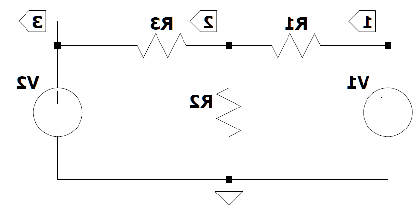
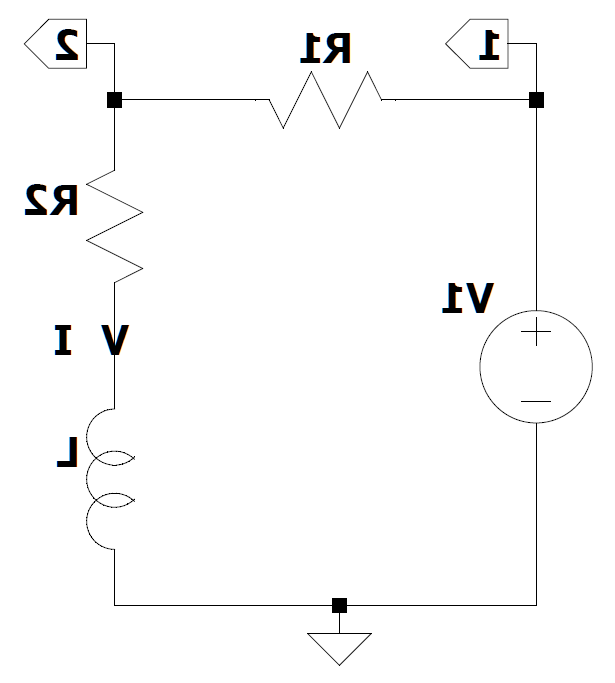
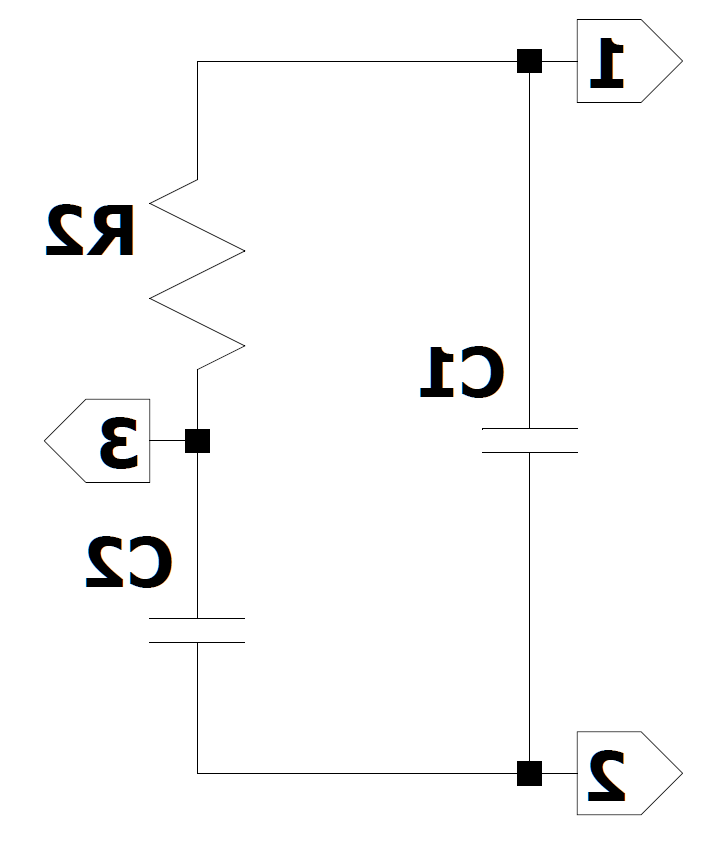
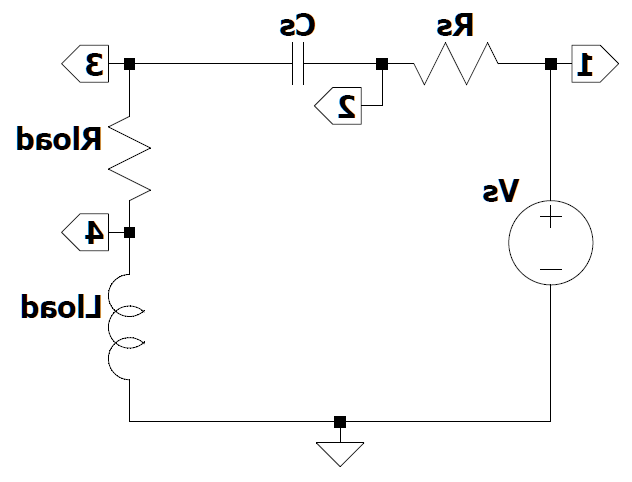
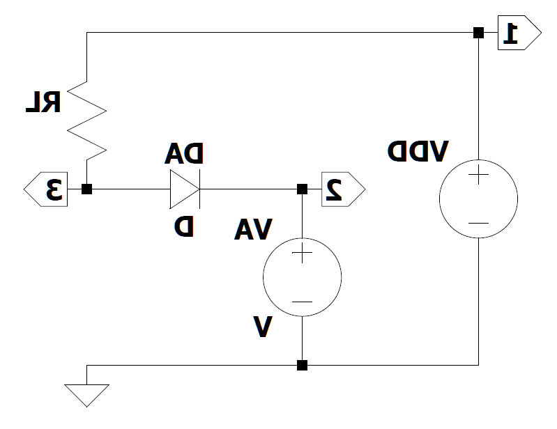
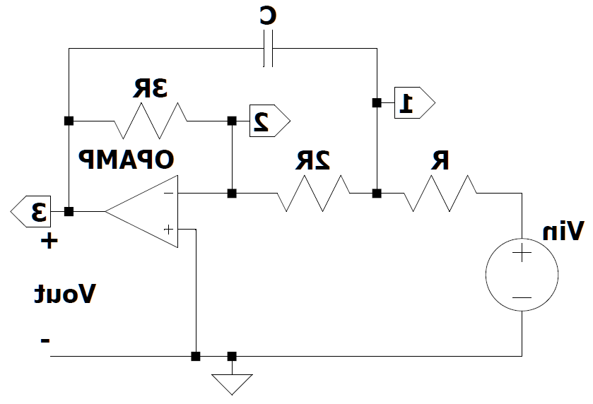
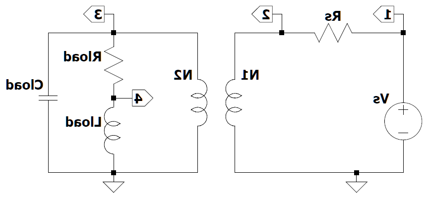

# Resit Final 2025

The real EEEN20020 resit from Spring 2024/25. Same circuits as [Final 2024](2024.md), new numbers and new twists.

**2 hours. Answer all three questions. Q1 is 100 marks, Q2 and Q3 are 50 marks each.** The % next to each part is its share of that question.

Open book. Calculator allowed.

There are **no official answers** for this paper. These are my worked answers, every number checked in Python (`tools/check_numbers.py`).

---

## Questions

### Q1. Five short circuits — 100 marks

**(a)** Derive i1(t), flowing from node 1 to node 2, as a function of time. Then calculate i1 at t = 1 ms. V1 = 2 sin(2000πt), V2 = 5 cos(5000πt), R1 = 1200 Ω, R2 = 2200 Ω, R3 = 3300 Ω. (20%)

**(b)** V1 has been at zero for a long time. At t = 0 it steps to 2 V, stays there for 50 μs, then returns to 0 V. Calculate e2 at t = 100 μs. R1 = 1200 Ω, R2 = 15 Ω, L = 100 mH. (20%)

**(c)** Write a formula for the admittance Y12(jω) of the RC network between nodes 1 and 2. (20%)

**(d)** Calculate the maximum power that can be dissipated in the load (Rload in series with Lload) and the value of Cs that gives it. Vs = 2 sin(2πft), f = 10 kHz, Rs = Rload = 50 Ω, Lload = 18 mH. (20%)

**(e)** Calculate the voltage at node 3 when (i) VA = 350 mV and (ii) VA = 4.5 V. VDD = 5 V, RL = 20 kΩ, the conducting diode drops 650 mV. (20%)

---

### Q2. Active filter — 50 marks

(a) Calculate H(ω) = Vout/Vin in terms of R, C and ω. (50%)

(b) Calculate a formula for f0, where the phase of H(ω) is 135°. (20%)

(c) With R = 10 kΩ and C = 4 nF, calculate f0. (10%)

(d) Calculate Vout(t) when Vin(t) = A cos(2πf0t), A = 1 V. (20%)

---

### Q3. Transformer and resonant load — 50 marks

A source (Vs, Rs) drives a load (Rload, Lload, Cload) through an ideal transformer with N1:N2 = 10:1.

(a) Calculate a formula for Zload(jω). (50%)

(b) Calculate Re and Im of Zload at f = 1 kHz, with Rload = 15 Ω, Lload = 180 mH, Cload = 120 nF. (30%)

(c) With the same values, calculate the amplitude of the voltage at node 3 when Vs is a 1 V, 1 kHz sine and Rs = 100 Ω. (20%)

---

## Answers

Q1 answers

**(a)** e2 = 0.5238 V1 + 0.1905 V2 = 1.048 sin(2000πt) + 0.952 cos(5000πt). i1 = (V1 − e2)/R1:

**i1(t) = 0.794 [sin(2000πt) − cos(5000πt)] mA**

At 1 ms: sin 2π = 0, cos 5π = −1. **i1 = 0.794 mA**

From: Topic 4 Rule 18

 

**(b)** τ = 82.3 μs. i(50 μs) = 0.750 mA. i(100 μs) = 0.408 mA. With V1 = 0: e2 = −R1 i.

**e2(100 μs) = −0.490 V**

From: Topic 9 Final 2024 Q1b worked example

 

**(c) Y12 = jωC1 + jωC2/(1 + jωR2C2)**

From: Topic 11 worked example

 

**(d)** Cancel the reactance: **Cs = 1/(ω²L) = 14.07 nF**. Then **Pmax = 2²/(8 × 50) = 10 mW**.

From: Topic 12 Equation 60

 

**(e)** (i) ON: **e3 = 1.0 V**. (ii) ON would need 5.15 V > VDD, so OFF: **e3 = 5 V**.

From: Topic 16 Rule 81

Q2 answers

**(a) H(ω) = −1/(1 + (5/3) jωRC)**

**(b) f0 = 3/(10πRC)**

**(c) f0 = 2387 Hz**

**(d) Vout(t) = 0.7071 cos(2πf0t + 135°) V**

From: Topic 15 §4 Equation 75

Q3 answers

**(a) Zload = (Rload + jωLload)/(1 − ω²LloadCload + jωRloadCload)**

**(b) Re = 687.6 Ω, Im = 7627 Ω**

**(c)** Reflected 100 × Zload ≫ Rs, so the primary has ≈ 1 V. **|e3| ≈ 0.100 V** (0.09996 V)

From: Topic 13 Final 2024 Q3 worked example

