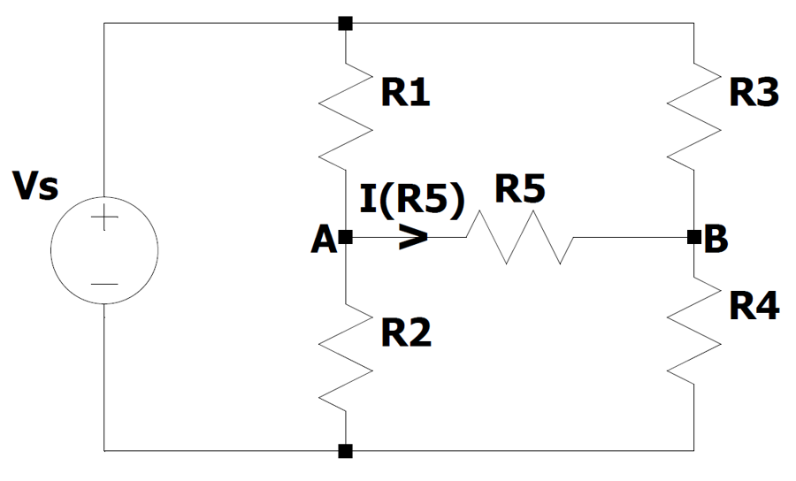
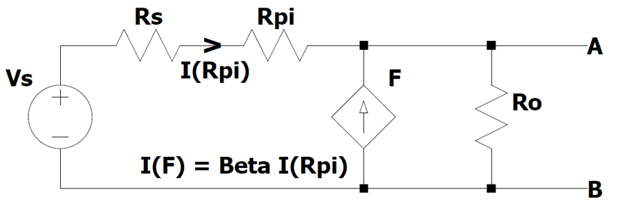
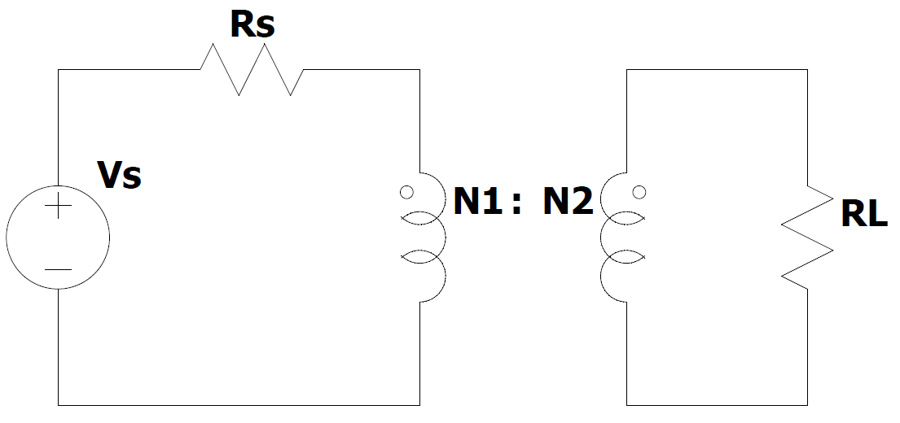
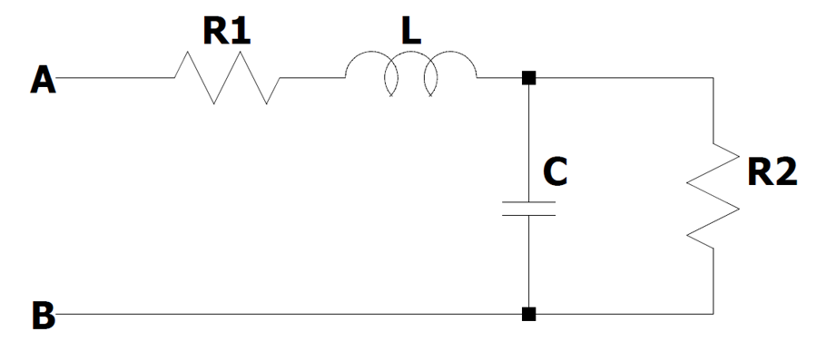
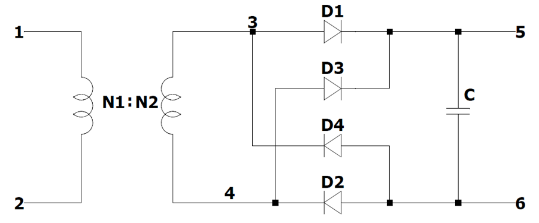
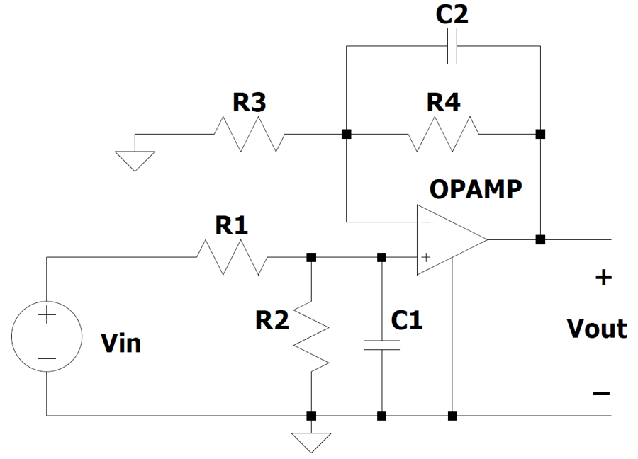
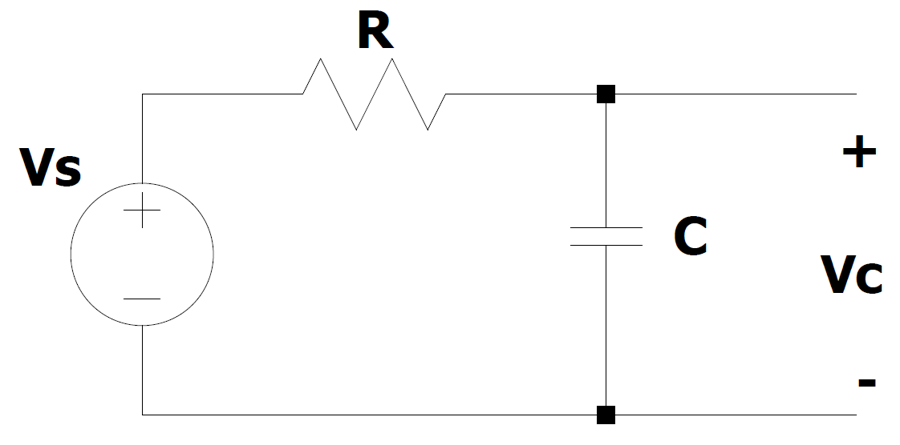
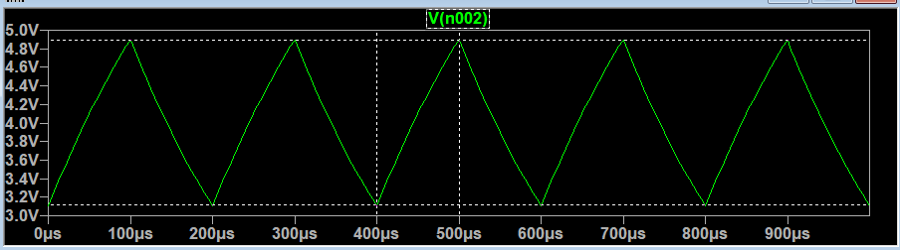

# Final 2025

The real EEEN20020 final from Autumn 2025/26.

**2 hours. Answer all three questions. Q1 is 100 marks, Q2 and Q3 are 50 marks each.** The % next to each part is its share of that question.

Open book. Calculator allowed. Give values with units, to three significant figures.

**This is the only paper with official answers.** They are marked "(official)" below. The working is mine, checked in Python (`tools/check_numbers.py`).

Do it **timed**, with your notes and the [exam sheet](../formula-sheet.md). Then mark it.

---

## Questions

### Q1. Five short circuits — 100 marks

**(a)** Calculate the current flowing from node A to node B through R5. Vs = 9 V, R1 = 1200 Ω, R2 = 2200 Ω, R3 = 3300 Ω, R4 = 4700 Ω, R5 = 5600 Ω. (20%)

**(b)** Calculate the Thévenin equivalent resistance of the circuit to the left of A and B. F is a current-controlled current source with I(F) = Beta × I(Rpi). Vs = 9 sin(2000πt) V, Rs = 50 Ω, Rpi = 5600 Ω, Beta = 200, Ro = 100 kΩ. (20%)

**(c)** An amplifier with output resistance Rs drives a resistive load RL through an ideal transformer. Calculate the turns ratio N1/N2 that transfers the maximum power. Vs = 9 sin(2000πt) V, Rs = 50 Ω, RL = 32 Ω. (20%)

**(d)** Calculate the magnitude and phase of Z_AB at f = 1 kHz. R1 = 6 Ω, L = 430 μH, C = 252 μF, R2 = 137 Ω. (20%)

**(e)** A power supply: a transformer with turns ratio 23:1, a bridge rectifier (D1 to D4) and a smoothing capacitor C = 100 μF. Each diode is piecewise-linear with Vth = 0.7 V and zero on-resistance. Estimate the peak-to-peak voltage V56 when V12 = 230 sin(100πt). (20%)

---

### Q2. Active filter — 50 marks

In Fig. 2, R1 = R2 = R3 = R4 = R and C1 = C2 = C.

(a) Calculate H(ω) = Vout(ω)/Vin(ω) in terms of R, C and ω. (50%)

(b) With R = 10 kΩ and C = 470 pF, calculate the steady-state Vout(t) when Vin(t) = 5 sin(2000πt) + 10 sin(2 × 10⁶ πt) V. (50%)

---

### Q3. RC circuit with a square wave — 50 marks

Fig. 3 shows a series RC network driven by Vs: a square wave between 0 V and 8 V, 5 kHz, 50% duty cycle (low for the first half of each cycle). R = 10 kΩ, C = 22 nF. After the initial transient:

(a) Sketch the capacitor voltage Vc(t) in steady state. (25%)

(b) Calculate the period of Vc(t). (25%)

(c) Calculate the maximum of Vc(t). (25%)

(d) Calculate the minimum of Vc(t). (25%)

---

## Answers

Q1 answers

**(a)** Nodal analysis with the top node at 9 V:

KCL at A: (eA − 9)/1200 + eA/2200 + (eA − eB)/5600 = 0

KCL at B: (eB − 9)/3300 + eB/4700 + (eB − eA)/5600 = 0

eA = 5.7735 V, eB = 5.4125 V.

**I(R5) = 0.3610/5600 = 64.46 μA** (official)

From: Topic 5 worked example

 

**(b)** Turn off Vs, keep F. Test voltage vt at A: I(Rpi) = −vt/5650.

it = vt/Ro + (1 + β) vt/5650.

**Rth = 100 k ∥ 5650/201 = 28.1 Ω** (official)

From: Topic 6 worked example, Equation 29

 

**(c)** (N1/N2)² × 32 = 50.

**N1/N2 = 1.25** (official)

From: Topic 13 Rule 64

 

**(d)** jωL = j2.702 Ω. R2 ∥ C = 0.0029 − j0.6316 Ω. Z = 6.003 + j2.070 Ω.

**|Z_AB| = 6.35 Ω, phase 19.0°** (official)

From: Topic 11 worked example

 

**(e)** Secondary peak 230/23 = 10 V. Two bridge diodes conduct: 10 − 1.4.

**8.6 V** (official)

With no load C holds a steady 8.6 V: it is really the peak (dc) value.

From: Topic 17 Final 2025 Q1e worked example

Q2 answers

**(a)** Input divider (R ∥ C)/(R + R ∥ C) = 1/(2 + jωCR). Non-inverting gain 1 + (R ∥ C)/R = (2 + jωCR)/(1 + jωCR). Multiply:

**H(ω) = 1/(1 + jωCR)** (official)

From: Topic 15 §5

 

**(b)** RC = 4.7 μs. Superposition, one frequency at a time.

1 kHz: ωRC = 0.0295: H = 0.99956∠−0.0295 rad.

1 MHz: ωRC = 29.5: H = 0.03384∠−1.537 rad.

**Vout(t) = 4.998 sin(2000πt − 0.0295) + 0.3384 sin(2 × 10⁶πt − 1.537) V** (official)

From: Topic 10 worked example, Topic 14 Rule 67

Q3 answers

τ = RC = 220 μs. Each half-period is 100 μs. x = e^(−100/220) = 0.6348.

**(a)** Exponential rise in each high half, exponential fall in each low half, between Vmin and Vmax, symmetric about 4 V. Peaks at 100, 300, 500 μs… Nearly a triangle wave because τ ≈ 2 × half-period.

**(b) Period = 200 μs** (official)

**(c) Vmax = 8/(1 + x) = 4.894 V** (official)

**(d) Vmin = 8x/(1 + x) = 3.106 V** (official)

From: Topic 9 Final 2025 Q3 worked example, Equation 48, drawing checklist

