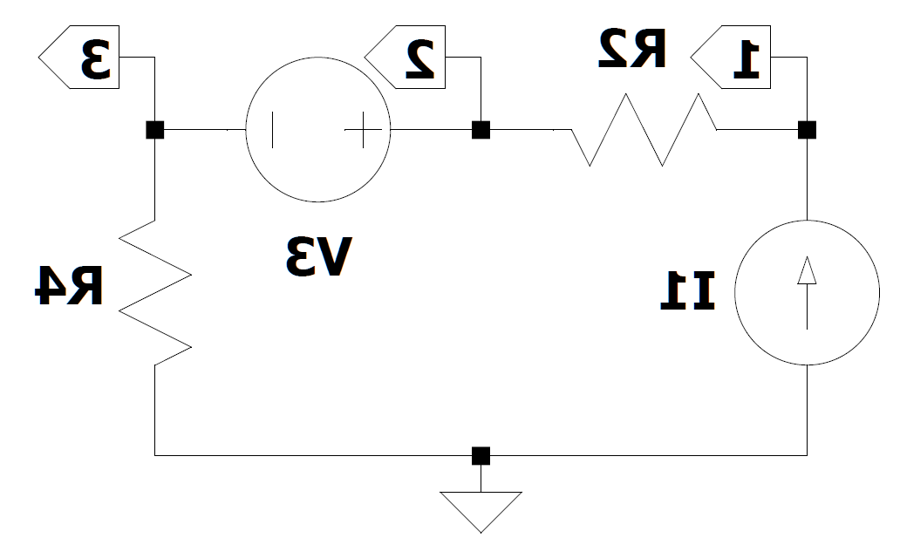

# Topic 1: End-of-topic test

Try each question first.
Then click to check.

Each answer says which notes section (§) it comes from.

---

## Part A: Homework and past-final questions

### E2-2 (Lecture 2, Example 2.2)

A 5 V element has a 2 A current arrow pointing **out of** its + terminal.

Is it supplying or consuming power? How much?

Answer

The arrow leaves the + terminal, so the labels break Rule 3.

Power absorbed = −vi = −(5)(2) = −10 W.

So it is **supplying 10 W**.

From: §3, Equation 4

---

### E2-3 (Lecture 2, Self test 2.2)

Same five-element circuit as Example 2.3 (§4).

i1 = 8 A, i2 = −8 A, i3 = 6 A, i4 = 2 A, i5 = 2 A.

v1 = 3 V, v2 = 6 V, v3 = 3 V, v4 = −1 V, v5 = 4 V.

All labels follow Rule 3. For each element, is it supplying or consuming, and how much?

Answer

Multiply p = vi for each:

- Element 1: 3 × 8 = 24 → **consuming 24 W**
- Element 2: 6 × (−8) = −48 → **supplying 48 W**
- Element 3: 3 × 6 = 18 → **consuming 18 W**
- Element 4: (−1) × 2 = −2 → **supplying 2 W**
- Element 5: 4 × 2 = 8 → **consuming 8 W**

Check with Rule 5: supplied 48 + 2 = 50 W. Consumed 24 + 18 + 8 = 50 W. ✓

From: §3, §4, Rule 5

---

### R2021-1a (Resit 2021 Q1a)

Calculate the instantaneous power dissipated in voltage source V3.

I1 = 1 mA, R2 = 2 kΩ, V3 = 3 V, R4 = 4 kΩ.

Answer

Everything is in one loop with the current source. So the loop current is I1 = 1 mA.

I1 pushes current into node 1, through R2, into the **+ terminal** of V3, out at node 3, through R4 and back.

Current enters at + → Rule 3 holds → p = vi is the power absorbed.

p = 3 V × 1 mA = **3 mW** (dissipated, i.e. absorbed).

The resistor values don't matter.

From: §4 worked example, Rule 3, Equation 4

---

## Part B: Exam-style questions

### M1: True or false

1. A negative current means the circuit is wrong.
2. With Rule 3 labels, p = vi > 0 means the element absorbs power.
3. A voltage source can absorb power.
4. v_AB = v_BA.
5. The powers of all elements in a circuit add up to zero.

Answer

1. **False.** It only means the current flows opposite to the arrow you drew (§1).
2. **True.** That is the whole point of the standard convention (§2, §3).
3. **True.** For example, a battery being charged, or V3 in Resit 2021 Q1a (§4 worked example).
4. **False.** v_AB = −v_BA (§1).
5. **True.** Conservation of power, Rule 5 (§4).

---

### M2: Multiple choice

A 12 V source drives 0.5 A **out of** its + terminal into a lamp. What does the source do?

- A. Absorbs 6 W
- B. Supplies 6 W
- C. Supplies 24 W
- D. Absorbs 24 W

Answer

**B.** The current leaves the + terminal, so absorbed power = −vi = −6 W. It supplies 6 W.

From: §3, Equation 4

---

### M3: Calculate

A 1 kΩ resistor carries 3 mA. A 2 mA current source sits in series with a 4 V source in another loop. Find the power absorbed by the resistor.

Answer

p = i²R = (3 mA)² × 1 kΩ = 9 × 10⁻⁶ × 1000 = **9 mW**.

The other loop is a distraction.

From: §3, Method

---

### M4: Explain

Explain why you should always label every element with the standard reference convention before writing p = vi.

Answer

With Rule 3 labels, the sign of p = vi tells you directly whether the element absorbs (+) or supplies (−) power.

If one element's labels break the rule, its product vi has the wrong sign, and Rule 5 (total = 0) will no longer check out.

From: §2, §4

