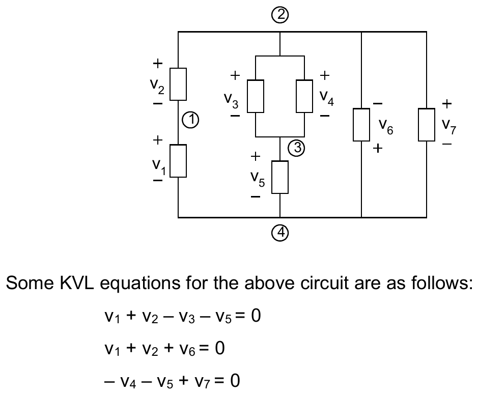

# Topic 2: End-of-topic test

Try each question first.
Then click to check.

Each answer says which notes section (§) it comes from.

---

## Part A: Homework and past-final questions

### E3-2 (Lecture 3, Example 3.2)

In this circuit v2 = 3 V, v5 = 1 V and v7 = 4 V. Find v1, v3, v4 and v6.

Answer

Loop with v1, v2, v7: v1 + v2 − v7 = 0 → **v1 = 1 V**

Loop with v3, v5, v7: v3 + v5 − v7 = 0 → **v3 = 3 V**

v3 and v4 are in parallel: **v4 = 3 V**

Loop with v6, v7: v6 + v7 = 0 → **v6 = −4 V**

From: §3, Rule 7

---

### E4-1 (Lecture 4, Self test 4.1)

A 5 kΩ resistor is connected between the + terminals of a 5 V source and a 2 V source (both − terminals on ground). A 2 mA current source and a 10 kΩ resistor are also connected to these nodes.

Find the current in the 5 kΩ resistor. Does it change if the 10 kΩ becomes 10 Ω, or the 2 mA becomes 2 A?

Answer

The 5 kΩ sits in a loop with only the two voltage sources. So its voltage is fixed: 5 − 2 = 3 V.

i = 3 V / 5 kΩ = **0.6 mA**.

It does **not change** in either case. The voltage sources fix the voltage across it, whatever the rest does (Rule 9).

From: §4, Rule 9, Equation 8

---

## Part B: Exam-style questions

### M1: True or false

1. The current through an ideal voltage source is always zero.
2. A closed ideal switch is a short circuit.
3. Ohm's law can be used on a voltage source.
4. If you know all the node voltages, you know every branch voltage.
5. Three resistors joined by one long wire are joined at one node.

Answer

1. **False.** It can be anything. The rest of the circuit decides (Rule 9).
2. **True.** Closed = short, open = open circuit (§4).
3. **False.** Ohm's law is for resistors only (Equation 8).
4. **True.** v = e_A − e_B (Equation 11).
5. **True.** A node is all the wire between elements (§1).

---

### M2: Multiple choice

A 2 mA current source drives a 3 kΩ resistor. A 9 V voltage source is in series with them. What is the voltage across the current source?

- A. 6 V
- B. 9 V
- C. It depends on the rest of the loop (KVL)
- D. 0 V

Answer

**C.** A current source's voltage is set by the rest of the circuit (Rule 10). You find it with KVL round the loop. Here: ±9 V ± 6 V, depending on the directions.

From: §4, Rule 10

---

### M3: Calculate

Node A is at e_A = 4 V and node B at e_B = −2 V (both relative to ground). A 3 kΩ resistor connects A to B. Find the current from A to B and the power in the resistor.

Answer

v_AB = e_A − e_B = 4 − (−2) = 6 V.

i = 6 / 3 kΩ = **2 mA** from A to B.

p = vi = 6 × 2 mA = **12 mW**.

From: Equation 11, Equation 8

---

### M4: Explain

A student writes i = V/R where V is the source voltage, but the resistor is not directly across the source. Explain the mistake.

Answer

Ohm's law uses the voltage **across the resistor itself**. If other elements share the source voltage, the resistor only sees part of it. Find the resistor's own voltage (e_A − e_B), then divide by R.

From: §4, Equation 8

