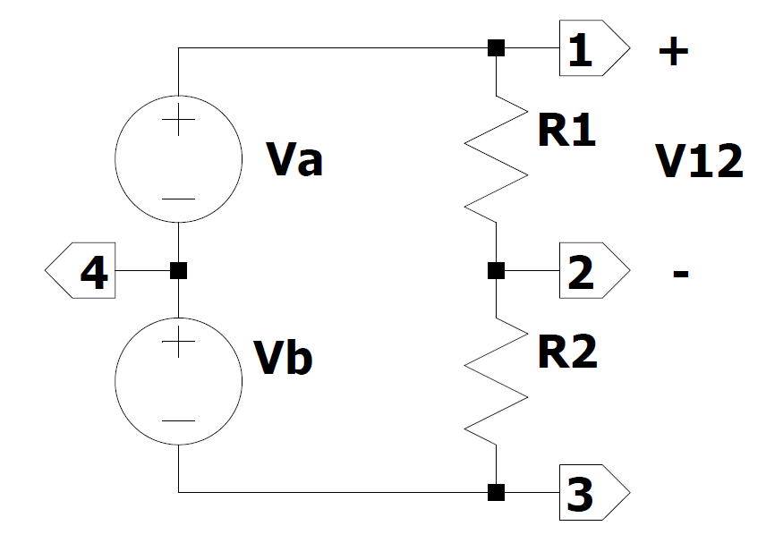
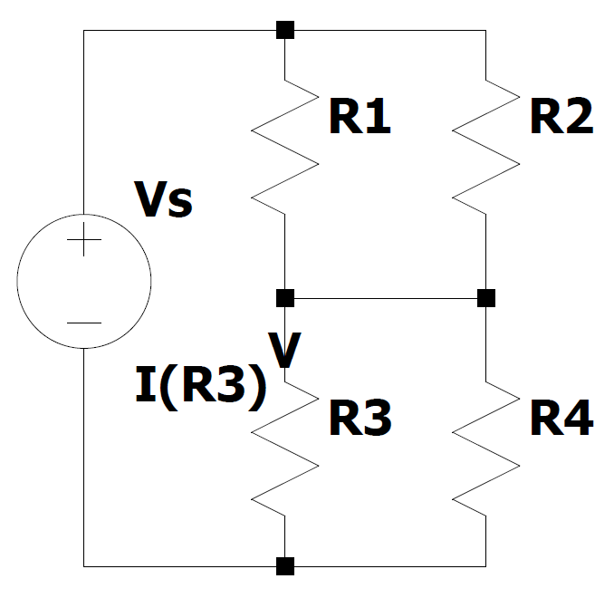
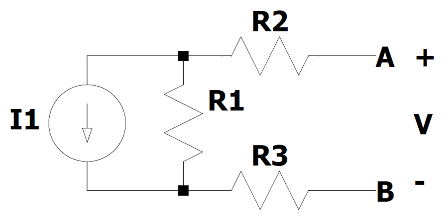
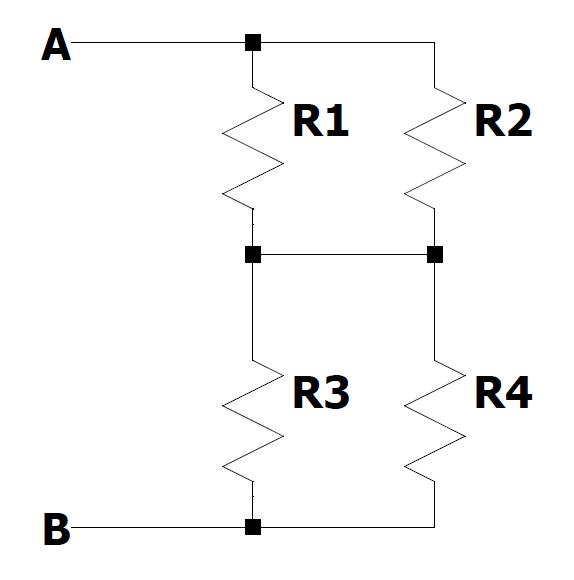
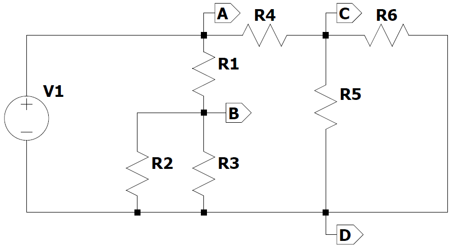
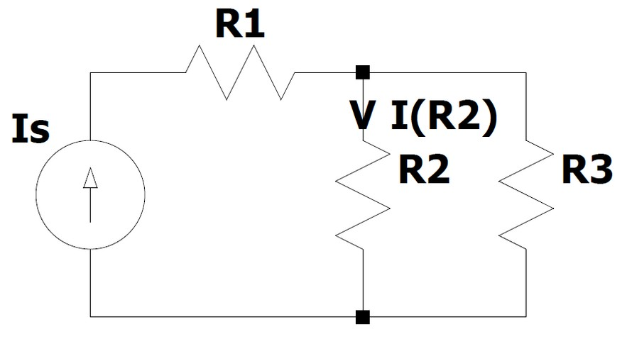
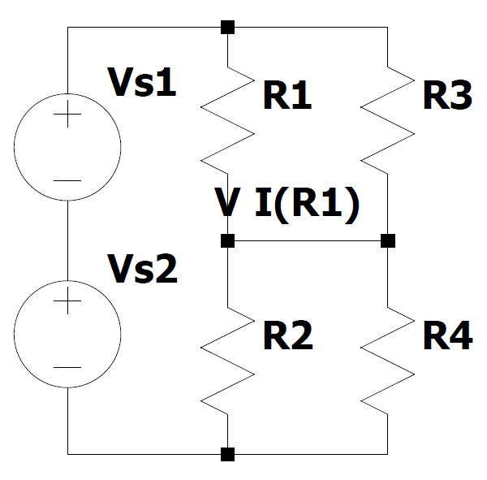
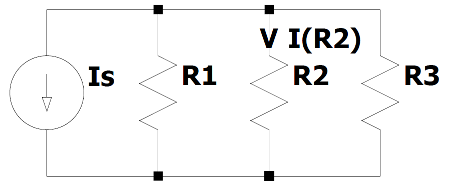
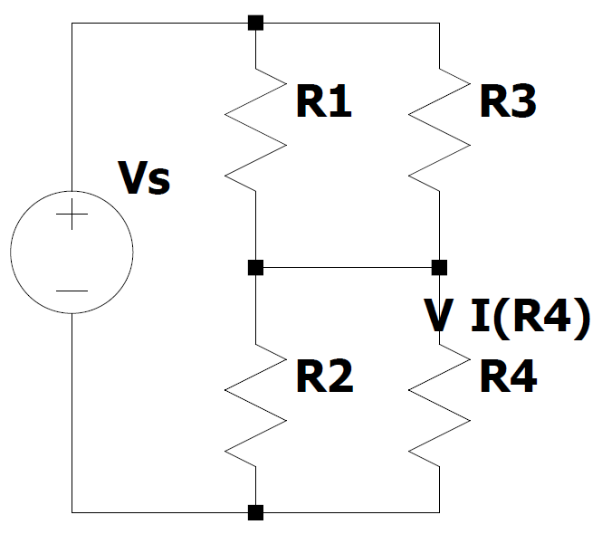

# Topic 3: End-of-topic test

Try each question first.
Then click to check.

Each answer says which notes section (§) it comes from.

All homework Greek-letter offsets (α, γ, δ, …) are set to 0. Your own sheet's numbers will be slightly different.

---

## Part A: Homework and past-final questions

### H0-1a (Homework 0 Q1a)

Calculate the voltage V12 across R1. R1 = 1200 Ω, R2 = 2200 Ω, Va = Vb = 1.5 V.

Answer

Va and Vb are in series, both + upward: together 3 V across R1 + R2 (Rule 14).

Voltage division: V12 = 3 × 1200 / (1200 + 2200) = **1.06 V** (official answer).

From: §1 Rule 14, §3 Equation 15

---

### H0-1b (Homework 0 Q1b)

Calculate the current I(R3) flowing top to bottom. Vs = 9 V, R1 = 1000, R2 = 2200, R3 = 3300, R4 = 4700 Ω.

Answer

The middle wire joins R1, R2 at the bottom and R3, R4 at the top. So R1 ∥ R2 is in series with R3 ∥ R4.

R1 ∥ R2 = 687.5 Ω. R3 ∥ R4 = 1938.75 Ω.

Total current = 9 / 2626.25 = 3.427 mA.

Current division into R3: 3.427 × 4700 / (3300 + 4700) = **2.01 mA** (official answer).

From: §2 Equation 13, §4 Equation 16

---

### H0-1c (Homework 0 Q1c)

Calculate the voltage V between A and B. I1 = 1 mA, R1 = 1200, R2 = 2200, R3 = 3300 Ω.

Answer

A and B are open, so no current flows in R2 or R3. They drop nothing.

So V = the voltage across R1.

I1's arrow points down, so the 1 mA flows **up** through R1. The bottom of R1 is higher than the top.

V = −1 mA × 1200 = **−1.2 V** (official answer).

From: §2, Topic 2 Equation 8

---

### H0-1d (Homework 0 Q1d)

Calculate the resistance between A and B. R1 = 1000, R2 = 2200, R3 = 3300, R4 = 4700 Ω.

Answer

(R1 ∥ R2) + (R3 ∥ R4) = 687.5 + 1938.75 = **2.626 kΩ** (official answer).

From: §2 Equations 12, 13

---

### H0-2 (Homework 0 Q2)

R1 = R6 = 1 kΩ, R2 = R5 = 2.2 kΩ, R3 = R4 = 3.3 kΩ, V1 = 9 V.

(a) Calculate V_CA across R4. (c) Calculate the power in R1.

Answer

**(a)** R5 ∥ R6 = 687.5 Ω. e_C = 9 × 687.5 / 3987.5 = 1.552 V.

V_CA = 1.552 − 9 = **−7.448 V** (official).

**(c)** R2 ∥ R3 = 1320 Ω. i = 9 / 2320 = 3.879 mA. P = i² × 1000 = **15.05 mW** (official).

From: §3 Equation 15, worked example

---

### H1-1a (Homework 1 Q1a)

Calculate I(R2), top to bottom. Is = 1 mA, R1 = 1000, R2 = 2200, R3 = 3300 Ω.

Answer

R1 is in series with the current source, so all 1 mA reaches R2 ∥ R3.

I(R2) = 1 mA × 3300 / 5500 = **0.6 mA**.

From: §1 Rule 14, §4 Equation 16

---

### H1-1b (Homework 1 Q1b)

Calculate I(R1), top to bottom. Vs1 = Vs2 = 1.5 V, R1 = 1000, R2 = 2200, R3 = 3300, R4 = 4700 Ω.

Answer

The two sources are in series: 3 V. The middle wire makes R1 ∥ R3 (top) in series with R2 ∥ R4 (bottom).

R1 ∥ R3 = 767.4 Ω. R2 ∥ R4 = 1498.6 Ω.

Voltage across the top pair = 3 × 767.4 / 2266.0 = 1.016 V.

I(R1) = 1.016 / 1000 = **1.016 mA**.

From: §2, §3 Equation 15

---

### HX1-1a (Homework 1 (2025) Q1a)

Last year's version. Is = 1 mA (arrow down), R1 = 1000, R2 = 2200, R3 = 3300 Ω, all in parallel. Find I(R2) top to bottom.

Answer

The source pushes current **down** through itself, so it pulls current **up** through the resistors. I(R2) is negative.

G total = 1/1000 + 1/2200 + 1/3300 = 1.758 mS.

I(R2) = −1 mA × (1/2200) / 1.758 mS = **−259 μA** (official).

From: §4 Equation 16 (conductance form)

---

### HX1-1b (Homework 1 (2025) Q1b)

Vs = 9 V, R1 = 1000, R2 = 2200, R3 = 3300, R4 = 4700 Ω. Find I(R4) top to bottom.

Answer

R1 ∥ R3 = 767.4 Ω on top, R2 ∥ R4 = 1498.6 Ω below.

Bottom voltage = 9 × 1498.6 / 2266.0 = 5.952 V.

I(R4) = 5.952 / 4700 = **1.266 mA** (official).

From: §3 Equation 15

---

### E6-2 (Lecture 6, Example 6.2)

A 5 V battery has 20 Ω internal resistance. Find the load voltage for a 20 Ω load and a 200 Ω load.

Answer

Voltage division (Rule 17):

20 Ω: 5 × 20/40 = **2.5 V**

200 Ω: 5 × 200/220 = **4.55 V**

From: §3 Rule 17

---

## Part B: Exam-style questions

### M1: True or false

1. Adding a resistor in parallel always lowers the total resistance.
2. Voltage division works whenever two resistors touch.
3. In current division, the bigger resistor takes the bigger current.
4. A resistor directly across an ideal voltage source changes no other voltage in the circuit.
5. Two 10 kΩ resistors in parallel give 5 kΩ.

Answer

1. **True.** Conductances add (§2).
2. **False.** Only when the same current flows through them (§3).
3. **False.** The smaller resistor takes more (§4).
4. **True.** The source fixes that voltage regardless (Rule 14).
5. **True.** Equal pair: R/2 (§2).

---

### M2: Multiple choice

A 6 mA source feeds 2 kΩ ∥ 4 kΩ. What current flows in the 4 kΩ?

- A. 4 mA
- B. 2 mA
- C. 3 mA
- D. 1.5 mA

Answer

**B.** i = 6 × 2/(2 + 4) = 2 mA. The other resistor goes on top.

From: §4 Equation 16

---

### M3: Calculate

A 12 V source drives 4 kΩ in series with (6 kΩ ∥ 12 kΩ). Find the voltage across the 12 kΩ and its current.

Answer

6 ∥ 12 = 4 kΩ. Divider: 12 × 4/(4 + 4) = **6 V** across the pair, so across the 12 kΩ.

i = 6 / 12 k = **0.5 mA**.

From: §2, §3

---

### M4: Explain

Why can't the bridge in Final 2025 Q1a be solved by series and parallel combining alone?

Answer

R5 joins the middle of the two dividers. Now no two resistors share both nodes (parallel), and no node has only two elements on it (series). You need node analysis (Topic 5) or a Thévenin equivalent (Topic 4).

From: §1, §5

