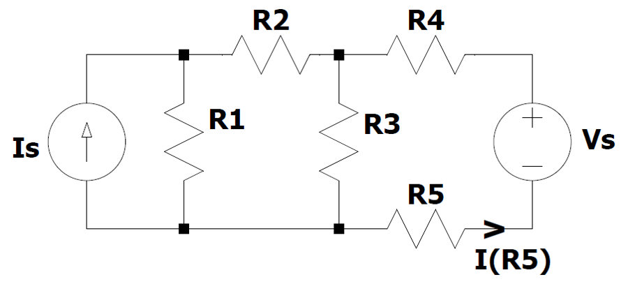
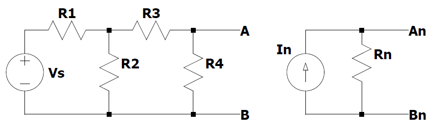
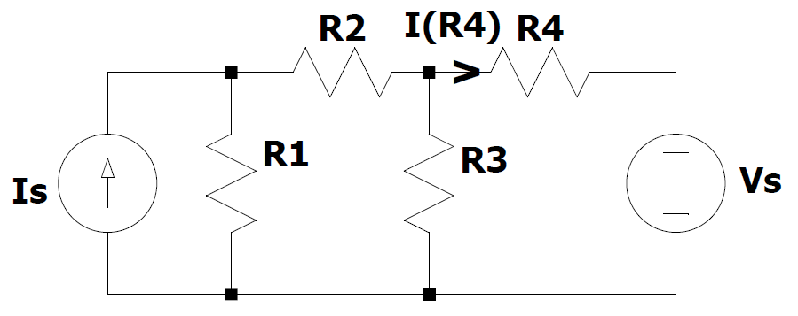
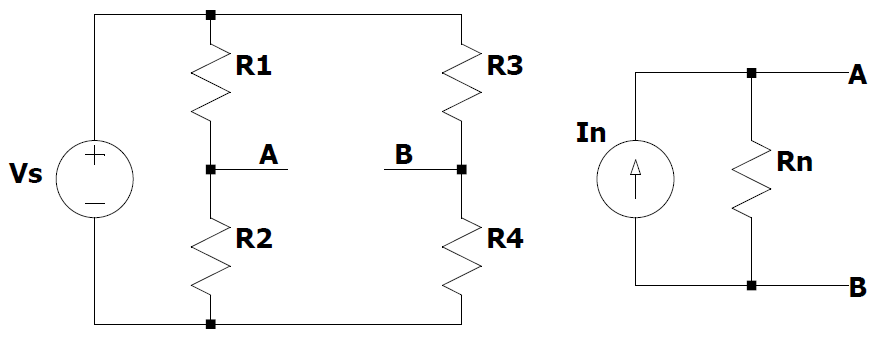
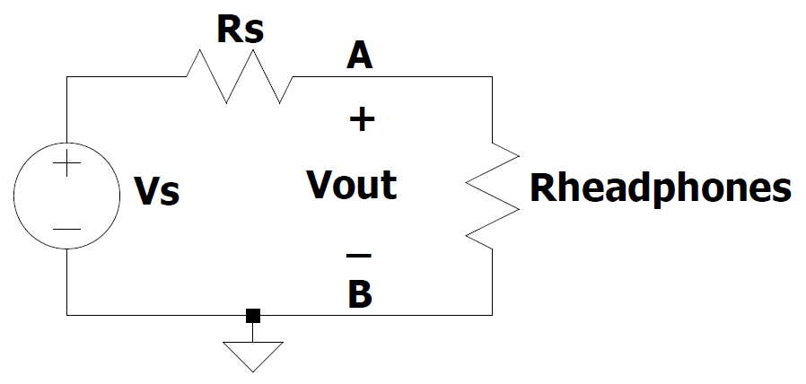
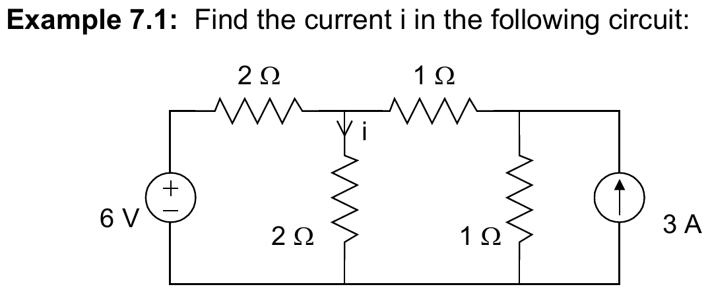
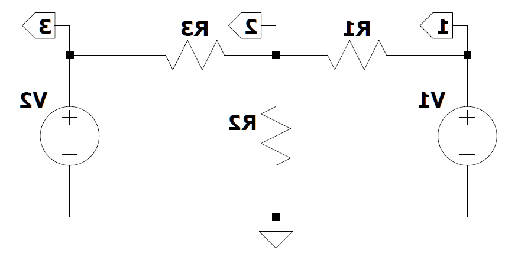

# Topic 4: End-of-topic test

Try each question first.
Then click to check.

Each answer says which notes section (§) it comes from.

Homework Greek-letter offsets are set to 0.

---

## Part A: Homework and past-final questions

### H1-1c (Homework 1 Q1c)

Find I(R5), in the direction of the arrow, when (i) Is = 1 mA, Vs = 0 V; (ii) Is = 0, Vs = 9 V; (iii) Is = 1 mA, Vs = 9 V.

R1 = 1200, R2 = 2200, R3 = 3300, R4 = 4700, R5 = 5600 Ω.

Answer

**(i) Is alone** (Vs shorted, so R4 and R5 are in series: 10.3 kΩ from node Q to ground).

Q sees R3 ∥ 10.3k = 2499 Ω. The current splits at the source node between R1 (1200) and R2 + 2499 = 4699.

Into R2: 1 mA × 1200/5899 = 0.2034 mA.

Into the R4–R5 path: 0.2034 × 3300/13600 = 49.4 μA. It flows through R5 **against** the arrow.

**I(R5) = −49.4 μA**

**(ii) Vs alone** (Is open). Vs drives R4 + R5 + (R3 ∥ (R2 + R1)) = 4700 + 5600 + 3300 ∥ 3400 = 11 975 Ω.

i = 9 / 11 975 = 0.752 mA, flowing **with** the arrow.

**I(R5) = +0.752 mA**

**(iii) Both:** add (Rule 18). −0.049 + 0.752 = **0.702 mA**.

From: §1 Rule 18

---

### H1-1d (Homework 1 Q1d)

Find In and Rn between A and B. Then find the current in a 1 kΩ resistor connected from A to B.

Vs = 12 V, R1 = 1000, R2 = 3300, R3 = 1200, R4 = 3600 Ω.

Answer

**Rn:** short Vs. R1 ∥ R2 = 767.4 Ω. Add R3: 1967.4 Ω. In parallel with R4:

Rn = 3600 ∥ 1967.4 = **1272 Ω**

**In:** short A to B. That shorts R4. Thévenin of Vs, R1, R2 at their middle: 12 × 3300/4300 = 9.209 V behind 767.4 Ω.

In = 9.209 / (767.4 + 1200) = **4.681 mA**

**1 kΩ load:** current division from the Norton source:

i = 4.681 × 1272/(1272 + 1000) = **2.621 mA**

From: §3 Rule 20

---

### HX1-1c (Homework 1 (2025) Q1c)

Last year's version: R4 goes straight to Vs. Find I(R4) for (i) Is = 1 mA alone, (ii) Vs = 9 V alone, (iii) both.

R1 = 1200, R2 = 2200, R3 = 3300, R4 = 4700 Ω.

Answer

**(i)** Vs shorted: Q sees R3 ∥ R4 = 1938.75 Ω. Into R2: 1 mA × 1200/(1200 + 2200 + 1938.75) = 0.2248 mA. Into R4: 0.2248 × 3300/8000 = **92.7 μA** (official).

**(ii)** Is open: 9 V drives R4 + R3 ∥ (R2 + R1) = 4700 + 1674.6 Ω. i = 1.412 mA, flowing from Vs into Q, against the arrow: **−1.41 mA** (official).

**(iii)** Sum: **−1.32 mA** (official).

From: §1 Rule 18

---

### HX1-1d (Homework 1 (2025) Q1d)

A Wheatstone bridge: Vs = 12 V, R1 = 1000, R2 = 3300, R3 = 1200, R4 = 3600 Ω. Find In, Rn and the current in a 1 kΩ load from A to B.

Answer

V_A = 12 × 3300/4300 = 9.209 V. V_B = 12 × 3600/4800 = 9.000 V. Vth = 0.209 V.

Rn = R1 ∥ R2 + R3 ∥ R4 = 767.4 + 900 = **1.667 kΩ** (official)

In = 0.209 / 1667 = **125 μA** (official)

1 kΩ: i = 0.209 / 2667 = **78.5 μA** (official)

From: §4 Equation 21

---

### HX2-1d (Homework 2 (2025) Q1d)

A signal generator (Vs and Rs) drives 32 Ω headphones. Vs = 100 sin(1200πt) mV, Vout = 40 sin(1200πt) mV. Estimate Rs.

Answer

Voltage divider: 40 = 100 × 32/(Rs + 32).

Rs + 32 = 80 → **Rs = 48 Ω** (official).

From: §3, Method

---

### E7-1 (Lecture 7, Example 7.1)

Find i using superposition.

Answer

6 V alone (3 A open): i1 = 1 A.

3 A alone (6 V shorted): i2 = 0.5 A.

**i = 1.5 A**

From: §1 Rule 18

---

### E8-4 (Lecture 8, Example 8.4)

A bridge with Vs = 12 V, R1 = 900 Ω, R2 = R3 = R4 = 1 kΩ, and RL = 10 kΩ from A to B. Find i in RL.

Answer

Vth = 12 (1000/1900 − 1000/2000) = 315.8 mV.

Rth = 900 ∥ 1000 + 1000 ∥ 1000 = 473.7 + 500 = 973.7 Ω.

i = 0.3158 / 10 973.7 = **28.8 μA**.

From: §4 Equation 21

---

### F2024-1a (Final 2024 Q1a)

Derive e2(t), then calculate e2 at t = 1.25 ms.

V1 = 5 sin(2000πt), V2 = 2 cos(5000πt), R1 = 1200, R2 = 2200, R3 = 3300 Ω.

Answer

Superposition. V1 alone: e2 = V1 × (R2∥R3)/(R1 + R2∥R3) = 0.5238 V1.

V2 alone: e2 = V2 × (R1∥R2)/(R3 + R1∥R2) = 0.1905 V2.

**e2(t) = 2.619 sin(2000πt) + 0.381 cos(5000πt) V**

At 1.25 ms: sin(2.5π) = 1, cos(6.25π) = 0.7071.

**e2 = 2.888 V**

From: §1 Rule 18, worked example

---

### R2025-1a (Resit 2025 Q1a)

Same circuit with V1 = 2 sin(2000πt), V2 = 5 cos(5000πt). Find i1(t), from node 1 to node 2 through R1, then i1 at t = 1 ms.

Answer

e2 = 0.5238 V1 + 0.1905 V2 = 1.048 sin(2000πt) + 0.952 cos(5000πt).

i1 = (V1 − e2)/R1 = (0.952 sin(2000πt) − 0.952 cos(5000πt)) / 1200

**i1(t) = 0.794 [sin(2000πt) − cos(5000πt)] mA**

At 1 ms: sin(2π) = 0, cos(5π) = −1.

**i1 = 0.794 mA**

The two terms have the same size. That is a coincidence of these numbers.

From: §1 Rule 18, worked example

---

## Part B: Exam-style questions

### M1: True or false

1. To turn off a current source for superposition, replace it with a short circuit.
2. Rn = Rth.
3. You can add the powers from each source to get the total power.
4. A dc source gives maximum power to a resistor equal to its internal resistance.
5. At maximum power transfer the efficiency is 100%.

Answer

1. **False.** A current source off is an **open** circuit (Rule 18).
2. **True.** Same resistance, only the source changes (Rule 20).
3. **False.** Power is not linear. Add currents or voltages, then compute power (§1).
4. **True.** RL = Rs (Equation 22).
5. **False.** Only 50%: half is lost in Rs (§5).

---

### M2: Multiple choice

A circuit has Voc = 6 V and Isc = 3 mA at terminals A–B. What is Rth?

- A. 18 Ω
- B. 0.5 kΩ
- C. 2 kΩ
- D. 18 kΩ

Answer

**C.** Rth = Voc / Isc = 6 / 3 mA = 2 kΩ.

From: §3 Rule 20

---

### M3: Calculate

A 10 V source with 50 Ω internal resistance drives a load. What load gets maximum power, and how much power is that?

Answer

RL = 50 Ω. Pmax = 10² / (4 × 50) = **0.5 W**.

From: §5 Equation 22

---

### M4: Explain

In Final 2024 Q1a, why can't you combine the two sources into one phasor?

Answer

They have different frequencies (1 kHz and 2.5 kHz). Phasors only add when they share one frequency. So find each one's effect separately (superposition) and add them in the time domain.

From: §1, worked example

