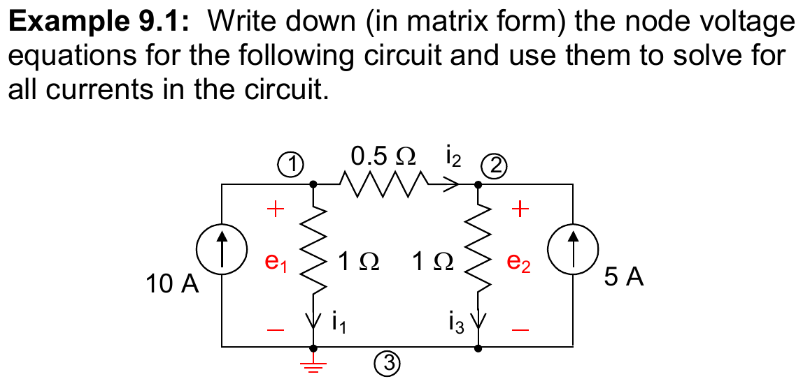
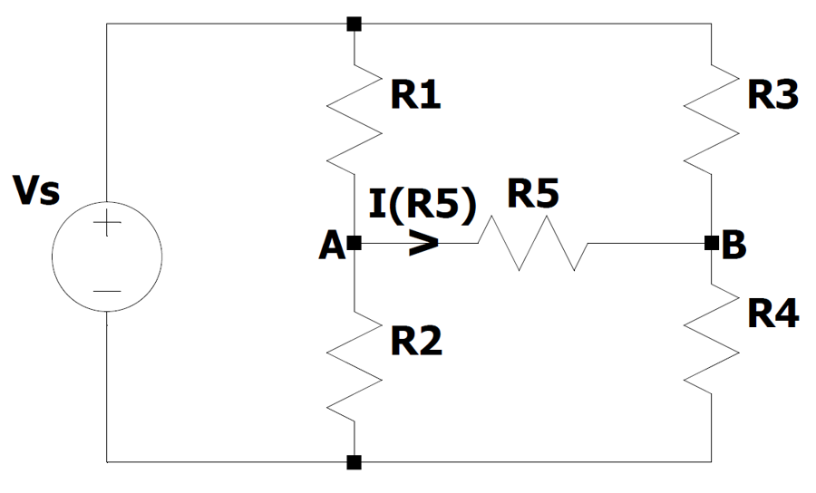
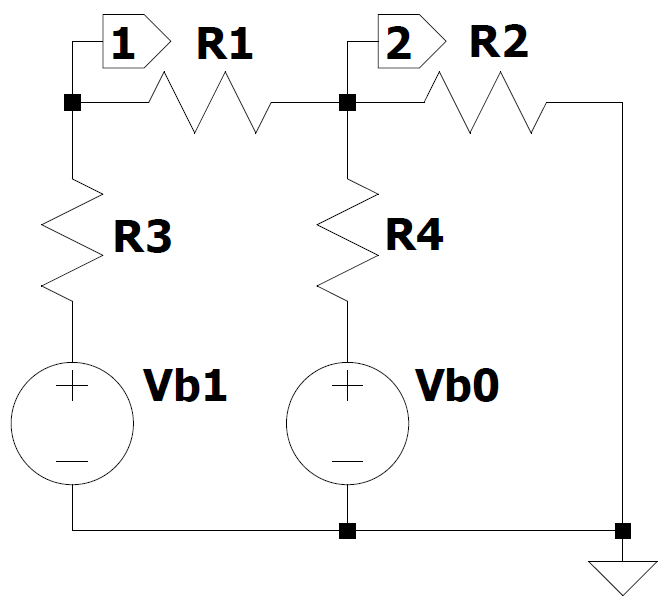
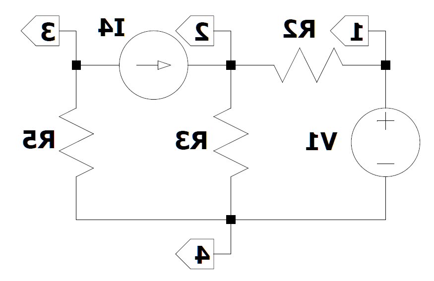
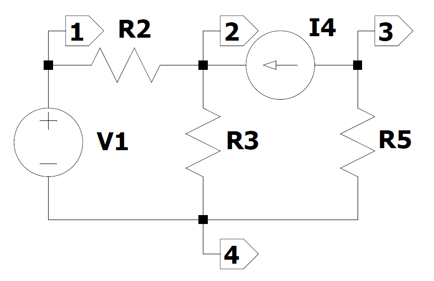
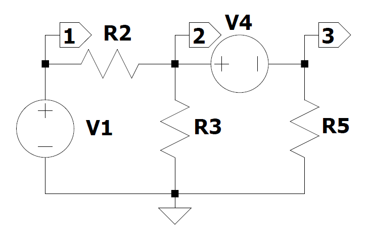
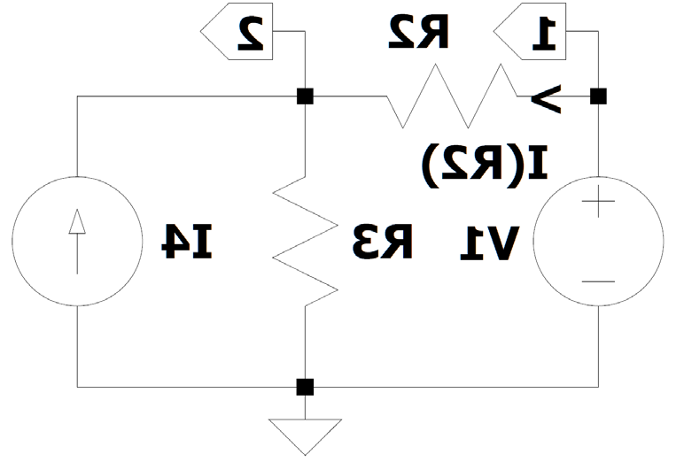

# Topic 5: End-of-topic test

Try each question first.
Then click to check.

Each answer says which notes section (§) it comes from.

These are the "easy 20%" of every Q1. Aim for under 6 minutes each.

---

## Part A: Homework and past-final questions

### E9-1 (Lecture 9, Example 9.1)

Write the node equations in matrix form and find all the currents.

Answer

By inspection (Rule 24), with G = 1/R:

| | e1 | e2 | = |
|---|---|---|---|
| node 1 | 1 + 2 = 3 | −2 | 10 |
| node 2 | −2 | 2 + 1 = 3 | 5 |

**e1 = 8 V, e2 = 7 V.** i1 = **8 A**, i2 = (8 − 7)/0.5 = **2 A**, i3 = **7 A**.

From: §1, §2 Rule 24

---

### F2025-1a (Final 2025 Q1a)

Calculate the current from node A to node B through R5.

Vs = 9 V, R1 = 1200, R2 = 2200, R3 = 3300, R4 = 4700, R5 = 5600 Ω.

Answer

KCL at A: (e_A − 9)/1200 + e_A/2200 + (e_A − e_B)/5600 = 0

KCL at B: (e_B − 9)/3300 + e_B/4700 + (e_B − e_A)/5600 = 0

e_A = 5.7735 V, e_B = 5.4125 V.

I(R5) = 0.3610/5600 = **64.46 μA** (official answer).

From: worked example, Rule 23

---

### F2023-1b (Final 2023 Q1b)

Calculate e1. Vb0 = Vb1 = 1 V, R1 = 1 kΩ, R2 = R3 = R4 = 2 kΩ.

Answer

Each battery sits in series with a 2 kΩ resistor. Write KCL directly.

Node 1: (e1 − 1)/2k + (e1 − e2)/1k = 0 → 1.5 e1 − e2 = 0.5

Node 2: (e2 − e1)/1k + (e2 − 1)/2k + e2/2k = 0 → −e1 + 2 e2 = 0.5

From the first: e2 = 1.5 e1 − 0.5. Into the second: −e1 + 3 e1 − 1 = 0.5 → e1 = 0.75.

**e1 = 0.75 V** (and e2 = 0.625 V)

From: §1 Rule 23

---

### R2024-1b (Resit 2024 Q1b)

Same circuit as Final 2023 Q1b. Calculate e2.

Answer

Same equations: 1.5 e1 − e2 = 0.5 and −e1 + 2 e2 = 0.5.

**e2 = 0.625 V**

From: §1 Rule 23

---

### F2022-1b (Final 2022 Q1b)

Calculate V24. V1 = 1 V, R2 = 2 kΩ, R3 = 3 kΩ, I4 = 0.5 mA, R5 = 5 kΩ.

Answer

Take node 4 as reference. V1 gives e1 = 1 V.

I4 pushes 0.5 mA **into** node 2 (and pulls it out of node 3).

KCL at 2: (e2 − 1)/2k + e2/3k = 0.5 mA → e2 (0.5 + 0.333) mS = 1 mA → e2 = 1.2 V.

**V24 = 1.2 V**

(Node 3: e3 = −0.5 mA × 5k = −2.5 V. It doesn't affect node 2: a current source isolates its two sides.)

From: §1, §2 Rule 24

---

### R2023-1b (Resit 2023 Q1b)

Same circuit and values as Final 2022 Q1b. Calculate V12.

Answer

e1 = 1 V, e2 = 1.2 V (Final 2022 Q1b).

**V12 = e1 − e2 = −0.2 V**

From: Topic 2 Equation 11

---

### F2021-1b (Final 2021 Q1b)

Calculate the voltage at node 2. V1 = 1 V, R2 = 2 kΩ, R3 = 3 kΩ, V4 = 4 V, R5 = 5 kΩ.

Answer

V4 is floating: e3 = e2 − 4.

KCL round nodes 2 and 3 together: (e2 − 1)/2k + e2/3k + (e2 − 4)/5k = 0.

×30k: 15e2 − 15 + 10e2 + 6e2 − 24 = 0 → 31 e2 = 39.

**e2 = 1.258 V**

From: worked example, Rule 25

---

### R2022-1b (Resit 2022 Q1b)

Same circuit. V1 = 5 V, R2 = 4 kΩ, R3 = 3 kΩ, V4 = 2 V, R5 = 5 kΩ. Calculate the voltage at node 3.

Answer

(e2 − 5)/4k + e2/3k + (e2 − 2)/5k = 0.

×60k: 15e2 − 75 + 20e2 + 12e2 − 24 = 0 → 47 e2 = 99 → e2 = 2.106 V.

**e3 = e2 − 2 = 0.106 V**

From: Rule 25

---

### R2021-1b (Resit 2021 Q1b)

Calculate the current from node 1 to node 2 through R2. Vm = 1 V, R2 = 2 kΩ, R3 = 3 kΩ, I4 = 4 mA (into node 2).

Answer

e1 = 1 V. KCL at 2: (e2 − 1)/2k + e2/3k = 4 mA.

e2 × 0.8333 mS = 4.5 mA → e2 = 5.4 V.

I(R2) = (e1 − e2)/R2 = (1 − 5.4)/2k = **−2.2 mA**

Negative: the current really flows from node 2 to node 1. The current source pushes it back into the voltage source.

From: §1 Rule 23

---

## Part B: Exam-style questions

### M1: True or false

1. In nodal analysis you write KCL at the ground node too.
2. The off-diagonal entries of Yn are negative conductances.
3. A voltage source from node 3 to ground means e3 is known.
4. A current source in series with a resistor: the resistor appears in the node equations.
5. A circuit with 5 nodes needs 4 node equations (fewer if some node voltages are known).

Answer

1. **False.** Every node except the reference (Rule 23).
2. **True.** Minus the conductance between the two nodes (Rule 24).
3. **True.** Rule 25.
4. **False.** It carries the source current whatever its value. It only changes the source's own voltage (Topic 3 Rule 14).
5. **True.** n − 1 equations (§1).

---

### M2: Multiple choice

Node 1 connects to a 10 V source through 1 kΩ, to ground through 1 kΩ, and to ground through 2 kΩ. What is e1?

- A. 5 V
- B. 4 V
- C. 6.67 V
- D. 3.33 V

Answer

**B.** (e1 − 10)/1k + e1/1k + e1/2k = 0 → 2.5 e1 = 10 → e1 = 4 V.

From: §1

---

### M3: Calculate

Use Rule 24 to write the matrix for: 2 mA into node 1; 1 kΩ from node 1 to ground; 2 kΩ from node 1 to node 2; 2 kΩ from node 2 to ground. Solve for e1 and e2.

Answer

In mS: [1 + 0.5, −0.5; −0.5, 0.5 + 0.5] [e1; e2] = [2; 0].

1.5 e1 − 0.5 e2 = 2 and −0.5 e1 + e2 = 0 → e2 = 0.5 e1 → 1.25 e1 = 2.

**e1 = 1.6 V, e2 = 0.8 V**

From: §2 Rule 24

---

### M4: Explain

Why is nodal analysis a safer exam method than series-parallel combining?

Answer

It always works for resistive circuits. The equations can be written by inspection, there are only (nodes − 1) of them, and you never need to spot a clever simplification.

From: §1

