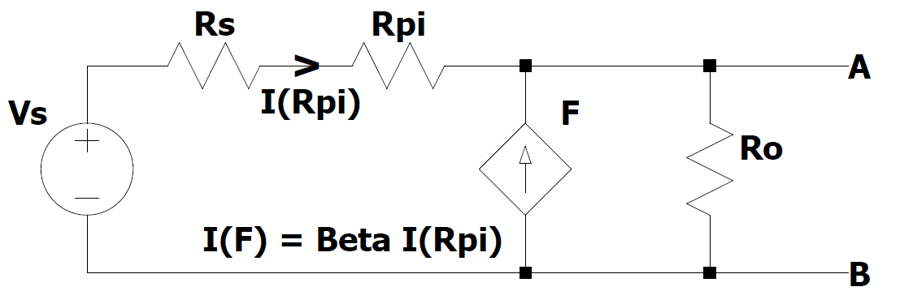
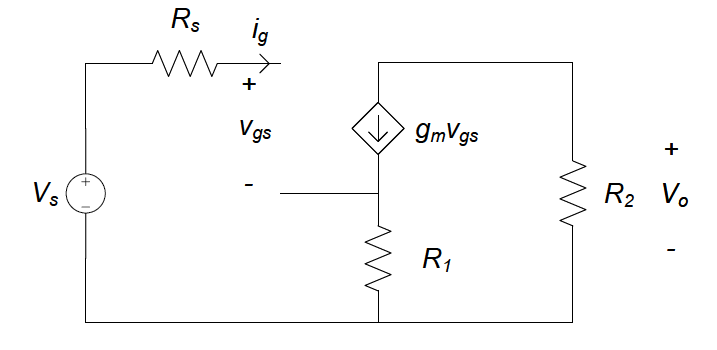
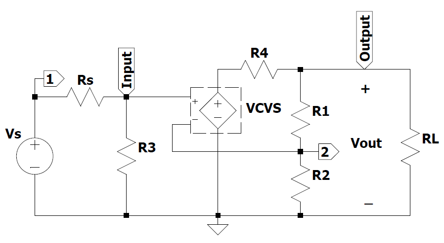
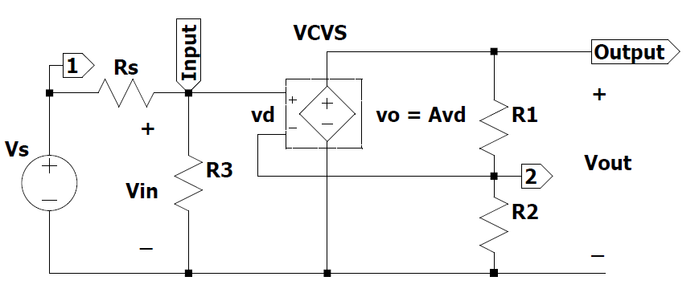
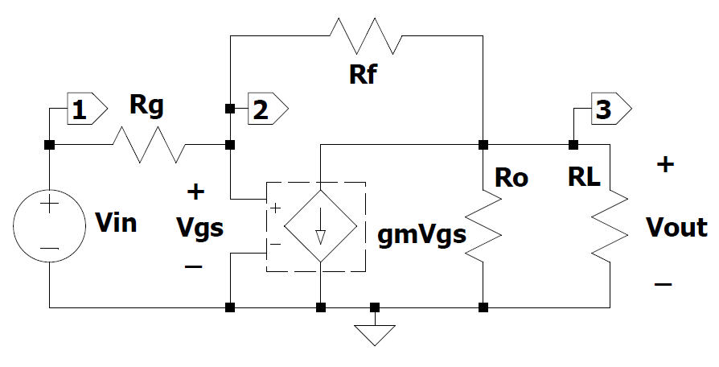
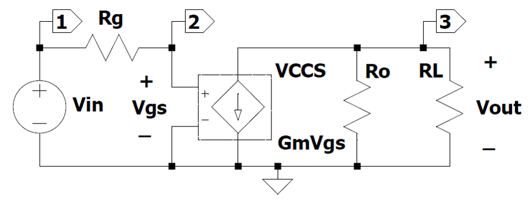
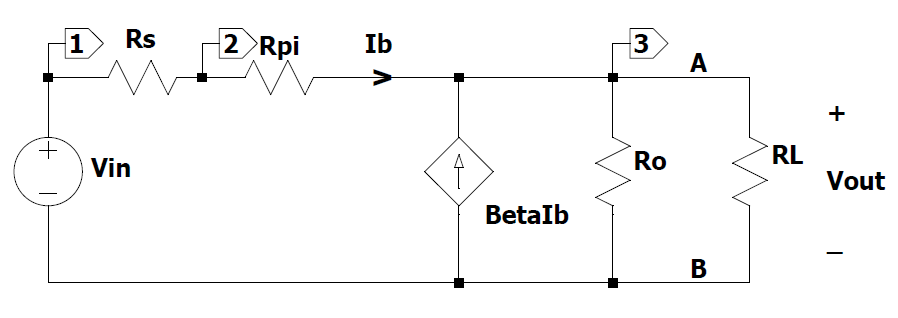
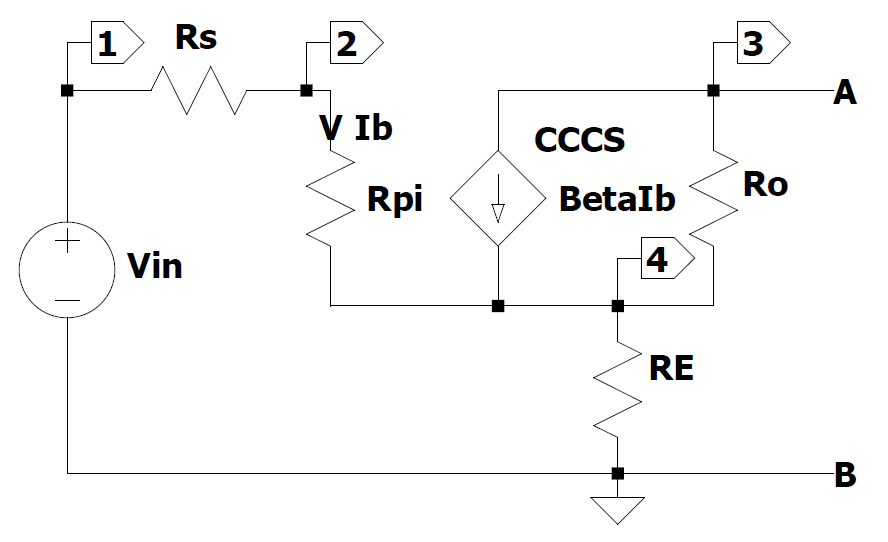

# Topic 6: End-of-topic test

Try each question first.
Then click to check.

Each answer says which notes section (§) it comes from.

Homework Greek-letter offsets are set to 0.

---

## Part A: Homework and past-final questions

### F2025-1b (Final 2025 Q1b)

Calculate the Thévenin resistance to the left of A and B. I(F) = β I(Rpi).

Vs = 9 sin(2000πt) V, Rs = 50 Ω, Rpi = 5600 Ω, β = 200, Ro = 100 kΩ.

Answer

Turn off Vs, keep F. Test voltage v_t at A: I(Rpi) = −v_t/5650.

i_t = v_t/Ro + v_t/5650 + 200 v_t/5650.

Rth = 100 k ∥ (5650/201) = 100 k ∥ 28.11 = **28.1 Ω** (official answer).

From: worked example, Rule 27, Equation 29

---

### F2023-3 (Final 2023 Q3)

(a) Find H = Vo/Vs in terms of Rs, R1, R2 and g_m. (b) Rs = 1 kΩ, R1 = 500 Ω, R2 = 10 kΩ. What g_m gives H = 20 dB?

Answer

**(a)** No gate current, so the gate is at Vs. v_gs = Vs − g_m v_gs R1 → v_gs = Vs/(1 + g_m R1). Vo = −g_m v_gs R2.

**H = −g_m R2 / (1 + g_m R1)** (Rs drops out.)

**(b)** |H| = 10: 10 000 g_m = 10 (1 + 500 g_m) → 5000 g_m = 10 → **g_m = 2 mS**.

From: worked example, Equation 30, Equation 31

---

### R2024-3 (Resit 2024 Q3)

Same circuit. Rs = 1 kΩ, R1 = 470 Ω, R2 = 22 kΩ. What g_m gives H = 30 dB?

Answer

|H| = 10^(30/20) = 31.62.

g_m × 22 000 = 31.62 (1 + 470 g_m) → g_m (22 000 − 14 862) = 31.62.

**g_m = 4.43 mS**

From: Equation 30, Equation 31

---

### H1-2 (Homework 1 Q2)

The VCVS gives vo = A vd, with vd = V(Input) − e2. R4 is in series with its output. R1 and R2 feed back from Output to node 2.

(a) Write Vo/c (RL open). (b) Write Is/c (RL shorted). Then with Vs = 100 mV, Rs = 50 Ω, R3 = 10 kΩ, R4 = 75 Ω, A = 100 kV/V, R1 = 10 kΩ, R2 = 2.2 kΩ, RL = 32 Ω find (c) Vout, (d) the power supplied by Vs, (e) the power in RL.

Answer

Input divider: Vin = Vs R3/(Rs + R3) (no current into the VCVS input).

**(a)** RL open: one current through R4, R1, R2. e2 = vo R2/(R4 + R1 + R2), and vo = A(Vin − e2):

**Vo/c = A Vin (R1 + R2) / (R4 + R1 + R2 + A R2)**, with Vin = Vs R3/(Rs + R3).

**(b)** RL shorted: Output = 0, so e2 = 0 and vo = A Vin:

**Is/c = A Vin / R4 = A Vs R3 / (R4 (Rs + R3))**

**(c)** Vin = 99.50 mV. With A this big the gain is almost exactly 1 + R1/R2 = 5.545:

**Vout = 0.552 V** (the 32 Ω load barely changes it: the feedback makes the output resistance tiny).

**(d)** P(Vs) = Vs²/(Rs + R3) = 0.01/10 050 = **995 nW**.

**(e)** P(RL) = 0.5517²/32 = **9.51 mW**.

(Is/c works out at 133 A: a "theoretical" number. A real amplifier would saturate long before that.)

From: §2, §3, Equation 28

---

### HX1-2 (Homework 1 (2025) Q2)

Last year's version, no R4 and no RL. Vs = 100 mV, Rs = 50 Ω, R3 = 10 kΩ, A = 100 kV/V, R1 = 18 kΩ, R2 = 2.2 kΩ. Find Vout, P(Vs), P(R1), P(R2).

Answer

Vin = Vs R3/(Rs + R3). Vout = A (R1 + R2) Vin / (R1 + R2 + A R2).

**Vout = 913.5 mV**, **P(Vs) = 995 nW**, **P(R1) = 36.8 μW**, **P(R2) = 4.5 μW** (all official).

Note: P(R1) + P(R2) ≫ P(Vs). The extra power comes from the VCVS (an active element).

From: §2, Equation 28

---

### H2-1b (Homework 2 Q1b)

Find the maximum positive value of Vout. Vin = 250 sin(4000πt) mV, Rg = 1 kΩ, Rf = 10 kΩ, g_m = 2.2 mS, Ro = 100 kΩ, RL = 5.6 kΩ. The VCCS current g_m v_gs flows from the output node to ground.

Answer

Let R' = Ro ∥ RL = 5303 Ω.

KCL at the output: (vo − e2)/Rf + g_m e2 + vo/R' = 0 → vo = −7.277 e2.

KCL at the gate: (e2 − vin)/Rg + (e2 − vo)/Rf = 0 → 1.1 e2 + 0.7277 e2 = vin (in mS) → e2 = 0.5471 vin.

Gain = −3.982. The output is an inverted sine of amplitude 3.982 × 0.25.

**Maximum positive Vout = 0.995 V** (when Vin is at its negative peak).

From: §1 Rule 26, Topic 5 Rule 23

---

### HX2-1b (Homework 2 (2025) Q1b)

No Rf. Vin = 500 sin(2000πt) mV, Rg = 1 kΩ, G_m = 2.2 mS, Ro = 50 kΩ, RL = 4.7 kΩ. Find Vout and its maximum positive value.

Answer

No gate current, so v_gs = Vin. The VCCS current flows into Ro ∥ RL:

**Vout = −G_m (Ro ∥ RL) Vin** = −9.45 Vin

Maximum positive value: 9.45 × 0.5 = **4.72 V** (official).

From: §2

---

### H2-1c (Homework 2 Q1c)

Find Rth to the left of A and B, and the RL for maximum power. Rs = 100 Ω, Rpi = 10 kΩ, β = 199, Ro = 100 kΩ.

Answer

Same structure as Final 2025 Q1b (Equation 29):

Rth = Ro ∥ (Rs + Rpi)/(β + 1) = 100 k ∥ (10 100/200) = 100 k ∥ 50.5 = **50.47 Ω**

Maximum power: **RL = 50.47 Ω**.

From: Equation 29, Topic 4 Equation 22

---

### HX2-1c (Homework 2 (2025) Q1c)

Now the CCCS (β = 150) and Ro = 80 kΩ both sit between node 3 and node 4, with RE = 470 Ω from node 4 to ground. Rs = 50 Ω, Rpi = 10 kΩ. Find Rth between A (node 3) and B (ground).

Answer

Test source at node 3. Here Equation 29 does **not** fit: use the full test-source method.

The result is

Rth = Ro [1 + β RE/(RE + Rs + Rpi)] + RE ∥ (Rs + Rpi) = 80 k × 7.70 + 449 = **616 kΩ** (official).

The emitter resistor RE multiplies the output resistance. Opposite to Final 2025 Q1b.

From: §3 Rule 27

---

### E10-4 (Lecture 10, Example 10.4)

Amplifier: A = 1000, Rs = 100 Ω, Ri = 10 kΩ, Ro = 8 Ω. (i) vs = 20 mV, RL = 4 Ω: find the load power. (ii) What RL maximises the load power, and what is it? (iii) What is the gain then, in dB?

Answer

**(i)** vL = (10 000/10 100) × 1000 × (4/12) vs = 330 vs = 6.6 V. P = 6.6²/4 = **10.89 W**.

**(ii)** Rth = Ro = 8 Ω, so **RL = 8 Ω**. vth = 990 × 0.02 = 19.8 V. P = 19.8²/(4 × 8) = **12.25 W**.

**(iii)** Gain = 990 × 8/16 = 495 → 20 log 495 = **53.9 dB**.

From: §2 Equation 28, §3, Equation 31

---

## Part B: Exam-style questions

### M1: True or false

1. A CCCS produces a current controlled by a current.
2. When finding Rth, you replace a VCVS by a short circuit.
3. A good voltage amplifier has a small input resistance.
4. A gain of 100 is 40 dB.
5. In Equation 30, if g_m R1 ≫ 1 the gain is about −R2/R1.

Answer

1. **True.** Rule 26.
2. **False.** Controlled sources stay on (Rule 27).
3. **False.** Large Ri, so it doesn't load the source (§2).
4. **True.** 20 log 100 = 40 dB (Equation 31).
5. **True.** The 1 becomes negligible (worked example).

---

### M2: Multiple choice

A VCCS has g_m = 5 mS and drives a 2 kΩ load. Its controlling voltage is 0.1 V. What is the load voltage (magnitude)?

- A. 0.5 V
- B. 1 V
- C. 10 V
- D. 0.25 V

Answer

**B.** i = 5 mS × 0.1 = 0.5 mA. v = 0.5 mA × 2 kΩ = 1 V.

From: §1 Rule 26

---

### M3: Calculate

A source vs with Rs = 1 kΩ drives an amplifier with Ri = 9 kΩ, A = 50, Ro = 100 Ω, into RL = 900 Ω. Find vL/vs.

Answer

(9/10) × 50 × (900/1000) = **40.5**

From: Equation 28

---

### M4: Explain

Why can't you find Rth of a circuit with a controlled source just by combining resistors?

Answer

The controlled source stays on and pushes a current (or voltage) that depends on what you apply. It changes the ratio v/i. You must apply a test source and compute v_t / i_t with the controlled source included.

From: §3 Rule 27

