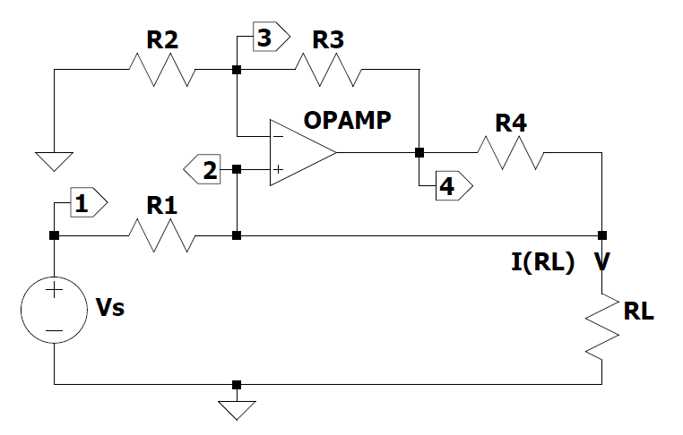
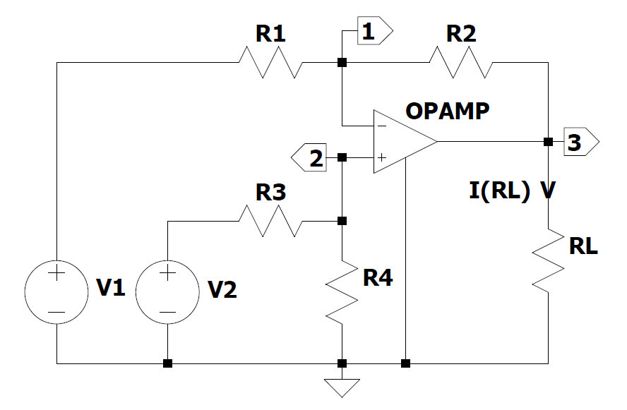
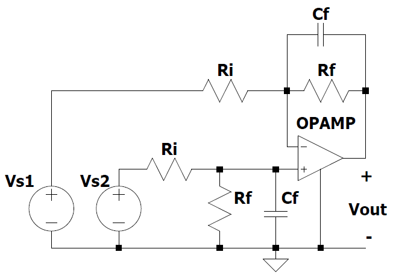

# Topic 7: End-of-topic test

Try each question first.
Then click to check.

Each answer says which notes section (§) it comes from.

Homework Greek-letter offsets are set to 0.

---

## Part A: Homework and past-final questions

### H2-2 (Homework 2 Q2)

The current in RL can be written I(RL) = Vs/R1 − e2/R0. (a) Express R0. Then with R1 = R2 = 10 kΩ, R3 = R4 = 12 kΩ, RL = 1 kΩ, Vs = 10 V find (b) R0, (c) I(RL), (d) e2, (e) e4.

Answer

**(a)** e4 = e2 (1 + R3/R2). KCL at node 2:

I(RL) = (Vs − e2)/R1 + (e4 − e2)/R4 = Vs/R1 − e2 (1/R1 − R3/(R2 R4))

**R0 = R1 R2 R4 / (R2 R4 − R1 R3)**

**(b)** R2 R4 = R1 R3 = 1.2 × 10⁸, so **R0 = ∞**.

**(c)** I(RL) = Vs/R1 = **1 mA**

**(d)** e2 = 1 mA × 1 kΩ = **1 V**

**(e)** e4 = 1 × 2.2 = **2.2 V**

From: worked example, Rule 32

---

### HX2-2 (Homework 2 (2025) Q2)

A difference amplifier. V1 through R1 to the − input, R2 feedback. V2 through R3 to the + input (node 2), R4 to ground. RL on the output.

R1 = 10 kΩ, R2 = 100 kΩ, R3 = 10 kΩ, R4 = 100 kΩ, RL = 1 kΩ, V1 = 0.5 V, V2 = 1 V. Find e2, e3, I(RL), P(RL).

Answer

e2 = V2 R4/(R3 + R4) = 1 × 100/110 = **909 mV** (official)

e3 = (R1 + R2)R4/(R1(R3 + R4)) V2 − (R2/R1) V1 = 10 × 1 − 10 × 0.5 = **5 V** (official)

I(RL) = 5 V / 1 kΩ = **5 mA**, P(RL) = **25 mW** (official)

Matched resistors, so it is just Equation 37: 10 × (1 − 0.5) = 5 V.

From: §2 Equation 37

---

### R2022-2 (Resit 2022 Q2)

Ri = 1 kΩ, Rf = 5 kΩ, Cf = 1 nF. (a) dc gain H1(0) = Vout/Vs1. (b) dc gain H2(0) = Vout/Vs2. (c) Vout when Vs1 = −0.8 V and Vs2 = 1.2 V.

Answer

At dc the capacitors are open circuits. A difference amplifier with matched Ri, Rf.

**(a) H1(0) = −Rf/Ri = −5**

**(b) H2(0) = +Rf/Ri = +5**

**(c)** Vout = 5 × (1.2 − (−0.8)) = **10 V**

From: worked example, Equation 37

---

### E12-1 (Lecture 12, Self test 12.1)

v1 drives R1 into the − input with R2 feedback. v2 drives R1 into the + input with R2 to ground. Find vo.

Answer

**vo = (R2/R1)(v2 − v1)**: the difference amplifier.

From: §2 Equation 37

---

### E14-2 (Lecture 14, Example 14.2)

An inverting amplifier with R1 = 10 kΩ, Rf = 50 kΩ uses a 741 (Ri = 2 MΩ, Ro = 75 Ω, A = 2 × 10⁵). Its gain is −4.99985. What does the ideal model give, and why is it so close?

Answer

Ideal: **−Rf/R1 = −5**.

With A this large, vd = vo/A is microvolts, so the virtual-short assumption is almost exact. The gain is set by the resistors.

From: §3, §4

---

## Part B: Exam-style questions

### M1: True or false

1. Current flows from the output of an ideal op amp into its − input.
2. In an inverting amplifier, the − input is at 0 V.
3. The non-inverting amplifier can have a gain below 1.
4. A buffer is useful because it draws no current from the source.
5. Rule 32 still works with positive feedback.

Answer

1. **False.** No current enters either input (Rule 32). The feedback current goes through the feedback resistor to the input resistor.
2. **True.** v− = v+ = 0, a virtual ground (§2).
3. **False.** 1 + Rf/R1 is always at least 1 (Equation 34).
4. **True.** So the source voltage is not divided down (§2).
5. **False.** Only with negative feedback (§5).

---

### M2: Multiple choice

An inverting amplifier has R1 = 2 kΩ and Rf = 10 kΩ. The input is 0.3 V. What is vo?

- A. 1.5 V
- B. −1.5 V
- C. 1.8 V
- D. −0.06 V

Answer

**B.** vo = −(10/2) × 0.3 = −1.5 V.

From: Equation 33

---

### M3: Calculate

A non-inverting amplifier has R1 = 1 kΩ to ground and Rf = 9 kΩ feedback. Input 0.2 V. Find vo, the current in R1, and the gain in dB.

Answer

Gain = 1 + 9 = 10. **vo = 2 V.**

v− = 0.2 V, so i(R1) = 0.2/1k = **0.2 mA** (the same current flows through Rf: (2 − 0.2)/9k = 0.2 mA ✓).

Gain = 20 log 10 = **20 dB**.

From: Equation 34, Topic 6 Equation 31

---

### M4: Explain

Why does the gain of an op-amp amplifier depend on the resistors and not on the op amp's own gain A?

Answer

With negative feedback, the op amp adjusts its output until vd = vo/A is almost zero. Because A is huge, vd ≈ 0 for any sensible output, and the circuit equations reduce to resistor ratios. Changing A from 10⁴ to 10⁹ changes the gain only in the 4th decimal place (§3).

From: §1, §3

