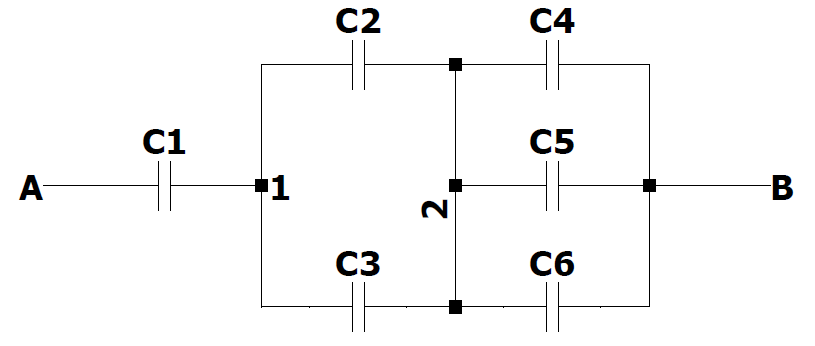
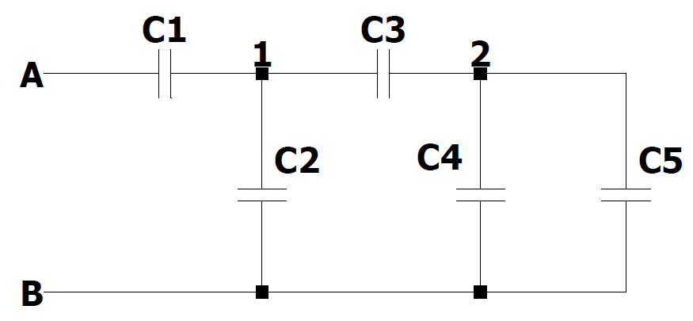
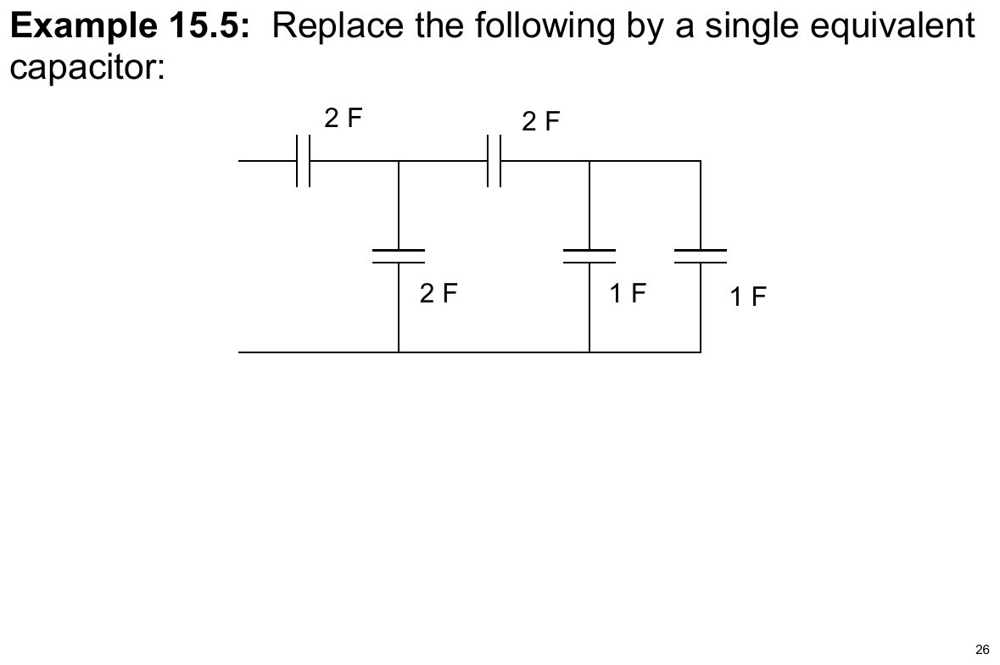

# Topic 8: End-of-topic test

Try each question first.
Then click to check.

Each answer says which notes section (§) it comes from.

---

## Part A: Homework and past-final questions

### H2-1a (Homework 2 Q1a)

Calculate C_AB. C1 to C6 are all 1000 pF.

Answer

C2 ∥ C3 = 2000 pF. C4 ∥ C5 ∥ C6 = 3000 pF.

Series: 1/C = 1/1000 + 1/2000 + 1/3000 = 11/6000.

**C_AB = 545.5 pF**

From: §2 Equation 40, worked example

---

### HX2-1a (Homework 2 (2025) Q1a)

A C-2C ladder. C1 = 2 nF (A to 1), C2 = 1 nF (1 to B), C3 = 2 nF (1 to 2), C4 = C5 = 1 nF (2 to B). Find C_AB.

Answer

From the right: C4 ∥ C5 = 2 nF. In series with C3 (2 nF): 1 nF.

In parallel with C2: 2 nF. In series with C1 (2 nF): **1 nF** (official).

Every stage looks like 1 nF to the left: that is why it's a "C-2C ladder".

From: §2 Equation 40

---

### E15-5 (Lecture 15, Example 15.5)

Replace by one capacitor. Then do the same picture with henries instead of farads (Example 16.3).

Answer

Capacitors: **6/5 F** (§2 Check).

Inductors combine like resistors.

Right end: the two 1 H in parallel = 0.5 H. Plus the second 2 H in series = 2.5 H.

That is in parallel with the 2 H going down: 2.5 × 2/4.5 = 10/9 H.

Plus the first 2 H in series: 2 + 10/9 = **28/9 H**.

From: §2 Equation 40, §3 Equation 42

---

## Part B: Exam-style questions

### M1: True or false

1. At dc steady state a capacitor is a short circuit.
2. The voltage across a capacitor can't change instantly.
3. The current through an inductor can't change instantly.
4. Two 10 nF capacitors in series give 20 nF.
5. A capacitor dissipates power like a resistor.

Answer

1. **False.** dv/dt = 0 means i = 0: an **open** circuit (§1).
2. **True.** It would need infinite current (Equation 38).
3. **True.** It would need infinite voltage (Equation 41).
4. **False.** Series capacitors give less: 5 nF (Equation 40).
5. **False.** It stores and returns energy (Equation 39).

---

### M2: Multiple choice

A 2 μF capacitor's voltage rises steadily from 0 to 3 V in 1 ms. What current flows?

- A. 6 mA
- B. 6 μA
- C. 1.5 mA
- D. 0

Answer

**A.** i = C dv/dt = 2 μF × 3 V/1 ms = 6 mA.

From: §1 Equation 38

---

### M3: Calculate

A 100 mH inductor carries 20 mA. A 470 nF capacitor has 10 V across it. Which stores more energy?

Answer

Inductor: ½ × 0.1 × 0.02² = **20 μJ**.

Capacitor: ½ × 470 n × 100 = **23.5 μJ**. The capacitor stores slightly more.

From: Equation 39

---

### M4: Explain

Why does an op-amp circuit with a capacitor in the feedback path integrate its input?

Answer

The − input is a virtual ground, so the input current is vin/R. That current can't enter the op amp, so it all flows into the capacitor: C dvo/dt = −vin/R. Integrating gives vo = −(1/RC)∫vin dt.

From: §4 Equation 43

