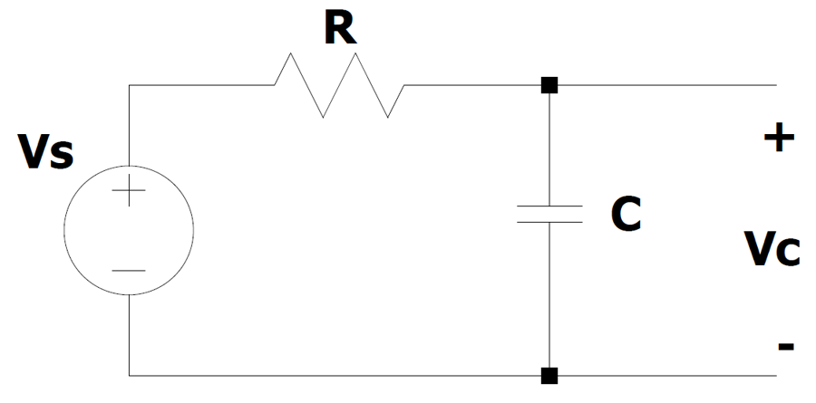
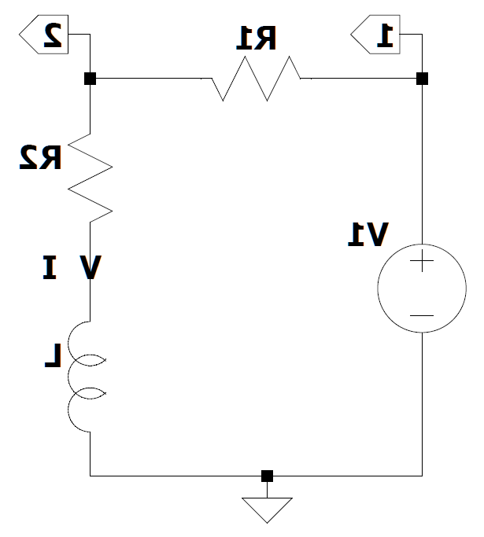
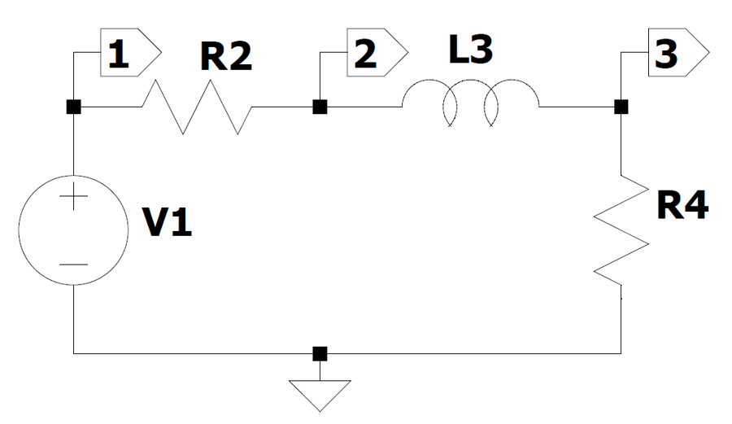
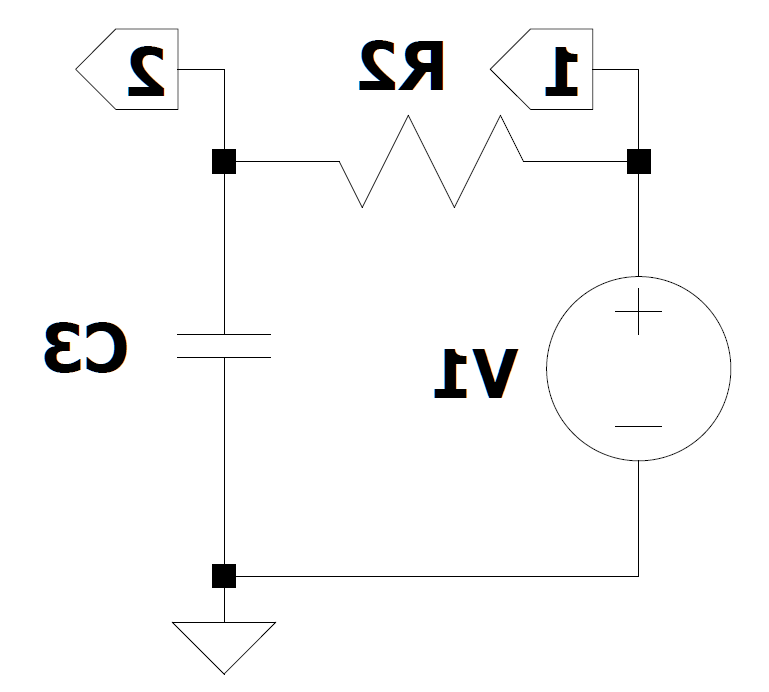
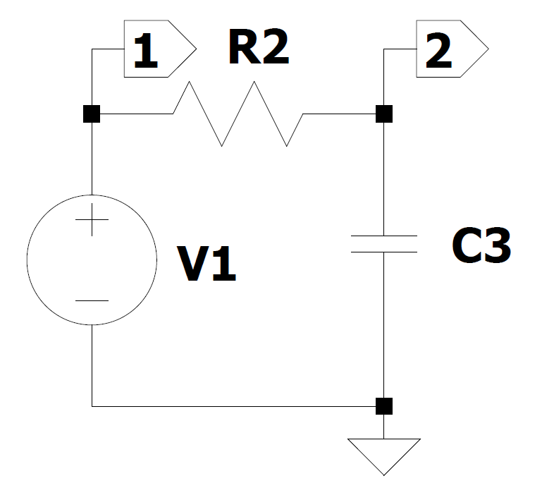
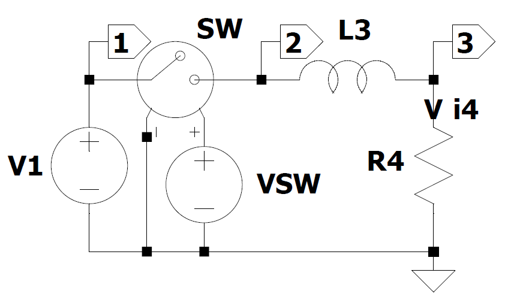
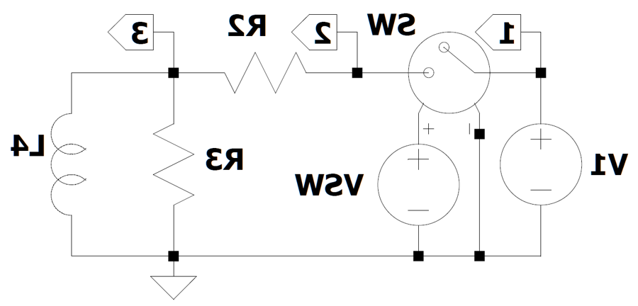
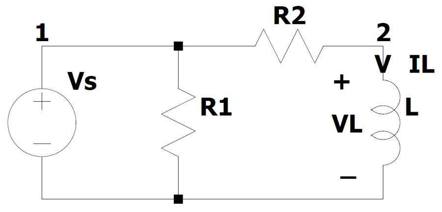
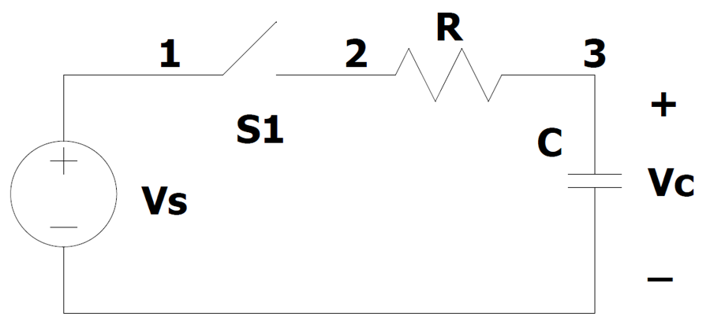
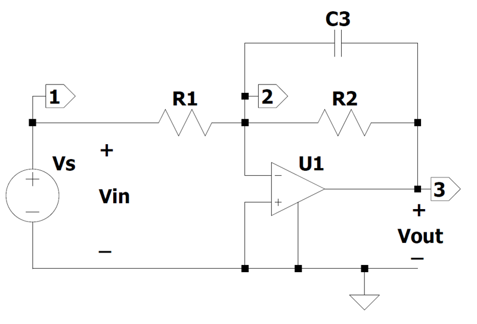

# Topic 9: End-of-topic test

Try each question first.
Then click to check.

Each answer says which notes section (§) it comes from.

Every one of these is the same three steps: **start, end, τ**. Then Equation 45.

---

## Part A: Homework and past-final questions

### F2025-3 (Final 2025 Q3)

A 0/8 V square wave, 5 kHz, 50% duty (low first) drives R = 10 kΩ and C = 22 nF. In steady state: (a) sketch Vc(t), (b) its period, (c) its maximum, (d) its minimum.

Answer

τ = 220 μs, half-period 100 μs, x = e^(−100/220) = 0.6348.

**(b) T = 200 μs** (official)

**(c) Vmax = 8/(1 + x) = 4.894 V** (official)

**(d) Vmin = 8x/(1 + x) = 3.106 V** (official)

**(a)** Exponential rises (high half) and falls (low half) between 3.106 and 4.894 V, symmetric about 4 V. Peaks at 100, 300, 500 μs. Follow the drawing checklist.

From: Final 2025 Q3 worked example, Equation 48, drawing checklist

---

### F2024-1b (Final 2024 Q1b)

V1 = 5 V for 0 ≤ t < 100 μs, 0 otherwise. R1 = 1200 Ω, R2 = 15 Ω, L = 100 mH. Find I at t = 200 μs.

Answer

τ = 0.1/1215 = 82.3 μs.

i(100 μs) = (5/1215)(1 − e^(−100/82.3)) = 2.894 mA.

i(200 μs) = 2.894 e^(−100/82.3) = 0.859 mA, still flowing from V1 through R1, R2, L to ground.

The figure's arrow for I points the other way, so **I(200 μs) = −0.859 mA** (magnitude 0.859 mA).

From: Final 2024 Q1b worked example, Equation 45

---

### R2025-1b (Resit 2025 Q1b)

Same circuit. V1 = 2 V for 50 μs, then 0. Find e2 (between R1 and R2) at t = 100 μs.

Answer

τ = 82.3 μs. i(50 μs) = (2/1215)(1 − e^(−50/82.3)) = 0.750 mA.

i(100 μs) = 0.750 e^(−50/82.3) = 0.408 mA.

V1 = 0 now, so e2 = 0 − R1 i = −1200 × 0.408 mA = **−0.490 V**

From: Final 2024 Q1b worked example

---

### F2023-1c (Final 2023 Q1c)

V1 has been 1 V for a long time. At t = 100 μs it steps to 2 V. Find e3 at t = 150 μs. R2 = 1 kΩ, L3 = 100 mH, R4 = 1200 Ω.

Answer

i: 0.4545 mA → 0.9091 mA, τ = 0.1/2200 = 45.45 μs.

i(150 μs) = 0.9091 − 0.4545 e^(−50/45.45) = 0.7578 mA.

**e3 = 1200 × 0.7578 mA = 0.909 V**

From: Final 2023 Q1c worked example

---

### R2024-1c (Resit 2024 Q1c)

Same circuit. V1 steps from 0 V to 2 V at t = 100 μs. R2 = 1 kΩ, L3 = 100 mH, R4 = 1500 Ω. Find the current from node 3 to ground through R4 at t = 150 μs.

Answer

Start 0. End 2/2500 = 0.8 mA. τ = 0.1/2500 = 40 μs.

i = 0.8 (1 − e^(−50/40)) = 0.8 × 0.7135 = **0.571 mA**

From: Equation 45, Equation 46

---

### F2022-1c (Final 2022 Q1c)

V1 has been 1 V for a long time. At t = 1 ms it steps to 2 V. R2 = 2200 Ω, C3 = 470 nF. Find e2 at t = 2 ms.

Answer

Start: e2 = 1 V (capacitor open, no drop on R2). End: 2 V. τ = 2200 × 470 n = 1.034 ms.

e2 = 2 + (1 − 2) e^(−1/1.034) = 2 − 0.380 = **1.620 V**

From: Equation 45

---

### R2023-1c (Resit 2023 Q1c)

V1 has been 1 V for a long time. At t = 1 ms it switches to 0 V. R2 = 1800 Ω, C3 = 560 nF. Find e2 at t = 1.5 ms.

Answer

Start 1 V, end 0 V, τ = 1800 × 560 n = 1.008 ms.

e2 = e^(−0.5/1.008) = **0.609 V**

From: Equation 45

---

### F2021-1c (Final 2021 Q1c)

The switch closes at t = 0. e3(0) = 0. V1 = 1 V, L3 = 3 mH, R4 = 4 kΩ. Find i4 at t = 1 μs.

Answer

i starts at 0 (inductor current continuous). End: 1 V/4 kΩ = 0.25 mA. τ = 3 mH/4 kΩ = 0.75 μs.

i4 = 0.25 (1 − e^(−1/0.75)) = 0.25 × 0.7364 = **184 μA**

From: Equation 45, Rule 47

---

### R2022-1c (Resit 2022 Q1c)

Same circuit with L3 = 6 mH. Find e3 at t = 3 μs.

Answer

τ = 6 mH/4 kΩ = 1.5 μs. e3 = R4 i = 1 × (1 − e^(−3/1.5)) = 1 − e^(−2) = **0.865 V**

From: Equation 45

---

### R2021-1c (Resit 2021 Q1c)

The switch closes at t = 0. I(L4) is 0 just before. V1 = 1 V, R2 = 2 kΩ, R3 = 3 kΩ (node 3 to ground), L4 = 4 mH (node 3 to ground). Find I(L4) at 5 μs.

Answer

Thévenin seen by L4: Vth = 1 × 3/5 = 0.6 V, Rth = 2k ∥ 3k = 1.2 kΩ.

End: L is a short, i(∞) = 0.6/1.2k = 0.5 mA. τ = 4 mH/1.2 kΩ = 3.33 μs.

I(L4) = 0.5 (1 − e^(−5/3.33)) = 0.5 × 0.777 = **388 μA**

From: Equation 46 (Thévenin), Equation 45

---

### H2-1d (Homework 2 Q1d)

Before t = 0 the switch is open and Vc = 9 V. It closes at t = 0. Vs = 5 V, R = 1 kΩ, C = 220 nF. Find Vc at 250 μs.

Answer

Start 9 V, end 5 V, τ = 220 μs.

Vc = 5 + 4 e^(−250/220) = 5 + 4 × 0.321 = **6.284 V**

The capacitor discharges **down** towards 5 V.

From: Equation 45

---

### HX3-1c (Homework 3 (2025) Q1c)

Vs steps from 0 to 1 V at t = 0. R1 = 4.7 kΩ (across Vs), R2 = 1.2 kΩ, L = 18 mH. Find VL and IL at 20 μs.

Answer

R1 is across the ideal source, so it changes nothing (Topic 3 Rule 14).

τ = 18 mH/1.2 kΩ = 15 μs. IL: 0 → 1/1200 = 0.833 mA.

IL = 0.833 (1 − e^(−20/15)) = **614 μA** (official)

VL jumps to 1 V then decays: VL = e^(−20/15) = **264 mV** (official)

From: Equation 45, Rule 47

---

### HX3-1d (Homework 3 (2025) Q1d)

Vc = 0 before the switch closes at t = 0. Vs = 5 V, R = 1200 Ω, C = 100 nF. Find Vc at 100 μs.

Answer

τ = 120 μs. Vc = 5 (1 − e^(−100/120)) = **2.83 V** (official)

From: Equation 45

---

### HX3-2 (Homework 3 (2025) Q2)

An inverting op amp with R1 = 1 kΩ input and R2 = 2.2 kΩ ∥ C3 = 330 nF feedback. C3 is discharged. At t = 0, Vs steps to 1 V. Find (a) Vout(0), (b) Vout after a long time, (c) τ, (d) Vout(1 ms).

Answer

The − input is a virtual ground, so the input current is a steady 1 mA. That makes it an R2 ∥ C3 circuit driven by a current.

**(a)** C3's voltage can't jump: **Vout(0) = 0 V** (official)

**(b)** C3 open: inverting gain −R2/R1: **Vout(∞) = −2.2 V** (official)

**(c)** C3 sees R2: **τ = R2 C3 = 726 μs** (official)

**(d)** Vout = −2.2 (1 − e^(−1/0.726)) = **−1.64 V** (official)

From: Method (lossy integrator), Topic 8 §4, Topic 7 Rule 32

---

### E17-2 (Lecture 17, Example 17.2)

The capacitor (2 F) was at 2 V. After the switch closes, it sees 3 V behind 1 Ω. Find v(t) and i(t).

Answer

τ = 1 × 2 = 2 s. **v(t) = 3 − e^(−t/2) V**, **i(t) = e^(−t/2) A** (from i = 3 − v).

From: §2

---

## Part B: Exam-style questions

### M1: True or false

1. Just after a switch, the capacitor current equals its value just before.
2. τ for an RL circuit is L/R.
3. After 5τ the transient is over 99% complete.
4. To find τ, use the resistance seen by the capacitor with the sources turned off.
5. In a square-wave steady state, Vmax and Vmin are symmetric about the average of the square wave.

Answer

1. **False.** The capacitor **voltage** is continuous, not its current (Rule 47).
2. **True.** Equation 46.
3. **True.** e^(−5) = 0.7% left (§2).
4. **True.** Equation 46.
5. **True.** By symmetry of the equal halves (Final 2025 Q3).

---

### M2: Multiple choice

A 10 kΩ resistor and 100 nF capacitor. The capacitor starts at 0 V and is charged towards 5 V. What is the voltage after 1 ms?

- A. 3.16 V
- B. 5 V
- C. 1.84 V
- D. 2.5 V

Answer

**A.** τ = 1 ms. 5 (1 − e^(−1)) = 3.16 V.

From: Equation 45

---

### M3: Calculate

An inductor of 50 mH carries 2 mA from a long-applied source through 1 kΩ. The source is suddenly removed (shorted), leaving L in series with 1 kΩ + 4 kΩ. Find the current 20 μs later.

Answer

Start 2 mA (continuous). End 0. τ = 50 mH/5 kΩ = 10 μs.

i = 2 e^(−2) = **0.271 mA**

From: Equation 45, Rule 47

---

### M4: Explain

Why must you find the capacitor voltage first, rather than the resistor current, at a switching instant?

Answer

Only the capacitor voltage (and inductor current) is guaranteed continuous. A resistor current can jump at the switch. So get v_C just before the switch, carry it across, then use KVL and Ohm to find the resistor current just after.

From: Rule 47

