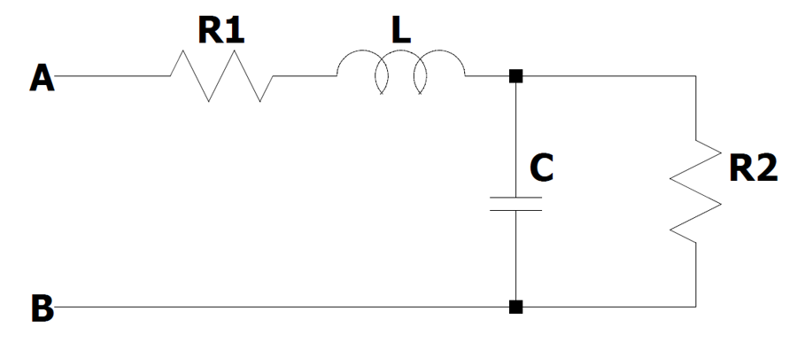
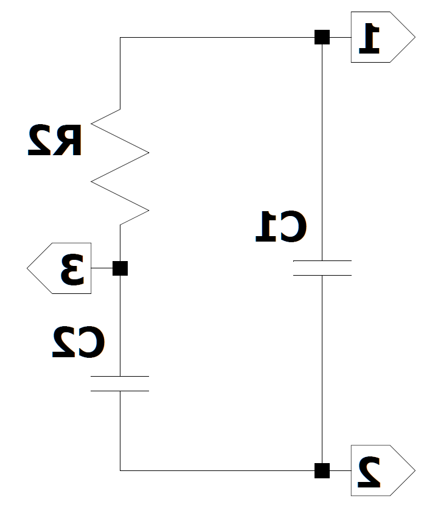
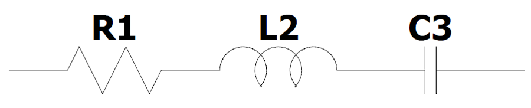
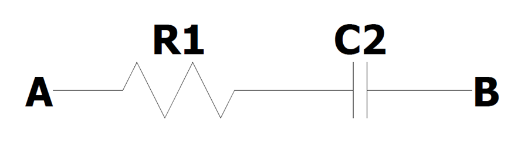
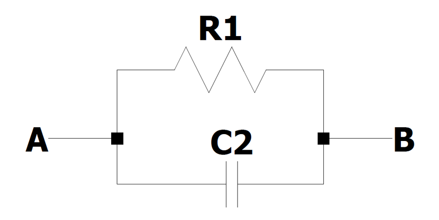
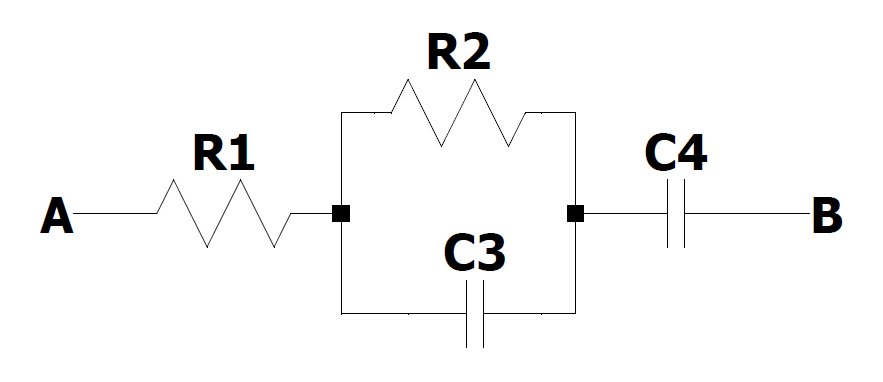
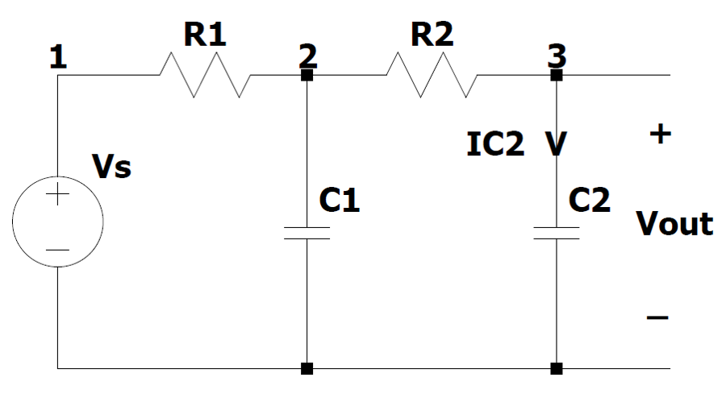
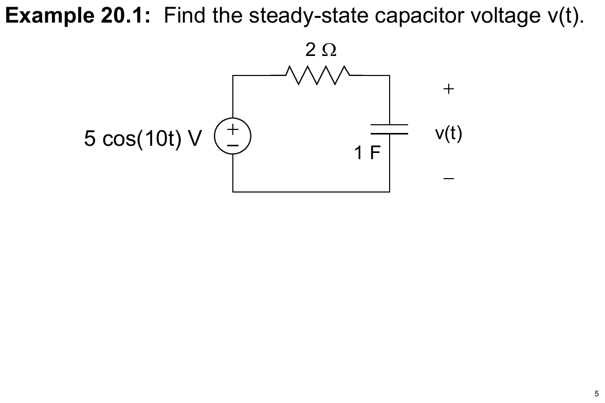

# Topic 11: End-of-topic test

Try each question first.
Then click to check.

Each answer says which notes section (§) it comes from.

Homework Greek-letter offsets are set to 0.

---

## Part A: Homework and past-final questions

### F2025-1d (Final 2025 Q1d)

Calculate |Z_AB| and its phase at f = 1 kHz. R1 = 6 Ω, L = 430 μH, C = 252 μF, R2 = 137 Ω.

Answer

jωL = j2.702. R2 ∥ (−j0.6316) = 0.0029 − j0.6316.

Z = 6.003 + j2.070.

**|Z| = 6.35 Ω, phase 19.0°** (official)

From: Final 2025 Q1d worked example

---

### F2024-1c (Final 2024 Q1c)

Write a formula for Z12(jω).

Answer

Z12 = Z_C1 ∥ (R2 + Z_C2):

**Z12 = (1 + jωR2C2) / [jω(C1 + C2) − ω² R2 C1 C2]**

From: Final 2024 Q1c worked example

---

### R2025-1c (Resit 2025 Q1c)

Write a formula for the admittance Y12(jω) of the same network.

Answer

Admittances in parallel add:

**Y12 = jωC1 + jωC2/(1 + jωR2C2)**

(The same as 1/Z12 above.)

From: Equation 55, worked example

---

### F2022-1d (Final 2022 Q1d)

R1 = 40 Ω in series with L2 = 18 mH, f = 1 kHz. Find |Z| and its phase.

Answer

ωL = 113.1 Ω. Z = 40 + j113.1.

**|Z| = 120.0 Ω, phase 70.5°**

From: §1 Equation 53

---

### R2023-1d (Resit 2023 Q1d)

Same R1 = 40 Ω, L2 = 18 mH. Find f where |Re Z| = |Im Z|, then |Z| and the phase there.

Answer

ωL = 40 → **f = 353.7 Hz**. **|Z| = 56.57 Ω, phase 45°**.

From: Resit 2023 Q1d worked example

---

### F2021-1d (Final 2021 Q1d)

Series R1 = 1300 Ω, L2 = 18 mH, C3 = 100 nF at f = 1000 Hz. Find |Z| and its phase.

Answer

ωL = 113.1 Ω. 1/(ωC) = 1591.5 Ω. X = 113.1 − 1591.5 = −1478.4 Ω.

Z = 1300 − j1478.4.

**|Z| = 1969 Ω, phase −48.7°** (capacitive)

From: Equation 53, Rule 54

---

### R2022-1d (Resit 2022 Q1d)

Series R1 = 40 Ω, L2 = 18 mH, C3 = 82 nF at f = 4000 Hz. Find |Z| and its phase.

Answer

ωL = 452.4 Ω. 1/(ωC) = 485.2 Ω. X = −32.8 Ω.

**|Z| = 51.75 Ω, phase −39.4°**

Close to resonance (Topic 13): the reactances almost cancel.

From: Equation 53

---

### R2021-1d (Resit 2021 Q1d)

Series R1 = 4700 Ω, L2 = 10 mH, C3 = 100 pF at f = 200 kHz. Find the magnitude and phase of the **admittance** Y.

Answer

ωL = 12 566 Ω. 1/(ωC) = 7958 Ω. Z = 4700 + j4609, |Z| = 6582 Ω, ∠Z = 44.4°.

**|Y| = 1/6582 = 151.9 μS, ∠Y = −44.4°**

From: Equation 55

---

### H3-1a (Homework 3 Q1a)

R1 = 1800 Ω in series with C2 = 2200 pF at f = 50 kHz. Find Re, Im, |Z| and the phase (degrees and radians).

Answer

1/(ωC) = 1446.9 Ω.

**Re = 1800 Ω, Im = −1447 Ω, |Z| = 2309 Ω, ∠Z = −38.79° = −0.677 rad**

From: Equation 53

---

### H3-1b (Homework 3 Q1b)

R1 = 1500 Ω in parallel with C2 = 3300 pF at f = 25 kHz. Find Re, Im, |Z| and the phase.

Answer

Z = R/(1 + jωRC), ωRC = 0.7776.

**Re = 934.8 Ω, Im = −726.9 Ω, |Z| = 1184 Ω, ∠Z = −37.87° = −0.661 rad**

From: Rule 54

---

### H3-1c (Homework 3 Q1c)

R1 = 1200 Ω + (R2 = 2200 Ω ∥ C3 = 3300 pF) + C4 = 4700 pF, at f = 30 kHz.

Answer

Z_C3 = −j1607.6, Z_C4 = −j1128.8. R2 ∥ C3 = 765.8 − j1048.0.

Z = 1965.8 − j2176.8.

**Re = 1966 Ω, Im = −2177 Ω, |Z| = 2933 Ω, ∠Z = −47.92° = −0.836 rad**

From: Rule 54

---

### H4-1c (Homework 4 Q1c)

Vs = 0.5 sin(150 000πt) drives R1 = 2.2 kΩ to node 2, C1 = 2200 pF from 2 to ground, R2 = 1 kΩ from 2 to 3, C2 = 1000 pF from 3 to ground. Find I_C2(t).

Answer

f = 75 kHz. Z_C1 = −j964.6 Ω, Z_C2 = −j2122 Ω.

Branch R2 + C2 = 1000 − j2122. In parallel with C1: Zp = 88.4 − j691.8.

V2 = 0.5 × Zp/(2200 + Zp) = 0.1459∠−65.9°.

I_C2 = V2/(1000 − j2122) = 62.2 μA ∠−1.13°.

Keep the sine as reference (the source is a sine):

**I_C2(t) = 62.2 sin(150 000πt − 1.13°) μA**

From: Rule 54, Rule 56, Topic 10 Rule 50

---

### E20-1 (Lecture 20, Example 20.1)

Find the steady-state capacitor voltage v(t).

Answer

V = 5/(1 + j20). **v(t) = 0.25 cos(10t − 1.52) V**

From: §2 Check

---

## Part B: Exam-style questions

### M1: True or false

1. A capacitor's impedance increases with frequency.
2. At dc an inductor is a short circuit.
3. Admittances in parallel add.
4. A positive impedance phase means the circuit is inductive.
5. Voltage division works with impedances.

Answer

1. **False.** 1/(ωC) falls with frequency (Equation 53).
2. **True.** jωL = 0 at ω = 0 (§1 table).
3. **True.** Like conductances (Equation 55).
4. **True.** +jX means inductive (§1).
5. **True.** Rule 54.

---

### M2: Multiple choice

What is the impedance of a 10 mH inductor at 1 kHz?

- A. j10 Ω
- B. j62.8 Ω
- C. −j62.8 Ω
- D. j6.28 kΩ

Answer

**B.** jωL = j × 2π × 1000 × 0.01 = j62.8 Ω.

From: Equation 53

---

### M3: Calculate

A 1 kΩ resistor in series with 159 nF at 1 kHz is driven by 10 cos(2000πt) V. Find the current i(t).

Answer

1/(ωC) = 1/(6283 × 159 n) = 1001 Ω ≈ 1 kΩ. Z = 1000 − j1000 = 1414∠−45°.

I = 10/1414∠−45° = 7.07 mA∠+45°.

**i(t) = 7.07 cos(2000πt + 45°) mA** (the current leads: capacitive).

From: Rule 56

---

### M4: Explain

In Final 2025 Q1d, why does the 137 Ω resistor hardly change the answer?

Answer

It is in parallel with a capacitor whose impedance is only 0.63 Ω at 1 kHz. In a parallel pair the much smaller impedance dominates, so R2 ∥ C ≈ Z_C. R2 only adds 0.003 Ω.

From: Final 2025 Q1d worked example

