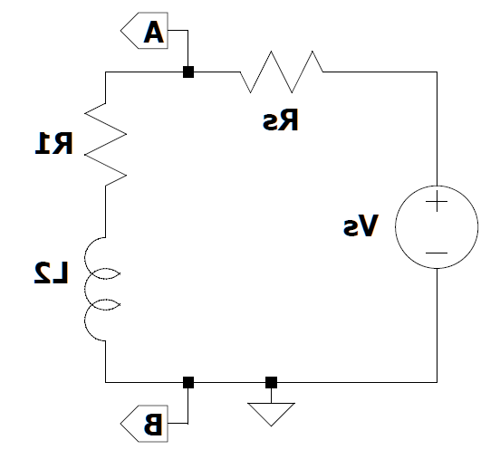
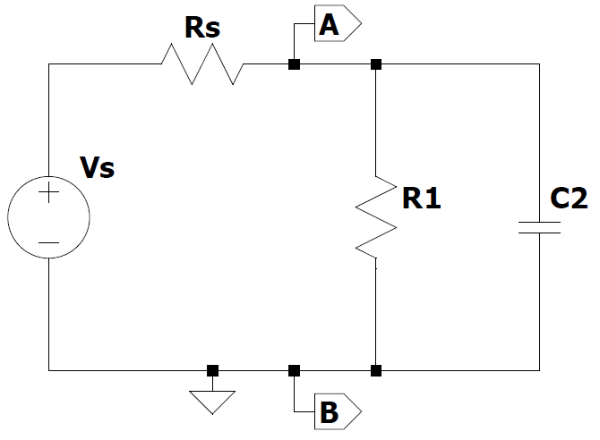
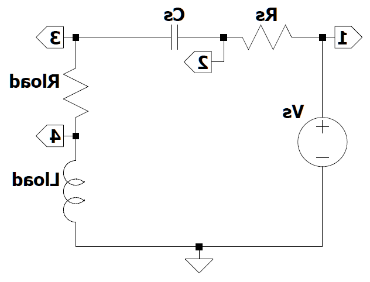
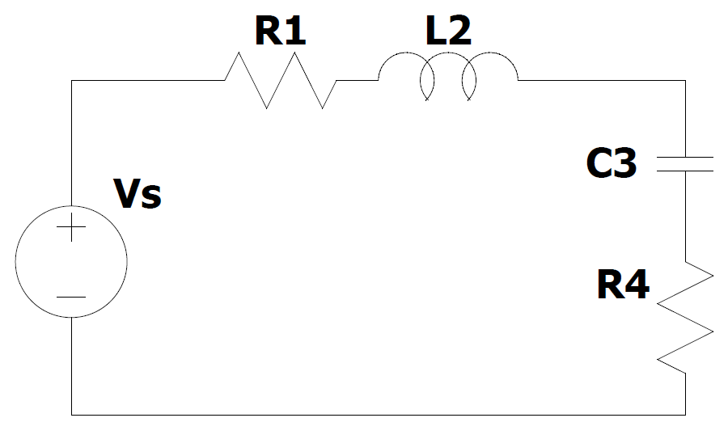

# Topic 12: End-of-topic test

Try each question first.
Then click to check.

Each answer says which notes section (§) it comes from.

Homework Greek-letter offsets are set to 0.

---

## Part A: Homework and past-final questions

### F2022-1a (Final 2022 Q1a)

Vs = 325 cos(2π50t), Rs = 10 Ω, load R1 = 100 Ω + L2 = 500 mH in series. Find the average power in the load.

Answer

Z = 110 + j157.1, |Z| = 191.8 Ω, |I| = 1.695 A.

P = ½ × 1.695² × 100 = **143.6 W**

From: Final 2022 Q1a worked example, Equation 58

---

### R2023-1a (Resit 2023 Q1a)

Same source and Rs = 10 Ω. Load R1 = 100 Ω ∥ C2 = 220 μF. Find the average power in the load.

Answer

Z_load = 100 ∥ (−j14.47) = 2.051 − j14.17. |V_A| = 250.2 V.

P = ½ × 250.2²/100 = **312.9 W**

From: Resit 2023 Q1a worked example

---

### F2024-1d (Final 2024 Q1d)

Vs = sin(2πft), f = 10 kHz, Rs = Rload = 50 Ω, Lload = 1 mH. Find Cs for maximum power transfer to the load.

Answer

Cancel the reactance: **Cs = 1/(ω²L) = 253.3 nF**

From: Equation 60, worked example

---

### R2025-1d (Resit 2025 Q1d)

Vs = 2 sin(2πft), f = 10 kHz, Rs = Rload = 50 Ω, Lload = 18 mH. Find the maximum load power and the Cs that gives it.

Answer

**Cs = 1/(ω²L) = 14.07 nF**

**Pmax = 2²/(8 × 50) = 10 mW**

From: Equation 60

---

### H3-1d (Homework 3 Q1d)

Vs is 1 Vpp at 10 kHz. R1 = 1200 Ω, L2 = 2200 pH, C3 = 3300 pF, R4 = 4700 Ω. Find the peak and average power in the load (C3 + R4).

Answer

1 Vpp → amplitude 0.5 V. L2 is negligible (0.14 mΩ). Z_C3 = −j4823 Ω.

Z_total = 5900 − j4823, |I| = 0.5/7620 = 65.6 μA.

**Average P = ½ × (65.6 μA)² × 4700 = 10.1 μW**

Load: Z_L = 4700 − j4823, |V_L| = 0.4419 V, θ = −45.7°.

**Peak P = ½ × 0.4419 × 65.6 μ × (1 + cos 45.7°) = 24.6 μW** (Rule 61)

From: Equation 58, Rule 61

---

### E21-1 (Lecture 21, Self test 21.1)

A source has E cos ωt behind 1 Ω and jωL. The load is 1 Ω with C. With L = C = 2 (ω in rad/s), the load power divided by the maximum available power is 1/(1 + ω⁴). At what ω is the load getting half the available power?

Answer

1/(1 + ω⁴) = ½ → ω⁴ = 1 → **ω = 1 rad/s**.

At ω → 0 the reactances vanish and the resistances are matched: ratio → 1.

From: §4 Equation 60

---

## Part B: Exam-style questions

### M1: True or false

1. An ideal inductor absorbs no average power.
2. 230 V rms is 325 V peak.
3. For maximum AC power, ZL = ZS.
4. Average power = ½ Vm Im when V and I are in phase.
5. With peak values, P = Vm Im cos θ.

Answer

1. **True.** Re(Z) = 0 (Equation 58).
2. **True.** 230 × √2 = 325 (Equation 59).
3. **False.** ZL = ZS\*, the conjugate (Equation 60).
4. **True.** cos 0 = 1 (Equation 57).
5. **False.** With peaks you need the ½ (Equation 57).

---

### M2: Multiple choice

A source E = 10 V peak with ZS = 50 + j30 Ω. What is the maximum average power any load can draw?

- A. 1 W
- B. 0.25 W
- C. 0.5 W
- D. 0.2 W

Answer

**B.** Pmax = |E|²/(8RS) = 100/400 = 0.25 W, with ZL = 50 − j30.

From: Equation 60

---

### M3: Calculate

A 10 V peak, 1 kHz source drives 100 Ω in series with 10 mH. Find the average power and the power factor.

Answer

ωL = 62.83 Ω. |Z| = 118.1 Ω. |I| = 84.7 mA.

**P = ½ × 0.0847² × 100 = 0.359 W**. Power factor = cos(tan⁻¹(62.83/100)) = 100/118.1 = **0.847** (lagging).

From: Equations 57, 58

---

### M4: Explain

Why does Final 2024 Q1d only need a series capacitor, not a transformer, to get maximum power?

Answer

The resistances already match (Rs = Rload = 50 Ω). The only mismatch is the load inductance. A series capacitor with 1/(ωCs) = ωL cancels it, making the load look like 50 Ω = Rs\*. A transformer is only needed when the resistances differ (Topic 13).

From: §4

