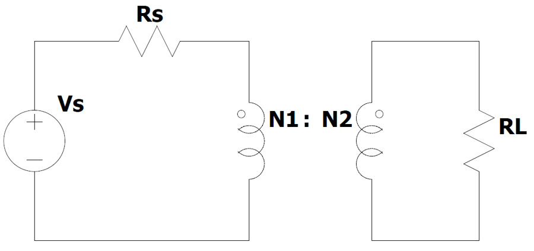
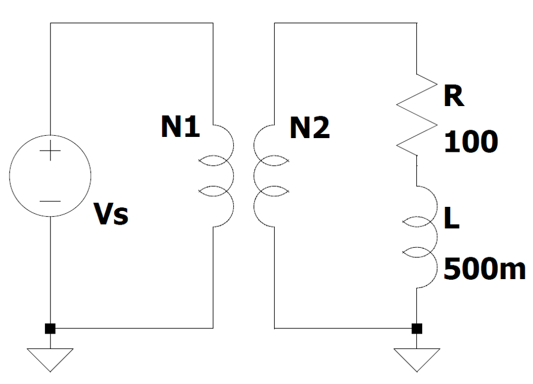
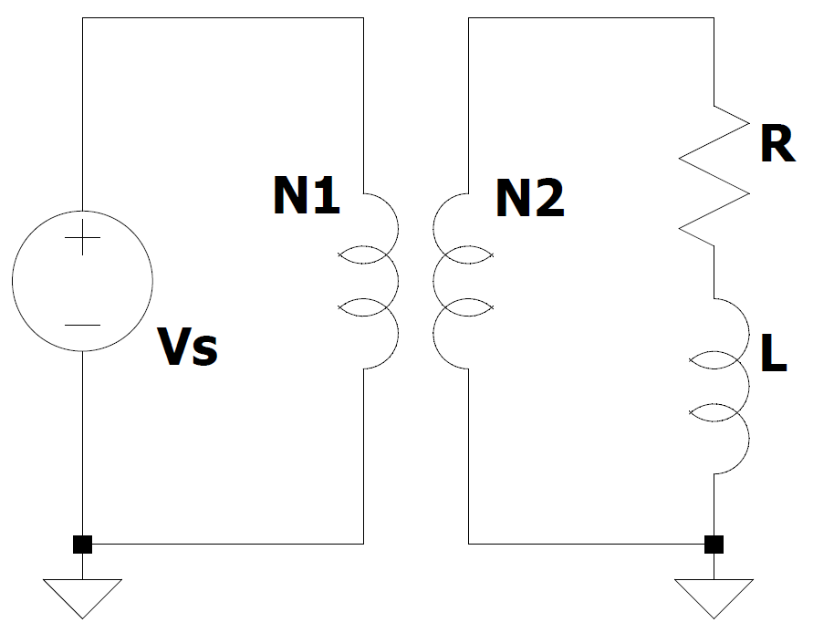
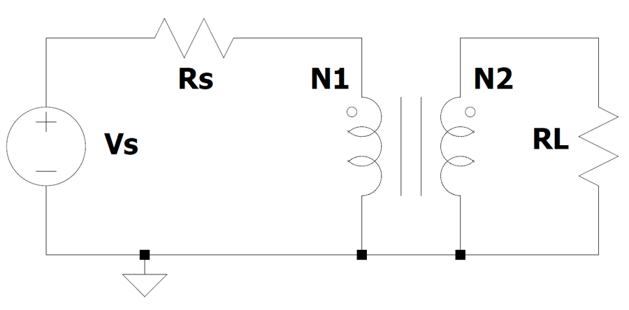
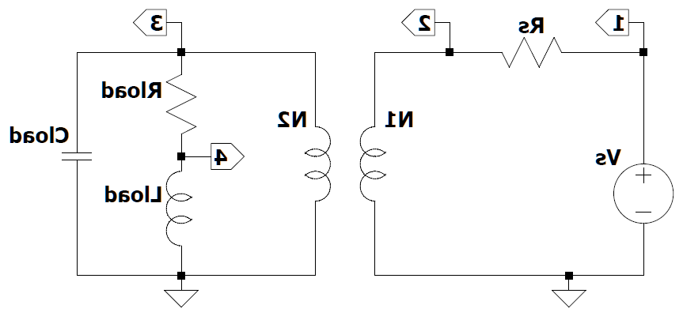
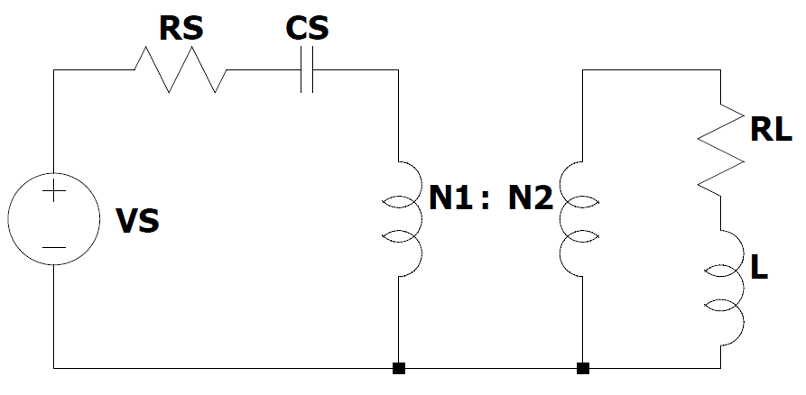

# Topic 13: End-of-topic test

Try each question first.
Then click to check.

Each answer says which notes section (§) it comes from.

Homework Greek-letter offsets are set to 0.

---

## Part A: Homework and past-final questions

### F2025-1c (Final 2025 Q1c)

An amplifier with output resistance Rs = 50 Ω drives RL = 32 Ω through an ideal transformer. Find N1/N2 for maximum power transfer.

Answer

(N1/N2)² × 32 = 50 → **N1/N2 = 1.25** (official)

From: Rule 64

---

### F2023-1a (Final 2023 Q1a)

Vs = 325 cos(2π50t), N1/N2 = 65, load R = 100 Ω + L = 500 mH. Find the average power in the load.

Answer

|V2| = 5 V. |Z| = 186.2 Ω. |I| = 26.85 mA.

**P = ½ × 0.02685² × 100 = 36.05 mW**

From: Final 2023 Q1a worked example

---

### R2024-1a (Resit 2024 Q1a)

Same, with R = 200 Ω and L = 1 H.

Answer

|V2| = 5 V. ωL = 314.2 Ω. |Z|² = 138 696.

**P = ½ × 25 × 200/138 696 = 18.03 mW**

From: Final 2023 Q1a worked example

---

### F2021-1a (Final 2021 Q1a)

Rs = 1000 Ω, RL = 10 Ω, N1 = 1000, N2 = 100, Vs = 1 cos(2π 5000 t). Find the average power in RL.

Answer

Reflected RL = 100 × 10 = 1000 Ω = Rs. Primary voltage 0.5 V peak.

**P = ½ × 0.5²/1000 = 125 μW**

From: Final 2021 Q1a worked example

---

### R2022-1a (Resit 2022 Q1a)

Same circuit, f = 500 Hz. The question asks for the power in RL. The answer box says Rs. Give both.

Answer

Frequency doesn't matter (no reactance). Matched, so the power splits equally.

**P(RL) = 125 μW, P(Rs) = 125 μW**

From: Final 2021 Q1a worked example

---

### F2024-3 (Final 2024 Q3)

(a) Find Zload(jω). (b) Re and Im of Zload at 1 kHz, Rload = 10 Ω, Lload = 220 mH, Cload = 100 nF. (c) The amplitude of e3 when Vs is 1 V at 1 kHz and Rs = 100 Ω.

Answer

**(a) Zload = (R + jωL)/(1 − ω²LC + jωRC)**

**(b) Re = 577 Ω, Im = 10 486 Ω**

**(c)** ⚠️ The paper gives no number for N1:N2. With 10:1 (as in Resit 2025): the reflected load (≈ 1 MΩ) is huge next to Rs, so V1 ≈ 1 V and **|e3| ≈ 0.100 V**. In general |e3| ≈ N2/N1 volts.

From: Final 2024 Q3 worked example

---

### R2025-3 (Resit 2025 Q3)

N1:N2 = 10:1. Rload = 15 Ω, Lload = 180 mH, Cload = 120 nF, f = 1 kHz, Rs = 100 Ω, Vs = 1 V amplitude. Find Zload (formula and value) and |e3|.

Answer

Zload = (R + jωL)/(1 − ω²LC + jωRC).

ωL = 1131 Ω, ω²LC = 0.8527, ωRC = 0.01131.

**Re = 687.6 Ω, Im = 7627 Ω**

Reflected: 100 × Zload ≫ 100 Ω, so **|e3| ≈ 0.100 V** (0.09996).

From: Final 2024 Q3 worked example

---

### H4-1a (Homework 4 Q1a)

VS = 1 V amplitude at 12.75 kHz, RS = 1000 Ω, a series CS, N1/N2 = 5, secondary RL = 40 Ω + L = 1000 nH. Find CS for maximum power, and that power.

Answer

Reflect the load: 25 × (40 + j0.0801) = 1000 + j2.003 Ω. The resistance already matches RS.

Cancel j2.003 Ω with CS: 1/(ωCS) = 2.003 → **CS = 6.23 μF**

**Pmax = 1²/(8 × 1000) = 125 μW**

From: Rule 64, Topic 12 Equation 60

---

### E22-2 (Lecture 22, Example 22.2)

A receiver: source with 1 + j0.1 Ω at 100 krad/s. Load: 100 + j1 Ω. Design a transformer plus series reactance X on the secondary for maximum power.

Answer

Need (n1/n2)² (100 + j(1 + X)) = 1 − j0.1.

Real: (n1/n2)² × 100 = 1 → **n1/n2 = 1/10**. Imaginary: (1 + X)/100 = −0.1 → **X = −11 Ω**: a **909 nF** capacitor.

From: Rule 64

---

### E22-3 (Lecture 22, Self test 22.1)

80 sin(1000t) V drives 30 Ω and 20 mH in series into a 3:1 transformer. The secondary has 5 Ω and 125 μF in series. Find the capacitor voltage.

Answer

Secondary: 5 − j8 Ω. Reflected: 9 × (5 − j8) = 45 − j72.

I1 = 80/(30 + j20 + 45 − j72) = 80/(75 − j52) = 0.877∠34.7°.

I2 = 3 × I1 in size: 2.630 A. Vc = 8 × 2.630 = 21.04 V, lagging I2 by 90°: 34.7° − 90° = −55.3° = −0.965 rad.

**vc(t) = 21.04 sin(1000t − 0.965) V**

From: Equations 62, 63

---

## Part B: Exam-style questions

### M1: True or false

1. A 10:1 transformer makes a 10 Ω load look like 100 Ω from the primary.
2. An ideal transformer dissipates no power.
3. At resonance a series LC is an open circuit.
4. f0 = 1/(2π√(LC)).
5. Below resonance a series LC circuit is capacitive.

Answer

1. **False.** (10)² × 10 = 1000 Ω (Equation 63).
2. **True.** Lossless (Equation 62).
3. **False.** Series → short. Parallel → open (Equation 65).
4. **True.** Equation 65.
5. **True.** 1/(ωC) > ωL below ω0 (§3).

---

### M2: Multiple choice

A 600 Ω source must drive an 8 Ω speaker. Which turns ratio N1/N2 gives maximum power?

- A. 75
- B. 8.66
- C. 0.115
- D. 4.8

Answer

**B.** √(600/8) = √75 = 8.66.

From: Rule 64

---

### M3: Calculate

L = 10 mH and C = 1 μF. Find f0. What is the impedance of the series LC at f0/2?

Answer

f0 = 1/(2π√(10⁻⁸)) = **1592 Hz**. At 796 Hz: ωL = 50 Ω, 1/(ωC) = 200 Ω.

**Z = j(50 − 200) = −j150 Ω** (capacitive, below resonance).

From: Equation 65

---

### M4: Explain

Why is the answer to Final 2024 Q3(c) almost exactly Vs × N2/N1?

Answer

The load is near parallel resonance at 1 kHz, so |Zload| ≈ 10.5 kΩ. Reflected to the primary it becomes about 1 MΩ, which is huge compared with Rs = 100 Ω. Almost no voltage drops across Rs, so the primary sees nearly all of Vs, and the secondary is that divided by the turns ratio.

From: §3, Final 2024 Q3 worked example

