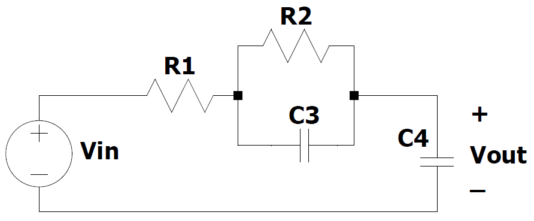
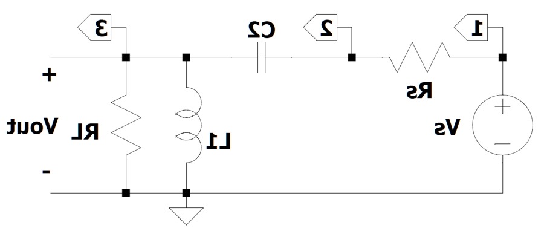

# Topic 14: End-of-topic test

Try each question first.
Then click to check.

Each answer says which notes section (§) it comes from.

Homework Greek-letter offsets are set to 0.

---

## Part A: Homework and past-final questions

### H3-2 (Homework 3 Q2)

(a) Express H(ω) = Vout/Vin in terms of Z1 to Z4. With R1 = 1200 Ω, R2 = 2200 Ω, C3 = 3300 pF, C4 = 4700 pF, f = 25 kHz and Vin = sin(ωt), find (b) |H|, (c) ∠H, (d) Vout(t) = Vm cos(ωt + φ).

Answer

**(a) H = Z4 / (Z1 + Z2 ∥ Z3 + Z4)**

**(b) |H| = 0.4155**

**(c) ∠H = −41.41° (−0.723 rad)**

**(d)** sin(ωt) = cos(ωt − 90°), so φ = −90° − 41.41° = −131.4°.

**Vout(t) = 0.4155 cos(157 080 t − 2.294) V**

From: Homework 3 Q2 worked example, Rule 67

---

### R2021-2 (Resit 2021 Q2)

Rs = RL = 1 kΩ, L1 = 1 mH, C2 = 1 nF. (a) Find H(ω) = Vout/Vs in the form (a + jb)/(c + jd). (b) Describe the gain and phase from 10 kHz to 10 MHz. (c) Vs = sin(10⁶ t), Vout = Vm cos(10⁶ t + φ): find Vm and φ.

Answer

**(a)** H = −ω²L1C2RL / [RL − ω²L1C2(Rs + RL) + jω(L1 + C2RsRL)]

**(b)** Second-order high-pass: +40 dB/decade at low f (−48 dB at 10 kHz), flattening at −6 dB above about 1 MHz. Phase from about 180° down to 0°, passing 63° at 159 kHz.

**(c)** At ω = 10⁶: H = 0.2 + j0.4 = 0.447∠63.4°.

**Vm = 0.447 V, φ = −26.6° (−0.464 rad)**

From: Resit 2021 Q2 worked example

---

### E23-2 (Lecture 23, Example 23.2)

H(ω) = 1/(1 + jω0.1). Find vo(t) for vi(t) = cos t + cos 10t + cos 100t.

Answer

ω = 1: H = 0.995∠−0.0997. ω = 10: 0.707∠−0.785. ω = 100: 0.0995∠−1.471.

**vo(t) = 0.995 cos(t − 0.0997) + 0.707 cos(10t − 0.785) + 0.0995 cos(100t − 1.471)**

From: Rule 67, superposition

---

### E24-1 (Lecture 24, Example 24.1)

R in series, L ∥ C to ground, with R = 2387 Ω, C = 1 nF, L = 25.33 μH. Find f0, the bandwidth and Q.

Answer

f0 = 1/(2π√(25.33 μ × 1 n)) = **1.000 MHz**

BW = 1/(RC) = 418.9 krad/s → **6.667 kHz**

**Q = f0/BW = 15**

From: §4 Equation 71

---

## Part B: Exam-style questions

### M1: True or false

1. At the 3 dB frequency of a first-order low-pass, the phase is −45°.
2. A first-order low-pass falls at −40 dB per decade.
3. At ω → ∞ a capacitor becomes a short circuit.
4. −20 dB means the amplitude is multiplied by 0.1.
5. The RLC band-pass has H = 1 at ω0 = 1/√(LC).

Answer

1. **True.** H = 1/(1 + j) (Equation 69).
2. **False.** −20 dB/decade. Second order is −40 (§2).
3. **True.** Rule 70.
4. **True.** Equation 68.
5. **True.** The L ∥ C is open at resonance (§4).

---

### M2: Multiple choice

An RC low-pass has R = 10 kΩ, C = 10 nF. What is its 3 dB frequency?

- A. 10 kHz
- B. 1.59 kHz
- C. 159 Hz
- D. 628 Hz

Answer

**B.** f0 = 1/(2πRC) = 1/(2π × 10⁻⁴) = 1592 Hz.

From: Equation 69

---

### M3: Calculate

The same RC low-pass gets vin = 2 cos(2π × 5000 t). Find vout(t).

Answer

ω/ω0 = 5000/1592 = 3.14. H = 1/(1 + j3.14) = 0.303∠−72.3°.

**vout(t) = 0.607 cos(2π × 5000 t − 72.3°) V**

From: Rule 67

---

### M4: Explain

How can you tell, without algebra, that Resit 2021 Q2's circuit is a high-pass filter?

Answer

At low frequency the series capacitor C2 is an open circuit (and L1 shorts the output), so nothing gets through. At high frequency C2 is a short and L1 is open, leaving a resistive divider RL/(Rs + RL) = 0.5. Low blocked, high passed: high-pass.

From: Rule 70

