# Topic 15: End-of-topic test

Try each question first.
Then click to check.

Each answer says which notes section (§) it comes from.

This is the most valuable test in the repo: Q2 plus Q1e is about 70 marks most years.

---

## Part A: Homework and past-final questions

### F2025-2 (Final 2025 Q2)

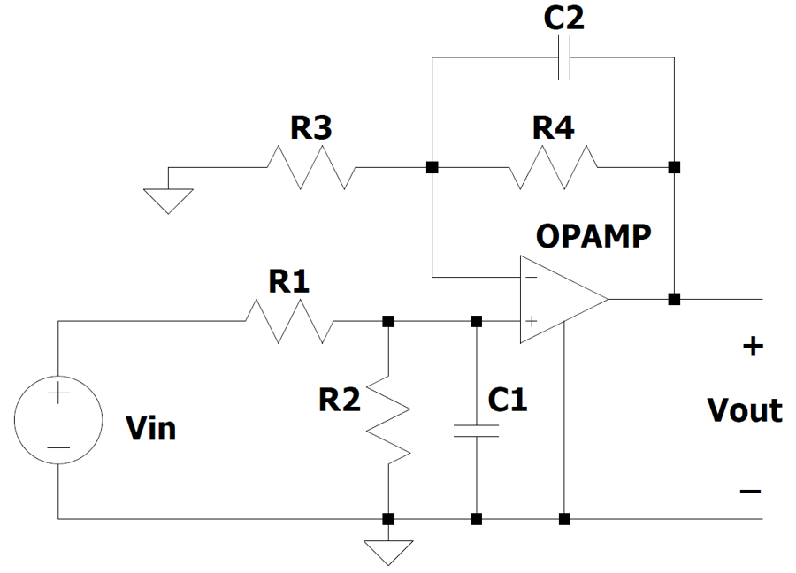

R1 = R2 = R3 = R4 = R, C1 = C2 = C. (a) Find H(ω). (b) R = 10 kΩ, C = 470 pF, Vin = 5 sin(2000πt) + 10 sin(2 × 10⁶πt). Find Vout(t).

Answer

**(a)** Divider 1/(2 + jωCR) × gain (2 + jωCR)/(1 + jωCR) = **1/(1 + jωCR)** (official)

**(b)** RC = 4.7 μs. 1 kHz: 0.99956∠−0.0295. 1 MHz: 0.03384∠−1.537.

**Vout(t) = 4.998 sin(2000πt − 0.0295) + 0.3384 sin(2 × 10⁶πt − 1.537) V** (official)

From: §5, Topic 10 worked example

---

### F2024-2 (Final 2024 Q2)

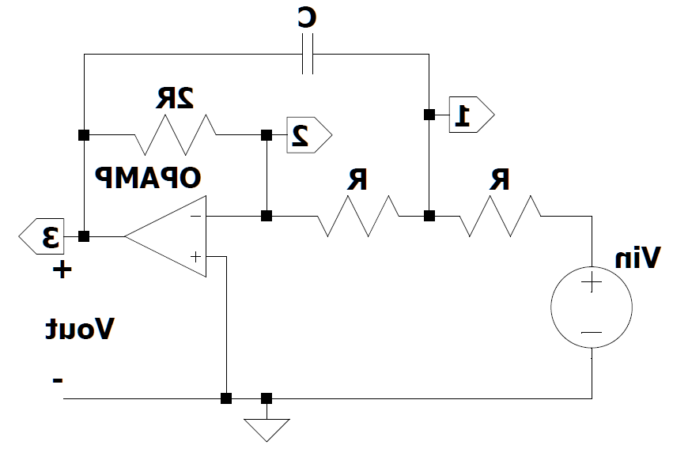

(a) H(ω) in R, C, ω. (b) A formula for f0 where the phase of H is 135°. (c) f0 for R = 10 kΩ, C = 1 nF. (d) Vout(t) for Vin = cos(2πf0t).

Answer

**(a) H = −1/(1 + 1.5 jωRC)**

**(b)** 1.5 ω0RC = 1 → **f0 = 1/(3πRC)**

**(c) f0 = 10.61 kHz**

**(d) Vout(t) = 0.7071 cos(2πf0t + 135°) V** (+3π/4 rad)

From: §4 Equation 75

---

### R2025-2 (Resit 2025 Q2)

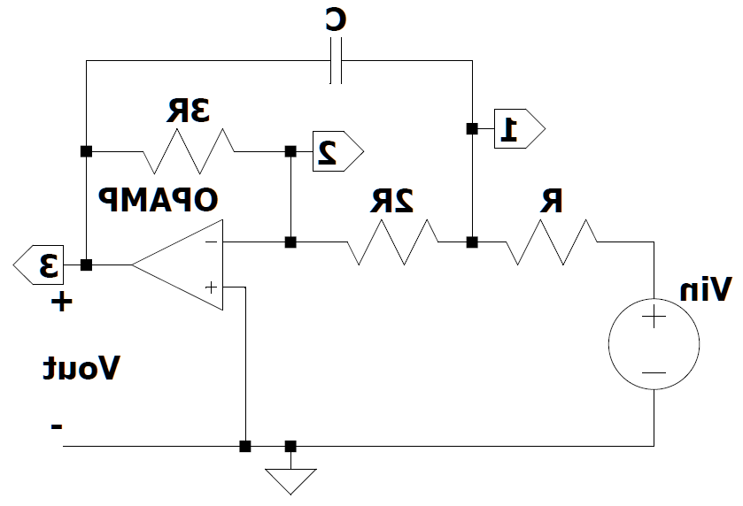

The same layout with R, 2R, 3R and C. Same four parts, with R = 10 kΩ and C = 4 nF.

Answer

**(a) H = −1/(1 + (5/3) jωRC)** (a = 2, b = 3 in Equation 75)

**(b) f0 = 3/(10πRC)**

**(c) f0 = 2387 Hz**

**(d) Vout(t) = 0.7071 cos(2πf0t + 135°) V**

From: §4 Equation 75

---

### F2023-2 (Final 2023 Q2)

(a) H in Z1 … Z4. (b) H in R1, R2, C3, C4. (c) f0 where the phase is −90°. (d) Vout(t) for Vin = A cos(2πf0t), A = 1 V.

Answer

**(a) H = Z3Z4 / (Z1Z2 + Z3(Z1 + Z2) + Z3Z4)**

**(b) H = 1 / (1 − ω²R1R2C3C4 + jωC4(R1 + R2))**

**(c) f0 = 1/(2π√(R1R2C3C4))**

**(d) Vout(t) = [√(R1R2C3/C4)/(R1 + R2)] cos(2πf0t − 90°)**. With equal R's and C's: 0.5 cos(2πf0t − 90°).

⚠️ This paper gives no component values for (c) and (d).

From: §3 Equation 74

---

### R2024-2 (Resit 2024 Q2)

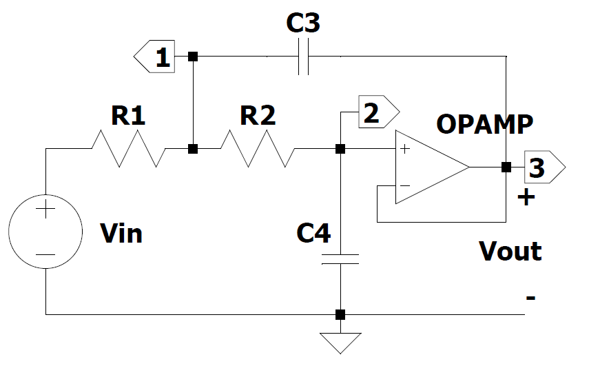

Same circuit. (c) R1 = R2 = 10 kΩ, C3 = C4 = 1 nF: find f0 (phase −90°). (d) Vout(t) for Vin = A cos(πf0t), A = 1 V.

Answer

**(c) f0 = 1/(2πRC) = 15.92 kHz** (ω0 = 10⁵ rad/s)

**(d)** πf0 = ω0/2 = 50 000 rad/s. H = 1/(0.75 + j1) = 0.8∠−53.13°.

**Vout(t) = 0.8 cos(50 000 t − 0.927) V**

From: §3

---

### F2022-2 (Final 2022 Q2)

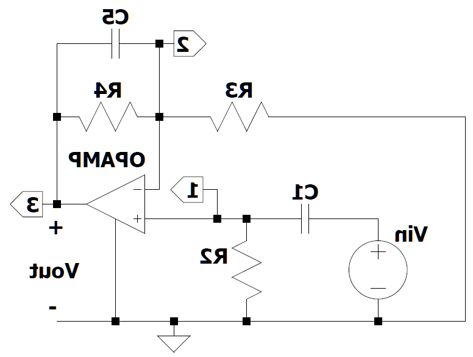

(a) e1(ω) in Vin, C1, R2. (b) Vout(ω) in e2, R3, R4, C5. (c) Vout(t) for Vin = cos(2π 7000 t). C1 = 100 μF, R2 = 10 kΩ, R3 = 1 kΩ, R4 = 10 kΩ, C5 = 1 nF.

Answer

**(a) e1 = Vin jωC1R2/(1 + jωC1R2)**

**(b) Vout = e2 (1 + Z45/R3), Z45 = R4/(1 + jωR4C5)** (and e2 = e1)

**(c) Vout(t) = 10.08 cos(43 982 t − 0.374) V** (−21.45°)

From: §5 Equation 76

---

### R2023-2 (Resit 2023 Q2)

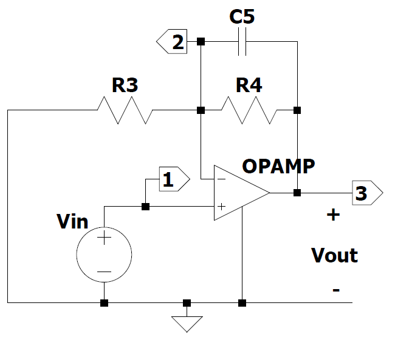

(a) Vout(ω) in Vin, C5, R3, R4. (b) Gain (dB) and phase at 1 kHz. (c) Vout(t) for Vin = cos(2π 10⁴ t). R3 = 1 kΩ, R4 = 10 kΩ, C5 = 4.7 nF.

Answer

**(a) Vout = Vin [1 + R4/(R3 (1 + jωR4C5))]**

**(b) 20.47 dB, −14.9°**

**(c) Vout(t) = 3.653 cos(62 832 t − 0.982) V** (−56.3°)

From: §5

---

### F2021-2 (Final 2021 Q2)

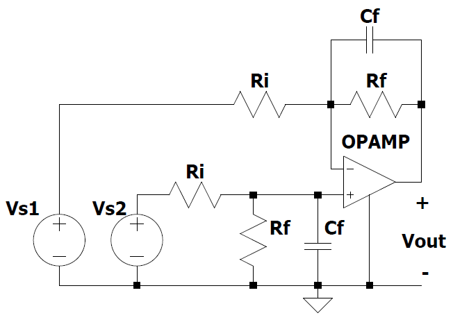

(a) H1 = Vout/Vs1. (b) H2 = Vout/Vs2. (c) Vout(t) for Vs1 = 1 cos(2π 10⁴ t), Vs2 = 2 cos(2π 10⁴ t). Ri = 1 kΩ, Rf = 10 kΩ, Cf = 1 nF.

Answer

**(a) H1 = −Zf/Ri = −(Rf/Ri)/(1 + jωRfCf)**

**(b) H2 = +Zf/Ri**

**(c) Vout(t) = 8.467 cos(2π 10⁴ t − 0.561) V** (−32.1°)

From: §6

---

### F2023-1e (Final 2023 Q1e)

dc gain (dB) and 3 dB bandwidth. R2 = 10 kΩ, C3 = 10 pF, R4 = 100 kΩ.

Answer

**dc gain 20 dB** (×10, inverting). **3 dB bandwidth 159.2 kHz**.

From: §2 Equation 73

---

### R2024-1e (Resit 2024 Q1e)

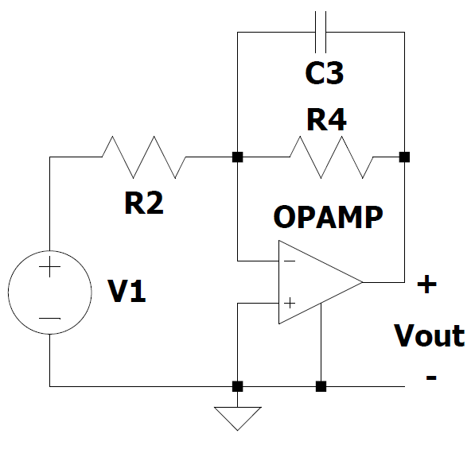

Same circuit. R2 = 22 kΩ, C3 = 100 pF, R4 = 180 kΩ.

Answer

**dc gain 18.26 dB** (×8.18). **3 dB bandwidth 8.84 kHz**.

From: Equation 73

---

### F2022-1e (Final 2022 Q1e)

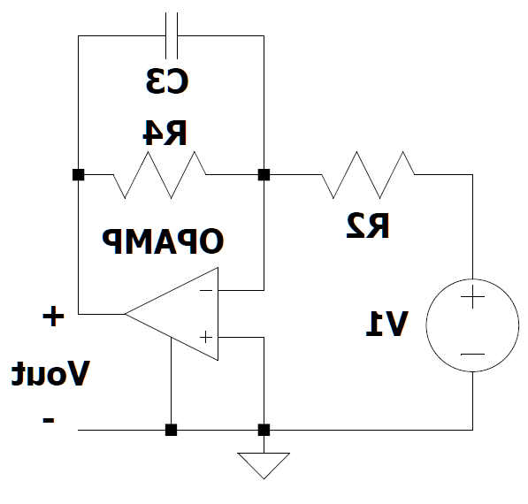

V1 = 50 cos(2π 50 000 t) mV, R2 = 10 kΩ, C3 = 10 pF, R4 = 330 kΩ. Find Vout(t).

Answer

**Vout(t) = 1.146 cos(2π 50 000 t + 2.338) V** (+134.0°)

From: §2 worked example

---

### R2023-1e (Resit 2023 Q1e)

V1 = 100 cos(2π 400 000 t) mV, R2 = 4.7 kΩ, C3 = 12 pF, R4 = 33 kΩ.

Answer

ωR4C3 = 0.995 (right at the corner, 401.9 kHz). |H| = 7.021/1.411 = 4.977.

**Vout(t) = 0.498 cos(2π 400 000 t + 2.359) V** (+135.1°)

From: Equation 73

---

### F2021-1e (Final 2021 Q1e)

V1 = 1 sin(2π 30 000 t), R2 = 1 kΩ, C3 = 2000 pF, R4 = 4 kΩ.

Answer

ωR4C3 = 1.508. |H| = 4/1.809 = 2.211, phase 180° − 56.45° = 123.55°.

The input is a sine, so keep sine:

**Vout(t) = 2.211 sin(2π 30 000 t + 2.156) V** (+123.6°)

From: Equation 73

---

### R2022-1e (Resit 2022 Q1e)

V1 = 2 cos(2π 10 000 t), R2 = 3.3 kΩ, C3 = 2200 pF, R4 = 8.2 kΩ.

Answer

ωR4C3 = 1.1335. |H| = 2.485/1.512 = 1.644. Phase 131.4°.

**Vout(t) = 3.288 cos(2π 10 000 t + 2.294) V**

From: Equation 73

---

### R2021-1e (Resit 2021 Q1e)

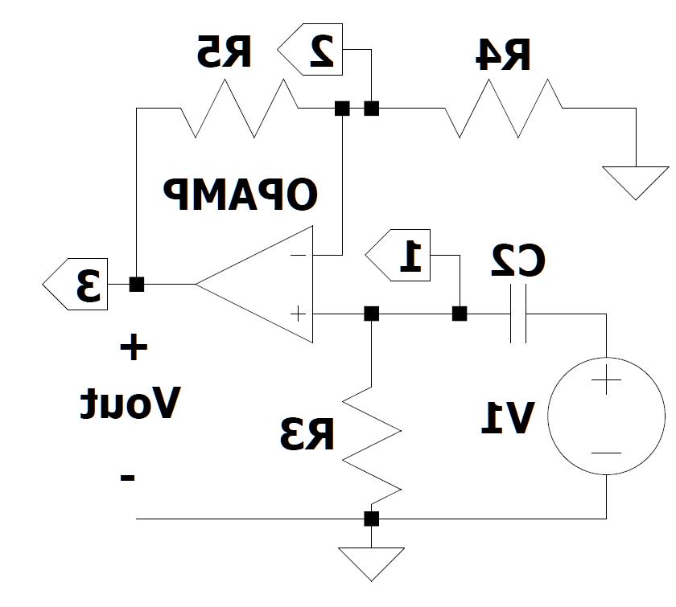

V1 = 1 cos(2π 10⁴ t) → C2 = 2000 pF → + input, R3 = 3 kΩ to ground. R4 = 4 kΩ (− input to ground), R5 = 5 kΩ feedback.

Answer

High-pass × non-inverting gain (Equation 76): H = [jωC2R3/(1 + jωC2R3)] (1 + R5/R4).

ωC2R3 = 0.377. HP part 0.3527∠69.3°. Gain 2.25.

**Vout(t) = 0.794 cos(2π 10⁴ t + 1.210) V** (+69.3°)

From: §5 Equation 76

---

### H4-2 (Homework 4 Q2)

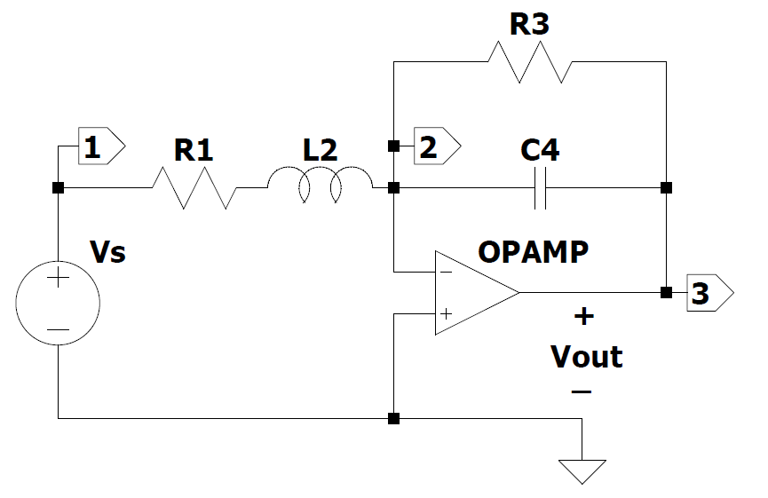

(a) H(f). R1 = 1200 Ω, L2 = 1200 nH, R3 = 2200 Ω, C4 = 2200 pF: (b) |H(1 kHz)|, (c) f3dB, (d) Vout(t) when Vs = sin(2πf3dB t).

Answer

**(a) H(f) = −[R3/(1 + j2πfR3C4)] / (R1 + j2πfL2)**

**(b) |H(1 kHz)| = 1.833**

**(c) f3dB = 1/(2πR3C4) = 32.88 kHz**

**(d) Vout(t) = 1.296 sin(2π × 32 880 t + 135°) V**

From: §7

---

## Part B: Exam-style questions

### M1: True or false

1. An inverting low-pass has phase 135° at its 3 dB frequency.
2. In the Sallen–Key low-pass, the phase is −90° at ω0 = 1/√(R1R2C3C4).
3. To get a dc gain, replace each capacitor by a short circuit.
4. In Final 2025 Q2 the input divider and the amplifier gain partly cancel.
5. Vin = cos(πf0t) has frequency f0.

Answer

1. **True.** 180° − 45° (§2).
2. **True.** The real part of the denominator is zero there (§3).
3. **False.** At dc a capacitor is **open** (§2 table).
4. **True.** The (2 + jωCR) cancels (§5).
5. **False.** cos(πf0t) = cos(2π (f0/2) t): frequency f0/2 (§3).

---

### M2: Multiple choice

An inverting amplifier has R2 = 5 kΩ in and R4 = 50 kΩ ∥ C3 = 100 pF in feedback. What are its dc gain and 3 dB frequency?

- A. 20 dB, 31.8 kHz
- B. 10 dB, 31.8 kHz
- C. 20 dB, 318 kHz
- D. −20 dB, 3.18 kHz

Answer

**A.** ×10 = 20 dB. f3dB = 1/(2π × 50 k × 100 p) = 31.8 kHz.

From: Equation 73

---

### M3: Calculate

The M2 filter gets V1 = 0.2 cos(2π × 31 830 t). Find Vout(t).

Answer

At its corner: |H| = 10/√2 = 7.07, phase 135°.

**Vout(t) = 1.414 cos(2π × 31 830 t + 135°) V**

From: §2

---

### M4: Explain

Why is "the frequency where the phase is 135°" the 3 dB frequency in Final 2024 Q2?

Answer

H = −1/(1 + 1.5jωRC) is an inverting first-order low-pass. The minus sign gives 180°, and the low-pass lag is tan⁻¹(1.5ωRC). The total is 135° when the lag is 45°, i.e. 1.5ωRC = 1. That is exactly where |H| has fallen to 1/√2: the 3 dB point.

From: §4

