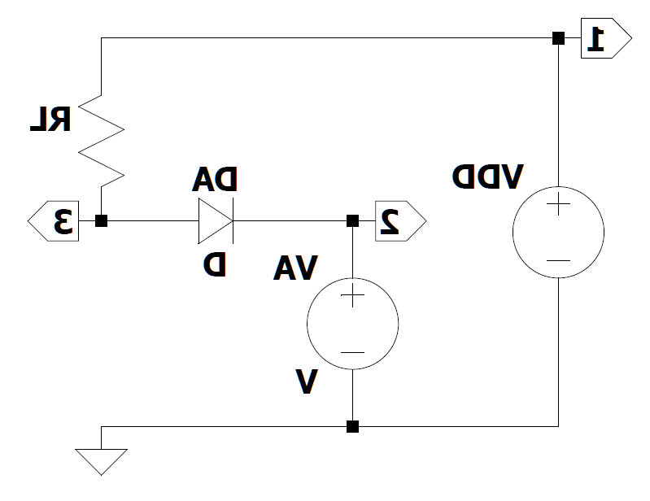
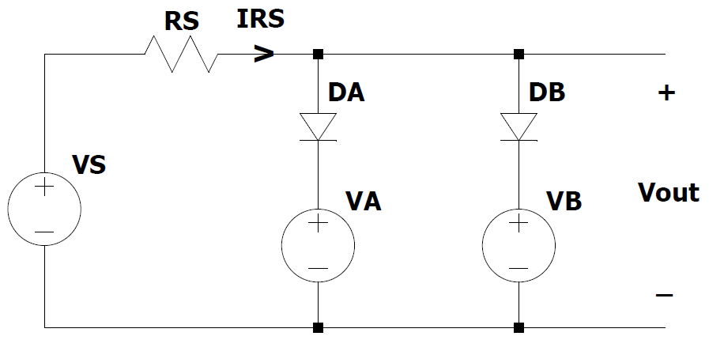
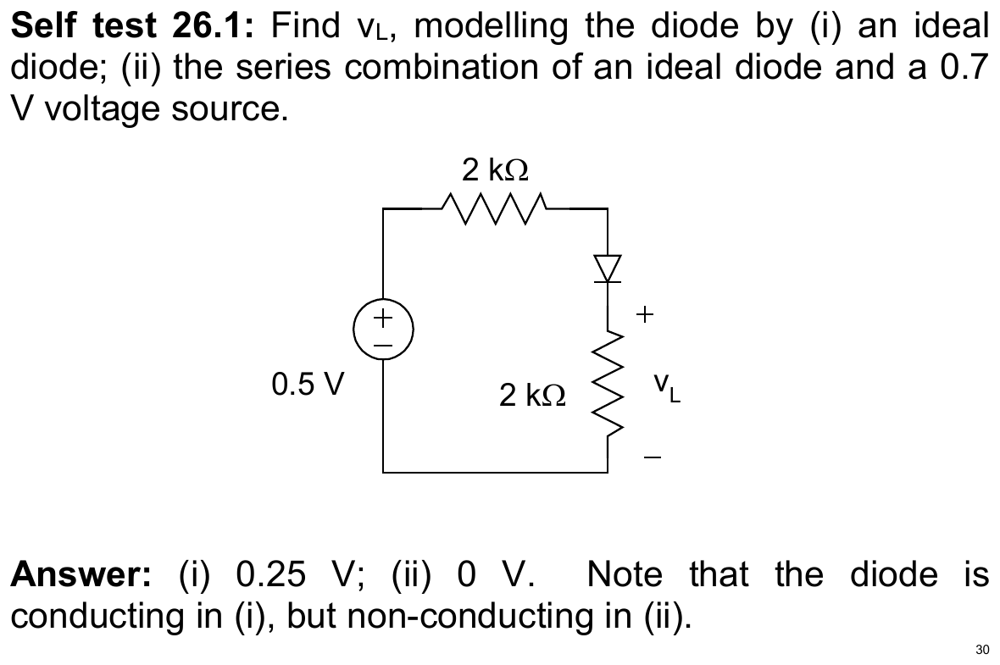

# Topic 16: End-of-topic test

Try each question first.
Then click to check.

Each answer says which notes section (§) it comes from.

Homework Greek-letter offsets are set to 0.

---

## Part A: Homework and past-final questions

### F2024-1e (Final 2024 Q1e)

Find e3 when (i) VA = 250 mV and (ii) VA = 4.5 V. VDD = 5 V, RL = 10 kΩ, diode drop 500 mV.

Answer

**(i)** ON: e3 = 0.25 + 0.5 = **0.75 V** (RL current 0.425 mA, forward ✓)

**(ii)** ON would give zero current. OFF: no current, **e3 = 5 V**

From: Final 2024 Q1e worked example, Rule 81

---

### R2025-1e (Resit 2025 Q1e)

Same circuit. VDD = 5 V, RL = 20 kΩ, diode drop 650 mV. Find e3 for (i) VA = 350 mV, (ii) VA = 4.5 V.

Answer

**(i)** ON: **e3 = 1.0 V** (current (5 − 1)/20 k = 0.2 mA ✓)

**(ii)** ON would need e3 = 5.15 V > 5 V. OFF: **e3 = 5 V**

From: Rule 81

---

### H4-1b (Homework 4 Q1b)

VS = 5 V, RS = 1 kΩ, VA = 3 V, VB = 4 V, Vth = 0.7 V for both diodes. Find IRS.

Answer

DA ON, DB OFF. Output = 3.7 V. DB sees −0.3 V: OFF ✓.

**IRS = (5 − 3.7)/1 kΩ = 1.3 mA**

From: Homework 4 Q1b worked example

---

### E26-2 (Lecture 26, Self test 26.1)

Find vL with (i) an ideal diode, (ii) an ideal diode plus 0.7 V.

Answer

**(i) vL = 0.25 V** (ON)

**(ii) vL = 0 V** (OFF: 0.5 V can't overcome 0.7 V)

From: §4 Check

---

## Part B: Exam-style questions

### M1: True or false

1. Superposition can be applied to a circuit with a diode.
2. An ideal diode that is ON behaves as a short circuit.
3. In the PWL model, an ON diode has exactly Vth across it.
4. If your "ON" guess gives a negative diode current, the diode is OFF.
5. VT ≈ 25 mV at room temperature.

Answer

1. **False.** The diode is nonlinear (Rule 77).
2. **True.** Rule 79.
3. **True.** Rule 80.
4. **True.** Rule 81.
5. **True.** Equation 78.

---

### M2: Multiple choice

A 9 V source drives 1 kΩ in series with a diode (Vth = 0.7 V) to ground. What is the current?

- A. 9 mA
- B. 8.3 mA
- C. 9.7 mA
- D. 0

Answer

**B.** ON: (9 − 0.7)/1 k = 8.3 mA, forward ✓.

From: Rule 80

---

### M3: Calculate

Same circuit, but the diode is reversed (cathode towards the source). Find the current and the diode voltage.

Answer

Assume ON: current would flow against the arrow ✗. OFF: **i = 0**, so no drop on the resistor: the diode has **9 V** across it in reverse.

From: Rule 81

---

### M4: Explain

Why can't you use phasors to find the output of a diode circuit driven by a sine wave?

Answer

Phasors rely on linearity: a sine in gives a sine out at the same frequency. A diode switches ON and OFF during each cycle, so the output is not a sine (it's clipped or rectified). Instead, find the input level where the diode switches, and work out each piece separately (Topic 17).

From: §1 Rule 77

