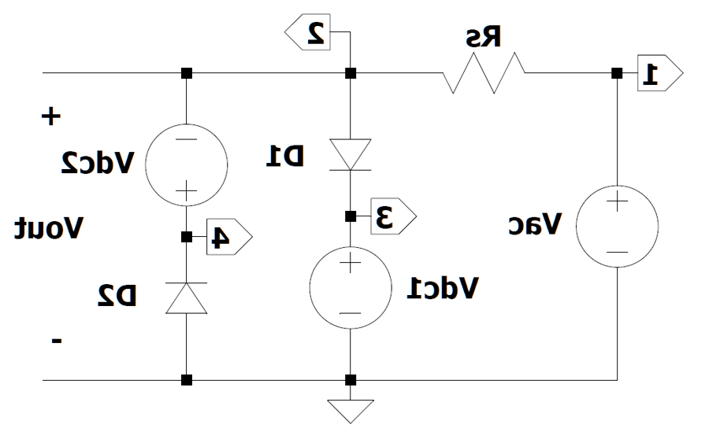
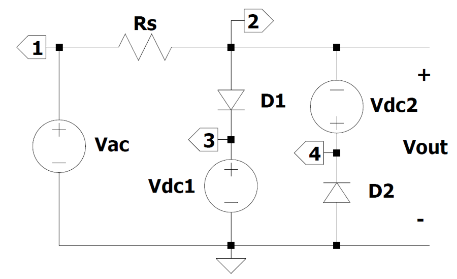
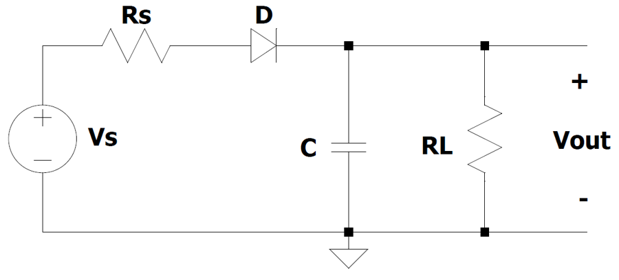
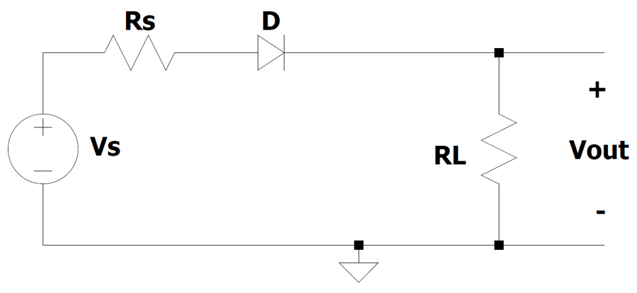
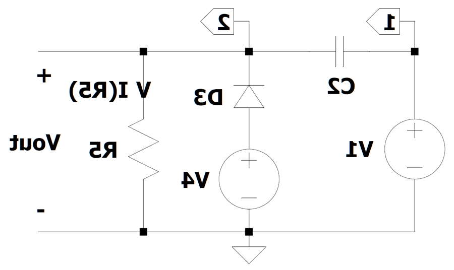
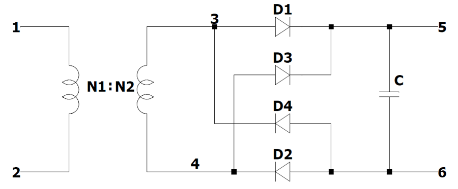
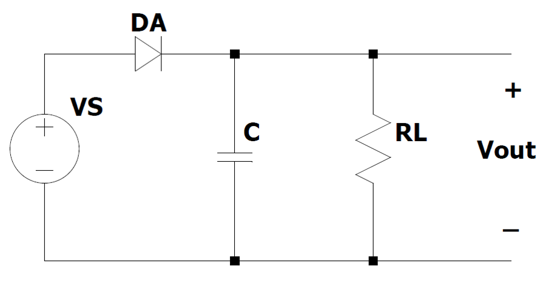

# Topic 17: End-of-topic test

Try each question first.
Then click to check.

Each answer says which notes section (§) it comes from.

Draw every sketch on paper. Then compare with the drawing checklist.

---

## Part A: Homework and past-final questions

### F2022-3 (Final 2022 Q3)

Vac = 5 sin(2π 1000 t), Rs = 100 Ω, Vdc1 = Vdc2 = 1.5 V, ideal diodes. (a) Sketch Vout. (b) Max and min. (c) Period.

Answer

**(a)** The sine, clipped flat at +1.5 V and −1.5 V. Between the levels, Vout = Vac.

**(b) Vmax = 1.5 V, Vmin = −1.5 V**

**(c) Period = 1 ms**

From: §4 Rule 85, clipper checklist, Final 2022 Q3 worked example

---

### R2023-3 (Resit 2023 Q3)

Vac = 1 sin(2π 2000 t), Rs = 100 Ω, Vdc1 = 0.5 V, Vdc2 = 1.5 V, ideal diode(s).

Answer

Clipped at +0.5 V. The negative side would clip at −1.5 V, but the input only reaches −1 V.

**Vmax = 0.5 V, Vmin = −1 V, period 0.5 ms**

Sketch: flat tops at 0.5 V, normal sine bottoms down to −1 V.

From: Rule 85

---

### F2023-1d (Final 2023 Q1d)

Vac = 15 sin(2π 1000 t), Rs = 200 Ω, Vdc1 = 3 V, Vdc2 = 4 V, ideal diodes. Max and min of Vout?

Answer

**Vmax = 3 V, Vmin = −4 V**

From: Rule 85

---

### R2024-1d (Resit 2024 Q1d)

Vac = 1.5 sin(2π 1000 t), Rs = 200 Ω, Vdc1 = Vdc2 = 0.7 V, ideal diodes.

Answer

**Vmax = 0.7 V, Vmin = −0.7 V**

(Like two real diodes back to back with no batteries.)

From: Rule 85

---

### F2021-3 (Final 2021 Q3)

Vs = 5 sin(2π 50 t), Rs = 10 Ω, RL = 1 kΩ, C = 100 μF, ideal diode. (a) Sketch Vout in steady state. (b) Max and period.

Answer

**(a)** A small ripple near the top: vo follows the input up to the peak, then decays slowly (τ = 0.1 s) until the next cycle catches it.

**(b) Max ≈ 4.8 V** (≈ 5 V if you ignore the Rs drop; 4.79 V by simulation). **Period 20 ms.** (Min ≈ 4.0 V.)

From: §3 Rule 84, peak detector checklist

---

### R2022-3 (Resit 2022 Q3)

Vs = 1 sin(2π 4000 t), Rs = 10 Ω, RL = 5 kΩ, ideal diode. (a) Sketch I_RL. (b) Max and period.

Answer

**(a)** Positive half-sine humps, zero in between.

**(b) Max = 1/(10 + 5000) = 199.6 μA. Period = 250 μs.**

From: §1 Rule 82

---

### R2021-3 (Resit 2021 Q3)

V1 = 1 sin(2π 1000 t), C2 = 100 μF, V4 = 1 V, R5 = 10 kΩ, ideal diode. Sketch I(R5) from t = 10 ms, and find its max, min, average and period.

Answer

Clamper: e2 = v1 − (A − V4). With A = V4 the shift is zero, so e2 = v1.

**I(R5) = 0.1 sin(2π 1000 t) mA: max 0.1 mA, min −0.1 mA, average 0, period 1 ms**

(General case: max V4/R5, min (V4 − 2A)/R5, average (V4 − A)/R5.)

From: §5 Rule 86, Resit 2021 Q3 worked example

---

### F2025-1e (Final 2025 Q1e)

Transformer 23:1, bridge rectifier (Vth = 0.7 V), C = 100 μF, no load, V12 = 230 sin(100πt). Estimate the peak-to-peak V56.

Answer

10 V peak on the secondary, minus two diode drops: **8.6 V** (official answer).

With no load the capacitor stays at 8.6 V, so this is really the peak (dc) value.

From: §2 Rule 83, Final 2025 Q1e worked example

---

### H4-1d (Homework 4 Q1d)

VS = 5 V amplitude at 1 kHz, Vth = 0.7 V, C = 1000 nF, RL = 1000 Ω. Find the max and min of Vout in steady state.

Answer

**Max = 4.3 V.** τ = 1 ms = T, so it droops a lot.

Solve 4.3 e^(−(t − 0.25 ms)/1 ms) = 5 sin(2π 1000 t) − 0.7 on the next rising edge: t ≈ 1.086 ms.

**Min ≈ 1.86 V**

From: Homework 4 Q1d worked example

---

## Part B: Exam-style questions

### M1: True or false

1. A bridge rectifier output is 2Vth below the input peak.
2. A full-wave rectifier's output has half the input's period.
3. A clamper changes the shape of the waveform.
4. In a clipper, Rs drops no voltage while both diodes are OFF (no load).
5. A bigger RL C makes the peak detector's ripple smaller.

Answer

1. **True.** Two diodes conduct (Rule 83).
2. **True.** Two humps per cycle (Rule 83).
3. **False.** It shifts it (Rule 86).
4. **True.** No current (Rule 87).
5. **True.** Slower decay (Rule 84).

---

### M2: Multiple choice

A half-wave rectifier with Vth = 0.7 V is fed 10 sin(ωt). What is the output peak?

- A. 10 V
- B. 9.3 V
- C. 8.6 V
- D. 7.07 V

Answer

**B.** 10 − 0.7.

From: Rule 82

---

### M3: Calculate

An ideal peak detector (no load) is fed 6 sin(ωt). Then a 10 kΩ load is added with C = 10 μF, at 50 Hz. Estimate the ripple (max − min).

Answer

Max ≈ 6 V. τ = 0.1 s, T = 20 ms. Min ≈ 6 e^(−0.02/0.1) = 4.91 V.

**Ripple ≈ 1.1 V** (a slight overestimate: the recharge starts a little before the full period ends).

From: Rule 84

---

### M4: Explain

In the two-diode clipper, why does Vout equal Vin exactly between the clip levels, even though there is a resistor Rs?

Answer

Between the levels both diodes are OFF (open circuits), and there's no other load. So no current flows through Rs, and Ohm's law gives zero volts across it. The output node simply sits at the source voltage.

From: Rule 87

