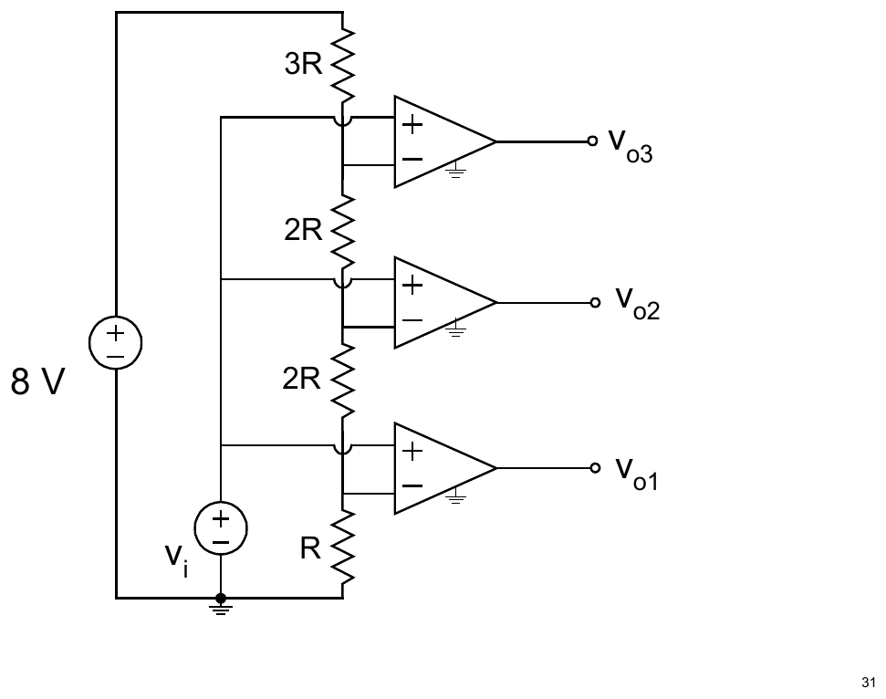

# Topic 18: End-of-topic test

Try each question first.
Then click to check.

Each answer says which notes section (§) it comes from.

Skim topic: not in any past paper.

---

## Part A: Homework and past-final questions

### E25-1 (Lecture 25, Example 25.1)

The op amps are ideal with saturation ±Esat. Find vo1, vo2, vo3 as functions of vi.

Answer

No input current, so the ladder is a plain divider of 8 V over R + 2R + 2R + 3R = 8R. References: **1 V, 3 V, 5 V** (bottom to top).

vo1 = +Esat if vi > 1 V, else −Esat. vo2: same at 3 V. vo3: same at 5 V.

From: §3 Rule 90

---

### E25-2 (Lecture 25, Self test 25.1)

An 8-bit quantizer, levels evenly spaced from 0 to 10 V. Find the resolution and the largest error (V and %).

Answer

**0.0392 V**, **0.0196 V**, **0.196%**

From: Equation 91

---

## Part B: Exam-style questions

### M1: True or false

1. A comparator uses negative feedback.
2. An op amp's output can't exceed its saturation voltage.
3. A 3-bit flash ADC needs 7 comparators.
4. Topic 7 Rule 32 (v+ = v−) holds when the op amp is saturated.

Answer

1. **False.** No feedback (Rule 89).
2. **True.** Rule 88.
3. **True.** 2³ − 1 = 7 (Rule 90).
4. **False.** Only in the linear region (Rule 88).

---

### M2: Multiple choice

An inverting amplifier with gain −20 runs from ±12 V supplies (Esat = 12 V). The input is 1 V dc. What is the output?

- A. −20 V
- B. −12 V
- C. +12 V
- D. 0 V

Answer

**B.** −20 V is beyond the supply. It saturates at −Esat = −12 V.

From: Rule 88

---

### M3: Explain

Why is a linear circuit unable to act as an AND gate (Lecture 25)?

Answer

By superposition, the output with both inputs high would be the sum of the outputs with each input high alone. An AND gate needs 0 for each input alone but 1 for both together: 0 + 0 ≠ 1. So it must be nonlinear (e.g. diodes, Topic 16).

From: Topic 16 §1

